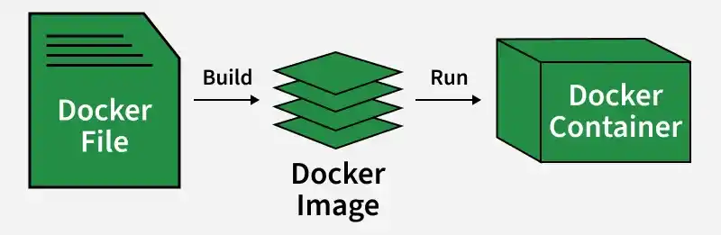

# Container Orchestration & Kubernetes for DevOps Engineers

Modern software development has changed completely in recent years. Earlier, applications were usually deployed on a single physical server or virtual machine. Today, companies build applications using:

- Containers
- Microservices
- Cloud infrastructure
- CI/CD pipelines
- Automation tools
- Kubernetes clusters

As applications become larger and traffic increases, manually managing containers becomes difficult and error-prone. This is where **Container Orchestration** becomes essential.

Container orchestration automates:

- Deployment
- Scaling
- Networking
- Monitoring
- Recovery
- Updates
- Resource management

For DevOps engineers, Kubernetes and orchestration are now core skills required in modern infrastructure and cloud environments.

# 1. Understanding Traditional Deployment Problems

Before containers existed, applications were deployed directly on servers.

Example:

- Install Python
- Install Java
- Install libraries
- Configure environment variables
- Configure web server
- Configure database connection

This caused many problems.

## 1.1 “Works on My Machine” Problem

One of the biggest problems in software deployment.

Example:

- Developer application works locally
- Same application fails in production

Why?  
Because:

- Different operating systems
- Different libraries
- Different package versions
- Different configurations

Containers solved this issue.

## 1.2 Dependency Conflicts

Different applications require different software versions.

Example:

Application A needs:

Python 3.9

Application B needs:

Python 3.11

Installing both on the same server creates conflicts.

Containers isolate applications separately.

## 1.3 Heavy Virtual Machines

Before containers, organizations used Virtual Machines (VMs).

Problems with VMs:

- Heavy storage usage
- High RAM usage
- Slow startup time
- Full operating system per VM

Containers are lightweight because they share the host operating system kernel.

# 2. What Are Containers?

A container is a lightweight isolated environment containing everything required to run an application.

A container includes:

- Application code
- Runtime
- Libraries
- Dependencies
- System tools
- Configuration files

Containers ensure applications behave consistently everywhere.

# 3. How Containers Work

Containers use:

- Linux namespaces
- cgroups
- process isolation
- filesystem isolation

Containers share the host OS kernel but remain isolated from each other.

# 4. Container vs Virtual Machine

| **Feature**    | **Container**  | **Virtual Machine** |
|----------------|----------------|---------------------|
| Size           | Lightweight    | Heavy               |
| Startup Time   | Seconds        | Minutes             |
| Performance    | Faster         | Slower              |
| OS Required    | Shared Host OS | Full OS             |
| Resource Usage | Low            | High                |

# 5. Docker and Containerization

Docker became the most popular container platform.

Docker introduced:

- Docker images
- Docker containers
- Docker Hub
- Dockerfile
- Docker Compose

# 6. Important Docker Concepts

## 6.1 Docker Image

A read-only template used to create containers.

Example:

Ubuntu Image

Nginx Image

Node.js Image

## 6.2 Docker Container

A running instance of an image.

Example:

``` bash
docker run nginx
```

## 6.3 Dockerfile

A file containing instructions to build Docker images.

Example:

``` dockerfile
FROM ubuntu
RUN apt update
CMD ["echo", "Hello"]
```

## 6.4 Docker Registry

Stores container images.

Examples:

- Docker Hub
- AWS ECR
- GitHub Container Registry

# 7. Why Single Containers Are Not Enough

Running one container is easy.

But real production environments may contain:

- Hundreds of containers
- Multiple servers
- Load balancing
- Failover systems
- Auto scaling
- Networking rules

Managing these manually becomes impossible.

# 8. What is Container Orchestration?

Container orchestration is the automated management of containerized applications.

It automates:

- Container deployment
- Scheduling
- Networking
- Scaling
- Monitoring
- Recovery
- Updates

The orchestration platform decides:

- Where containers run
- How many containers run
- How traffic reaches them
- What happens when failures occur

# 9. Real-World Example of Orchestration

Imagine an e-commerce website.

It contains:

- Frontend service
- Backend API
- Database
- Payment service
- Redis cache
- Notification service

Each service runs inside containers.

Without orchestration:

- Manual deployments
- Manual scaling
- Manual recovery

With orchestration:

- Everything becomes automated

# 10. Why DevOps Engineers Need Orchestration

Modern DevOps focuses on:

- Automation
- Scalability
- Reliability
- High availability

Container orchestration supports all these goals.

# 11. Major Features of Container Orchestration

# 11.1 Automated Deployment

Containers automatically deploy across available servers.

The orchestrator chooses the best node.

# 11.2 Scheduling

Scheduling means deciding where containers should run.

The orchestrator checks:

- CPU usage
- RAM usage
- Node availability
- Resource limits

# 11.3 Self-Healing

If containers fail:

- Restart automatically
- Replace failed containers
- Maintain desired state

This increases reliability.

# 11.4 Auto Scaling

Applications automatically scale during traffic spikes.

Example:

- 2 Pods during low traffic
- 20 Pods during heavy traffic

# 11.5 Load Balancing

Traffic distributes evenly across containers.

Benefits:

- Better performance
- High availability
- No overload

# 11.6 Rolling Updates

Applications update gradually without downtime.

Old containers are replaced step by step.

# 11.7 Service Discovery

Containers communicate using internal DNS names.

Example:

frontend-service

backend-service

database-service

# 11.8 Monitoring and Logging

Orchestration platforms integrate with:

- Monitoring systems
- Alerting systems
- Centralized logs

# 12. Container Orchestration Workflow

Basic workflow:

    Developer Writes Code
    ↓
    Build Docker Image
    ↓
    Push Image to Registry
    ↓
    Kubernetes Pulls Image
    ↓
    Deploy Containers
    ↓
    Users Access Application

# 13. Popular Orchestration Platforms

## 13.1 Kubernetes

Kubernetes is the most popular orchestration platform.

Features:

- Open source
- Highly scalable
- Cloud-native
- Huge ecosystem

## 13.2 Docker Swarm

Built directly into Docker.

Advantages:

- Easy to learn
- Simple setup

Disadvantages:

- Smaller ecosystem
- Less enterprise adoption

## 13.3 OpenShift

Enterprise Kubernetes platform by:

Red Hat

Provides:

- Security features
- Developer tools
- Enterprise integrations

## 13.4 Amazon ECS

AWS-managed container orchestration service.

Integrated with:

- EC2
- IAM
- VPC
- CloudWatch

# 14. Introduction to Kubernetes

Kubernetes is often abbreviated as:

K8s

(8 letters between K and s)

Kubernetes automates:

- Deployment
- Scaling
- Networking
- Failover
- Container management

Originally created by:  
Google

Maintained by:  
Cloud Native Computing Foundation

# 15. Why Kubernetes Became Industry Standard

Kubernetes became popular because it solves large-scale infrastructure problems.

Major advantages:

- High availability
- Multi-cloud support
- Auto healing
- Scalability
- Strong ecosystem
- Community support
- Infrastructure automation

# 16. Kubernetes Architecture

A Kubernetes environment is called a cluster.

Cluster architecture:

Kubernetes Cluster

│

├── Control Plane

│

└── Worker Nodes

# 17. Kubernetes Control Plane

The control plane manages the cluster.

Think of it as:

The Brain of Kubernetes

# 18. API Server

The API Server is the main communication gateway.

All requests go through it.

Example:

``` bash
kubectl get pods
```

This command communicates with API Server.

# 19. Scheduler

The Scheduler decides:

- Which node runs which Pod

It checks:

- CPU
- Memory
- Node conditions
- Taints and tolerations

# 20. Controller Manager

Controllers continuously compare:

- Desired state
- Current state

If differences exist:

- Kubernetes fixes them automatically

# 21. etcd Database

etcd stores cluster information.

Stores:

- Configurations
- Secrets
- Cluster state
- Metadata

It is extremely important.

If etcd fails completely:

- Cluster state may be lost

# 22. Worker Nodes

Worker nodes actually run applications.

Each worker node contains:

- Kubelet
- Container runtime
- Kube Proxy

# 23. Kubelet

Kubelet communicates with the control plane.

Responsibilities:

- Start containers
- Monitor Pods
- Report node health

# 24. Container Runtime

The runtime actually runs containers.

Popular runtimes:

- containerd
- CRI-O
- Docker (older setups)

# 25. Kube Proxy

Handles:

- Networking
- Traffic routing
- Service communication

# 26. Pods in Kubernetes

A Pod is the smallest deployable unit.

Pods contain:

- One or more containers
- Shared networking
- Shared storage

# 27. Sidecar Containers

Sometimes Pods contain helper containers.

Example:

Main Application Container

Logging Sidecar

Monitoring Sidecar

This pattern is called:

Sidecar Pattern

# 28. ReplicaSets

ReplicaSets ensure a fixed number of Pods stay running.

Example:

Desired Pods = 3

Current Pods = 2

Kubernetes creates one more Pod automatically.

# 29. Deployments

Deployments manage ReplicaSets and Pods.

Features:

- Scaling
- Updates
- Rollbacks
- Self-healing

Most applications use Deployments.

# 30. Services in Kubernetes

Pods are temporary.

IP addresses can change.

Services provide:

- Stable networking
- Stable DNS
- Load balancing

# 31. Types of Kubernetes Services

## 31.1 ClusterIP

Internal communication inside cluster.

## 31.2 NodePort

Exposes application using node IP and port.

## 31.3 LoadBalancer

Creates cloud load balancer automatically.

Used in:

- AWS
- Azure
- GCP

# 32. Kubernetes Networking

Kubernetes networking is one of the most important concepts.

Key rules:

- Every Pod gets an IP
- Pods communicate directly
- Services provide stable access

# 33. Ingress Controller

Ingress manages external web traffic.

Functions:

- SSL/TLS
- Domain routing
- Reverse proxy
- HTTP routing

Popular ingress controllers:

- NGINX Ingress
- Traefik
- HAProxy

# 34. ConfigMaps

ConfigMaps store non-sensitive configuration.

Example:

- URLs
- Port numbers
- Environment variables

# 35. Secrets

Secrets store sensitive information.

Example:

- Passwords
- Tokens
- Certificates
- API keys

Secrets should never be hardcoded.

# 36. Persistent Volumes

Containers are temporary.

Persistent Volumes provide durable storage.

Used for:

- Databases
- Uploads
- Application files

# 37. StatefulSets

Used for stateful applications.

Examples:

- MySQL
- PostgreSQL
- MongoDB

Features:

- Stable storage
- Stable network identity

# 38. DaemonSets

Run one Pod on every node.

Used for:

- Monitoring agents
- Log collectors
- Security tools

Examples:

- Fluentd
- Node Exporter

# 39. Jobs and CronJobs

## Jobs

Run tasks once.

Example:

- Database backup

## CronJobs

Run tasks repeatedly based on schedule.

Example:

Daily backup at 2 AM

# 40. Resource Requests and Limits

Kubernetes controls CPU and memory usage.

Example:

    resources:
    requests:
    memory: "128Mi"
    limits:
    memory: "512Mi"

Benefits:

- Prevent resource abuse
- Better scheduling
- Cluster stability

# 41. Health Checks

Kubernetes checks application health.

Types:

- Liveness Probe
- Readiness Probe
- Startup Probe

# 42. Kubernetes Security

Security is critical.

Important concepts:

- RBAC
- Network Policies
- Pod Security
- Secrets Management
- Image Scanning

# 43. RBAC (Role-Based Access Control)

Controls user permissions.

Example:

- Developer access
- Admin access
- Read-only access

# 44. Network Policies

Control Pod-to-Pod communication.

Acts like firewall rules.

# 45. Kubernetes Monitoring

Monitoring helps track:

- CPU
- Memory
- Network
- Disk usage
- Application health

Popular tools:

- Prometheus
- Grafana

# 46. Logging in Kubernetes

Logs help troubleshoot problems.

Popular logging tools:

- ELK Stack
- Loki
- Fluentd

# 47. CI/CD and Kubernetes

CI/CD automates application delivery.

Pipeline flow:

    Code Push
    ↓
    CI Pipeline
    ↓
    Build Docker Image
    ↓
    Push Registry
    ↓
    Deploy to Kubernetes

# 48. GitOps

GitOps manages infrastructure using Git.

Popular GitOps tools:

- ArgoCD
- FluxCD

Benefits:

- Version control
- Easy rollback
- Automation

# 49. Helm Package Manager

Helm simplifies deployments.

Helm uses:

- Charts
- Templates
- Reusable YAML

Helm reduces YAML duplication.

# 50. Kubernetes YAML Files

Everything in Kubernetes is defined using YAML.

Common resource types:

- Pod
- Deployment
- Service
- ConfigMap
- Secret

# 51. Important kubectl Commands

Check Pods:

``` bash
kubectl get pods
```

Describe Pod:

``` bash
kubectl describe pod pod-name
```

View Logs:

``` bash
kubectl logs pod-name
```

Apply YAML:

``` bash
kubectl apply -f deployment.yaml
```

Delete Resource:

``` bash
kubectl delete pod pod-name
```

# 52. Kubernetes Troubleshooting

Common troubleshooting steps:

- Check logs
- Describe resources
- Check events
- Verify networking
- Verify resource limits

# 53. Managed Kubernetes Services

Cloud providers offer managed Kubernetes.

Examples:

| **Cloud**    | **Service** |
|--------------|-------------|
| AWS          | EKS         |
| Azure        | AKS         |
| Google Cloud | GKE         |

Benefits:

- Easier management
- Automated upgrades
- Managed control plane

# 54. Kubernetes Ecosystem Tools

Popular ecosystem tools:

- Istio
- Linkerd
- ArgoCD
- Velero
- Kustomize

# 55. Service Mesh

Service mesh manages communication between services.

Features:

- Encryption
- Traffic control
- Observability
- Retry policies

Popular service mesh:

- Istio

# 56. Kubernetes Best Practices

- Use namespaces
- Use RBAC
- Limit container privileges
- Scan images
- Monitor clusters
- Use resource limits
- Use version control
- Backup etcd

# 57. Common Beginner Mistakes

- Ignoring security
- Hardcoding secrets
- No monitoring
- No resource limits
- Running everything in default namespace
- Poor YAML formatting

# 58. Learning Roadmap for DevOps Engineers

Recommended learning order:

1.  Linux
2.  Networking
3.  Git
4.  Docker
5.  YAML
6.  Kubernetes basics
7.  Helm
8.  CI/CD
9.  Cloud platforms
10. Monitoring & Security

# 59. Real-World Kubernetes Use Cases

Kubernetes is widely used for:

- Microservices
- AI/ML platforms
- SaaS applications
- Banking systems
- Streaming services
- Cloud-native applications

# 60. Future of Kubernetes

The future includes:

- AI-powered operations
- GitOps
- Edge computing
- Serverless Kubernetes
- Platform engineering

Kubernetes continues growing rapidly.

# 61. Final Thoughts

Container orchestration transformed modern infrastructure.

Kubernetes allows DevOps engineers to:

- Automate deployments
- Build scalable systems
- Improve reliability
- Manage cloud-native applications

Learning Kubernetes takes time, but mastering its fundamentals creates a strong foundation for:

- DevOps Engineering
- Cloud Engineering
- Site Reliability Engineering
- Platform Engineering
- Cloud-Native Development

# **🐳 DOCKER COMPLETE HANDWRITTEN NOTES (BEGINNER → PRO)**

# **🚀 DevOps Roadmap (Docker + Kubernetes Focus)**

# **🟢 PHASE 0 — FOUNDATION (Must Before DevOps)**

### **🧠 Linux (VERY IMPORTANT)**

You must be comfortable with:

- File system (ls, cd, find)
- Permissions (chmod, chown)
- Processes (ps, top, kill)
- Networking (curl, ping, netstat)
- Shell scripting basics

📌 Goal:  
👉 You should feel “comfortable inside terminal”

### **🌐 Networking Basics (Your strength already 👍)**

- IP, DNS, DHCP
- Ports (80, 443, 22)
- TCP vs UDP
- HTTP/HTTPS flow
- Load balancing basics

### **🔧 Git & GitHub**

- git init
- commit, push, pull
- branches
- merge conflicts
- GitHub Actions basics

📌 Goal:  
👉 You can manage code like a DevOps engineer

# **🟡 PHASE 1 — DOCKER (CONTAINERIZATION CORE)**

## **🐳 1. Docker Basics**

- What is container
- Image vs container
- Docker architecture

## **⚙️ 2. Docker CLI (Hands-on)**

You must master:

``` bash
docker run
docker ps
docker images
docker exec
docker logs
docker stop
```

## **🧱 3. Dockerfile (VERY IMPORTANT)**

Learn:

- FROM, RUN, COPY, CMD, ENTRYPOINT
- Image layering
- Multi-stage builds

📌 Goal:  
👉 Build your own application image

## **🌐 4. Docker Networking**

- bridge network
- custom networks
- container-to-container communication

## **💾 5. Docker Volumes**

- persistent storage
- database storage concept

## **📦 6. Docker Compose**

- multi-container apps
- YAML structure

Example:

- App + Database
- Frontend + Backend + MongoDB

## **🚀 7. Real Project (IMPORTANT)**

Build:  
👉 Node.js / React app + MongoDB using Docker Compose

📌 END OF DOCKER PHASE  
You should now be able to:  
✔ Build images  
✔ Run apps  
✔ Connect services  
✔ Deploy locally

# **🟠 PHASE 2 — CI/CD (DEVOPS AUTOMATION)**

## **🔄 1. CI/CD Concepts**

- Continuous Integration
- Continuous Delivery
- Continuous Deployment

## **🧪 2. GitHub Actions**

Learn:

- pipelines
- workflows
- build automation
- Docker build in pipeline

Example flow:

Code → GitHub → GitHub Actions → Docker Image → Deploy

## **🐳 3. Docker in CI/CD**

- build image automatically
- push to registry (Docker Hub / ECR)
- deploy container

## **📌 Goal:**

👉 Fully automated pipeline

# **🔵 PHASE 3 — KUBERNETES (ORCHESTRATION CORE)**

## **☸️ 1. Kubernetes Basics**

Learn:

- What is Kubernetes
- Why we need it
- Cluster architecture

## **🧩 2. Core Components**

### **Control Plane:**

- API Server
- Scheduler
- Controller Manager
- etcd

### **Worker Node:**

- Kubelet
- Container Runtime (Docker/containerd)
- Kube-proxy

## **📦 3. Kubernetes Objects**

### **Must learn:**

- Pod
- Deployment
- Service
- ConfigMap
- Secret

## **🔄 4. Kubernetes Networking**

- ClusterIP
- NodePort
- LoadBalancer
- Ingress

## **💾 5. Storage**

- Persistent Volume (PV)
- Persistent Volume Claim (PVC)

## **⚙️ 6. Deployment Strategy**

- Rolling updates
- Blue-Green deployment
- Canary deployment

## **🚀 7. Kubernetes + Docker Integration**

- Docker builds image
- Kubernetes runs container

## **📌 Goal:**

👉 Deploy full application on Kubernetes cluster

# **🟣 PHASE 4 — CLOUD (AWS DEVOPS)**

## **☁️ AWS Services for DevOps**

### **Must learn:**

- EC2 (servers)
- S3 (storage)
- IAM (permissions)
- ECR (Docker images storage)
- ECS (container service)
- EKS (Kubernetes service)

## **🐳 AWS + Docker Flow:**

GitHub → Docker Build → ECR → ECS → Running App

## **☸️ AWS + Kubernetes Flow:**

Docker → ECR → EKS Cluster → Pods Running

# **🔴 PHASE 5 — ADVANCED DEVOPS**

## **📊 Monitoring**

- Prometheus
- Grafana
- CloudWatch

## **🔐 Security**

- IAM roles
- Secrets management
- RBAC in Kubernetes

## **⚡ Logging**

- ELK Stack
- Fluentd
- CloudWatch logs

## **🚀 Performance**

- Auto scaling
- Load balancing
- Resource limits

# **🟤 PHASE 6 — REAL PROJECTS (MOST IMPORTANT)**

## **💼 Project 1 (Beginner)**

- Static website
- Dockerize it
- Deploy using Nginx container

## **💼 Project 2 (Intermediate)**

- Node.js + MongoDB
- Docker Compose
- CI/CD pipeline

## **💼 Project 3 (Advanced)**

- Full microservices app
- Kubernetes deployment
- Auto scaling + Load balancer

## **💼 Project 4 (Pro DevOps)**

- AWS:
  - GitHub Actions
  - Docker ECR
  - ECS / EKS
  - CI/CD full automation

# **🧠 FINAL DEVOPS MASTER FLOW**

    Code
    ↓
    GitHub
    ↓
    CI/CD Pipeline
    ↓
    Docker Image
    ↓
    Registry (Docker Hub / ECR)
    ↓
    Kubernetes / ECS
    ↓
    Monitoring (Prometheus / CloudWatch)

# **🎯 FINAL SKILL TARGET**

After completing this roadmap, you will be able to:

✔ Build containers (Docker)  
✔ Deploy apps (Kubernetes)  
✔ Automate pipelines (CI/CD)  
✔ Deploy on AWS  
✔ Monitor production systems  
✔ Work as DevOps Engineer

# **📘 CHAPTER 1: FUNDAMENTALS (DOCKER FOUNDATION)** 

# **🌿 SECTION 1: VIRTUALIZATION FOUNDATION**

# **🧱 1. What is Virtualization?**

🧠 **Simple Meaning:  
** Virtualization is a technology that allows one physical machine to behave like **multiple independent computers (virtual machines)**.

👉 One Physical Server → Many Virtual Machines

## **⚙️ Why Virtualization Exists (IMPORTANT missing concept)**

Before virtualization:

- One server → one application → wasted resources ❌

After virtualization:

- One server → multiple isolated systems → efficient use of hardware ✅

👉 Goal:  
✔ Better resource utilization  
✔ Cost saving  
✔ Isolation  
✔ Flexibility

# **🧩 2. Core Component: Hypervisor** 

A **Hypervisor** is the brain of virtualization.

It sits between:

    Hardware
    ↓
    Hypervisor
    ↓
    Virtual Machines

## **⚙️ What Hypervisor does:**

- Allocates CPU, RAM, Disk
- Creates and runs VMs
- Ensures isolation between VMs
- Manages VM lifecycle (start, stop, delete)

# **🧱 3. Types of Virtualization** 

## **🟢 1. Full Virtualization**

🧠 Meaning:  
Guest OS runs WITHOUT knowing it's virtualized.

✔ Uses complete virtual hardware simulation

Example:

- Windows running inside VMware on Linux

✔ Pros:

- Strong isolation
- No OS modification required

❌ Cons:

- Slightly slower (emulation overhead)

## **🟡 2. Paravirtualization (Advanced concept)**

🧠 Meaning:  
Guest OS KNOWS it is virtualized and communicates with hypervisor.

✔ Direct communication → faster performance

👉 Example:

- Xen Hypervisor (older cloud systems)

✔ Pros:

- Better performance than full virtualization

❌ Cons:

- Requires modified OS/kernel support

## **🔵 3. Hardware-Assisted Virtualization (MODERN STANDARD)**

🧠 Meaning:  
CPU itself supports virtualization features.

👉 Technologies:

- Intel VT-x
- AMD-V

✔ Used in:

- VMware
- KVM
- VirtualBox (modern versions)

✔ Pros:

- Fast
- Stable
- Production-ready

# **🖥️ 4. Types of Hypervisors (REAL WORLD)**

## **🟢 Type 1 Hypervisor (Bare Metal) — PRODUCTION LEVEL**

🧠 Runs directly on hardware (no OS layer)

    Hardware
    ↓
    Hypervisor
    ↓
    VMs

### **Examples:**

- VMware ESXi
- Microsoft Hyper-V
- KVM (Linux-based cloud standard)

✔ Advantages:

- Very fast
- Highly secure
- Used in data centers & cloud

❌ Disadvantages:

- Harder to manage
- Requires infrastructure knowledge

👉 This is what AWS / Azure / Google Cloud rely on internally

## **🟡 Type 2 Hypervisor (Hosted) — LEARNING LEVEL**

🧠 Runs on top of an operating system

    Hardware
    ↓
    OS (Windows/Linux)
    ↓
    Hypervisor
    ↓
    VMs

### **Examples:**

- VirtualBox
- VMware Workstation

✔ Advantages:

- Easy for beginners
- Good for practice labs

❌ Disadvantages:

- Slower performance
- Not used in production cloud systems

# **⚡ 5. When Virtualization is Used (EXPANDED)**

Virtualization is used in:

### **☁️ Cloud Computing**

- AWS EC2
- Azure Virtual Machines
- Google Compute Engine

### **🧪 Testing & Development**

- Test different OS environments
- Safe debugging

### **🏢 Enterprise Systems**

- Run multiple services on one server
- Legacy applications

### **🔐 Security Isolation**

- Separate environments for apps/users

# **🧱 6. What is a Virtual Machine (VM)?**

🧠 **Simple Meaning:  
** A VM is a complete computer inside a computer.

## **📦 VM contains:**

Each VM has:

- 🧠 Full Operating System (Windows/Linux)
- 💻 Virtual CPU
- 🧠 Virtual RAM
- 💾 Virtual Disk (VHD/VMDK)
- 🌐 Virtual Network Interface

## **⚙️ VM Architecture Flow:**

    Physical Hardware
    ↓
    Hypervisor
    ↓
    VM1 (OS + Apps)

VM2 (OS + Apps)

VM3 (OS + Apps)

# **⚠️ 7. Limitations of Virtual Machines (IMPORTANT FOR DOCKER)**

## **❌ Problems with VMs:**

### **🧠 1. Heavy**

- Each VM has full OS
- Consumes GBs of storage

### **🐌 2. Slow Startup**

- Takes minutes to boot

### **🧱 3. High Resource Usage**

- Each OS uses CPU + RAM separately

### **📦 4. Large Size**

- VM image = very large

# **🧠 8. Why VMs are STILL Important**

Even with Docker and containers:

✔ Strong isolation (most secure)  
✔ Run different OS types  
✔ Enterprise legacy systems  
✔ Kernel-level separation

# **🔥 9. CRITICAL CONNECTION TO DOCKER** 

This is where your Docker understanding begins.

## **🧠 Key Idea:**

| **Virtual Machines** | **Containers (Docker)** |
|----------------------|-------------------------|
| Full OS per VM       | Share OS kernel         |
| Heavy                | Lightweight             |
| Slow startup         | Fast startup            |
| GB size              | MB size                 |
| Hypervisor-based     | OS-level virtualization |

## **🚀 Simple Mental Model:**

- VM = “Full Computer inside computer”
- Docker = “Lightweight isolated process inside OS”

# **🎯 SUMMARY** 

✔ Virtualization = Multiple computers in one machine  
✔ Hypervisor = Manager of VMs  
✔ Type 1 = Production (Cloud)  
✔ Type 2 = Learning (Desktop)  
✔ VM = Full OS machine  
✔ VM is heavy but secure  
✔ Docker will replace VM use in many modern cases

# **🌿 SECTION 2: SYSTEM & NETWORK FOUNDATIONS**

# **🧱 1. Operating System Basics (CRITICAL FOUNDATION)**

Docker is built on **Linux kernel features**, so OS understanding is mandatory.

## **🧠 Process vs Program (VERY IMPORTANT)**

- 📄 **Program** = static file (code stored on disk)
- ⚙️ **Process** = program in execution (running instance)

👉 Key Docker Insight:

- Docker does NOT run full OS
- Docker runs **processes inside isolation**

Example:

nginx (process)

python app.py (process)

node server.js (process)

✔ Container = isolated process environment

## **🧠 File System Basics (LINUX CORE)**

You must understand:

### **📁 Files & Directories**

Everything in Linux is treated as a file.

### **🧭 Paths**

- Absolute path: `/home/user/app`
- Relative path: `./app`

## **🔐 Permissions (VERY IMPORTANT FOR CONTAINERS)**

Linux permission model:

| **Permission** | **Meaning** |
|----------------|-------------|
| r              | read        |
| w              | write       |
| x              | execute     |

Commands:

``` bash
chmod
chown
```

👉 Docker connection:

- Containers often fail due to permission issues
- Volume mounting depends on file permissions

# **🐧 2. Linux Basics (CORE SKILL FOR DOCKER)**

Docker = Linux environment abstraction

## **📌 Essential Commands (EXPANDED)**

### **📂 Navigation**

ls \# list files

cd \# change directory

pwd \# show current path

### **📁 File operations**

cp \# copy

mv \# move/rename

rm \# remove

``` bash
mkdir # create folder
```

### **📄 File viewing**

cat \# show file

less \# scroll file

head \# first lines

tail \# last lines

### **🔍 Search**

``` bash
grep "text" file
```

### **⚙️ Process management**

``` bash
ps # running processes
```

top \# system usage

kill \# stop process

## **⚙️ systemctl (IMPORTANT DEVOPS LINK)**

``` bash
systemctl start nginx
systemctl stop nginx
systemctl status nginx
```

👉 Docker replacement idea:

- systemctl manages OS services
- Docker manages **container services**

# **🌐 3. Networking Basics (CORE FOR DOCKER + CLOUD)**

## **🧠 IP Address**

Unique identity of a machine in a network.

Example:

192.168.1.10

👉 Docker uses internal IPs for containers

## **🚪 Ports (VERY IMPORTANT)**

Ports = application entry points

| **Port** | **Service** |
|----------|-------------|
| 80       | HTTP        |
| 443      | HTTPS       |
| 3306     | MySQL       |

### **🧠 Key Docker Concept:**

Container exposes ports to host machine

Example:

``` bash
docker run -p 8080:80 nginx
```

## **🌍 DNS (Domain System)**

Converts domain → IP address

Example:

google.com → 142.250.x.x

👉 Docker containers also use DNS internally in networks

## **🏠 localhost**

127.0.0.1

👉 Means:

- your own machine
- inside container = different localhost than host

## **🔁 Basic Network Flow (IMPORTANT MODEL)**

Client → IP → Port → Application → Response

# **💻 4. Command Line (CLI SKILLS = DOCKER CONTROL PANEL)**

Docker is 100% CLI-driven.

## **📌 Core CLI Skills**

### **Navigation**

cd, ls, pwd

### **File handling**

cp, mv, rm

### **View data**

cat, less

### **Search**

``` bash
grep
```

### **Background execution**

    command &
    nohup command

## **🧠 Docker Insight:**

If CLI is weak → Docker feels “confusing”

Because:

- no GUI
- everything is command-based

# **📦 5. Software Packaging & Dependency Problem (VERY IMPORTANT)**

## **🧠 Dependency Problem (REAL WORLD ISSUE)**

Applications require:

- runtime (Node, Python, Java)
- libraries
- OS packages

Example:  
Node.js app needs:

- Node runtime
- npm modules
- system libraries

## **❌ Problem Without Docker**

Works on my system → fails in production

## **🐳 Docker Solution**

👉 Bundle everything:

- App code
- Dependencies
- Runtime
- Environment config

✔ Result:  
Same behavior everywhere

# **🔁 6. Client–Server Architecture (DOCKER CORE MODEL)**

## **🧠 Concept**

Client → sends request  
Server → processes request  
Server → sends response

## **🐳 Docker Mapping (VERY IMPORTANT)**

| **Component** | **Docker Equivalent** |
|---------------|-----------------------|
| Client        | Docker CLI            |
| Server        | Docker Daemon         |
| Request       | docker command        |
| Response      | container output      |

# **⚙️ 7. Basic Programming Knowledge (LIGHT BUT NECESSARY)**

You should understand:

- What is an application
- What is runtime
- What is server

Examples:

- Node.js app → JavaScript runtime
- Python script → Python interpreter
- Java app → JVM

👉 Docker runs ALL of these as containers.

# **📡 8. Basic Web Concepts (VERY IMPORTANT FOR DEVOPS)**

## **🌐 HTTP / HTTPS**

Protocol used for communication between browser and server

## **🧠 Web Server**

Examples:

- Nginx
- Apache

👉 Docker often runs web servers inside containers

## **🔌 API Concept**

API = communication between services

Example:

- frontend → backend API
- backend → database API

# **🧱 9. Virtualization vs Container Thinking (CORE BRIDGE)**

This is your mental shift:

| **Virtual Machine**     | **Container**           |
|-------------------------|-------------------------|
| Full OS                 | Shares OS kernel        |
| Heavy                   | Lightweight             |
| Slow boot               | Fast boot               |
| Hardware virtualization | OS-level virtualization |

## **🧠 Key Insight:**

👉 Docker is NOT a VM  
👉 Docker is **process isolation using Linux kernel features**

# **🧩 10. DevOps Thinking (VERY IMPORTANT MINDSET SHIFT)**

Docker is not just a tool — it's a **workflow philosophy**

## **⚙️ Core DevOps Principles:**

- Automation
- Consistency
- Repeatability
- Fast deployment

## **🧠 DevOps Rule:**

> “If it works in development, it must work in production exactly the same way.”

## **🔥 Docker solves:**

- environment mismatch
- dependency chaos
- deployment inconsistency

# **⚡ 11. Basic Security Awareness (REAL WORLD IMPORTANT)**

## **🔐 Key Concepts:**

- Linux permissions matter inside containers
- Containers are isolated BUT NOT fully secure
- Avoid running everything as root user

Example bad practice:

``` bash
docker run root-user-app
```

## **🧠 Security Insight:**

- Container ≠ VM security level
- Host kernel is shared
- Misconfiguration can break isolation

# **🎯 FINAL SUMMARY (SECTION 2 CORE IDEA)**

✔ OS = foundation of Docker  
✔ Linux = Docker environment base  
✔ Networking = container communication  
✔ CLI = Docker control system  
✔ Dependencies = reason Docker exists  
✔ Client-server = Docker architecture model  
✔ DevOps = mindset behind Docker usage

# **🚀 FINAL CHAPTER 1 SUMMARY**

## **🧱 Foundation Layers Before Docker:**

### **1. Virtualization**

- Hypervisor
- VM concept
- Hardware abstraction

### **2. Operating System (Linux)**

- Processes
- File system
- Permissions

### **3. Networking**

- IP, ports, DNS
- localhost
- client-server flow

### **4. CLI Skills**

- Linux command usage
- File and process management

### **5. Software Packaging**

- Dependency management problem

### **6. Client-Server Model**

- Core Docker architecture idea

### **7. Web Basics**

- HTTP, APIs, web servers

### **8. DevOps Mindset**

- Automation + consistency

### **9. Security Awareness**

- Permissions and isolation

# **🧠 FINAL INSIGHT (VERY IMPORTANT)**

👉 If you master this Chapter 1, Docker becomes:

- Easy to understand
- Easy to debug
- Easy to use in real DevOps projects

👉 If you skip this, Docker becomes memorization instead of engineering

# **📘 CHAPTER 2: Docker FUNDAMENTALS** 

# **🌿 SECTION 1: Docker FUNDAMENTALS**

## **🧱 1. What is Docker?**

Docker is an **open-source platform used to build, package, and run applications inside containers**.

## **🧠 Simple Meaning:**

Docker ensures:

> “If it works on my laptop, it will work everywhere.”

## **📦 What Docker actually does**

A normal application depends on:

- Programming language runtime (Node.js, Python, Java)
- Libraries (npm, pip packages)
- System dependencies (Linux packages)
- Environment variables
- OS configuration

👉 Docker bundles ALL of this into one unit called:

### **🧩 Container Image → Runs as Container**

## **🧩 Key Concept**

Application + Dependencies + Configuration + Runtime  
= 🐳 Docker Container

## **⚙️ Why Docker is lightweight**

Unlike Virtual Machines:

- ❌ No full OS inside container
- ✅ Uses host OS kernel

👉 Result:

- Less RAM usage
- Faster startup
- Small size

## **🧠 Real-world analogy**

| **System** | **Analogy**              |
|------------|--------------------------|
| VM         | Full independent house   |
| Docker     | Room in shared apartment |

## **📌 Why Docker became popular**

- Microservices architecture
- Cloud computing (AWS, Azure, GCP)
- CI/CD automation
- Scalable distributed systems

## **❗ Why Docker Exists (Problem → Solution)**

### **❌ Traditional Problem:**

Code works on developer machine but fails in production:

- Dependency missing
- Version mismatch
- OS differences
- Environment drift

### **💥 Root Cause:**

- Different environments
- Manual setup errors
- Missing libraries
- Runtime inconsistency

## **🐳 Docker Solution**

### **Docker bundles everything into a single unit:**

### **🧩 Docker Image → Blueprint**

### **🐳 Container → Running Instance**

**Docker ensures:**

✔ Same environment everywhere  
✔ Development = Testing = Production

### **📦 Fix Strategy:**

Instead of sending only code:

👉 Send: Code + Runtime + Dependencies + Config

### **🚀 Result:**

| **Problem**         | **Docker Fix**              |
|---------------------|-----------------------------|
| Works on my machine | Same environment everywhere |
| Dependency issues   | Pre-built images            |
| Setup errors        | Container isolation         |
| Deployment issues   | Portable runtime            |

## **🐳 Docker Model** 

Application Code

\+ Runtime

\+ Dependencies

\+ System Libraries

\+ Configurations

= Docker Image

→ Runs as Container

# **🌿 SECTION 2: DOCKER ARCHITECTURE**

## **🧠 Docker Architecture Overview**

Docker uses **Client–Server architecture**

## **🧩 1. Docker CLI (Client)**

This is what YOU use.

Example:

``` bash
docker run nginx
```

👉 CLI just sends commands

## **⚙️ 2. Docker Daemon (dockerd) — THE BRAIN**

Runs in background and handles everything:

- Creating containers
- Running containers
- Managing images
- Managing networks
- Managing volumes

## **🧠 Think of it like:**

- CLI = Remote control
- Daemon = Actual system engine

## **🧩 3. Docker Engine**

Docker Engine = Complete system that includes:

- CLI
- Daemon
- Core runtime system

👉 It is the full Docker platform

## **🧩 4. containerd**

- Manages container lifecycle
- Handles image execution
- Sits under Docker Daemon

## **🧩 5. runc**

- Low-level container runtime
- Actually creates and runs containers

👉 Final execution layer

## **🧠 Simple Flow:**

User  
→ Docker CLI  
→ Docker Daemon  
→ containerd  
→ runc  
→ Container Running

## **🌐 6. Docker Hub (Registry)**

Docker Hub is a **cloud storage for images**

It contains:

- Ubuntu images
- Nginx images
- Node.js images
- MySQL images
- Custom images

## **🧠 Architecture Flow Summary:**

User → CLI → Daemon → Images → Containers

# **🌿 SECTION 3: CORE DOCKER CONCEPTS**

## **🖼️ 1. Docker Image**

### **🧠 Meaning:**

A Docker image is a **read-only blueprint of an application**

### **📦 Contains:**

- Application code
- Runtime
- Libraries
- System tools
- Environment setup

### **🧠 Properties:**

- Read-only
- Versioned
- Portable

## **📦 2. Docker Container**

### **🧠 Meaning:**

A container is a **running instance of a Docker image**

### **📦 Contains:**

- Running application
- Active process
- Writable layer on top of image

## **🧠 Simple Understanding:**

| **Image** | **Container**    |
|-----------|------------------|
| Blueprint | Running system   |
| Recipe    | Cooked food      |
| Design    | Live application |

## **🔥 Important Insight:**

👉 One image can create multiple containers

Example:

``` bash
docker run nginx
docker run nginx
docker run nginx
```

## **🔄 3. Docker Lifecycle**

### **Steps:**

1.  Pull Image

``` bash
docker pull nginx
```

2.  Create Container

``` bash
docker create nginx
```

3.  Run Container

``` bash
docker start <id>
```

4.  Running State
- App is active
5.  Stop Container

``` bash
docker stop <id>
```

6.  Remove Container

``` bash
docker rm <id>
```

### **🧠 Flow:**

Image → Pull → Create → Run → Stop → Remove

### **⚡ DevOps Flow:**

Developer → Builds Image  
CI/CD → Pushes Image  
Server → Pulls Image  
Production → Runs Container

# **🌿 SECTION 4: DOCKER DEEP INTERNAL WORKING**

## **⚙️ Docker Internal Architecture**

Docker includes:

- Docker Engine (core system)
- Docker Daemon (background service)
- containerd (container manager)
- runc (runtime executor)

## **🧠 Execution Flow:**

Docker CLI  
→ Daemon  
→ containerd  
→ runc  
→ Container Process

# **🌿 SECTION 5: DOCKER NETWORKING**

## **🌐 Why Networking?**

Containers need communication between:

- Frontend ↔ Backend
- Backend ↔ Database

## **🧩 Network Types:**

### **1. Bridge (Default)**

- Containers communicate inside same host

### **2. Host**

- Uses host network directly

### **3. None**

- No network access

## **🌍 Port Concept**

Each container runs on ports:

- Nginx → 80
- Node.js → 3000

## **🔁 Port Mapping**

``` bash
docker run -p 8080:80 nginx
```

### **🧠 Meaning:**

| **Host** | **Container** |
|----------|---------------|
| 8080     | 80            |

### **🌍 Access:**

[http://localhost:8080](http://localhost:8080)

# **📦 SECTION 6: VOLUMES (DATA PERSISTENCE)**

## **🧠 Problem:**

Containers are temporary → data lost after stop ❌

## **📦 Solution: Volumes**

Persistent storage outside container lifecycle

## **Types:**

### **1. Named Volume (Best Practice)**

### **2. Bind Mount (Host folder mapping)**

## **🧪 Example Concept:**

- Database data
- Logs
- Upload files

# **📄 SECTION 7: DOCKERFILE (IMAGE CREATION)**

## **🧠 What is Dockerfile?**

A script to build Docker images

## **Example:**

``` dockerfile
FROM nginx
COPY index.html /usr/share/nginx/html
```

## **🧠 Meaning:**

- FROM → base image
- COPY → add files
- Build custom image

## **Build Command:**

docker build -t my-nginx .

# **🌿 SECTION 8: VIRTUALIZATION VS CONTAINERIZATION**

| **Feature** | **VM**  | **Docker**    |
|-------------|---------|---------------|
| OS          | Full OS | Shared kernel |
| Speed       | Slow    | Fast          |
| Size        | Large   | Small         |
| Boot time   | Minutes | Seconds       |
| Isolation   | Strong  | Medium        |

# **🚀 FINAL CHAPTER 2 SUMMARY**

## **🧠 Core Understanding:**

### **🖼️ Docker Image**

- Blueprint
- Read-only
- Portable

### **📦 Docker Container**

- Running instance
- Lightweight process
- Isolated environment

### **⚙️ Docker Architecture**

- CLI → Daemon → containerd → runc
- Docker Engine runs everything
- Docker Hub stores images

### **🌐 Networking**

- Bridge, Host, None
- Port mapping enables access

### **💾 Storage**

- Volumes ensure persistence

### **📄 Dockerfile**

- Used to build custom images

## **🔥 FINAL DEVOPS INSIGHT:**

> Docker is not just a tool  
> It is a complete system for:

- Build (Images)
- Run (Containers)
- Store (Registry)
- Connect (Networking)
- Persist (Volumes)

# **📘 CHAPTER 3: 🐳 DOCKERFILE** 

1.  Official **Dockerfile Doc: [Just Click](https://docs.docker.com/build/concepts/dockerfile/#:~:text=A%20Dockerfile%20is%20a%20text,Description)**
2.  Official **Dockerfile reference: [Just Click](https://docs.docker.com/reference/dockerfile/#format)**

# **🌿 SECTION 1: Dockerfile FUNDAMENTALS**

# **📌 1. What is Docker?**

Docker is a platform to **build, ship, and run applications in containers**.

👉 Key Idea:

- ❌ Without Docker → “Works on my machine”
- ✅ With Docker → Runs the same everywhere (Laptop, Server, Cloud)

# **📦 2. What is a Dockerfile?**

A **Dockerfile** is a text file that contains instructions to build a Docker image.



A **Dockerfile** is:

👉 A *recipe (script)* to build a **Docker Image  
** 👉 That image becomes a **Container (running app)**

👉 Think:

Dockerfile → Docker Image → Docker Container

✔️ Blueprint (recipe) of commands  
✔️ Automates image creation

### **🔁 Full Flow**

Dockerfile → docker build → Image → docker run → Container

# **📁 3. Dockerfile Naming**

- Default: `Dockerfile` (no extension, capital D)
- Custom:

docker build -f myapp.Dockerfile .

# **🧱 4. Internal Working** 

Dockerfile works in **layers**:

- Each instruction = **new layer**
- Layers are:
  - Cached
  - Reusable
  - Immutable

👉 This is why order matters (performance optimization)

# **🧱 5. Why Dockerfile is Important**

### **✅ 1. Layered Image Creation**

- Each instruction = **read-only layer**
- Layers are cached → faster builds

### **✅ 2. Infrastructure as Code (IaC)**

- Environment setup becomes **code**
- Version-controlled, repeatable

### **✅ 3. Universal Consistency**

- Same app runs on any system

# **🔁 6. Docker Workflow**

\# Build image

docker build -t my-app:1.0 .

    # Run container
    docker run -p 3000:3000 my-app:1.0

Steps:

1.  Write Dockerfile
2.  Build image
3.  Run container

# **🧱 7. Docker Image Concept**

- Image = **read-only template**
- Built in **layers**
- Each instruction = new layer
- Layers are cached → faster builds

# **⚙️ 8. Core Dockerfile Instructions (80/20)**

| **Instruction** | **Purpose**               |
|-----------------|---------------------------|
| FROM            | Base image                |
| WORKDIR         | Set working directory     |
| COPY            | Copy files                |
| RUN             | Execute commands          |
| ENV             | Set environment variables |
| EXPOSE          | Document port             |
| CMD             | Default run command       |
| ENTRYPOINT      | Fixed executable          |

# **🧠 9. Full Dockerfile Instructions** 

## **🔹 FROM**

``` dockerfile
FROM node:18
```

- Base OS + runtime
- Must be first

## **🔹 WORKDIR**

    WORKDIR /app

- Creates + sets working directory
- Better than `mkdir`

## **🔹 COPY**

COPY . .

- Copies files from host → container

## **🔹 ADD (Advanced COPY)**

    ADD file.tar.gz /app/

- Can extract `.tar`
- Can fetch URLs  
  > 👉 Prefer `COPY` unless needed

## **🔹 RUN**

    RUN npm install

- Runs during build
- Creates new layer

## **🔹 ENV**

    ENV NODE_ENV=production

- Runtime variables

## **🔹 ARG**

    ARG VERSION=1.0

- Build-time variable only

## **🔹 EXPOSE**

    EXPOSE 3000

- Documentation only (not publishing port)

## **🔹 CMD**

    CMD ["node", "app.js"]

- Default container command
- Only last CMD works

## **🔹 ENTRYPOINT**

    ENTRYPOINT ["node"]
    CMD ["app.js"]

- ENTRYPOINT = fixed command
- CMD = arguments

## **🔹 USER**

    USER node

- Runs container as non-root (security)

## **🔹 VOLUME**

    VOLUME /data

- Persistent storage

## **🔹 LABEL**

    LABEL version="1.0"

- Metadata

## **🔹 HEALTHCHECK**

    HEALTHCHECK CMD curl --fail http://localhost:3000 || exit 1

- Checks container health

## **🔹 SHELL**

    SHELL ["/bin/bash", "-c"]

## **🔹 STOPSIGNAL**

    STOPSIGNAL SIGTERM

## **🔹 ONBUILD (Rare)**

    ONBUILD COPY . /app

## **🔹 MAINTAINER ❌ (Deprecated)**

👉 Use LABEL instead

# **📦 10. Core Dockerfile Instructions** 

## **1. FROM (Base Image)**

👉 Starting point (OS + runtime)

``` dockerfile
FROM node:18-alpine
```

✔ Must be first line

## **2. WORKDIR**

👉 Like `cd` inside container

    WORKDIR /app

## **3. COPY**

👉 Copy local → container

COPY . .

✔ Preferred over ADD

## **4. ADD (Advanced COPY)**

👉 Extra features:

- Download URL
- Auto extract `.tar`


    ADD file.tar.gz /app/

❗ Best Practice: Avoid unless needed

## **5. RUN**

👉 Execute commands during build

    RUN npm install

✔ Creates new layer

## **6. ENV**

👉 Set environment variables

    ENV PORT=3000

## **7. EXPOSE**

👉 Document port

    EXPOSE 3000

❗ Does NOT open port (just metadata)

## **8. CMD**

👉 Default command (can override)

    CMD ["node", "app.js"]

## **9. ENTRYPOINT**

👉 Fixed main command

    ENTRYPOINT ["node"]
    CMD ["app.js"]

👉 Runs as:

node app.js

# **⚔️ CMD vs ENTRYPOINT** 

| **Feature** | **CMD**         | **ENTRYPOINT**  |
|-------------|-----------------|-----------------|
| Purpose     | Default command | Main executable |
| Override    | Easy            | Hard            |
| Use case    | Flexible apps   | Fixed behavior  |

# **🧪 11. Production Dockerfile (Node.js – CLEAN FINAL VERSION)**

``` dockerfile
FROM node:18-alpine
WORKDIR /app
COPY package*.json ./
RUN npm install
```

COPY . .

    ENV NODE_ENV=production
    EXPOSE 3000
    USER node
    CMD ["node", "server.js"]

# **🚀 12. Build & Run Commands (FULL WORKFLOW)**

docker build -t my-app:1.0 .

``` bash
docker run -d -p 3000:3000 my-app:1.0
```

### **🔍 Useful Commands**

``` bash
docker images
docker ps -a
docker logs <container_id>
docker rm <container_id>
docker rmi <image_id>
```

# **🧠 13. Core Docker Concepts (PRO LEVEL – SIMPLE)**

## **🔹 Layers & Caching**

COPY package.json .

    RUN npm install

👉 Why?

- Dependencies cached
- Faster rebuilds
- Only code changes trigger rebuild

## **🔹 Build Context**

docker build .

👉 Meaning:

- `.` = current folder
- Only files inside this folder are accessible

## **🔹 .dockerignore (MUST USE)**

node_modules

.git

.env

\*.log

👉 Benefits:

- Smaller images
- Faster builds
- Security improvement

## **🔹 CMD vs ENTRYPOINT**

| **CMD**           | **ENTRYPOINT**   |
|-------------------|------------------|
| Default command   | Fixed command    |
| Can be overridden | Hard to override |

## **🔹 Image Tagging**

my-app:1.0

👉 Always use versions  
❌ Avoid `latest` in production

# **⚡ 14. MOST IMPORTANT OPTIMIZATION RULE**

## **❌ Wrong**

COPY . .

    RUN npm install

## **✅ Correct**

    COPY package*.json ./
    RUN npm install

COPY . .

👉 Why?

- Better caching
- Faster builds
- No unnecessary reinstall

# **📁 15. .dockerignore (ESSENTIAL)**

node_modules

.git

.env

\*.log

👉 Benefits:

- Faster builds
- Smaller images
- No secret leakage

# **🔥 16. ADVANCED CONCEPTS (DEVOPS LEVEL)**

## **🔹 Multi-Stage Build (IMPORTANT)**

``` dockerfile
FROM node:18 AS build
WORKDIR /app
```

COPY . .

``` dockerfile
RUN npm install && npm run build
FROM nginx:alpine
COPY --from=build /app/build /usr/share/nginx/html
```

👉 Benefits:

- Smaller image
- Production optimized
- Cleaner architecture

## **🔹 Non-Root User (SECURITY)**

    USER node

👉 Why?

- Prevents root access
- Safer containers
- Production standard

## **🔹 Layer Optimization**

    RUN apt update && apt install -y curl

👉 Why?

- Reduces layers
- Faster builds

# **⚖️ 17. Dockerfile vs Docker Compose**

| **Dockerfile** | **Docker Compose**       |
|----------------|--------------------------|
| Builds image   | Runs multi containers    |
| Single app     | Full system              |
| Low-level      | High-level orchestration |

# **🧠 18. BUILD vs RUNTIME (VERY IMPORTANT)**

| **Instruction** | **Stage**  |
|-----------------|------------|
| RUN             | Build time |
| ARG             | Build time |
| ENV             | Runtime    |
| CMD             | Runtime    |

# **🧪 19. REAL DEVOPS FLOW**

    Write Dockerfile
    ↓
    Build Image (docker build)
    ↓
    Run Container (docker run)
    ↓
    Push to Docker Hub
    ↓
    Deploy (AWS / Kubernetes)

# **🎯 FINAL SIMPLIFIED MINDSET**

👉 Docker =

- Build image once
- Run anywhere
- Same behavior everywhere

# **🌿 SECTION 2: How to Write Your First Dockerfile** 

We’ll build a **simple Node.js app container** (very common in DevOps labs).

# **🧠 1. FIRST: Understand Dockerfile (No Confusion Version)**

👉 A **Dockerfile is NOT code like JavaScript or Python**

👉 It is:  
**A step-by-step instruction list to build an image**

Think like this:

Step 1 → Choose OS

Step 2 → Install tools

Step 3 → Copy app

Step 4 → Install dependencies

Step 5 → Run app

That’s it.

# **🧱 2. HOW TO WRITE A DOCKERFILE (MENTAL FORMULA)**

Whenever you create Dockerfile, follow this EXACT order:

1\. FROM → Base OS / runtime

2\. WORKDIR → Where app lives

3\. COPY → Copy files

4\. RUN → Install dependencies

5\. ENV → Set variables (optional)

6\. EXPOSE → App port

7\. CMD → Start app

👉 90% of Dockerfiles follow THIS.

# **🧾 3. CLEAN + CORRECT DOCKERFILE SYNTAX (FIXED YOUR NOTES)**

Here is your **corrected + professional version**:

``` dockerfile
# 1. Base Image
FROM node:18-alpine
# 2. Set Working Directory
WORKDIR /app
# 3. Copy dependency files first (for caching)
COPY package*.json ./
# 4. Install dependencies
RUN npm install
# 5. Copy all project files
```

COPY . .

    # 6. Environment variables (optional)
    ENV NODE_ENV=production
    # 7. Expose port (documentation)
    EXPOSE 3000
    # 8. Default command to run app
    CMD ["node", "app.js"]

# **🔧 4. Dockerfile INSTRUCTIONS** 

## **🔹 FROM**

``` dockerfile
FROM node:18
```

👉 Base image (OS + runtime)

## **🔹 WORKDIR**

    WORKDIR /app

👉 Like `cd /app
` 👉 Automatically creates folder

## **🔹 COPY**

COPY . .

👉 Copy files from your system → container

## **🔹 RUN**

    RUN npm install

👉 Runs during build time  
👉 Creates new layer

👉 Two formats:

**Shell form**

    RUN npm install

**Exec form**

    RUN ["npm", "install"]

## **🔹 CMD (IMPORTANT)**

    CMD ["node", "app.js"]

👉 Runs when container starts  
👉 Only LAST CMD works

## **🔹 EXPOSE**

    EXPOSE 3000

👉 Just documentation  
👉 Does NOT open port

## **🔹 ENV**

    ENV NODE_ENV=production

👉 Runtime environment variable

## **🔹 ARG**

    ARG VERSION=1.0

👉 Build-time variable (only during build)

## **🔹 ENTRYPOINT (ADVANCED)**

    ENTRYPOINT ["node"]
    CMD ["app.js"]

👉 ENTRYPOINT = fixed command  
👉 CMD = default argument

## **🔹 VOLUME (FIXED)**

❌ You wrote: `VOLUM
` ✔️ Correct:

    VOLUME ["/app/data"]

👉 Persistent storage

## **🔹 USER (FIXED)**

❌ You wrote: `UDER
` ✔️ Correct:

    USER node

👉 Run container as non-root (security)

## **🔹 LABEL**

    LABEL maintainer="you@example.com"

👉 Metadata

## **🔹 STOPSIGNAL**

    STOPSIGNAL SIGTERM

👉 How container stops

## **🔹 HEALTHCHECK (FIXED)**

    HEALTHCHECK --interval=30s --timeout=10s --retries=3 \
    CMD curl -f http://localhost/ || exit 1

👉 Checks if app is alive

## **🔹 ONBUILD (ADVANCED)**

    ONBUILD RUN npm install

👉 Runs when this image is used as base

# **🧠 5. IMPORTANT CONCEPTS (FROM YOUR NOTES — FIXED)**

## **🔹 Layers**

👉 Each instruction = new layer  
👉 Layers are cached → faster builds

## **🔹 Build Context**

docker build .

👉 `.` = current folder  
👉 Only these files are available

## **🔹 Instructions vs Arguments**

Example:

``` dockerfile
FROM node:18
```

- FROM = instruction
- node:18 = argument

## **🔹 Tags**

my-app:1.0

- my-app = name
- 1.0 = tag

# **🚀 6. COMPLETE STEP-BY-STEP** 

# **🧱 STEP 0: Create Project Folder**

``` bash
mkdir my-docker-app
```

cd my-docker-app

# **📁 STEP 1: Create Basic App Files**

## **1. Create** `app.js`

const http = require('http');

const server = http.createServer((req, res) =\> {

res.end('Hello from Docker 🚀');

    });

server.listen(3000, () =\> {

console.log('Server running on port 3000');

    });

## **2. Create** `package.json`

``` json
{
"name": "docker-app",
"version": "1.0.0",
"main": "app.js",
"dependencies": {}
}
```

# **🚫 STEP 2: Create** `.dockerignore` **(VERY IMPORTANT)**

``` bash
touch .dockerignore
```

Add this inside:

node_modules

.git

.env

👉 Why this matters:

- Prevents unnecessary files
- Makes build faster
- Improves security

# **🧾 STEP 3: Create Dockerfile**

touch Dockerfile

# **✍️ STEP 4: Write Dockerfile (LINE BY LINE – FINAL VERSION)**

``` dockerfile
# 1. Base Image (OS + Node.js)
FROM node:18-alpine
# 2. Set working directory inside container
WORKDIR /app
# 3. Copy dependency files first (IMPORTANT for caching)
```

COPY package.json .

    # 4. Install dependencies
    RUN npm install
    # 5. Copy all project files

COPY . .

    # 6. Expose port (documentation only)
    EXPOSE 3000
    # 7. Start the application
    CMD ["node", "app.js"]

# **🧠 UNDERSTAND EACH LINE (VERY SIMPLE)**

| **Line** | **Meaning**               |
|----------|---------------------------|
| FROM     | Choose base OS + Node     |
| WORKDIR  | Set working folder        |
| COPY     | Copy files into container |
| RUN      | Install dependencies      |
| EXPOSE   | Tell which port app uses  |
| CMD      | Start app                 |

👉 That’s ALL Dockerfile logic.

# **⚡ STEP 5: Build Docker Image**

docker build -t myapp .

👉 What happens:

- Docker reads Dockerfile
- Executes line by line
- Creates image

# **▶️ STEP 6: Run Container**

``` bash
docker run -d -p 3000:3000 myapp
```

👉 Meaning:

- `-d` → background
- `-p` → port mapping (your PC → container)

# **🌐 STEP 7: Test Application**

Open browser:

http://localhost:3000

✔ Output:

Hello from Docker 🚀

# **🔍 STEP 8: Verify**

### **Running containers**

``` bash
docker ps
```

### **Logs**

``` bash
docker logs <container_id>
```

# **🧹 STEP 9: Stop & Remove**

``` bash
docker stop <container_id>
docker rm <container_id>
```

# **🔁 STEP 10: Practice Variations (IMPORTANT)**

Try modifying:

### **Change port:**

    EXPOSE 5000

### **Add ENV:**

    ENV NODE_ENV=production

# **🌿 SECTION 3: 🔐 SECURITY** 

# **🔐 SECURITY BEST PRACTICES IN DOCKER (IMPORTANT FOR DEVOPS)**

## **❌ 1. Hardcoding Secrets (BAD PRACTICE)**

    ENV PASSWORD=123

👉 Problem:

- Secrets stored inside image
- Anyone with image can see them
- NOT secure for production

## **✅ 1. Secure Way (Runtime Variables)**

``` bash
docker run -e PASSWORD=123 app
```

👉 Why this is better:

- Value is passed at runtime
- Not stored inside image
- Safer for deployment systems

## **✅ 2. Use** `.env` **File (Recommended)**

``` bash
docker run --env-file .env app
```

👉 Benefits:

- Keeps secrets outside code
- Easy to manage multiple configs
- Standard DevOps practice

## **🔐 3. Use Docker Secrets (PRODUCTION LEVEL)**

👉 Used in Swarm / Kubernetes

- Secure secret storage
- Encrypted handling
- Not exposed in container layers

## **👤 4. NEVER RUN AS ROOT (VERY IMPORTANT)**

### **❌ Bad (Default behavior)**

- Container runs as root user
- High security risk

### **✅ Good (Secure Way)**

    RUN adduser appuser
    USER appuser

👉 Why this matters:

- Limits container permissions
- Reduces damage if container is compromised
- Production best practice

## **🎯 FINAL SECURITY RULES (MEMORIZE THIS)**

- ❌ Never hardcode passwords or secrets
- ✔ Pass secrets at runtime (`-e`)
- ✔ Use `.env` files for configuration
- ✔ Use Docker secrets in production systems
- ✔ Always run containers as **non-root user**

## **🧠 SIMPLE MINDSET**

👉 Security in Docker =

**“Nothing sensitive inside image, everything passed at runtime”**

# **🌿 SECTION 4: Dockerfile Best Practices & Workflow** 

# **⚡Optimization Best Practices**

✔️ Use small images (`alpine`)  
✔️ Combine RUN commands  
✔️ Reduce layers  
✔️ Use multi-stage builds

# **🧠 FINAL UNDERSTANDING** 

Dockerfile → docker build → Image → docker run → Container

# **📊 Real DevOps Workflow**

Code → GitHub → Dockerfile → Build → Push → Deploy (AWS/K8s)

# **🧭 Mental Model (Remember This Forever)**

👉 Dockerfile = **Recipe  
** 👉 Image = **Cake  
** 👉 Container = **Eating the cake (running app)**

# **🎯 DevOps Thinking**

When writing Dockerfile, ask:

- What is my base image?
- What dependencies are needed?
- What files should I copy?
- How will the app start?
- How to make it smaller & secure?

# **⚠️ COMMON & BEGINNER MISTAKES IN DOCKERFILE (AVOID THESE)**

## **❌ Writing & Structure Mistakes**

- Writing `COPY . .` before `npm install`
- Copying all files too early in the Dockerfile
- Writing everything twice or duplicating steps
- Mixing steps without proper order
- Confusing Dockerfile syntax with logic flow

## **❌ File & Build Issues**

- Forgetting to use `.dockerignore`
- Not optimizing build layers
- Using too many `RUN` layers unnecessarily

## **❌ Best Practice Violations**

- Using `latest` tag blindly instead of versioned images
- Using `ADD` instead of `COPY` without reason
- Not exposing correct application port
- Running containers as root user

## **❌ Security Mistakes**

- Hardcoding secrets (passwords, API keys) inside Dockerfile

## **❌ Structure & Command Mistakes**

- Using `mkdir` instead of `WORKDIR`
- Not understanding correct instruction order

## **🎯 FINAL REMINDER**

👉 Most Docker mistakes come from:

- Wrong order of instructions
- Ignoring best practices
- Not understanding build layers

✔ Fix these → you understand Docker properly

# **🧪 Troubleshooting Dockerfile**

✔️ Check build logs  
✔️ Validate syntax  
✔️ Optimize layer order  
✔️ Ensure dependencies exist

# **💡 Pro Tip (From DevOps Perspective)**

👉 Always think:

- Build fast (caching)
- Keep image small
- Secure (non-root user)
- Avoid secrets in Dockerfile

# **🧠 GOLDEN RULE (DOCKERFILE MINDSET + BEST PRACTICES)**

Every Dockerfile is just answering **5 simple questions + following clean practices**:

## **🧱 1. Core 5 Questions (Dockerfile Structure)**

- **What base image should I use?** → `FROM`
- **Where should the app live inside container?** → `WORKDIR`
- **What files should I copy?** → `COPY`
- **What dependencies should I install?** → `RUN`
- **How should the app start?** → `CMD`

## **⚡ 2. Best Practices (PRODUCTION RULES)**

- ✔️ Keep Docker images **small and lightweight**
- ✔️ Use **official base images** (Node, Python, Nginx, etc.)
- ✔️ Always use **specific version tags** (avoid `latest`)
- ✔️ Never store **secrets inside Dockerfile** (use env/runtime variables)
- ✔️ Optimize build **layers for caching and speed**
- ✔️ Always use `.dockerignore` to exclude unnecessary files

## **🎯 FINAL MINDSET**

👉 A Dockerfile is not complex.

It is simply:

**5 questions + clean engineering habits**

✔ That’s it.

# **📘 CHAPTER 4: Docker Compose** 

# **🌿 SECTION 1: What is Docker Compose?**

## **🧱 1. Definition**

**Docker Compose** is a tool used to define and run **multi-container Docker applications** using a single YAML file.

🧠 Simple Meaning:  
Instead of running many `docker run` commands manually, you define everything in one file and run it with one command.

## **⚠️ Important Correction (Your Note Fix)**

❌ *Each container has its own compose file* → **WRONG  
** ✅ One **compose file can define multiple containers (services)**

## **🎯 Why Docker Compose?**

Without Compose:

``` bash
docker run -d -p 3000:3000 app
docker run -d -p 27017:27017 mongo
```

With Compose:

``` bash
docker compose up
```

👉 One command runs everything

## **🧠 Core Benefits**

- Single YAML file for all services
- Easy to manage multi-container apps
- Declarative approach (define desired state)
- Easy collaboration (code can be versioned)
- Automatic network creation
- Faster development workflow

# **🌿 SECTION 2: YAML Basics (Very Important)**

## **🧱 1. What is YAML?**

YAML = configuration language used by Docker Compose

## **⚠️ Key Rules**

- Indentation matters (spaces only ❗)
- No tabs allowed
- Key-value format

## **🧾 Example**

``` yaml
name: my-app
version: "3.9"
```

# **🌿 SECTION 3: Basic Docker Compose File Structure**

## **🧱 Standard Structure**

    version: "3.9"
    services:
    app:
    image: nginx
    ports:

\- "8080:80"

## **🧠 Explanation**

| **Key**  | **Meaning**           |
|----------|-----------------------|
| version  | Compose file version  |
| services | List of containers    |
| app      | Service name (custom) |
| image    | Docker image          |
| ports    | Port mapping          |

# **🌿 SECTION 4: Core Concepts**

## **🧱 1. Services**

Each **service = one container**

    services:
    web:
    image: nginx

## **🧱 2. Multiple Services (Real Use Case)**

    services:
    frontend:
    image: nginx
    backend:
    image: node
    database:
    image: mongo

👉 This is **microservices structure**

## **🧱 3. Networking (Very Important)**

### **✅ Default Behavior**

- Compose creates **one shared network**
- All services can talk to each other

frontend → backend → database

👉 Communication using **service name**

Example:

mongodb://database:27017

## **🧱 4. Custom Network**

    networks:
    my-network:

## **🧱 5. Volumes (Data Persistence)**

⚠️ Containers are **ephemeral** (temporary)

👉 Data is lost when container is removed

### **✅ Solution: Volumes**

    services:
    db:
    image: mongo
    volumes:
    - db-data:/data/db
    volumes:
    db-data:

👉 Data is saved even if container stops

## **🧱 6. Environment Variables**

environment:

\- DB_USER=admin

\- DB_PASS=1234

⚠️ Risk: Sensitive data exposure

## **🧱 7. Secrets (Advanced & Secure)**

    secrets:
    my_password:
    file: ./password.txt
    services:
    app:
    secrets:

\- my_password

👉 More secure than environment variables

## **🧱 8. Depends On (Startup Order)**

    services:
    app:
    depends_on:

\- database

👉 Ensures DB starts before app

# **🌿 SECTION 5: Build vs Image**

## **🧱 Using Prebuilt Image**

image: nginx

## **🧱 Building Your Own Image**

build: .

👉 Uses Dockerfile in current directory

# **🌿 SECTION 6: Docker Compose Commands**

## **🧱 Start Services**

``` bash
docker compose up
```

## **🧱 Run in Background**

``` bash
docker compose up -d
```

## **🧱 Stop Services**

``` bash
docker compose down
```

👉 Removes:

- Containers
- Networks
- Volumes (if specified)

## **🧱 View Containers**

``` bash
docker ps
docker ps -a
```

## **🧱 View Logs**

``` bash
docker compose logs -f
```

## **🧱 Rebuild Containers**

``` bash
docker compose up --build
```

# **🌿 SECTION 7: Lifecycle Behavior**

## **🧠 Key Points**

- `docker compose up` → creates + starts containers
- If config changes → containers recreated
- Logs are aggregated
- `CTRL + C` → stops containers

## **🧱 Detached Mode**

``` bash
docker compose up -d
```

👉 Runs in background

# **🌿 SECTION 8: Microservices with Docker Compose**

## **🧠 Concept**

- One service = one responsibility
- Example:

| **Service** | **Role** |
|-------------|----------|
| frontend    | UI       |
| backend     | API      |
| database    | Storage  |

## **🎯 Benefits**

- Separation of concerns
- Independent scaling
- Easy development

# **🌿 SECTION 9: Security Best Practices**

## **❌ Don’t Do**

- Hardcode passwords
- Push secrets to Git

## **✅ Do**

- Use `.env` file
- Use secrets
- Use private registry

# **🌿 SECTION 10: Real DevOps Workflow**

## **🔁 Flow**

Code → Dockerfile → Build Image → Push → Deploy → Run (Compose)

## **🧱 Registry**

- Store images centrally
- Example: Docker Hub (private/public)

# **🌿 SECTION 11: Limitations of Docker Compose**

## **❌ Problems**

- Works on **single host only**
- No auto-scaling
- No self-healing
- Manual management required

## **🚀 Solution: Kubernetes**

## **🧠 Why Kubernetes?**

- Multi-node deployment
- Auto-scaling
- Self-healing containers
- Load balancing

# **🌿 SECTION 12: Complete Example (Real App)**

    version: "3.9"
    services:
    frontend:
    image: nginx
    ports:

\- "3000:80"

backend:

build: .

ports:

\- "5000:5000"

depends_on:

\- database

    database:
    image: mongo
    volumes:
    - db-data:/data/db
    volumes:
    db-data:

# **🌿 FINAL UNDERSTANDING**

👉 Docker Compose = **Multi-container manager**

compose.yml → docker compose up → Multiple Containers Running

# **⚡ Small Corrections to Your Notes**

- ✔️ Compose is **not always pre-installed** (new Docker uses `docker compose`, old used `docker-compose`)
- ✔️ One file can manage **multiple containers**
- ✔️ Compose works best for **local dev + small deployments**
- ✔️ Use volumes for persistence
- ✔️ Use secrets for security

# **📘 CHAPTER 5: DOCKER IMAGES, CONTAINERS & BUILD SYSTEM (ADVANCED CORE)**

# **🌿 SECTION 1: DEEP UNDERSTANDING OF DOCKER IMAGE**

## **🖼️ 1. What is a Docker Image (Deep Concept)**

A Docker Image is a **read-only template** used to create containers.

But in reality:

🧠 A Docker Image is NOT a single file  
👉 It is a **stack of layers**

## **🧩 2. Docker Image = Layered File System**

Each instruction in a Dockerfile creates a new layer.

Example:

``` dockerfile
FROM ubuntu
RUN apt update
RUN apt install nginx
COPY index.html /var/www/html
```

👉 Each line becomes a separate layer:

📦 Layers:

- Base OS layer (Ubuntu)
- Update layer
- Nginx install layer
- Application files layer

## **⚡ Why Layers Matter**

✔ Faster builds  
✔ Reusability  
✔ Caching system  
✔ Smaller image sharing

## **🧠 Docker Image Key Properties**

- Read-only
- Immutable (cannot change once created)
- Versioned
- Portable across systems

## **🏷️ 3. Image Naming Structure**

repository:tag

Example:

nginx:latest

node:18

myapp:v1

## **🧠 Tag Meaning:**

| **Tag** | **Meaning**         |
|---------|---------------------|
| latest  | default version     |
| v1      | version 1           |
| alpine  | lightweight version |

## **📦 4. Image Registry (Storage System)**

Images are stored in registries:

- Docker Hub (default)
- AWS ECR
- GitHub Container Registry
- Private registry

# **🌿 SECTION 2: DOCKER CONTAINER (ADVANCED UNDERSTANDING)**

## **📦 1. What is a Container (Deep Concept)**

A container is:

🧠 A **running instance of a Docker image**

BUT technically:

👉 It is a **process isolated by Linux kernel features**

## **⚙️ 2. What happens when container runs?**

When you run:

``` bash
docker run nginx
```

Docker does:

1.  Creates a writable layer on top of image
2.  Assigns network stack
3.  Allocates filesystem
4.  Starts process (nginx)
5.  Isolates it from host system

## **🧠 Container = 3 Layers**

📦 Image Layer (read-only)  
✏️ Writable Layer (runtime changes)  
⚙️ Kernel Isolation (namespaces + cgroups)

## **🔄 3. Container Lifecycle (Deep)**

``` bash
docker create
docker start
docker run
docker stop
docker restart
docker rm
```

## **🧪 Container States:**

| **State** | **Meaning**            |
|-----------|------------------------|
| Created   | exists but not running |
| Running   | active process         |
| Paused    | frozen                 |
| Stopped   | exited                 |
| Deleted   | removed                |

## **⚡ 4. Important Container Commands**

``` bash
docker ps # running containers
docker ps -a # all containers
docker logs <id> # logs
docker exec -it <id> bash # enter container
```

## **🧠 Docker Exec (Very Important)**

Used to access running container:

``` bash
docker exec -it container_id /bin/bash
```

👉 This gives shell access inside container

# **🌿 SECTION 3: DOCKERFILE (BUILDING IMAGES)**

## **📄 1. What is Dockerfile?**

A Dockerfile is:

🧠 A script used to build Docker images automatically

## **⚙️ 2. Dockerfile Structure**

``` dockerfile
FROM node:18
WORKDIR /app
```

COPY package.json .

    RUN npm install

COPY . .

    CMD ["node", "app.js"]

## **🧩 3. Dockerfile Instructions**

| **Instruction** | **Meaning**               |
|-----------------|---------------------------|
| FROM            | base image                |
| WORKDIR         | working directory         |
| COPY            | copy files                |
| RUN             | execute commands          |
| CMD             | default container command |
| ENTRYPOINT      | fixed command             |

## **🧠 CMD vs ENTRYPOINT**

| **CMD**           | **ENTRYPOINT**     |
|-------------------|--------------------|
| default command   | fixed command      |
| can be overridden | harder to override |

## **🚀 4. Build Docker Image**

docker build -t myapp:v1 .

## **📦 Build Flow:**

Dockerfile → Build Engine → Layers → Image

## **⚡ 5. Build Cache System**

Docker uses caching:

✔ If layer not changed → reused  
✔ If changed → rebuild from that step

👉 This makes builds faster

## **🧠 Example:**

If COPY changes → only later steps rebuild

# **🌿 SECTION 4: DOCKER LAYERS (IMPORTANT CONCEPT)**

## **🧩 1. What are Layers?**

Each instruction creates a layer:

- Base OS layer
- Dependency layer
- App layer
- Config layer

## **⚡ 2. Why Layers Matter**

✔ Faster rebuild  
✔ Reusable components  
✔ Storage efficiency

## **🧠 Golden Rule:**

👉 Change at bottom = fast rebuild  
👉 Change at top = full rebuild

# **🌿 SECTION 5: DOCKERIGNORE FILE**

## **🚫 1. What is .dockerignore?**

A file used to exclude unnecessary files from Docker image build.

## **📦 Example:**

node_modules

.git

.env

logs

README.md

## **🧠 Why .dockerignore is Important**

Without it:

❌ Large image size  
❌ Sensitive data leak  
❌ Slow build

## **⚡ Benefits:**

✔ Smaller images  
✔ Faster build  
✔ Better security  
✔ Clean deployments

# **🌿 SECTION 6: DOCKER IMAGE MANAGEMENT**

## **📦 1. List Images**

``` bash
docker images
```

## **🧹 2. Remove Image**

``` bash
docker rmi image_id
```

## **🧼 3. Clean System**

``` bash
docker system prune
```

## **📤 4. Push Image to Registry**

``` bash
docker tag myapp user/myapp:v1
docker push user/myapp:v1
```

## **📥 5. Pull Image**

``` bash
docker pull nginx
```

# **🌿 SECTION 7: DOCKER INSPECTION & DEBUGGING**

## **🔍 1. Inspect Container**

``` bash
docker inspect container_id
```

👉 Shows full JSON details

## **📊 2. View Logs**

``` bash
docker logs container_id
```

## **⚡ 3. Real-time Logs**

``` bash
docker logs -f container_id
```

## **🧠 4. Stats Monitoring**

``` bash
docker stats
```

Shows:

- CPU usage
- Memory usage
- Network usage

# **🌿 SECTION 8: ADVANCED CONTAINER CONCEPTS**

## **⚙️ 1. Port Mapping**

``` bash
docker run -p 8080:80 nginx
```

👉 Host:Container

## **🌐 2. Environment Variables**

``` bash
docker run -e ENV=production myapp
```

## **💾 3. Container Restart Policy**

``` bash
docker run --restart always myapp
```

## **🔁 Options:**

| **Policy** | **Meaning**      |
|------------|------------------|
| no         | default          |
| always     | always restart   |
| on-failure | restart on crash |

# **🌿 SECTION 9: BEST PRACTICES (VERY IMPORTANT)**

## **🧠 1. Use Lightweight Base Images**

✔ alpine images preferred

## **📦 2. Minimize Layers**

Combine commands:

    RUN apt update && apt install nginx

## **🚫 3. Always Use .dockerignore**

## **🧹 4. Clean Unused Images**

``` bash
docker system prune -a
```

## **🔐 5. Never store secrets in images**

Use:

- ENV variables
- Docker secrets
- CI/CD pipelines

# **🚀 FINAL CHAPTER 3 SUMMARY**

## **🧠 Docker Image**

✔ Layered blueprint  
✔ Read-only  
✔ Built from Dockerfile

## **📦 Docker Container**

✔ Running instance  
✔ Isolated process  
✔ Writable runtime layer

## **📄 Dockerfile**

✔ Automation script  
✔ Builds images  
✔ Defines environment

## **🚫 .dockerignore**

✔ Excludes unnecessary files  
✔ Improves security + performance

## **⚙️ Core DevOps Flow**

Dockerfile → Image → Registry → Container → Runtime System

# **🔥 FINAL DEVOPS INSIGHT**

Docker is not just about containers.

It is a **complete lifecycle system**:

- Build (Dockerfile)
- Package (Image layers)
- Run (Container)
- Optimize (Caching + layers)
- Secure (.dockerignore)
- Deploy (Registry + CI/CD)

# **📘 CHAPTER 6: DOCKER SETUP, INSTALLATION & CONFIGURATION (REAL DEVOPS GUIDE)**

# **🌿 SECTION 1: DOCKER INSTALLATION ON LINUX (AWS EC2 DEEP GUIDE)**

## **🧠 1. What does Docker Installation mean?**

Docker installation is the process of setting up:

- Docker Engine (dockerd)
- Docker CLI
- Required system dependencies

👉 On a Linux server (like AWS EC2), Docker runs as a system service.

## **☁️ 2. EC2 Preparation (IMPORTANT STEP)**

Before installing Docker:

✔ Launch EC2 instance (Amazon Linux / Ubuntu)  
✔ Connect via SSH  
✔ Ensure root or sudo access

## **⚙️ 3. Step-by-Step Installation (Amazon Linux / RHEL)**

### **🔄 Step 1: Update System Packages**

``` bash
sudo yum update -y
```

🧠 Meaning:

- Updates OS packages
- Fixes security vulnerabilities
- Ensures compatibility

### **📦 Step 2: Install Docker Engine**

``` bash
sudo yum install docker -y
```

🧠 Installs:

- Docker Engine (dockerd)
- Docker CLI
- Required dependencies

### **🚀 Step 3: Start Docker Service**

``` bash
sudo service docker start
```

🧠 Meaning:

- Starts Docker Daemon (background engine)
- Without this → Docker commands fail

### **🔁 Step 4: Enable Docker on Boot**

``` bash
sudo systemctl enable docker
```

🧠 Meaning:

- Docker starts automatically after reboot
- Essential for production servers

## **🔥 DevOps Insight**

👉 In real-world production:

> “Docker must always auto-start after system reboot”

## **🧪 Step 5: Verify Installation**

``` bash
docker version
```

✔ Shows:

- Client version
- Server version
- Confirms daemon is running

# **🌿 SECTION 2: DOCKER SERVICE ARCHITECTURE ON LINUX**

## **⚙️ 1. What happens after installation?**

Docker runs as a system service:

dockerd (Docker Daemon)

## **🧩 2. Docker Service Components**

| **Component** | **Role**                         |     |
|---------------|----------------------------------|-----|
| docker CLI    | User command interface           |     |
| dockerd       | Core engine (background service) |     |
| containerd    | Container lifecycle manager      |     |
| runc          | Low-level runtime                |     |

## **🔄 3. Execution Flow**

    User Command
    ↓
    Docker CLI
    ↓
    Docker Daemon (dockerd)
    ↓
    containerd
    ↓
    runc
    ↓
    Container Execution

## **🧠 Simple Analogy**

| **Component** | **Real-life Example** |
|---------------|-----------------------|
| CLI           | Remote control        |
| Daemon        | TV system             |
| containerd    | Processor             |
| runc          | Execution engine      |

# **🌿 SECTION 3: DOCKER CLI (COMMAND INTERFACE SYSTEM)**

## **🧠 1. What is Docker CLI?**

Docker CLI is your interface to control Docker Engine.

## **🔍 2. Check Docker Status**

``` bash
docker version
```

## **📦 3. Run Container (Basic)**

``` bash
docker run nginx
```

🧠 What happens internally:

1.  Checks local image
2.  If not found → pulls from Docker Hub
3.  Creates container
4.  Starts process

## **⚡ 4. Run in Background**

``` bash
docker run -d nginx
```

🧠 Meaning:

- -d = detached mode
- Runs in background
- Frees terminal

## **📊 5. List Containers**

``` bash
docker ps
```

👉 Running containers only

``` bash
docker ps -a
```

👉 All containers (running + stopped)

## **🛑 6. Stop Container**

``` bash
docker stop <container_id>
```

🧠 Sends SIGTERM (graceful shutdown)

## **🔥 DevOps Insight**

| **Command**  | **Meaning**    |
|--------------|----------------|
| docker ps    | live systems   |
| docker ps -a | system history |

# **🌿 SECTION 4: DOCKER HUB (IMAGE REGISTRY SYSTEM)**

## **🌐 1. What is Docker Hub?**

Docker Hub is a cloud-based registry for Docker images.

👉 Think of it as:

> GitHub for Docker images

## **📦 2. What it contains**

- Official images (Ubuntu, Nginx, Node.js)
- Community images
- Private images

## **📥 3. Pull Image**

``` bash
docker pull nginx:latest
```

## **🏷️ 4. Image Tags (VERY IMPORTANT)**

nginx:latest

nginx:1.25

nginx:stable

🧠 Meaning:

| **Tag** | **Meaning**             |
|---------|-------------------------|
| latest  | default version         |
| 1.25    | specific version        |
| stable  | production-safe version |

## **🚨 DevOps Rule**

👉 Never use `latest` in production

✔ Always use versioned tags

## **🔥 Why Docker Hub matters?**

- Used in CI/CD pipelines
- Used in Kubernetes
- Used in AWS ECS

# **🌿 SECTION 5: DOCKER NETWORKING (DEVOPS CORE CONCEPT)**

## **🌐 1. Why networking is needed?**

Containers must communicate:

- Frontend → Backend
- Backend → Database

## **🔌 2. Network Types**

### **🟦 Bridge Network (DEFAULT)**

- Default Docker network
- Containers communicate internally

``` bash
docker network ls
```

### **🖥️ Host Network**

- Uses host system network
- No isolation
- Very fast but less secure

### **🚫 None Network**

- Fully isolated
- No internet access

## **🧩 3. Create Custom Network**

``` bash
docker network create my-network
```

## **🔗 4. Run Container in Network**

``` bash
docker run --network my-network nginx
```

## **🧠 Real DevOps Example**

Frontend → Backend → Database

(all inside same Docker network)

# **🌿 SECTION 6: DOCKER VOLUMES (DATA PERSISTENCE SYSTEM)**

## **💾 1. Problem**

Containers are temporary:

❌ Data lost when container stops or deletes

## **✅ 2. Solution: Volumes**

Volumes store data outside container lifecycle.

## **📦 3. Create Volume**

``` bash
docker volume create mydata
```

## **🔗 4. Attach Volume**

``` bash
docker run -v mydata:/app nginx
```

## **🧠 How it works**

Container ↔ Volume ↔ Host Storage

## **🔥 Real Use Cases**

- Databases (MySQL, MongoDB)
- Logs
- File uploads
- Persistent apps

## **🧠 Key Insight**

| **Type** | **Meaning** |
|----------|-------------|
| Image    | Stateless   |
| Volume   | Stateful    |

# **🌿 SECTION 7: DOCKER PORT MAPPING (VERY IMPORTANT)**

## **🌍 1. What is Port Mapping?**

It connects:

👉 Host machine → Container application

## **🔧 2. Example**

``` bash
docker run -p 8080:80 nginx
```

## **🧠 Meaning**

| **System** | **Port** |
|------------|----------|
| Host       | 8080     |
| Container  | 80       |

## **🔄 Flow**

Browser → Host:8080 → Container:80 → Application

## **🚀 Real DevOps Example**

| **Service** | **Port** |
|-------------|----------|
| Web App     | 3000     |
| API         | 5000     |
| Nginx       | 80       |

## **⚠️ Important Rule**

👉 One port cannot be shared by multiple containers on same host

# **🚀 FINAL CHAPTER 4 SUMMARY**

## **🧠 You now understand:**

✔ Docker installation on AWS EC2  
✔ Docker system architecture (CLI → Daemon → containerd → runc)  
✔ Docker CLI commands  
✔ Docker Hub registry system  
✔ Container networking types  
✔ Data persistence using volumes  
✔ Port mapping for real applications

## **🔥 Final DevOps Insight**

Docker is not just installation.

It is a full runtime ecosystem:

Install → Run → Connect → Store → Persist → Expose

# **🌿 SECTION 8: DOCKER INSTALLATION ON UBUNTU (DEVOPS STANDARD SETUP)** 

## **🧾 1. What This Section Covers**

This section explains how to install Docker Engine on Ubuntu step-by-step in a production-ready DevOps environment.

👉 Includes:

- Official Docker repository setup
- Secure installation method
- Service configuration
- Verification and troubleshooting

# **🌿 STEP 1: UPDATE SYSTEM PACKAGES**

``` bash
sudo apt-get update
```

🧠 Meaning:

- Updates package index
- Ensures latest software versions
- Prepares system for Docker installation

# **🌿 STEP 2: INSTALL REQUIRED DEPENDENCIES**

``` bash
sudo apt-get install -y ca-certificates curl gnupg
```

🧠 Meaning:

| **Package**     | **Purpose**             |
|-----------------|-------------------------|
| ca-certificates | SSL verification        |
| curl            | downloads files         |
| gnupg           | manages encryption keys |

# **🌿 STEP 3: ADD DOCKER GPG KEY (SECURITY STEP)**

``` bash
sudo install -m 0755 -d /etc/apt/keyrings
curl -fsSL https://download.docker.com/linux/ubuntu/gpg | \
sudo gpg --dearmor -o /etc/apt/keyrings/docker.gpg
sudo chmod a+r /etc/apt/keyrings/docker.gpg
```

## **🧠 WHY THIS IS IMPORTANT**

👉 Ensures:

- Package authenticity
- Prevents tampering
- Secure installation source

# **🌿 STEP 4: ADD DOCKER OFFICIAL REPOSITORY**

echo \\

"deb \[arch=\$(dpkg --print-architecture) signed-by=/etc/apt/keyrings/docker.gpg\] https://download.docker.com/linux/ubuntu \\

\$(. /etc/os-release && echo "\$VERSION_CODENAME") stable" \| \\

``` bash
sudo tee /etc/apt/sources.list.d/docker.list > /dev/null
```

## **🧠 WHAT THIS DOES**

👉 Adds official Docker repository to system  
👉 Ensures latest Docker versions are installed  
👉 Replaces old default Ubuntu Docker packages

# **🌿 STEP 5: INSTALL DOCKER ENGINE**

``` bash
sudo apt-get update
sudo apt-get install -y docker-ce docker-ce-cli containerd.io docker-buildx-plugin docker-compose-plugin
```

## **🧩 PACKAGE MEANING**

| **Component**         | **Purpose**          |
|-----------------------|----------------------|
| docker-ce             | Docker engine        |
| docker-ce-cli         | CLI tool             |
| containerd.io         | runtime manager      |
| docker-buildx-plugin  | advanced builds      |
| docker-compose-plugin | multi-container tool |

## **🧠 DEVOPS INSIGHT**

👉 This is full production-grade Docker installation (not basic version)

# **🌿 STEP 6: VERIFY INSTALLATION**

``` bash
sudo docker run hello-world
```

## **🧠 WHAT HAPPENS HERE**

Docker:

1.  Pulls test image
2.  Creates container
3.  Runs verification message

## **✔ SUCCESS OUTPUT MEANS:**

- Docker installed correctly
- Daemon is running
- Network is working

# **🌿 STEP 7: START AND ENABLE DOCKER SERVICE (IMPORTANT)**

``` bash
sudo systemctl start docker
sudo systemctl enable docker
```

## **🧠 MEANING**

| **Command** | **Purpose**     |
|-------------|-----------------|
| start       | runs Docker now |
| enable      | starts on boot  |

# **🌿 STEP 8: CHECK DOCKER SERVICE STATUS**

``` bash
sudo systemctl status docker
```

## **🧠 EXPECTED OUTPUT**

- Active: running
- No errors
- Service enabled

# **🌿 STEP 9: RUN DOCKER WITHOUT SUDO (IMPORTANT DEVOPS STEP)**

By default Docker requires sudo ❌

## **🔧 FIX:**

``` bash
sudo usermod -aG docker $USER
```

## **🔄 APPLY CHANGES:**

    newgrp docker

## **🧠 WHY THIS MATTERS**

👉 Allows running Docker as normal user  
👉 Required for DevOps workflows  
👉 Improves productivity in CI/CD and development

# **🌿 STEP 10: VERIFY USER PERMISSION**

``` bash
docker ps
```

👉 If it runs without sudo → setup successful ✔

# **🌿 STEP 11: TEST BASIC CONTAINER**

``` bash
docker run nginx
```

OR background mode:

``` bash
docker run -d -p 8080:80 nginx
```

## **🌐 ACCESS:**

http://localhost:8080

# **🌿 STEP 12: TROUBLESHOOTING (REAL DEVOPS SKILLS)**

## **❌ Problem: Docker not found**

which docker

## **❌ Problem: Permission denied**

✔ Fix:

``` bash
sudo usermod -aG docker $USER
```

## **❌ Problem: Docker daemon not running**

``` bash
sudo systemctl start docker
```

## **❌ Problem: Image not pulling**

``` bash
docker pull nginx
```

# **🌿 STEP 13: POST INSTALLATION CHECKLIST (PRODUCTION READY)**

✔ Docker installed  
✔ Service running  
✔ User added to docker group  
✔ Hello-world test passed  
✔ nginx container running

# **🚀 DEVOPS INSIGHT (VERY IMPORTANT)**

👉 Real production installation is NOT just installing Docker  
👉 It includes:

- Security setup
- User permissions
- Service configuration
- Verification testing
- Runtime validation

# **🧠 FINAL SUMMARY**

You now understand:

✔ Secure Docker installation on Ubuntu  
✔ Repository + GPG key setup  
✔ Docker Engine components  
✔ Service management  
✔ User permissions  
✔ Verification process  
✔ Basic troubleshooting

# **🔥 FINAL DEVOPS TAKEAWAY**

> “Installation is not completion — verification is completion.”

# **🌿 SECTION 9: DOCKER INSTALLATION ON AWS EC2 (AMAZON LINUX)**

## **🧾 1. What This Section Covers**

This explains how to install Docker on an **AWS EC2 Amazon Linux instance**, which is one of the most common real-world DevOps environments.

## **☁️ STEP 1: UPDATE SYSTEM PACKAGES**

``` bash
sudo yum update -y
```

🧠 Meaning:

- Updates all system packages
- Fixes security patches
- Prepares EC2 for Docker installation

## **📦 STEP 2: INSTALL DOCKER**

``` bash
sudo yum install docker -y
```

🧠 Installs:

- Docker Engine
- Docker CLI
- Required dependencies

## **🚀 STEP 3: START DOCKER SERVICE**

``` bash
sudo service docker start
```

## **🔁 STEP 4: ENABLE DOCKER ON BOOT**

``` bash
sudo systemctl enable docker
```

🧠 Meaning:  
Docker will start automatically after EC2 restart

## **👤 STEP 5: ADD EC2 USER TO DOCKER GROUP**

``` bash
sudo usermod -aG docker ec2-user
```

## **🔄 APPLY CHANGES**

    newgrp docker

## **🧪 STEP 6: VERIFY INSTALLATION**

``` bash
docker run hello-world
```

## **🔥 DEVOPS INSIGHT**

👉 AWS EC2 is the most common real production environment for Docker setups  
👉 This is the base of many CI/CD pipelines

# **🌿 SECTION 10: OFFLINE DOCKER INSTALLATION (NO INTERNET ENVIRONMENT)**

## **🧾 1. What This Means**

Used when:

- Server has NO internet access ❌
- Secure enterprise environments
- Air-gapped systems (banking, military, enterprise)

## **📦 STEP 1: DOWNLOAD DOCKER PACKAGES (ONLINE MACHINE)**

On a machine with internet:

    apt-get download docker-ce docker-ce-cli containerd.io

OR manually download `.deb` files from Docker website.

## **📁 STEP 2: TRANSFER FILES TO OFFLINE SERVER**

Use:

- USB drive
- SCP
- Secure transfer tools

## **📂 STEP 3: INSTALL PACKAGES MANUALLY**

``` bash
sudo dpkg -i docker-ce.deb
sudo dpkg -i docker-ce-cli.deb
sudo dpkg -i containerd.io.deb
```

## **🔧 STEP 4: FIX DEPENDENCIES (IF REQUIRED)**

``` bash
sudo apt-get install -f
```

## **🚀 STEP 5: START DOCKER SERVICE**

``` bash
sudo systemctl start docker
sudo systemctl enable docker
```

## **🧪 STEP 6: VERIFY INSTALLATION**

``` bash
docker version
```

## **🔥 DEVOPS INSIGHT**

👉 Offline installation is used in **high-security production systems  
** 👉 No external dependency = maximum control & security

# **🌿 SECTION 11: DOCKER UPGRADE & UNINSTALL GUIDE**

## **🔄 PART A: DOCKER UPGRADE (LATEST VERSION)**

### **🧾 STEP 1: UPDATE PACKAGE LIST**

``` bash
sudo apt-get update
```

### **📦 STEP 2: UPGRADE DOCKER PACKAGES**

``` bash
sudo apt-get upgrade docker-ce docker-ce-cli containerd.io
```

### **🧪 STEP 3: VERIFY VERSION**

``` bash
docker version
```

## **🧠 DEVOPS INSIGHT**

👉 Always upgrade Docker before production deployments for security patches

## **❌ PART B: DOCKER UNINSTALL**

### **🧹 STEP 1: STOP DOCKER SERVICE**

``` bash
sudo systemctl stop docker
```

### **🗑️ STEP 2: REMOVE DOCKER PACKAGES**

``` bash
sudo apt-get purge docker-ce docker-ce-cli containerd.io
```

### **🧼 STEP 3: REMOVE ALL DATA (OPTIONAL)**

``` bash
sudo rm -rf /var/lib/docker
sudo rm -rf /var/lib/containerd
```

### **🔍 STEP 4: VERIFY REMOVAL**

``` bash
docker version
```

👉 Should show: command not found

## **⚠️ WARNING**

Deleting `/var/lib/docker` will remove:

- Containers
- Images
- Volumes
- Networks

## **🔥 DEVOPS INSIGHT**

👉 Uninstall = full cleanup of system state  
👉 Always backup volumes before removal in production

# **🚀 FINAL SUMMARY (SECTION 9–11)**

## **🧠 YOU NOW UNDERSTAND:**

### **☁️ Section 9**

✔ Docker installation on AWS EC2  
✔ IAM-style Linux user setup  
✔ Production EC2 Docker environment

### **🔌 Section 10**

✔ Offline Docker installation  
✔ Enterprise air-gapped environments  
✔ Manual package installation

### **🔄 Section 11**

✔ Docker upgrade process  
✔ Safe uninstallation steps  
✔ Full system cleanup

# **🔥 FINAL DEVOPS INSIGHT**

> “A DevOps engineer is not defined by installing Docker — but by managing it across all environments: cloud, offline, and production lifecycle.”

# **📘 CHAPTER 7: IMAGE BUILDING & DOCKERFILE** 

# **🌿 SECTION 1: DOCKERFILE FUNDAMENTALS** 

## **🧾 1. What is a Dockerfile?**

A Dockerfile is a **text-based build script** used to automatically create Docker images.

👉 Think of it as:

🧠 “A step-by-step recipe for building an application environment”

## **🧩 2. Why Dockerfile exists?**

Without Dockerfile, you would manually:

- Install OS packages
- Install runtime (Node, Python, Java)
- Copy application code
- Configure environment
- Start application

👉 Dockerfile automates ALL of this.

## **🧱 3. Basic Example (Real DevOps Case)**

``` dockerfile
FROM node:18
WORKDIR /app
```

COPY . .

    RUN npm install
    CMD ["npm","start"]

## **🔍 4. Execution Flow (IMPORTANT)**

Dockerfile is executed **top to bottom**

| **Stage** | **Type**             |
|-----------|----------------------|
| FROM      | base image           |
| COPY      | file transfer        |
| RUN       | build time execution |
| CMD       | runtime execution    |

## **🧠 KEY DEVOPS INSIGHT**

👉 Dockerfile = Build-time definition  
👉 CMD = Run-time instruction

# **🌿 SECTION 2: DOCKERFILE INSTRUCTIONS** 

## **🧩 1. FROM (BASE IMAGE)**

``` dockerfile
FROM ubuntu
FROM node:18
FROM python:3.10
```

🧠 Meaning:

- Starting point of image
- Provides OS + runtime

## **⚙️ 2. RUN (BUILD TIME COMMAND)**

    RUN apt update
    RUN npm install

🧠 Meaning:

- Executes during image build
- Creates a new layer every time

## **📁 3. COPY (FILE TRANSFER)**

    COPY package.json /app

🧠 Meaning:

- Moves files from host → container

## **🚀 4. CMD (DEFAULT RUNTIME COMMAND)**

    CMD ["node","app.js"]

🧠 Meaning:

- Runs when container starts
- Can be overridden

## **🔒 5. ENTRYPOINT (FIXED COMMAND)**

    ENTRYPOINT ["node"]

🧠 Meaning:

- Cannot be easily overridden
- Used for strict execution flow

## **🌍 6. ENV (ENVIRONMENT VARIABLES)**

    ENV NODE_ENV=production

🧠 Meaning:

- Used for configuration
- No code modification needed

## **🧠 DevOps Insight**

👉 ENV = runtime configuration control system

# **🌿 SECTION 3: DOCKER IMAGE LAYERS** 

## **🧱 1. What is a Layer?**

Each Docker instruction creates a **layer**.

Example:

``` dockerfile
FROM node:18
```

COPY . .

    RUN npm install
    CMD ["npm","start"]

👉 Creates 4 layers

## **⚡ 2. Why Layers Matter**

### **✔ 1. Caching (FAST BUILDS)**

If nothing changes → Docker reuses layers

### **✔ 2. Storage Efficiency**

Same base image reused across multiple projects

### **✔ 3. CI/CD Speed**

Only changed layers are rebuilt

## **🧠 Example (Important)**

If only code changes:

👉 npm install layer is reused  
👉 Only COPY layer is rebuilt

## **🔥 DEVOPS INSIGHT**

👉 “Docker is not just containerization — it is layer-based optimization system”

# **🌿 SECTION 4: DOCKERIGNORE FILE** 

## **❌ 1. Problem Without .dockerignore**

Docker copies unnecessary files:

- node_modules ❌ (huge)
- .git ❌
- .env ❌
- logs ❌

## **✅ 2. Solution: .dockerignore**

node_modules

.env

.git

dist

logs

## **🧠 Benefits**

✔ Smaller images  
✔ Faster builds  
✔ Better security  
✔ Clean deployments

## **🔥 DevOps Insight**

👉 `.dockerignore = .gitignore for Docker builds`

# **🌿 SECTION 5: MULTI-STAGE BUILDS** 

## **❌ Problem (Normal Dockerfile)**

- Large image size
- Build tools included
- Not production optimized

## **✅ Solution: Multi-Stage Build**

## **🧱 Example**

``` dockerfile
# Stage 1: Build stage
FROM node:18 AS build
WORKDIR /app
```

COPY . .

``` dockerfile
RUN npm install
# Stage 2: Production stage
FROM node:18-slim
WORKDIR /app
```

COPY --from=build /app .

    CMD ["node","app.js"]

## **🔍 How it works**

### **Stage 1 (Builder)**

- Installs dependencies
- Builds application
- Contains full toolchain

### **Stage 2 (Final Image)**

- Only production output
- No build tools
- Lightweight image

## **📊 Result Comparison**

| **Without Multi-stage** | **With Multi-stage** |
|-------------------------|----------------------|
| Large image             | Small image          |
| Slow deployment         | Fast deployment      |
| Includes tools          | Production clean     |
| Less secure             | Highly secure        |

## **🧠 DevOps Insight**

👉 Multi-stage builds are used in ALL real production systems (AWS, Kubernetes, CI/CD)

# **🌿 SECTION 6: DOCKER SECURITY** 

## **🔒 1. Never run as root**

❌ Bad:

Containers run as root by default

✔ Better:

    RUN useradd appuser
    USER appuser

## **🔐 2. Use Lightweight Base Images**

| **Bad**   | **Good**  |
|-----------|-----------|
| ubuntu    | alpine    |
| full node | node:slim |

## **🔑 3. Never store secrets in Dockerfile**

❌ Bad:

    ENV PASSWORD=12345

✔ Good practices:

- Environment variables
- AWS Secrets Manager
- Kubernetes Secrets
- Docker secrets (Swarm)

## **🧠 4. Reduce Attack Surface**

- Remove unnecessary packages
- Use minimal images
- Use read-only containers (advanced)

## **🔥 DevOps Insight**

👉 “Smaller image = safer image”

# **🌿 SECTION 7: DOCKER BUILD PROCESS** 

## **⚙️ What happens when you run build?**

docker build -t myapp .

## **🔄 Internal Flow**

    Dockerfile
    ↓
    Build Context Sent
    ↓
    Layer by Layer Execution
    ↓
    Image Creation
    ↓
    Stored in Local Cache

## **🧠 Build Context Meaning**

👉 Everything in current folder is sent to Docker engine

# **🚀 FINAL CHAPTER 5 SUMMARY**

## **🧠 You now understand:**

✔ What Dockerfile really is  
✔ How Docker instructions work internally  
✔ Image layering system (VERY IMPORTANT)  
✔ Build-time vs runtime concept  
✔ Why .dockerignore improves performance  
✔ Multi-stage builds (production optimization)  
✔ Docker security best practices  
✔ How Docker builds images internally

## **🔥 FINAL DEVOPS INSIGHT**

Docker image building is not just scripting.

It is a **system optimization pipeline**:

Code → Dockerfile → Layers → Image → Registry → Container → Production

# **📘 CHAPTER 8: MULTI-CONTAINER SYSTEMS (DOCKER COMPOSE + MICROSERVICES CORE)** 

# **🌿 SECTION 1: DOCKER COMPOSE FUNDAMENTALS**

## **🧾 1. What is Docker Compose?**

Docker Compose is a tool used to define and run **multi-container applications** using a single YAML file.

👉 Instead of multiple `docker run` commands:

🧠 You define the entire system in one file → `docker-compose.yml`

## **🧠 Simple Meaning**

👉 “Infrastructure as Code for Docker containers”

## **❌ 2. Problem Without Docker Compose**

Real-world application contains:

- Frontend (React / Node)
- Backend API (Node / Java)
- Database (MongoDB / MySQL)
- Cache (Redis)

### **Without Compose:**

``` bash
docker run frontend
docker run backend
docker run mongo
docker run redis
```

### **Problems:**

❌ Too many manual commands  
❌ Hard to manage  
❌ Hard to scale  
❌ Easy to misconfigure networks

## **✅ 3. Solution: Docker Compose**

👉 One file manages everything

## **🧱 4. Basic Docker Compose File**

    version: "3.8"
    services:
    app:
    image: node
    ports:

\- "3000:3000"

    db:
    image: mongo
    ports:

\- "27017:27017"

## **🔍 5. Key Components**

### **🟦 services**

Defines containers in system

👉 Each service = one container

### **🟩 app service**

    app:
    image: node

👉 Runs application container

### **🟨 db service**

    db:
    image: mongo

👉 Runs database container

## **🚀 6. Run Docker Compose**

    docker-compose up -d

## **🧠 What happens internally?**

1.  Reads YAML file
2.  Pulls images
3.  Creates containers
4.  Creates internal network
5.  Starts all services

## **🔥 DevOps Insight**

👉 Docker Compose automatically creates a **shared network**

So containers communicate like:

app → db (by service name)

# **🌿 SECTION 2: DOCKER COMPOSE ADVANCED CONCEPTS**

## **🌐 1. Internal Networking in Compose**

All services are automatically connected in one network.

## **🧠 Example Communication**

frontend → backend → database

👉 They talk using service names:

- db
- app
- redis

## **🔁 2. depends_on (VERY IMPORTANT)**

Controls startup order

    services:
    app:
    image: node
    depends_on:

\- db

    db:
    image: mongo

## **🧠 Meaning:**

👉 Start DB first, then app

## **💾 3. Volumes in Compose**

    services:
    db:
    image: mongo
    volumes:
    - mongo-data:/data/db
    volumes:
    mongo-data:

## **🧠 Why?**

✔ Data persistence  
✔ Database safety  
✔ Production stability

## **🔌 4. Ports in Compose**

ports:

\- "8080:80"

👉 Host → Container mapping

## **⚡ 5. Scaling Services**

    docker-compose up --scale app=3

## **🧠 Meaning:**

👉 Run 3 instances of app container

## **🔥 DevOps Insight**

👉 Compose = local orchestration tool  
👉 Kubernetes = production orchestration tool

# **🌿 SECTION 3: MICROSERVICES ARCHITECTURE (CORE DEVOPS CONCEPT)**

## **🧾 1. What is Microservices?**

Microservices is an architecture where:

👉 Application is split into **small independent services**

## **❌ 2. Monolithic Architecture (OLD STYLE)**

Everything in one system:

- UI
- Backend
- Database logic

### **Problems:**

❌ Hard to scale  
❌ Hard to deploy  
❌ One bug affects whole system

## **✅ 3. Microservices Architecture**

Each function = independent service

- User Service
- Order Service
- Payment Service
- Notification Service

## **🧠 Docker Role in Microservices**

👉 Each microservice runs in a container

## **🧱 Example Architecture**

Frontend → Backend → Database

↓ ↓ ↓

Container Container Container

## **🚀 Benefits**

### **✔ 1. Independent Deployment**

Update one service without breaking others

### **✔ 2. Scalability**

Scale only required service

### **✔ 3. Isolation**

Each service runs separately

### **✔ 4. Technology Freedom**

- Node.js
- Python
- Java
- Go

All can work together

## **🔥 DevOps Insight**

👉 Microservices = Architecture  
👉 Docker = Runtime for microservices  
👉 Kubernetes = Scale manager for microservices

# **🌿 SECTION 4: ENVIRONMENT VARIABLES (CONFIGURATION MANAGEMENT)**

## **🧾 1. What are Environment Variables?**

Environment variables are dynamic configuration values passed into containers.

## **❌ Problem Without Env Variables**

Hardcoded values:

- DB password
- API keys
- Environment settings

👉 Very unsafe ❌

## **✅ Solution: Environment Variables**

## **🔹 Example**

``` bash
docker run -e NODE_ENV=production nginx
```

## **🧠 Meaning**

| **Key**  | **Value**  |
|----------|------------|
| NODE_ENV | production |

## **🔐 2. Multiple Environment Variables**

``` bash
docker run -e DB_HOST=mongo \
```

-e DB_USER=admin \\

-e DB_PASS=1234 myapp

## **🧠 Why Env Variables are Important?**

### **✔ 1. Security**

No secrets inside image

### **✔ 2. Flexibility**

Same image works in:

- Dev
- Test
- Production

### **✔ 3. CI/CD Integration**

Pipelines inject values dynamically

## **🔥 Real DevOps Practice**

Environment variables are stored in:

- AWS Secrets Manager
- Kubernetes Secrets
- GitHub Actions
- Jenkins pipelines

# **🌿 SECTION 5: DOCKER COMPOSE IN REAL DEVOPS PIPELINES**

## **🔄 Real Workflow**

Developer → GitHub → CI/CD → Docker Build → Compose → Deployment

## **🧠 Real Usage**

Used in:

- Local development
- Testing environments
- Integration testing
- Microservices simulation

# **🚀 FINAL CHAPTER 6 SUMMARY**

## **🧠 You now understand:**

✔ Docker Compose (multi-container orchestration)  
✔ How real applications are structured  
✔ Service communication inside Docker networks  
✔ Microservices architecture using containers  
✔ Environment variables for secure configuration  
✔ Scaling and dependency management

## **🔥 FINAL DEVOPS INSIGHT**

Docker Compose is not production orchestration.

It is:

👉 “Development orchestration layer for microservices systems”

## **🧱 Final Architecture Understanding**

    Compose File
    ↓
    Multiple Containers
    ↓
    Internal Network
    ↓
    Microservices System
    ↓
    Full Application Stack

# **📘 CHAPTER 9: DOCKER IN DEVOPS PIPELINES (CI/CD + CLOUD + PRODUCTION OPS)**

# **🌿 SECTION 1: CI/CD FUNDAMENTALS (DEVOPS CORE CONCEPT)**

## **🧾 1. What is CI/CD?**

CI/CD is a DevOps automation process:

### **🔄 CI (Continuous Integration)**

👉 Automatically:

- Build code
- Test code
- Validate changes

### **🚀 CD (Continuous Delivery / Deployment)**

👉 Automatically:

- Deliver application
- Deploy to server or cloud

## **🧠 Simple Meaning**

> “Every code change is automatically built, tested, packaged, and deployed.”

## **🔥 Why CI/CD is important?**

- Faster releases
- Fewer human errors
- Automated workflows
- Production consistency

# **🌿 SECTION 2: DOCKER ROLE IN CI/CD PIPELINES**

## **🧠 Why Docker is used in CI/CD?**

Docker solves a major DevOps problem:

❌ “Works on my machine” issue

## **✅ Docker Solution**

👉 Same environment everywhere:

- Developer machine
- CI server
- Production server

## **🔄 CI/CD FLOW WITH DOCKER**

Code → GitHub → CI Pipeline → Docker Build → Image Registry → Deployment Server

## **🧱 Step-by-Step Breakdown**

### **🟦 1. Code Push (Developer)**

Developer pushes code to GitHub repository.

### **⚙️ 2. CI Trigger (GitHub Actions / Jenkins)**

Pipeline starts automatically.

### **🐳 3. Docker Build Stage**

docker build -t myapp .

👉 Creates Docker image from Dockerfile

### **🧪 4. Test Stage**

- Run unit tests
- Run integration tests
- Validate container build

### **📦 5. Push Image to Registry**

Image is pushed to:

- Docker Hub
- AWS ECR
- GitHub Container Registry

### **🚀 6. Deployment Stage**

Server pulls image:

``` bash
docker pull myapp
docker run myapp
```

## **🧠 DevOps Insight**

👉 Docker = Standard deployment unit in CI/CD pipelines

## **🔥 Real CI/CD Flow**

Developer → Git Push → GitHub Actions → Docker Image → AWS ECS Deployment

# **🌿 SECTION 3: AWS + DOCKER (REAL CLOUD DEVOPS ARCHITECTURE)**

## **☁️ 1. Why AWS + Docker?**

Because AWS provides:

- Scalability
- Automation
- Production infrastructure

## **🧩 2. Amazon ECR (Elastic Container Registry)**

👉 Private Docker registry on AWS

### **📦 What it does:**

- Stores Docker images securely
- Integrated with IAM security
- Used in production pipelines

### **🔄 Flow:**

Docker Image → Push → ECR → Pull → Deployment

## **🧩 3. Amazon ECS (Elastic Container Service)**

👉 Runs Docker containers on AWS

### **What ECS does:**

- Runs containers
- Scales containers
- Manages clusters

## **🧩 4. Amazon EC2**

👉 Virtual machine where Docker runs manually

You:

- Install Docker
- Run containers directly

## **🧠 AWS Architecture Flow**

Developer → GitHub → Docker Build → ECR → ECS → EC2 Infrastructure

## **📊 AWS Service Roles**

| **Service** | **Role**           |
|-------------|--------------------|
| ECR         | Store images       |
| ECS         | Run containers     |
| EC2         | Host Docker engine |

## **🔥 DevOps Insight**

👉 ECS = orchestration layer  
👉 EC2 = compute layer  
👉 ECR = storage layer

# **🌿 SECTION 4: DOCKER DEBUGGING (REAL PRODUCTION SKILLS)**

## **🧾 Why debugging matters?**

In production:

👉 Containers WILL fail

So DevOps engineers must fix fast.

## **🔍 1. View Logs**

``` bash
docker logs container_id
```

Used for:

- Errors
- Crash logs
- Runtime issues

## **🔧 2. Enter Container**

``` bash
docker exec -it container_id /bin/bash
```

Used for:

- File inspection
- Debugging environment
- Manual testing

## **🧠 Difference**

| **Command** | **Purpose**      |
|-------------|------------------|
| logs        | output view      |
| exec        | inside container |

## **🔎 3. Inspect Container**

``` bash
docker inspect container_id
```

Shows:

- IP address
- Networks
- Volumes
- Configuration

## **🧠 DevOps Insight**

👉 inspect = full system diagnostic report

## **⚡ Debug Flow (REAL WORLD)**

Error → logs → exec → inspect → fix → redeploy

# **🌿 SECTION 5: DOCKER OPTIMIZATION (PRODUCTION BEST PRACTICES)**

## **🚀 Why optimization matters?**

Without optimization:

- Large images ❌
- Slow CI/CD ❌
- High cloud cost ❌
- Security risks ❌

## **🧩 1. Use Lightweight Base Images**

``` dockerfile
FROM node:alpine
```

### **Benefits:**

- Smaller size
- Faster startup
- More secure

## **🧩 2. Reduce Layers**

❌ Bad:

    RUN apt-get update
    RUN apt-get install curl
    RUN apt-get install git

✅ Good:

    RUN apt-get update && apt-get install curl git -y

## **🧠 Why?**

👉 Each RUN = new image layer  
👉 Fewer layers = smaller image

## **🧩 3. Docker Cache Optimization**

Docker reuses layers if unchanged:

✔ Faster builds  
✔ Faster CI/CD pipelines

## **🧩 4. Multi-Stage Builds**

👉 Already production standard for optimization

- Build stage
- Production stage

## **📊 Optimization Impact**

| **Technique** | **Benefit**      |
|---------------|------------------|
| Alpine images | smaller size     |
| fewer layers  | faster builds    |
| caching       | CI/CD speed      |
| multi-stage   | production-ready |

## **🔥 DevOps Insight**

> “Optimization is not optional — it is production requirement”

# **🌿 SECTION 6: REAL DEVOPS DOCKER PIPELINE ARCHITECTURE**

## **🧠 End-to-End System**

    Developer
    ↓
    GitHub
    ↓
    CI Pipeline (GitHub Actions)
    ↓
    Docker Build
    ↓
    Test Stage
    ↓
    Push to ECR / Docker Hub
    ↓
    ECS / EC2 Deployment
    ↓
    Production Running Containers

# **🚀 FINAL CHAPTER 7 SUMMARY**

## **🧠 You now understand:**

✔ CI/CD pipeline with Docker  
✔ Docker role in automation systems  
✔ AWS Docker ecosystem (ECR, ECS, EC2)  
✔ Real production debugging workflow  
✔ Container optimization techniques  
✔ End-to-end DevOps architecture

# **🔥 FINAL DEVOPS INSIGHT**

Docker is not just a container tool.

It is a **standard unit of DevOps automation pipelines**:

Code → Build → Test → Package (Docker) → Store → Deploy → Scale → Monitor

# **📘 CHAPTER 10: ADVANCED DOCKER**

#  **PRODUCTION + SECURITY + INTERNALS + ORCHESTRATION FOUNDATION**

# **🌿 SECTION 1: DOCKER SECURITY (PRODUCTION HARDENING)**

## **🧾 1. Why Docker Security Matters?**

Docker containers share the **host Linux kernel**, which means:

👉 Misconfiguration = system-wide risk

## **🔴 2. Image Vulnerability Scanning**

### **🧪 Tools:**

- Trivy (most popular)
- Docker Scout
- Snyk

### **📦 Example:**

    trivy image nginx

### **🧠 What it checks:**

- OS vulnerabilities
- Package vulnerabilities
- Known CVEs
- Misconfigurations

## **🔒 3. Run Container as Non-Root User**

### **❌ Bad:**

Container runs as root by default

### **✅ Good:**

    RUN useradd appuser
    USER appuser

## **🧠 Why?**

- Limits attack surface
- Prevents host escalation attacks

## **🧪 4. Read-Only Containers**

``` bash
docker run --read-only nginx
```

## **🧠 Meaning:**

Container filesystem cannot be modified at runtime

## **🔐 5. Linux Capabilities (Advanced Security)**

Instead of full root access, Docker can limit permissions:

--cap-drop ALL

--cap-add NET_BIND_SERVICE

## **🧠 Benefit:**

Fine-grained control over container privileges

## **🧼 6. Rootless Docker**

👉 Docker runs without root privileges

✔ More secure  
✔ Less risk to host system

## **🔐 7. Securing Docker Daemon**

Best practices:

- Disable remote access
- Use TLS for Docker API
- Restrict socket access

## **🔥 DevOps Insight**

> “Security starts at build stage, not deployment stage”

# **🌿 SECTION 2: DOCKER STORAGE INTERNALS (DEEP SYSTEM VIEW)**

## **📦 1. Storage Types Comparison**

| **Type**   | **Use Case**             |
|------------|--------------------------|
| Volume     | production data          |
| Bind Mount | development              |
| tmpfs      | temporary memory storage |

## **📁 2. Bind Mount**

-v /host/path:/container/path

👉 Direct mapping to host filesystem

## **📦 3. Volume**

``` bash
docker volume create mydata
```

👉 Managed by Docker

✔ safer  
✔ portable  
✔ production-ready

## **⚡ 4. tmpfs Mount**

--tmpfs /app

👉 Stored in RAM (not disk)

## **🧠 5. Docker Storage Driver (overlay2)**

Docker uses:

👉 overlay filesystem

### **It manages:**

- Image layers
- Writable container layer
- File merging system

## **🧠 Internal Structure:**

Lower Layer (Image)

\+

Upper Layer (Container)

=

Merged View

## **🔥 DevOps Insight**

> “Docker is a layered filesystem engine, not just containers”

# **🌿 SECTION 3: DOCKER LOGGING SYSTEM (OBSERVABILITY CORE)**

## **📜 1. Default Logging System**

``` bash
docker logs container_id
```

## **📁 Storage Location:**

/var/lib/docker/containers/

## **⚙️ 2. Logging Drivers**

| **Driver** | **Purpose**    |
|------------|----------------|
| json-file  | default        |
| syslog     | Linux logs     |
| journald   | systemd logs   |
| awslogs    | AWS CloudWatch |

## **🔄 3. Log Rotation**

Prevent disk overflow:

--log-opt max-size=10m

--log-opt max-file=3

## **📊 4. Centralized Logging (Real DevOps)**

Tools:

- ELK Stack (Elasticsearch, Logstash, Kibana)
- AWS CloudWatch
- Grafana Loki

## **🧠 DevOps Insight**

> “If logs are not centralized, system is not production-ready”

# **🌿 SECTION 4: HEALTH CHECKS (PRODUCTION STANDARD)**

## **🧾 1. What is HEALTHCHECK?**

Monitors container health automatically

## **🧱 Example:**

    HEALTHCHECK CMD curl -f http://localhost:3000 || exit 1

## **🧠 Status Types:**

| **Status** | **Meaning** |
|------------|-------------|
| healthy    | working     |
| unhealthy  | failed      |
| starting   | booting     |

## **🔄 2. Why Health Checks Matter?**

- Auto-restart decisions
- Load balancer routing
- Kubernetes integration

## **🔥 DevOps Insight**

> “No health check = blind production system”

# **🌿 SECTION 5: DOCKER REGISTRY (PRODUCTION STRATEGY)**

## **📦 1. What is Docker Registry?**

Storage system for Docker images:

- Docker Hub
- AWS ECR
- Private registry

## **🔐 2. Authentication Flow**

``` bash
docker login
```

## **🔄 3. Image Flow**

Build → Tag → Login → Push → Pull → Deploy

## **🏷️ 4. Image Tagging Strategy**

app:v1

app:v1.1

app:v2

## **🚫 Avoid:**

- latest in production ❌

## **🧠 DevOps Insight**

> “Versioning is control. No versioning = chaos”

# **🌿 SECTION 6: CONTAINER RUNTIME (DEEP INTERNAL VIEW)**

## **⚙️ 1. OCI (Open Container Initiative)**

Defines standards for:

- Image format
- Runtime behavior

## **🧩 2. containerd**

Responsible for:

- Pulling images
- Managing container lifecycle
- Low-level orchestration

## **🧠 3. runc**

👉 Actual execution engine

Uses Linux kernel features:

- namespaces
- cgroups

## **🔄 Execution Flow:**

Docker CLI → dockerd → containerd → runc → container

## **🔥 DevOps Insight**

> “Docker is a wrapper, real execution is done by runc”

# **🌿 SECTION 7: INTRO TO ORCHESTRATION (KUBERNETES FOUNDATION)**

## **🧾 1. Problem with Docker Alone**

Docker cannot:

- Auto scale
- Self-heal
- Load balance
- Manage clusters

## **🚀 2. Solution: Orchestration Tools**

- Kubernetes (industry standard)
- Docker Swarm (simple use cases)

## **🧠 3. Simple Meaning**

| **Tool**   | **Meaning**        |
|------------|--------------------|
| Docker     | runs containers    |
| Kubernetes | manages containers |

## **🔥 4. Failure Handling Example**

| **System** | **Behavior**      |
|------------|-------------------|
| Docker     | manual restart ❌ |
| Kubernetes | auto recovery ✔   |

## **🧠 DevOps Insight**

> “Docker runs apps. Kubernetes runs systems.”

# **🚀 FINAL CHAPTER 8 SUMMARY (100% COMPLETE)**

## **🧠 You now fully understand:**

### **🔒 Security**

✔ Image scanning  
✔ Non-root containers  
✔ Rootless Docker  
✔ Capability control

### **💾 Storage**

✔ Volumes  
✔ Bind mounts  
✔ tmpfs  
✔ overlay2 internal system

### **📜 Logging**

✔ Logging drivers  
✔ Centralized logging  
✔ Log rotation  
✔ Production observability

### **❤️ Health Checks**

✔ Container health monitoring  
✔ Auto recovery systems

### **📦 Registry**

✔ Docker Hub / ECR  
✔ Authentication flow  
✔ Versioning strategy

### **⚙️ Runtime Internals**

✔ OCI standard  
✔ containerd role  
✔ runc execution engine

### **🚀 Orchestration Intro**

✔ Why Kubernetes exists  
✔ Docker limitations  
✔ Scaling concept

# **🔥 FINAL DEVOPS MASTER INSIGHT**

Docker is not just a tool.

It is a **full system lifecycle engine**:

Build → Secure → Store → Run → Monitor → Scale → Orchestrate

# **📘 CHAPTER 11: Dockerfile (Advanced Best Practices Add-on)**

## **⚡ 1. Use** `.dockerignore` **properly (beyond basics)**

You mentioned it, but here’s the deeper rule:

✔️ Always exclude:

- `.git`
- `node_modules` (if rebuilding inside container)
- `.env` (VERY important ⚠️)
- logs, temp files

🧠 Why:

- Prevent secrets leakage
- Reduce build context size
- Faster builds

## **⚡ 2. Minimize number of layers**

Each instruction = one layer

❌ Bad:

    RUN apt update
    RUN apt install -y curl

✔️ Good:

    RUN apt update && apt install -y curl && rm -rf /var/lib/apt/lists/*

🧠 Why:

- Fewer layers → smaller image
- Cleaner build

## **⚡ 3. Always clean package manager cache**

Especially for:

- `apt`
- `yum`
- `apk`

✔️ Example:

    RUN apt update && apt install -y curl \

&& rm -rf /var/lib/apt/lists/\*

🧠 Why:

- Cache files increase image size unnecessarily

## **⚡ 4. Use** `COPY` **instead of** `ADD` **(most of the time)**

❌ Avoid:

    ADD . /app

✔️ Prefer:

    COPY . /app

🧠 Why:

- `ADD` has extra features (auto-extract, URL fetch)
- Can cause unexpected behavior
- `COPY` is predictable and safer

## **⚡ 5. Use** `WORKDIR` **instead of** `cd`

❌ Bad:

    RUN cd /app

✔️ Good:

    WORKDIR /app

🧠 Why:

- Cleaner
- Persistent working directory across layers

## **⚡ 6. Use** `CMD` **vs** `ENTRYPOINT` **correctly**

✔️ `CMD` → default command (can override)  
✔️ `ENTRYPOINT` → fixed command

Example:

    CMD ["node", "app.js"]

OR

    ENTRYPOINT ["node"]
    CMD ["app.js"]

🧠 Rule:

- Use `CMD` for flexibility
- Use `ENTRYPOINT` for strict execution

## **⚡ 7. Avoid hardcoding secrets**

❌ Never do:

    ENV DB_PASSWORD=123456

✔️ Use:

- Environment variables at runtime
- Docker secrets
- `.env` file (but not inside image)

🧠 Why:

- Images are public/shareable → secrets leak risk

## **⚡ 8. Use** `EXPOSE` **for documentation (not security)**

    EXPOSE 3000

🧠 Important:

- It does NOT open ports
- It just documents intended port

## **⚡ 9. Use health checks**

    HEALTHCHECK CMD curl --fail http://localhost:3000 || exit 1

🧠 Why:

- Docker can detect unhealthy containers
- Useful in Kubernetes / production

## **⚡ 10. Use build arguments (**`ARG`**) wisely**

``` dockerfile
ARG NODE_VERSION=18
FROM node:${NODE_VERSION}
```

🧠 Why:

- Flexible builds
- Avoid hardcoding versions

## **⚡ 11. Tag images properly**

✔️ Good tagging:

myapp:1.0

myapp:1.0.1

myapp:prod

❌ Avoid:

myapp:latest

🧠 Why:

- Version control
- Rollback support

## **⚡ 12. Use multi-stage builds (advanced use)**

You mentioned it—here’s stronger practice:

✔️ Separate:

- Build stage (heavy tools)
- Runtime stage (lightweight)

Example:

``` dockerfile
FROM node:18 AS builder
WORKDIR /app
```

COPY . .

``` dockerfile
RUN npm install && npm run build
FROM node:18-alpine
WORKDIR /app
```

COPY --from=builder /app/dist .

    CMD ["node", "app.js"]

🧠 Result:

- Smaller image
- No build tools in production

## **⚡ 13. Avoid running unnecessary services**

❌ Don’t run:

- SSH
- Cron
- Multiple processes

✔️ One container = one main process

🧠 Why:

- Microservices principle
- Easier scaling & debugging

## **⚡ 14. Use proper file permissions**

    RUN chown -R appuser:appuser /app

🧠 Why:

- Prevent permission issues
- Improve security

## **⚡ 15. Keep Dockerfile readable & maintainable**

✔️ Use comments:

    # Install dependencies
    RUN npm install

✔️ Logical order:

1.  Base image
2.  Dependencies
3.  App code
4.  Run command

# **🧠 FINAL GOLDEN RULES (VERY IMPORTANT)**

✔️ Small image = fast + secure  
✔️ Fewer layers = optimized  
✔️ No secrets inside image  
✔️ Specific versions only  
✔️ Non-root user always  
✔️ Multi-stage = production ready

# **📘 CHAPTER 11: DOCKER MASTER CHEAT SHEET** 

# **(FINAL REVISION + INTERVIEW READY)**

# **🌿 SECTION 1: DOCKER CORE COMMANDS (DAILY DEVOPS TOOLKIT)**

# **🖼️ IMAGE MANAGEMENT (DOCKER IMAGES)**

## **🔹 List Images**

``` bash
docker images
```

👉 Shows all local images

## **🔹 Pull Image**

``` bash
docker pull nginx
```

👉 Downloads image from Docker Hub

## **🔹 Remove Image**

``` bash
docker rmi nginx
```

👉 Deletes image from local system

## **🧠 DEVOPS INSIGHT**

👉 Images are reusable templates  
👉 Used in CI/CD pipelines, testing, production

# **📦 CONTAINER MANAGEMENT (RUNNING SYSTEMS)**

## **🔹 Run Container**

``` bash
docker run nginx
```

## **🔹 Run in Background**

``` bash
docker run -d nginx
```

## **🔹 List Running Containers**

``` bash
docker ps
```

## **🔹 List All Containers**

``` bash
docker ps -a
```

## **🔹 Stop Container**

``` bash
docker stop container_id
```

## **🔹 Remove Container**

``` bash
docker rm container_id
```

## **🧠 DEVOPS INSIGHT**

👉 Container = live running instance of an image  
👉 Can be stopped, restarted, recreated anytime

# **🔍 DEBUGGING (VERY IMPORTANT FOR JOBS)**

## **🔹 View Logs**

``` bash
docker logs container_id
```

👉 Used for:

- Errors
- Crash analysis
- Application output

## **🔹 Enter Container Shell**

``` bash
docker exec -it container_id /bin/bash
```

## **🧠 Difference**

| **Command** | **Purpose**     |
|-------------|-----------------|
| logs        | view output     |
| exec        | enter container |

## **🔥 REAL DEVOPS FLOW**

Error → logs → exec → fix → redeploy

# **🌐 NETWORKING (MICROSERVICES COMMUNICATION)**

## **🔹 List Networks**

``` bash
docker network ls
```

## **🔹 Create Network**

``` bash
docker network create my-net
```

## **🧠 WHY NETWORKING MATTERS**

Containers must communicate:

- Frontend → Backend
- Backend → Database

## **🔥 REAL EXAMPLE**

frontend → backend → database

(all connected via docker network)

## **🧠 DEVOPS INSIGHT**

👉 Docker networking is foundation of microservices communication

# **💾 VOLUMES (DATA PERSISTENCE)**

## **🔹 List Volumes**

``` bash
docker volume ls
```

## **🔹 Create Volume**

``` bash
docker volume create mydata
```

## **🔹 Attach Volume**

``` bash
docker run -v mydata:/app nginx
```

## **🧠 WHY VOLUMES MATTER**

Without volume:  
❌ Data lost after container stops

With volume:  
✔ Data persists permanently

## **🔥 REAL USE CASES**

- Databases (MySQL, MongoDB)
- Logs
- File uploads
- Persistent storage systems

# **🌿 SECTION 2: DOCKER CORE CONCEPT REVISION**

## **🖼️ IMAGE**

👉 Blueprint of application  
👉 Read-only  
👉 Used to create containers

## **📦 CONTAINER**

👉 Running instance of image  
👉 Isolated environment  
👉 Lightweight process

## **⚙️ DOCKER DAEMON**

👉 Background engine (dockerd)  
👉 Manages containers, images, networks

## **🧱 DOCKER COMPOSE**

👉 Runs multiple containers using YAML file  
👉 Used in microservices systems

## **💾 VOLUME**

👉 Persistent storage outside container lifecycle

## **🌐 NETWORK**

👉 Communication system between containers

## **🧠 MASTER ONE-LINE DEFINITION**

> Docker is a platform that packages applications into portable containers for consistent execution anywhere.

# **🌿 SECTION 3: DOCKER INTERVIEW QUESTIONS (VERY IMPORTANT)**

## **❓ 1. What is Docker?**

👉 Docker is a containerization platform used to package applications with dependencies into portable containers.

## **❓ 2. VM vs Container?**

| **Feature** | **VM**  | **Container** |
|-------------|---------|---------------|
| OS          | Full OS | Shared OS     |
| Size        | Large   | Small         |
| Speed       | Slow    | Fast          |
| Boot        | Minutes | Seconds       |

## **❓ 3. What is Dockerfile?**

👉 A script used to build Docker images step-by-step.

## **❓ 4. What is Docker Compose?**

👉 Tool to run multiple containers using a single YAML file.

## **❓ 5. What is Docker Hub?**

👉 Cloud registry to store Docker images.

## **❓ 6. What is a Volume?**

👉 Storage mechanism to persist data outside container lifecycle.

## **❓ 7. What is Port Mapping?**

-p 8080:80

👉 Host port → Container port

## **❓ 8. What is Image Layering?**

👉 Each Docker instruction creates a layer enabling caching and fast builds.

## **❓ 9. Why Docker is used in DevOps?**

👉 Because it ensures:

- Consistency
- Portability
- Automation
- Scalability

## **❓ 10. What problem does Docker solve?**

👉 “Works on my machine” problem

# **🚀 FINAL MASTER SUMMARY (FULL DOCKER KNOWLEDGE)**

## **🧠 YOU NOW MASTERED:**

✔ Docker architecture  
✔ Images vs containers  
✔ Dockerfile creation  
✔ Docker Compose systems  
✔ Networking & volumes  
✔ CI/CD integration  
✔ AWS deployment (ECR, ECS, EC2)  
✔ Debugging & logs  
✔ Optimization techniques  
✔ Security concepts  
✔ Interview preparation

# **🔥 FINAL DEVOPS MASTER INSIGHT**

Docker is not just a tool.

It is a **standard runtime layer of modern DevOps systems**:

Code → Image → Container → Network → Volume → CI/CD → Cloud → Production

**🚀 Docker Swarm Learning Roadmap – From Basics to Advanced**

I’ve been exploring Docker Swarm lately and structured a roadmap to master it step by step. Sharing this for anyone looking to strengthen their DevOps and container orchestration skills 👇

🔹 BASIC (Foundation Level)  
• Docker Swarm Architecture – Understanding clustering and orchestration  
• Swarm Init & Nodes – Manager vs Worker nodes  
• Services Deployment – Running containers using `docker service create
`• Raft Consensus – How managers maintain cluster state  
• Desired State Concept – Self-healing and orchestration basics

🔹 CORE (Practical Level)  
• Stacks & Compose – Multi-container deployment with `docker stack deploy
`• Scaling & Load Balancing – Replicas, routing mesh, ingress networking  
• Networking – Overlay networks for cross-node communication  
• Volumes & Persistent Storage – Managing stateful containers  
• Placement Constraints – Deploying services on specific nodes  
• Global vs Replicated Services – Different deployment strategies

🔹 ADVANCED (Production Level)  
• Secrets & Configs – Secure configuration management  
• Rolling Updates & Rollbacks – Zero-downtime deployments  
• Monitoring & Logs – Health checks, troubleshooting, centralized logging  
• High Availability (HA) – Multiple manager nodes and failover  
• Resource Limits – CPU and memory constraints  
• Swarm Security – TLS encryption, node authentication  
• CI/CD Integration – Deploying Swarm stacks from Jenkins/GitHub Actions/GitLab CI

🔹 REAL-WORLD PROJECTS (Best Practice)  
• Deploy NGINX + Node.js + MySQL stack  
• Run a monitoring stack using Prometheus + Grafana  
• Build a private Docker Registry  
• Deploy a microservices application on Swarm  
• Automate deployments using CI/CD pipelines

💡 Key Takeaway:  
Docker Swarm is lightweight, simple, and fast to learn for container orchestration. If you already know Docker, Swarm is a great next step before diving deeper into Kubernetes.

📌 I’m currently building hands-on labs for each stage. If you have tips, learning resources, or production use cases, feel free to share!

# **📘 CHAPTER 1: KUBERNETES (FULL BEGINNER → ADVANCED FOUNDATION)**

# **🌿 SECTION 1: WHAT IS KUBERNETES?**

## **🧾 1. What is Kubernetes?**

Kubernetes (K8s) is an **open-source container orchestration platform** used to:

- Deploy containers
- Scale applications
- Manage container lifecycle
- Handle failures automatically

## **🧠 Simple Meaning**

👉 If Docker runs containers  
👉 Kubernetes manages containers at scale

## **❌ Problem Kubernetes Solves**

Docker alone cannot:

- Auto-scale containers
- Restart failed containers automatically
- Balance traffic
- Manage clusters of machines

## **✅ Kubernetes Solution**

👉 Kubernetes automates everything:

- Deployment
- Scaling
- Self-healing
- Load balancing

## **🔥 DevOps Insight**

> Docker = single container engine  
> Kubernetes = full container management system

# **🌿 SECTION 2: KUBERNETES ARCHITECTURE**

## **🧠 1. Kubernetes Architecture Overview**

Kubernetes has 2 main parts:

### **🟦 Control Plane (Master Node)**

### **🟩 Worker Nodes**

## **🧩 2. Master Node (Control Plane)**

👉 Brain of Kubernetes system

It contains:

- API Server
- Scheduler
- Controller Manager
- etcd (database)

### **⚙️ Responsibilities:**

- Accept user requests
- Decide where containers run
- Monitor cluster state
- Store cluster data

## **🧠 Simple Analogy**

| **Component** | **Real Life** |
|---------------|---------------|
| Master Node   | Manager       |
| Worker Node   | Employees     |

## **🟩 3. Worker Node**

👉 Where containers actually run

It contains:

- Kubelet
- Container runtime (Docker/containerd)
- Kube-proxy

## **🔄 Architecture Flow**

User → API Server → Scheduler → Worker Node → Pods Running

## **🔥 DevOps Insight**

> “Master decides, Worker executes”

# **🌿 SECTION 3: PODS (SMALLEST DEPLOYMENT UNIT)**

## **🧾 1. What is a Pod?**

A Pod is the **smallest deployable unit in Kubernetes**

👉 A Pod contains:

- One or more containers
- Shared network
- Shared storage

## **🧠 Simple Meaning**

👉 Pod = wrapper around container

## **🧱 Example**

Pod:

├── Container (App)

├── Container (Sidecar logging)

## **⚙️ Key Features**

- Containers inside a Pod share IP
- Containers inside Pod share storage
- Pod has lifecycle management

## **🔥 DevOps Insight**

> “You don’t deploy containers in Kubernetes — you deploy Pods”

# **🌿 SECTION 4: REPLICASET (SELF-HEALING SYSTEM)**

## **🧾 1. What is ReplicaSet?**

ReplicaSet ensures a specific number of Pods are always running.

## **❌ Problem Without ReplicaSet**

- If Pod crashes → app goes down

## **✅ Solution**

ReplicaSet ensures:

👉 Desired number of Pods always running

## **🧱 Example**

Desired Pods = 3

If 1 fails → Kubernetes creates new one

## **🧠 Key Feature**

- Self-healing system
- Automatic recovery

## **🔥 DevOps Insight**

> “ReplicaSet = auto repair system for containers”

# **🌿 SECTION 5: DEPLOYMENTS (PRODUCTION STANDARD)**

## **🧾 1. What is Deployment?**

Deployment manages:

- ReplicaSets
- Updates
- Rollbacks

## **⚙️ Why Deployment?**

Because ReplicaSet alone cannot:

- Manage version updates
- Handle rollbacks

## **🧱 Example Flow**

v1 App → Deployment → ReplicaSet → Pods

## **🚀 Key Features**

- Rolling updates
- Rollback support
- Version control

## **🔄 Rolling Update Example**

👉 Update app without downtime

## **🔥 DevOps Insight**

> “Deployment = production-grade container manager”

# **🌿 SECTION 6: KUBERNETES SERVICES (NETWORKING LAYER)**

## **🧾 1. What is Service?**

Service exposes Pods to network traffic.

👉 Pods are temporary  
👉 Services provide stable access

## **🌐 2. Types of Services**

## **🟦 1. ClusterIP (DEFAULT)**

- Internal communication only
- Used between microservices

## **🟨 2. NodePort**

- Exposes app on node IP + port
- Used for testing

## **🟩 3. LoadBalancer**

- Exposes app to internet
- Used in cloud (AWS, GCP)

## **🧠 Example Flow**

User → LoadBalancer → Service → Pod

## **🔥 DevOps Insight**

> “Service is the bridge between user and Pod”

# **🌿 SECTION 7: KUBERNETES VS DOCKER COMPOSE**

## **⚖️ Comparison Table**

| **Feature**    | **Docker Compose** | **Kubernetes** |
|----------------|--------------------|----------------|
| Scale          | Small apps         | Large systems  |
| Usage          | Local dev          | Production     |
| Auto-healing   | No                 | Yes            |
| Load balancing | No                 | Yes            |
| Complexity     | Simple             | Advanced       |

## **🧠 Simple Meaning**

- Compose → local multi-container tool
- Kubernetes → production orchestration system

## **🔥 DevOps Insight**

> “Compose is for developers, Kubernetes is for production engineers”

# **🌿 SECTION 8: REAL PRODUCTION ARCHITECTURE SHIFT**

## **🧾 1. Docker Architecture**

App → Container → Docker Engine

## **🧾 2. Kubernetes Architecture**

Users → Service → Deployment → ReplicaSet → Pods → Containers

## **🚀 Key Difference**

Docker = runs containers  
Kubernetes = manages entire system

## **🌐 Real Production Flow**

GitHub → CI/CD → Docker Image → Registry → Kubernetes Cluster → Pods → Service → Users

## **🔥 DevOps Insight**

> “Kubernetes is what makes Docker production-ready at scale”

# **🚀 FINAL CHAPTER 9 SUMMARY (COMPLETE FOUNDATION)**

## **🧠 You now understand:**

✔ Kubernetes architecture (Master + Worker)  
✔ Pods (smallest unit of deployment)  
✔ ReplicaSets (self-healing system)  
✔ Deployments (production rollout system)  
✔ Services (network exposure layer)  
✔ Docker Compose vs Kubernetes  
✔ Real production architecture shift

# **🔥 FINAL DEVOPS MASTER INSIGHT**

Docker solves:

👉 “How to run applications”

Kubernetes solves:

👉 “How to run applications at scale in production”

## **🧱 COMPLETE FLOW (END TO END DEVOPS SYSTEM)**

Code → Docker Image → Registry → Kubernetes Deployment → Pods → Service → Users
