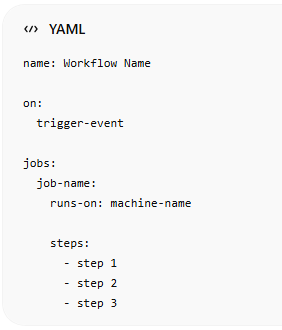
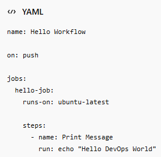

# 📘 CHAPTER 1: Data Serialization & Scripting Languages

*(Foundation Before Learning YAML & JSON)*

If you skip this chapter, YAML/JSON will feel like **random syntax**.  
If you understand this, YAML/JSON will feel like **logical tools**.

# 🧠 1. What is Data Serialization (Simple + Real Meaning)

## 📌 Definition:

**Data Serialization** is the process of converting data into a format that can be:

- Stored (file, database)
- Transmitted (network, APIs)
- Reconstructed later

## ☕ Real-Life Analogy

Imagine:

- You **write a message on paper** → give it to someone
- They **read and understand it**

👉 Writing = **Serialization  
** 👉 Reading = **Deserialization**

## 💻 Real Dev Example

### Step 1: Internal Data (Python object)

    user = {
    "name": "Ali",
    "age": 25
    }

👉 This is **not transferable directly**

### Step 2: Convert to JSON (Serialization)

``` json
{
"name": "Ali",
"age": 25
}
```

👉 Now it can be:

- Sent over network
- Stored in file
- Shared with other systems

# 🔄 2. Serialization vs Deserialization

| **Process**     | **Meaning**                  |
|-----------------|------------------------------|
| Serialization   | Object → transferable format |
| Deserialization | Format → usable object       |

## 🔁 Full Flow (Real System)

Python Object → JSON/YAML → Network → JSON/YAML → JavaScript Object

👉 This is how **modern applications communicate**

# 🌐 3. Why Data Serialization is Needed

Without serialization:

❌ Systems cannot communicate  
❌ Data cannot be shared properly

## 🎯 Real Use Cases

### 1. APIs

- Backend (Python) → Frontend (JavaScript)

### 2. Databases

- Store structured data safely

### 3. Configuration Files

- YAML / JSON used in tools

### 4. Microservices

- Service → Service communication

# 🧱 4. What is a Data Format

A **data format** is a structured way to represent data.

## 🔥 Popular Formats

| **Format** | **Use**        |
|------------|----------------|
| JSON       | APIs, web      |
| YAML       | DevOps configs |
| XML        | Legacy systems |

## 🧠 Key Insight

👉 Data ≠ Format

- Data = Meaning
- Format = Representation

# ⚙️ 5. Scripting Languages & Their Role

## 📌 What is a Scripting Language?

A scripting language is used to:

- Automate tasks
- Process data
- Interact with systems

## 🔥 Examples:

- Python
- JavaScript
- Bash

## 🧠 Role in Serialization

👉 Scripting languages:

- Convert data → JSON/YAML
- Read JSON/YAML → objects

## 💻 Example in Python

    import json
    data = {"name": "Ali"}
    json_data = json.dumps(data) # serialize
    print(json_data)

## 💻 Example in JavaScript

let data = { name: "Ali" };

let jsonData = JSON.stringify(data); // serialize

console.log(jsonData);

# 🔑 6. Key Concepts You MUST Understand

## 🧩 1. Data Structure (Internal)

user = {"name": "Ali"}

👉 Used inside program

## 🧩 2. Data Format (External)

{"name": "Ali"}

👉 Used for communication/storage

## 🧩 3. Encoding vs Serialization

| **Term**      | **Meaning**                  |
|---------------|------------------------------|
| Encoding      | Convert to bytes             |
| Serialization | Convert to structured format |

👉 Example:

- JSON string → encoded to UTF-8 bytes

## 🧩 4. Interoperability

👉 Different systems can communicate

Example:

Python → JavaScript → Go

👉 All understand JSON/YAML

# 📦 7. Types of Serialization Formats

## 🟢 Text-Based (Human Readable)

- JSON
- YAML
- XML

✔ Easy to read/debug  
❌ Slightly slower

## 🔴 Binary (Machine Efficient)

- Protocol Buffers
- Avro

✔ Fast  
❌ Hard to read

# ⚡ 8. JSON vs YAML (Quick Preview)

| **Feature** | **JSON** | **YAML** |
|-------------|----------|----------|
| Readability | Medium   | High     |
| Complexity  | Simple   | Flexible |
| Use Case    | APIs     | DevOps   |

# 🔄 9. Serialization Flow (Step-by-Step)

## 🎯 Scenario: Backend → Frontend

### ✅ Step 1: Create Data (Python)

user = {"name": "Ali", "age": 25}

### ✅ Step 2: Serialize

json_data = json.dumps(user)

### ✅ Step 3: Send over Network

- API response
- HTTP request

### ✅ Step 4: Receive (JavaScript)

let user = JSON.parse(jsonData);

👉 Now frontend can use the data

# 🧠 10. Important Technical Terms

## 📌 Schema

Structure/blueprint of data

Example:

``` json
{
"name": "string",
"age": "number"
}
```

## 📌 Parsing

Reading serialized data into usable form

## 📌 Marshalling / Unmarshalling

- Same as serialization/deserialization

# ⚠️ 11. Common Mistakes (With Explanation & Fix)

## ❌ Mistake 1: Sending Raw Objects

user = {"name": "Ali"}

👉 Cannot send directly over network

### ✅ Fix:

Serialize first:

json.dumps(user)

## ❌ Mistake 2: Invalid Format

{name: Ali}

👉 Invalid JSON

### ✅ Fix:

{"name": "Ali"}

## ❌ Mistake 3: Ignoring Data Types

    "age": "25"

👉 Wrong type (string instead of number)

### ✅ Fix:

    "age": 25

## ❌ Mistake 4: Confusing Format vs Object

👉 Thinking JSON = programming object

### ✅ Fix:

- JSON = string format
- Object = runtime structure

# 💡 12. Professional Tips (Real Dev Advice)

## 💡 Tip 1: Always Ask

👉 “What format am I using?”

## 💡 Tip 2: Use Correct Format

- JSON → APIs
- YAML → configuration

## 💡 Tip 3: Think in Structure

👉 Don’t memorize syntax  
👉 Understand hierarchy

## 💡 Tip 4: Practice Conversion

- Object → JSON
- JSON → Object

👉 This builds real skill

# 🧪 13. Mini Practice (Before YAML/JSON)

## 🧪 Task 1:

Convert this to JSON:

Name: Ali

Age: 25

## 🧪 Task 2:

👉 Why can’t Python dictionary be sent directly?

## 🧪 Task 3:

👉 Identify:

- Internal format
- External format

# **📘 YAML Complete Notes** 

# **(Beginner → Advanced for DevOps)**

# **🌿 SECTION 1: PREREQUISITE CONCEPTS (DETAILED & EASY)**

👉 Before learning YAML, you must **train your brain to think in data structures**, not just text.

# **🔹 0.1 What is Data (Structured vs Unstructured)**

### **🧠 What is Data?**

- **Data is any kind of information that computers store, process, or transfer**
- **It can be:**
  - **Text**
  - **Numbers**
  - **Images**
  - **Configuration settings**

**👉 In DevOps, data mostly means:**

- **configuration values**
- **system settings**
- **infrastructure definitions**

### **🧱 Types of Data**

## **1. Unstructured Data**

- **Data with no fixed format or organization**
- **Hard for machines to understand directly**

**✅ Examples:**

- **Paragraph text**
- **Emails**
- **Logs without format**

**Charlie is a DevOps engineer working with AWS and Docker.**

**👉 Problem:**

- **Computer cannot easily extract:**
  - **name**
  - **role**
  - **tools**

## **2. Structured Data**

- **Data organized in a clear, predictable format**
- **Easy for machines to read and process**

**✅ Example:**

``` yaml
name: Charlie
role: DevOps Engineer
tools:
```

**- AWS**

**- Docker**

**👉 Now machine understands:**

- **name = Charlie**
- **role = DevOps Engineer**
- **tools = list**

### **💡 Key Understanding**

- **YAML works ONLY with structured data**
- **Structure = hierarchy (parent → child)**

**👉 Think like a tree:**

**root**

**├── name**

**├── role**

**└── tools**

# **🔹 0.2 What is Data Serialization & Deserialization**

## **🧠 What is Serialization?**

- **Serialization = convert data into transferable format**
- **Used when sending/storing data**

**👉 Think:**

> **“Convert object → text”**

## **🧠 What is Deserialization?**

- **Reverse process**
- **Convert text → usable data structure**

**👉 Think:**

> **“Convert text → object”**

## **🔁 Real DevOps Flow (IMPORTANT)**

1.  **You write YAML file**
2.  **Tool reads YAML**
3.  **YAML → converted into internal object**
4.  **Tool executes based on that data**

## **📦 Example (Real Understanding)**

### **Step 1: YAML File**

``` yaml
app: nginx
port: 80
```

### **Step 2: Tool Reads It**

**Internally becomes:**

``` json
{
"app": "nginx",
"port": 80
}
```

**👉 This is deserialization**

## **💡 Why This Matters in DevOps**

- **Kubernetes reads YAML → creates pods**
- **Docker Compose reads YAML → runs containers**
- **CI/CD reads YAML → executes pipeline**

**👉 Without serialization → systems cannot communicate**

# **🔹 0.3 What is Configuration File**

## **🧠 Definition**

- **A configuration file defines:**
  - **how a system behaves**
  - **what settings it uses**

**👉 It is NOT code — it is instructions for software**

## **🧱 Real-Life Analogy**

**Think of:**

- **Mobile settings**
- **WiFi configuration**
- **App settings**

**👉 YAML = “settings file for systems”**

## **⚙️ Example (Simple Config)**

``` yaml
server:
host: localhost
port: 8080
```

**👉 This tells system:**

- **where to run**
- **which port to use**

## **💡 Important Concept**

**YAML does NOT do logic:**

**❌ No:**

- **loops**
- **conditions**
- **functions**

**✅ Only:**

- **configuration**
- **structure**
- **values**

## **🔥 Real DevOps Examples**

- **Kubernetes → define deployments**
- **Docker → define containers**
- **GitHub Actions → define pipeline steps**

**👉 YAML = control panel of DevOps systems**

# **🔹 0.4 What is Key-Value Structure**

## **🧠 Basic Idea**

**Everything in YAML is built on:**

**key: value**

## **🔑 What is Key?**

- **A name or label**
- **Used to identify data**

**👉 Example:**

**name: Charlie**

- **key = name**

## **📦 What is Value?**

- **The actual data stored**

**👉 Example:**

**name: Charlie**

- **value = Charlie**

## **💡 Think Like Dictionary**

**Like in real life:**

| **Key**  | **Value**           |
|----------|---------------------|
| **Name** | **Charlie**         |
| **Age**  | **30**              |
| **Role** | **DevOps Engineer** |

## **🔁 YAML Example**

``` yaml
name: Charlie
age: 30
role: DevOps Engineer
```

## **🧠 Advanced Understanding**

- **Value can be:**
  - **string**
  - **number**
  - **list**
  - **object**

**👉 Example:**

    user:
    name: Charlie
    skills:

**- AWS**

**- Docker**

# **🔹 0.5 JSON vs XML vs YAML (DEEP MENTAL MODEL)**

## **🧱 1. JSON (JavaScript Object Notation)**

### **Features:**

- **Strict format**
- **Uses** `{ }` **and** `[ ]`
- **No comments allowed**

**✅ Example:**

``` json
{
"name": "Charlie",
"age": 30
}
```

**👉 Machine-friendly but less readable**

## **🧱 2. XML (Extensible Markup Language)**

### **Features:**

- **Tag-based**
- **Very verbose (long)**

**✅ Example:**

**\<user\>**

**\<name\>Charlie\</name\>**

**\<age\>30\</age\>**

**\</user\>**

**👉 Heavy and outdated in DevOps**

## **🧱 3. YAML (Your Focus)**

### **Features:**

- **Uses indentation**
- **No brackets/tags**
- **Very clean**

**✅ Example:**

``` yaml
name: Charlie
age: 30
```

## **⚖️ Comparison Table**

| **Feature**     | **YAML**   | **JSON**     | **XML**  |
|-----------------|------------|--------------|----------|
| **Readability** | `⭐⭐⭐⭐` | `⭐⭐`       | `⭐`     |
| **Complexity**  | **Medium** | **Low**      | **High** |
| **Comments**    | **✅**     | **❌**       | **✅**   |
| **Syntax**      | **Indent** | **Brackets** | **Tags** |

## **🧠 Final Mental Model**

**👉 JSON = machine language  
👉 XML = old structured language  
👉 YAML = human-friendly config language**

## **🔥 Important Insight (VERY POWERFUL)**

**👉 YAML is basically:**

**JSON without brackets**

**Example:**

**JSON:**

**{"name": "Charlie"}**

**YAML:**

**name: Charlie**

# **🧠 FINAL UNDERSTANDING OF SECTION 1**

**After this section, you must clearly understand:**

- **✔ Data must be structured**
- **✔ YAML is a data format (not programming)**
- **✔ YAML is used for configuration**
- **✔ Everything is key-value based**
- **✔ YAML is easier version of JSON**

# **🌿 SECTION 1: YAML FUNDAMENTALS**

# **🔰 1. What is YAML (Deep Understanding)**

## **🧠 Definition (Simple + Real Meaning)**

- YAML stands for **YAML Ain’t Markup Language**
- It is a **data serialization format**
- Used to represent **structured data in a clean, human-readable way**

👉 In simple words:

> YAML is a way to **write data so both humans and machines can understand it easily**

## **🧱 What YAML Actually Does**

- YAML **describes data**
- It does NOT:
  - execute code
  - run logic
  - perform operations

👉 It only answers:

- What is the data?
- How is it structured?

## **⚠️ VERY IMPORTANT (Core Concept)**

YAML is **NOT a programming language**

That means:

❌ No loops  
❌ No if conditions  
❌ No functions

✅ Only:

- structure
- values
- relationships

## **💡 Think Like This (POWERFUL MENTAL MODEL)**

👉 YAML is like:

- **Blueprint of a building** (not the building itself)
- **Recipe of food** (not cooking itself)

Example:

``` yaml
app: nginx
port: 80
```

👉 This does NOT run nginx  
👉 It only tells system:

- which app
- which port

## **🔁 Real DevOps Flow**

1.  You write YAML
2.  Tool reads YAML
3.  Tool converts YAML → internal object
4.  Tool executes action

👉 YAML = **input for tools**

## **📦 Simple Example Breakdown**

``` yaml
app: nginx
port: 80
```

- `app` → key
- `nginx` → value
- `port` → key
- `80` → value

👉 This is **structured data**

# **⚡ 2. Why YAML is Everywhere (DevOps Reality)**

## **🧠 Why YAML Became Popular**

YAML solved a big problem:

👉 Old formats (XML, JSON) were:

- hard to read
- messy
- too technical

👉 YAML made configs:

- clean
- readable
- simple

## **✅ Key Advantages**

### **1. Human-Readable**

- Looks like normal text
- Easy to understand even for beginners

``` yaml
name: Charlie
role: DevOps Engineer
```

👉 You don’t need heavy syntax knowledge

### **2. Lightweight**

- No brackets `{ }`
- No tags `<tag>`
- No extra symbols

👉 Less noise → more clarity

### **3. Supports Complex Data**

- Can handle:
  - nested objects
  - lists
  - multi-level configs


    app:
    name: nginx
    ports:

\- 80

\- 443

👉 Works for small → large systems

### **4. Easy to Maintain**

- Clean format = fewer mistakes
- Easy debugging

👉 Very important in production systems

## **🔥 Where YAML is Used (DevOps Reality)**

### **☸️ Kubernetes**

- Used to define:
  - deployments
  - pods
  - services

``` yaml
apiVersion: apps/v1
kind: Deployment
```

👉 YAML = backbone of Kubernetes

### **🐳 Docker Compose**

- Defines multi-container apps


    services:
    web:
    image: nginx

### **🔁 CI/CD Pipelines**

- Automates build & deploy


    jobs:
    build:
    runs-on: ubuntu-latest

### **⚙️ Ansible**

- Automation tool

\- name: Install nginx

## **💡 Powerful Insight**

👉 In DevOps:

- You don’t click buttons
- You write YAML

👉 That’s why:

> If YAML is weak → DevOps becomes difficult

# **📏 3. YAML Rules (NON-NEGOTIABLE)**

👉 These are **strict rules** — breaking them = errors

## **🔹 Rule 1: Indentation Defines Structure (MOST IMPORTANT)**

### **🧠 Concept**

- YAML uses **spaces to show hierarchy**
- Indentation = parent-child relationship

### **✅ Correct Example**

``` yaml
app:
name: nginx
port: 80
```

👉 Structure:

- app (parent)
  - name (child)
  - port (child)

### **❌ Wrong Example**

    app:
    name: nginx

👉 Problem:

- YAML cannot understand structure

### **💡 Key Rule**

- Same level → same indentation
- Child → more indentation

👉 Think:

> indentation = tree structure

## **🔹 Rule 2: Spaces ONLY (NO TABS ❌)**

### **🧠 Why?**

- YAML parser does NOT accept tabs
- Tabs break parsing

### **❌ Wrong**

    app:
    name: nginx # tab used

### **✅ Correct**

    app:
    name: nginx

### **💡 Best Practice**

- Always use **2 spaces**
- Never mix spaces + tabs

## **🔹 Rule 3: Case Sensitive**

### **🧠 Meaning**

- YAML treats keys differently based on case

### **❌ Example**

Name: Charlie

name: John

👉 These are **two different keys**

### **💡 Rule**

- Be consistent:
  - use lowercase keys

## **🔹 Rule 4: Colon + Space REQUIRED**

### **🧠 Format**

key: value

### **❌ Wrong**

key:value

👉 YAML may fail or misinterpret

### **✅ Correct**

key: value

## **🔹 Rule 5: No Random Formatting**

- YAML is strict
- Small mistake = failure

### **❌ Common Mistake**

``` yaml
app:
name: nginx
port: 80 # wrong indentation
```

## **🔥 Why These Rules Matter (REALITY)**

- YAML is parsed step-by-step
- Parser depends on:
  - indentation
  - spacing
  - structure

👉 One mistake =

- pipeline failure
- deployment failure
- production issue

# **🧠 FINAL UNDERSTANDING OF SECTION 1**

After this section, you should clearly understand:

## **✅ YAML Core Concepts**

- YAML is **data format, not programming**
- Used for **configuration**
- Represents **structured data**

## **✅ Why YAML is Critical**

- Used in:
  - Kubernetes
  - Docker
  - CI/CD
- Backbone of DevOps

## **✅ Rules You MUST Follow**

- Indentation = structure
- Spaces only
- Case-sensitive
- Use `key: value` format

# **🧱 SECTION 2: CORE DATA STRUCTURES**

👉 YAML is built on just **3 core structures**:

- Scalar (single value)
- Mapping (key-value object)
- Sequence (list)

👉 Everything in YAML = combination of these three

# **🔹 2.1 Scalar (Single Value)**

## **🧠 What is a Scalar?**

- A **scalar** is the simplest form of data
- It represents **a single value only**
- It cannot contain child elements

👉 Think:

> One piece of data → no structure inside

## **📦 Types of Scalar Values**

A scalar can be:

- String → `"Charlie"`
- Number → `30`
- Boolean → `true / false`
- Null → `null`

## **✅ Example**

``` yaml
name: Charlie
age: 30
active: true
```

## **🔍 Breakdown**

- `name` → key
- `Charlie` → scalar value
- `age` → key
- `30` → scalar value

👉 Each value is **independent and atomic**

## **💡 Important Behavior**

- YAML automatically detects type:
  - `30` → number
  - `true` → boolean
  - `"30"` → string

## **⚠️ Common Mistake**

status: yes \# becomes true (boolean)

👉 Fix:

status: "yes"

## **🧠 Real DevOps Example**

``` yaml
replicas: 3
image: nginx
debug: false
```

👉 These are all scalars controlling system behavior

## **🔥 Key Understanding**

👉 Scalar = **leaf node in tree**

It cannot go deeper.

# **🔹 2.2 Mapping (Dictionary / Object)**

## **🧠 What is Mapping?**

- A **mapping** is a collection of key-value pairs
- It represents an **object or dictionary**

👉 Think:

> One key → multiple related values

## **🧱 Structure**

    key:
    child_key: value

## **✅ Example**

``` yaml
server:
host: localhost
port: 8080
```

## **🔍 Breakdown**

- `server` → parent key (mapping)
- Inside:
  - `host` → child key
  - `port` → child key

👉 This creates **hierarchy**

## **🌳 Tree Visualization**

server

├── host: localhost

└── port: 8080

## **💡 Why Mapping is Important**

- Groups related data
- Makes configs organized
- Used everywhere in DevOps

## **🔥 Real DevOps Example**

``` yaml
database:
type: mysql
host: db.local
port: 3306
```

👉 This is a **configuration block**

## **⚠️ Important Rule**

- Keys must be unique

❌ Wrong:

``` yaml
name: A
name: B
```

## **🧠 Advanced Insight**

👉 Mapping = **object in programming**

Like:

- Python dict
- JavaScript object

# **🔹 2.3 Sequence (List)**

## **🧠 What is Sequence?**

- A **sequence** is a list of items
- Items are ordered

👉 Think:

> Collection of values

## **🧱 Structure**

items:

\- value1

\- value2

## **✅ Example**

items:

\- apple

\- banana

## **🔍 Breakdown**

- `items` → key
- `- apple` → list item
- `- banana` → list item

👉 Dash `-` = new item

## **💡 Key Features**

- Order matters
- Can contain:
  - scalars
  - mappings
  - other lists

## **🔥 Real DevOps Example**

ports:

\- 80

\- 443

👉 Used for exposing services

## **🔹 Sequence of Objects**

``` yaml
users:
- name: Ali
age: 25
- name: Ahmed
age: 30
```

👉 Very common in:

- Kubernetes
- Docker Compose

## **⚠️ Common Mistake**

Wrong indentation:

items:

\- apple \# ❌

Correct:

items:

\- apple

## **🧠 Mental Model**

👉 Sequence = **array/list**

# **🔹 2.4 Nested Structures (MOST IMPORTANT)**

## **🧠 What is Nesting?**

- Combining:
  - mapping
  - sequence
  - scalar

👉 This creates **complex hierarchical data**

## **🧱 Example**

    app:
    config:
    db:
    host: localhost

## **🌳 Tree View**

app

└── config

└── db

└── host: localhost

## **💡 Why Nesting is Powerful**

- Represents real-world systems
- Allows deep configuration

## **🔥 Real DevOps Example**

    application:
    name: my-app
    database:
    host: localhost
    ports:

\- 5432

\- 5433

👉 This includes:

- mapping inside mapping
- sequence inside mapping

## **🔁 Mixed Structures Example**

    services:
    - name: web
    ports:

\- 80

    - name: db
    ports:

\- 3306

👉 Combination of:

- sequence
- mapping
- scalar

## **⚠️ Common Mistakes**

### **❌ Wrong Indentation**

    app:
    config:
    db:
    host: localhost

👉 YAML may break or misinterpret

### **❌ Over-Nesting**

Too deep = hard to read

## **🧠 Golden Rule**

👉 YAML = Tree Structure

- Mapping → branches
- Sequence → grouped branches
- Scalar → leaf nodes

# **🔥 FINAL MENTAL MODEL (VERY IMPORTANT)**

👉 Everything in YAML is built from:

- Scalar → value
- Mapping → object
- Sequence → list

👉 Combined → create full system configs

# **🚀 REAL DEVOPS UNDERSTANDING**

When you see this:

    services:
    - name: web
    image: nginx
    ports:

\- 80

👉 Your brain should read:

- services → list
- each item → object
- inside → key-value

# **⚠️ SECTION 3: YAML TYPE SYSTEM (CRITICAL)**

👉 This section is **VERY IMPORTANT** because:

> YAML can silently change your data → causing hidden bugs

# **🔹 3.1 Implicit Typing (Hidden Danger)**

## **🧠 What is Implicit Typing?**

- YAML automatically **guesses the data type**
- You don’t specify type → YAML decides it

👉 Think:

> “YAML is trying to be smart… but sometimes it breaks things”

## **📦 Example**

``` yaml
active: true
count: 10
name: Charlie
```

👉 YAML interprets:

- `true` → boolean
- `10` → integer
- `Charlie` → string

## **⚠️ The Hidden Problem**

Some values **look like strings**, but YAML converts them:

| **Value** | **YAML Converts To** |
|-----------|----------------------|
| yes       | true                 |
| no        | false                |
| on        | true                 |
| off       | false                |

## **❌ Dangerous Example (Real Bug)**

country: NO

👉 YAML interprets:

country: false \# ❌ WRONG

## **🇳🇴 This is called: "Norway Problem"**

- `NO` = country code for Norway
- YAML thinks → boolean `false`

👉 This can break:

- configs
- APIs
- deployments

## **🔥 Real DevOps Example (VERY IMPORTANT)**

env:

DEBUG: NO

👉 System reads:

DEBUG = false \# ❌ unexpected behavior

## **🧠 Key Insight**

👉 YAML does **implicit conversion based on patterns**, not intention

# **🔹 3.2 Safe Practice (HOW TO AVOID BUGS)**

## **✅ Rule: Always Quote Risky Values**

### **✔ Correct**

``` yaml
country: "NO"
status: "yes"
enabled: "on"
```

## **🧠 Why Quoting Works**

- Quotes force YAML to treat value as **string**
- Prevent automatic conversion

## **🔥 Best Practice (PRO LEVEL)**

👉 Always quote when value:

- looks like boolean (`yes/no/on/off`)
- contains special characters
- could be misinterpreted

## **📦 Safe Example**

env:

COUNTRY: "NO"

DEBUG: "off"

VERSION: "1.0"

## **⚠️ Common Mistake**

version: 1.0

👉 YAML may treat as **float**, not string

👉 Safer:

version: "1.0"

## **🧠 Golden Rule**

> If you are unsure → **quote it**

# **🔹 3.3 Explicit Typing (Advanced Control)**

## **🧠 What is Explicit Typing?**

- You manually tell YAML:  
  >   
  >   
  > “This value must be this type”

👉 Override YAML’s automatic behavior

## **🧱 Syntax**

key: !!type value

## **📦 Examples**

``` yaml
value: !!str true
number: !!int 10
price: !!float 3.14
```

## **🔍 Breakdown**

- `!!str` → force string
- `!!int` → force integer
- `!!float` → force float

## **🔥 Why This Matters**

Sometimes quoting is not enough in complex systems:

👉 Example:

value: !!str 123

👉 Without tag:

- YAML → integer

👉 With tag:

- YAML → string

## **⚙️ Real DevOps Example**

env:

PORT: !!int "8080"

👉 Ensures:

- always treated as integer

## **⚠️ When to Use Explicit Typing**

Use it when:

- strict systems (APIs, schemas)
- avoiding ambiguity
- working with automation tools

## **🧠 Important Insight**

👉 Most beginners:

- ignore this  
  > 👉 Professionals:

- use it to avoid production bugs

# **🔥 BONUS: YAML TYPE CONFUSION CASES**

## **⚠️ Boolean Traps**

on → true

off → false

yes → true

no → false

## **⚠️ Numeric Traps**

00123 → interpreted as number

1.0 → float

## **⚠️ Null Values**

null

~

(empty)

👉 All mean **null**

# **🧠 FINAL MENTAL MODEL (VERY IMPORTANT)**

👉 YAML Type System =

- Implicit typing (automatic)
- Explicit typing (manual control)

👉 Your job as DevOps engineer:

- Control data
- Avoid hidden conversions
- Ensure correct interpretation

# **🚀 REAL DEVOPS IMPACT**

If you ignore this:

❌ Wrong configs  
❌ Failed deployments  
❌ Unexpected behavior

If you master this:

✅ Clean configs  
✅ Predictable systems  
✅ Zero hidden bugs

# **📚 SECTION 4: STRINGS (FULL CONTROL)**

👉 Strings in YAML are **more complex than they look**

Why?

- YAML tries to be smart (type conversion)
- Formatting matters (especially multi-line)
- Used heavily in DevOps (scripts, env, configs)

# **🔹 4.1 Plain vs Quoted Strings**

## **🧠 Plain Strings (Unquoted)**

- Written without quotes
- Simple and clean
- Best for basic text

## **✅ Example**

``` yaml
name: Charlie
city: Lahore
```

## **⚠️ Limitations of Plain Strings**

Plain strings can break when:

- Special characters used (`:`, `#`, `{}`)
- Value looks like boolean (`yes`, `no`)
- Leading/trailing spaces exist

## **❌ Problem Example**

status: yes \# becomes true ❌

## **🧠 Quoted Strings (Safe Mode)**

👉 Two types:

- Double quotes `" "`
- Single quotes `' '`

## **✅ Example**

``` yaml
name: "Charlie"
status: "yes"
path: "/var/log/app"
```

## **💡 Why Use Quotes?**

- Prevent automatic type conversion
- Allow special characters
- Ensure value stays string

## **🔍 Difference Between Single & Double Quotes**

### **🔸 Double Quotes** `" "` **(Flexible)**

- Supports escape characters

text: "Line1\nLine2"

👉 `\n` = new line

### **🔸 Single Quotes** `' '` **(Literal)**

- No escape processing
- Everything treated as raw text

text: 'Line1\nLine2'

👉 Output = `Line1\nLine2`

## **🧠 Best Practice**

Use quotes when:

- value contains special characters
- value looks like boolean/number
- writing paths, URLs, passwords

# **🔹 4.2 Multi-line Strings (VERY IMPORTANT)**

👉 Used heavily in:

- scripts
- logs
- configs
- CI/CD pipelines

## **🧠 Why Multi-line Matters**

Sometimes data is not one line:

- shell scripts
- config blocks
- long messages

👉 YAML provides **two main styles**

# **🔸 1. Literal Style (**`|`**) → Preserve Format**

## **🧠 Behavior**

- Keeps:
  - line breaks
  - spacing
  - formatting

## **✅ Example**

text: \|

line1

line2

## **🔍 Output**

line1

line2

👉 New lines are preserved

## **🔥 Real DevOps Example**

    script: |
    echo "Starting app"
    npm install
    npm start

👉 Perfect for:

- shell scripts
- CI/CD commands

# **🔸 2. Folded Style (**`>`**) → Merge Lines**

## **🧠 Behavior**

- Converts multiple lines → single line
- Replaces newline with space

## **✅ Example**

text: \>

line1

line2

## **🔍 Output**

line1 line2

## **💡 When to Use**

- long descriptions
- messages
- documentation text

## **🔥 Real Example**

description: \>

This is a long message

that becomes one line

# **🔹 4.3 Chomp Indicators (ADVANCED CONTROL)**

## **🧠 What is Chomp?**

- Controls **extra newline at the end**
- Used with `|` and `>`

## **🔸 Default Behavior**

text: \|

hello

👉 Output ends with newline:

hello\n

# **🔸 Chomp Types**

## **🔹 1. Strip (**`-`**) → Remove newline**

text: \|-

hello

👉 Output:

hello

(no extra newline)

## **🔹 2. Keep (**`+`**) → Keep all newlines**

text: \|+

hello

👉 Output:

hello\n\n

(extra newline preserved)

## **🔹 Works with Folded Too**

text: \>-

hello

## **🧠 Why This Matters**

In DevOps:

- extra newline can break scripts
- config parsing may fail
- APIs may behave differently

# **🔥 REAL DEVOPS SCENARIOS**

## **🐳 Docker Compose Script**

    command: |
    echo "Start"

nginx -g "daemon off;"

👉 Must preserve format → use `|`

## **🔁 CI/CD Pipeline**

    run: |
    npm install
    npm test

## **⚠️ Bug Example**

    text: >
    echo "Hello"
    echo "World"

👉 Becomes:

``` bash
echo "Hello" echo "World"
```

❌ Script breaks

# **🧠 FINAL STRING MENTAL MODEL**

👉 YAML Strings = 3 levels of control:

### **1. Basic Level**

- plain text
- quoted text

### **2. Multi-line Level**

- `|` → preserve lines
- `>` → merge lines

### **3. Advanced Level**

- `|-` → remove newline
- `|+` → keep newline

# **🔥 PRO TIP (IMPORTANT)**

👉 For DevOps:

- Scripts → use `|`
- Long text → use `>`
- Risky values → use quotes
- Production configs → avoid plain strings

# **🧾 SECTION 5: LISTS & FLOW STYLE**

👉 In YAML, lists are called **sequences  
** 👉 They are used to store **multiple values under one key**

# **🔹 5.1 Block Style List (MOST COMMON)**

## **🧠 What is Block Style?**

- Uses `-` (dash) to define each item
- Each item is on a **new line**
- Indentation defines structure

## **✅ Example**

items:

\- apple

\- banana

## **🔍 Breakdown**

- `items` → key
- `- apple` → first item
- `- banana` → second item

👉 Each `-` = new element in list

## **🌳 Visual Structure**

items

├── apple

└── banana

## **💡 Key Rules**

- Dash `-` must align properly
- Indentation must be consistent

## **❌ Common Mistake**

items:

\- apple \# ❌ wrong indentation

## **🔥 Real DevOps Example**

ports:

\- 80

\- 443

👉 Used in:

- Kubernetes
- Docker

## **🧠 When to Use Block Style**

- Large lists
- Complex data
- Better readability

# **🔹 5.2 Inline Style List (Compact Format)**

## **🧠 What is Inline Style?**

- List written in **single line**
- Uses `[ ]` (like JSON)

## **✅ Example**

items: \[apple, banana\]

## **🔍 Equivalent to**

items:

\- apple

\- banana

## **💡 When to Use Inline**

- Small lists
- Simple configs
- One-line values

## **⚠️ Limitations**

- Hard to read for large lists
- Not suitable for nested structures

## **🔥 Real DevOps Example**

ports: \[80, 443\]

## **🧠 Best Practice**

👉 Use inline only when:

- list is short (2–4 items)
- readability is not affected

# **🔹 5.3 List of Objects (VERY IMPORTANT)**

## **🧠 What is This?**

- A list where each item is a **mapping (object)**

👉 This is the **most used pattern in DevOps**

## **✅ Example**

``` yaml
users:
- name: Ali
age: 25
- name: Ahmed
age: 30
```

## **🔍 Breakdown**

- `users` → list
- each `-` → one object
- inside → key-value pairs

## **🌳 Visual Structure**

users

├── {name: Ali, age: 25}

└── {name: Ahmed, age: 30}

## **🔥 Real DevOps Example (VERY IMPORTANT)**

``` yaml
containers:
- name: web
image: nginx
- name: db
image: mysql
```

👉 This is exactly how:

- Kubernetes defines containers
- Docker Compose defines services

## **⚠️ Common Mistakes**

### **❌ Wrong indentation**

``` yaml
users:
- name: Ali
age: 25 # ❌ broken
```

### **❌ Missing dash**

    users:
    name: Ali # ❌ not a list anymore

## **🧠 Key Insight**

👉 List of objects =  
**multiple structured entries**

# **🔹 5.4 Flow Style (JSON-like Structure)**

## **🧠 What is Flow Style?**

- Compact format using:
  - `{}` for objects
  - `[]` for lists

👉 Looks like JSON

## **✅ Example (Object)**

user: {name: Charlie, age: 30}

## **✅ Example (List)**

numbers: \[1, 2, 3\]

## **🔍 Equivalent Block Style**

``` yaml
user:
name: Charlie
age: 30
```

## **💡 Why Flow Style Exists**

- Compact representation
- Useful for short configs
- Easy inline usage

## **⚠️ Limitations**

- Hard to read when complex
- Not ideal for nested structures
- Debugging becomes difficult

## **🔥 Real DevOps Example**

env: {APP_ENV: production, DEBUG: "false"}

## **🧠 When to Use Flow Style**

Use it when:

- data is small
- readability is not compromised
- quick inline configuration needed

# **🔥 MIXED STRUCTURES (IMPORTANT FOR REAL USE)**

## **🧠 Combination Example**

    services:
    - name: web
    ports: [80, 443]
    - name: db
    ports:

\- 3306

## **🔍 What’s Happening**

- `services` → list
- each item → object
- `ports` → sometimes inline, sometimes block

👉 YAML allows mixing styles

# **⚠️ COMMON PITFALLS**

## **❌ Wrong Indentation**

items:

\- apple

\- banana \# ❌ wrong nesting

## **❌ Mixing Without Clarity**

items: \[apple,

banana\] \# ❌ bad formatting

## **❌ Missing Spaces**

items:\[apple, banana\] \# ❌ invalid

# **🧠 FINAL MENTAL MODEL**

👉 Lists in YAML = **Sequences**

- `-` → item indicator
- `[ ]` → inline list
- `{ }` → inline object

👉 Your brain should read this instantly:

``` yaml
users:
- name: Ali
skills: [AWS, Docker]
```

Meaning:

- users → list
- each item → object
- skills → list inside object

# **🚀 REAL DEVOPS UNDERSTANDING**

When you see:

    containers:
    - name: app
    image: nginx
    ports:

\- 80

👉 You should understand:

- containers → list
- each item → container config
- ports → list inside object

# **🔥 PRO TIP**

👉 In real DevOps:

- Use **block style** → for clarity
- Use **inline style** → for small values
- Avoid complex flow style → hard to debug

# **🧩 SECTION 6: ADVANCED YAML FEATURES**

👉 These features help you:

- reduce repetition
- manage large configs
- write clean and reusable YAML

# **🔗 6.1 Anchors & Aliases (VERY IMPORTANT)**

## **🧠 What Problem Do They Solve?**

In real DevOps configs:

- You repeat same values again and again
- This creates:
  - duplication
  - errors
  - hard maintenance

👉 Anchors & aliases solve this

## **🧱 Core Concept**

- **Anchor (**`&`**)** → define reusable block
- **Alias (**`*`**)** → reuse that block

👉 Think:

> Anchor = save  
> Alias = reuse

## **✅ Basic Example**

``` yaml
default: &config
retries: 3
timeout: 30
service:
```

\<\<: \*config

## **🔍 Breakdown**

- `&config` → defines anchor
- `*config` → references it
- `<<:` → merges values into object

## **🌳 Result (Expanded View)**

``` yaml
service:
retries: 3
timeout: 30
```

## **💡 Why This is Powerful**

- Avoid repetition
- Keep configs DRY (Don’t Repeat Yourself)
- Easy updates → change once, apply everywhere

## **🔥 Real DevOps Example**

``` yaml
defaults: &app
image: nginx
replicas: 2
services:
```

\- \<\<: \*app

name: web

\- \<\<: \*app

name: api

👉 Used in:

- Kubernetes manifests
- Docker Compose
- CI/CD configs

## **⚠️ Common Mistakes**

### **❌ Using alias before anchor**

service:

\<\<: \*config \# ❌ not defined yet

### **❌ Forgetting** `<<:`

service:

\*config \# ❌ invalid

## **🧠 Mental Model**

👉 Anchor = template  
👉 Alias = copy of template

# **🔹 6.2 Override Values (VERY IMPORTANT)**

## **🧠 What is Override?**

- You reuse a block
- Then modify specific values

👉 Think:

> “Use base config + change what you need”

## **✅ Example**

``` yaml
default: &config
retries: 3
timeout: 30
service:
```

\<\<: \*config

retries: 5

## **🔍 Result**

``` yaml
service:
retries: 5
timeout: 30
```

## **💡 Key Rule**

👉 Override happens **after merge**

## **🔥 Real DevOps Example**

``` yaml
defaults: &container
image: nginx
ports:
```

\- 80

containers:

\- \<\<: \*container

name: web

\- \<\<: \*container

``` yaml
name: api
image: node # override
```

## **🧠 Why This Matters**

- Create base config
- Customize per service
- Reduce duplication

# **📄 6.3 Multi-Document YAML**

## **🧠 What is It?**

- One YAML file can contain **multiple documents**
- Each document separated by `---`

## **✅ Example**

---

app: nginx

---

app: redis

## **🔍 Meaning**

👉 This is NOT one config  
👉 It is TWO separate YAML documents

## **💡 Why Use It?**

- Combine multiple resources in one file
- Useful in DevOps deployments

## **🔥 Real DevOps Example (Kubernetes)**

---

``` yaml
apiVersion: v1
kind: Service
```

---

``` yaml
apiVersion: apps/v1
kind: Deployment
```

👉 One file → multiple resources

## **⚠️ Important Notes**

- Each document is processed separately
- Tools must support multi-doc YAML

## **🧠 Mental Model**

👉 `---` = new file inside same file

# **⚙️ 6.4 YAML Schemas (ADVANCED CONCEPT)**

## **🧠 What is Schema?**

- Schema defines:
  - how YAML interprets values
  - how types are handled

👉 It controls **type behavior**

## **📦 Types of YAML Schemas**

## **🔹 1. FailSafe Schema**

### **🧠 Behavior**

- Everything treated as **string**

### **✅ Example**

value: yes

👉 Result:

value: "yes"

## **🔹 2. JSON Schema**

### **🧠 Behavior**

- Strict typing (like JSON)
- No automatic conversions

### **💡 Rules**

- Only:
  - string
  - number
  - boolean
  - null

## **🔹 3. Core Schema (DEFAULT)**

### **🧠 Behavior**

- Flexible typing
- Allows implicit conversions

### **⚠️ Example**

yes → true

no → false

## **🧠 Why Schema Matters**

- Different tools use different schemas
- Behavior may change between systems

👉 Example:

- Kubernetes uses strict validation
- Some parsers behave differently

## **🔥 Real DevOps Impact**

If you don’t understand schema:

❌ Unexpected type conversion  
❌ Config mismatch  
❌ Deployment errors

# **🔥 BONUS: COMBINED ADVANCED EXAMPLE**

``` yaml
defaults: &app
image: nginx
replicas: 2
```

---

services:

\- \<\<: \*app

name: web

\- \<\<: \*app

``` yaml
name: api
replicas: 3
```

## **🧠 What’s Happening**

- Anchor defined
- Alias reused
- Values overridden
- Multi-document used

👉 This is **real-world YAML usage**

# **🧠 FINAL MENTAL MODEL**

👉 Advanced YAML =

- Anchors → reuse
- Aliases → reference
- Merge (`<<:`) → combine
- Override → customize
- Multi-doc → multiple configs
- Schema → type behavior

# **🔥 PRO TIP (VERY IMPORTANT)**

👉 In real DevOps:

- Use anchors for large configs
- Use override for environment differences
- Use multi-doc for Kubernetes
- Always test schema behavior

# **🧠 SECTION 7: YAML INTERNAL WORKING**

👉 This section explains:

> What happens *inside the system* when YAML is read

# **🔹 7.1 YAML Parsing Model (HOW YAML REALLY WORKS)**

## **🧠 What is Parsing?**

- Parsing = **reading and understanding structured data**
- Every DevOps tool must “understand” YAML before using it

👉 Think:

> YAML file → brain of system → executable data

## **⚙️ YAML Processing Happens in 3 Steps**

# **🔹 STEP 1: SCAN (TOKENIZATION)**

## **🧠 What happens here?**

- YAML file is broken into **small pieces (tokens)**

👉 These tokens include:

- keys
- values
- indentation
- symbols (`:`, `-`, `---`)

## **📦 Example Input**

``` yaml
app: nginx
port: 80
```

## **🔍 Scan Output (Conceptual)**

System sees:

- `app`
- `:`
- `nginx`
- `port`
- `80`

## **💡 Key Idea**

👉 YAML is first broken into **raw building blocks**

## **⚠️ Why This Matters**

If syntax is wrong:

- scanner cannot split correctly
- everything fails later

# **🔹 STEP 2: PARSE (STRUCTURE BUILDING)**

## **🧠 What happens here?**

- System builds **hierarchy (tree structure)** from tokens

👉 It understands:

- what is key
- what is value
- what is parent/child

## **📦 Example**

``` yaml
app:
name: nginx
port: 80
```

## **🌳 Parsed Structure**

app

├── name: nginx

└── port: 80

## **💡 Key Idea**

👉 YAML becomes a **tree structure in memory**

## **⚠️ What Breaks Here?**

- wrong indentation
- missing colon
- incorrect nesting

👉 Parser cannot build structure → error

# **🔹 STEP 3: COMPOSE (FINAL DATA OBJECT)**

## **🧠 What happens here?**

- Parsed structure is converted into **usable object**

👉 This is what applications actually use

## **📦 Example Output (Internal Object)**

``` json
{
"app": {
"name": "nginx",
"port": 80
}
}
```

## **💡 Key Idea**

👉 YAML is NOT used directly  
👉 It is converted into **language-specific objects**

## **🔥 Used By**

- Kubernetes → Go objects
- Docker → runtime configs
- CI/CD → execution pipelines

# **⚠️ WHY YAML BREAKS SO EASILY**

## **🧠 Root Cause**

YAML is **structure-sensitive**, not text-sensitive

## **❌ Example: Indentation Error**

    app:
    name: nginx # ❌ broken structure

## **💥 What Happens Internally?**

### **Step 1 (Scan):**

- tokens exist

### **Step 2 (Parse):**

- structure CANNOT be built

👉 Result:  
❌ parsing failure → system stops

## **💡 Key Insight**

👉 YAML errors usually happen in STEP 2 (parsing)

# **🔥 REAL DEVOPS IMPACT**

## **☸️ Kubernetes Example**

If YAML fails:

- Pod is not created
- Deployment fails
- Cluster rejects config

## **🐳 Docker Example**

If parsing fails:

- container does not start
- compose file is rejected

## **🔁 CI/CD Example**

If YAML fails:

- pipeline stops immediately
- deployment never runs

# **🧠 IMPORTANT MENTAL MODEL**

👉 YAML is NOT “just text file”

It is:

Text File → Scanner → Parser → Object Model → System Execution

# **🧠 WHY INDENTATION IS SO IMPORTANT**

## **🧱 Because indentation defines:**

- parent
- child
- hierarchy

## **📦 Example**

    app:
    config:
    db:
    host: localhost

👉 System builds:

- app
  - config
    - db
      - host

## **💥 If indentation breaks:**

👉 structure becomes meaningless  
👉 parser fails immediately

# **🔥 ADVANCED INSIGHT (PRO LEVEL)**

## **🧠 YAML is not executed**

It is:

- interpreted
- validated
- converted into objects

## **💡 Tools do NOT “run YAML”**

They:

- read YAML
- convert into internal model
- execute logic based on that model

# **🧠 FINAL MENTAL MODEL (VERY IMPORTANT)**

👉 YAML Processing Pipeline:

    YAML File
    ↓
    SCAN (break into tokens)
    ↓
    PARSE (build structure/tree)
    ↓
    COMPOSE (create object)
    ↓
    APPLICATION EXECUTION

# **🔥 PRO TIP**

👉 When debugging YAML:

Think like system:

- “Did scanner understand text?”
- “Did parser build structure?”
- “Did object get created?”

# **⚠️ SECTION 8: COMMON MISTAKES**

👉 This section teaches:

> Why YAML breaks in real systems + how to fix it like a DevOps engineer

# **❌ 8.1 Indentation Error (MOST COMMON + MOST DANGEROUS)**

## **🧠 What is the problem?**

YAML uses **spaces to define structure**.

If indentation is wrong:

- hierarchy breaks
- parser fails
- config becomes invalid

## **❌ Wrong Example**

    app:
    name: nginx

## **💥 What YAML THINKS here:**

- `app` exists
- `name` is NOT inside app

👉 This creates confusion → parsing failure

## **✅ Correct Example**

    app:
    name: nginx

## **🌳 Correct Structure**

app

└── name: nginx

## **🔥 Real DevOps Impact**

- Kubernetes deployment fails
- Docker Compose rejects file
- CI/CD pipeline stops immediately

## **🧠 Rule**

> Indentation = structure = truth

# **❌ 8.2 Tabs Usage (HIDDEN KILLER ERROR)**

## **🧠 What is the issue?**

YAML supports ONLY spaces  
Tabs are invisible but destructive

## **❌ Wrong Example**

    app:
    name: nginx # tab used ❌

## **💥 Why it breaks**

- YAML parser cannot interpret tab consistently
- Different editors treat tabs differently

## **✅ Correct Example**

    app:
    name: nginx

## **🔥 Real DevOps Problem**

- Works in your editor
- Fails in CI/CD pipeline

👉 This is called:

> “Works locally, breaks in production”

## **🧠 Rule**

> Always use 2 spaces (industry standard)

# **❌ 8.3 Duplicate Keys (LOGIC OVERWRITE BUG)**

## **🧠 What happens?**

If same key is written multiple times:

- last value wins OR
- system behaves unpredictably

## **❌ Wrong Example**

``` yaml
name: A
name: B
```

## **💥 Result**

Depending on parser:

- A is ignored
- B overrides A

👉 You lose data silently (VERY DANGEROUS)

## **🔥 Real DevOps Impact**

``` yaml
replicas: 2
replicas: 5
```

👉 You think 2 pods will run  
👉 Actually 5 pods run → unexpected cost/load

## **✅ Best Practice**

- Never duplicate keys
- Validate YAML before deployment

## **🧠 Rule**

> YAML does NOT warn you— it silently overrides

# **❌ 8.4 Boolean Confusion (NORWAY PROBLEM – CRITICAL)**

## **🧠 What happens?**

YAML automatically converts certain words into boolean values:

| **Value** | **Becomes** |
|-----------|-------------|
| yes       | true        |
| no        | false       |
| on        | true        |
| off       | false       |

## **❌ Dangerous Example**

country: NO

## **💥 YAML interprets:**

country: false

## **🇳🇴 Why called “Norway Problem”?**

- “NO” is ISO country code for Norway
- YAML thinks it is boolean “no”

## **🔥 Real DevOps Failure**

env:

DEBUG: NO

👉 System reads:

DEBUG = false

👉 Unexpected behavior in production

## **✅ Safe Fix**

``` yaml
country: "NO"
debug: "no"
```

## **🧠 Rule**

> Always quote values that look like keywords

# **🧠 SUMMARY OF COMMON MISTAKES**

## **❌ 1. Indentation Error**

- breaks structure
- causes parsing failure

## **❌ 2. Tabs Usage**

- invisible but dangerous
- causes inconsistent parsing

## **❌ 3. Duplicate Keys**

- silently overwrites values
- causes hidden bugs

## **❌ 4. Boolean Confusion**

- YAML auto-converts values
- leads to unexpected behavior

# **🔥 REAL DEVOPS DEBUGGING MINDSET**

When YAML fails, think:

### **1. Structure problem?**

→ indentation

### **2. Formatting problem?**

→ tabs/spaces

### **3. Data loss?**

→ duplicate keys

### **4. Wrong values?**

→ implicit type conversion

# **🧠 FINAL MENTAL MODEL**

👉 YAML errors are NOT random

They come from 4 root causes:

STRUCTURE (indentation)

FORMAT (tabs/spaces)

LOGIC (duplicate keys)

TYPES (boolean conversion)

# **🔥 PRO TIP (VERY IMPORTANT)**

👉 In real DevOps:

- Always validate YAML before applying
- Use linters (yamllint, kubeval)
- Never trust “looks correct”

# **🛠️ SECTION 9: TOOLS & VALIDATION**

👉 This section teaches:

> How professionals prevent YAML mistakes BEFORE they break production

# **🔹 9.1 Why YAML Tools Matter (BIG PICTURE)**

## **🧠 Problem in Real DevOps**

YAML is:

- strict about indentation
- silent about errors (no warnings sometimes)
- easy to break accidentally

👉 Result:

- pipelines fail
- deployments break
- debugging becomes hard

## **💡 Solution**

We use tools to:

- validate YAML before running
- catch mistakes early
- enforce standards
- automate checking in CI/CD

## **🔥 Mental Model**

👉 Write YAML → Validate → Deploy  
NOT  
👉 Write YAML → Deploy → Pray it works

# **🔹 9.2 VS Code YAML Extension (DEVELOPER TOOL)**

## **🧠 What it is**

- Official YAML support for Visual Studio Code
- Provides real-time feedback while writing YAML

## **⚙️ What it does**

- Highlights syntax errors
- Shows indentation issues
- Autocompletes structure
- Detects invalid formatting

## **✅ Example Benefit**

If you write:

    app:
    name: nginx

👉 VS Code immediately shows:

- indentation error warning
- visual red underline

## **💡 Why it’s important**

- Prevents mistakes while typing
- Saves debugging time later

## **🧠 Rule**

> If VS Code is not happy → your YAML is probably broken

# **🔹 9.3 yamllint (PROFESSIONAL TOOL)**

## **🧠 What is yamllint?**

- A command-line tool
- Checks YAML syntax + style rules

## **⚙️ What it checks**

- indentation consistency
- spacing rules
- formatting issues
- structural problems

## **📦 Example Usage**

yamllint config.yaml

## **🔍 Output Example**

line 3: wrong indentation

line 5: missing space after colon

## **💡 Why DevOps uses it**

- Ensures consistency across teams
- Prevents production YAML errors
- Enforces best practices automatically

## **🧠 Mental Model**

> VS Code = real-time helper  
> yamllint = final checker before deployment

# **🔹 9.4 Online YAML Validators (QUICK CHECK TOOL)**

## **🧠 What they are**

- Browser-based tools
- Paste YAML → instantly validated

## **⚙️ What they do**

- check syntax errors
- show structure tree
- detect formatting issues

## **💡 When to use**

- quick testing
- learning phase
- debugging small snippets

## **⚠️ Limitation**

- Not used in production pipelines
- Not secure for sensitive configs

## **🧠 Rule**

> Use for learning/debugging, not deployment systems

# **🔹 9.5 CI/CD Pipeline Validation (MOST IMPORTANT IN REAL DEVOPS)**

## **🧠 What is it?**

- YAML is validated automatically inside pipelines

👉 Example:

- GitHub Actions
- GitLab CI
- Jenkins pipelines

## **⚙️ Why it matters**

Before deploying:

- YAML is checked automatically
- invalid files are rejected

## **🔥 Real Example (GitHub Actions)**

    jobs:
    validate:
    runs-on: ubuntu-latest
    steps:
    - name: Check YAML
    run: yamllint config.yaml

## **💥 What happens if YAML is wrong?**

- pipeline fails immediately
- deployment stops
- error shown in logs

## **💡 Why this is powerful**

- prevents production mistakes
- enforces team standards
- automates validation

## **🧠 Mental Model**

> No validated YAML → no deployment

# **🔹 9.6 Debugging Strategy (REAL DEVOPS SKILL)**

## **🧠 Step 1: Validate Syntax**

- check indentation
- check spacing
- check structure

## **🧠 Step 2: Check Tools Output**

- VS Code warnings
- yamllint errors

## **🧠 Step 3: Run in CI/CD**

- see pipeline failure logs

## **🧠 Step 4: Fix Iteratively**

- small corrections
- re-test again

## **🔥 Debugging Mindset**

👉 Don’t guess  
👉 Let tools tell you the problem

# **⚠️ COMMON REAL-WORLD MISTAKE**

## **❌ “It looks fine, so it should work”**

👉 WRONG mindset in YAML

## **💥 Reality**

- YAML can LOOK correct
- but still fail due to:
  - indentation mismatch
  - hidden tabs
  - schema mismatch

## **🧠 Correct mindset**

> “If it is not validated, it is not correct”

# **🧠 FINAL MENTAL MODEL (VERY IMPORTANT)**

👉 YAML workflow in DevOps:

    Write YAML
    ↓
    VS Code (real-time check)
    ↓
    yamllint (static validation)
    ↓
    CI/CD pipeline validation
    ↓
    Deployment

# **🔥 PRO TIP (VERY IMPORTANT)**

👉 In real DevOps environments:

- Never trust raw YAML
- Always validate twice:
  - locally (VS Code / yamllint)
  - remotely (CI/CD pipeline)

# **⚙️ SECTION 10: DEVOPS REAL-WORLD USAGE**

👉 This section shows:

> How YAML is actually used in production systems

# **🐳 10.1 Docker Compose (Multi-Container Applications)**

## **🧠 What is Docker Compose?**

- A tool used to run **multiple containers together**
- Defined using a YAML file: `docker-compose.yml`

👉 Think:

> “One file to run full application stack”

## **⚙️ Basic Structure**

    services:
    web:
    image: nginx

## **🔍 Breakdown**

- `services` → defines all containers
- `web` → name of container
- `image` → Docker image to use

## **🔥 Real-World Example**

    services:
    web:
    image: nginx
    ports:

\- "80:80"

    db:
    image: mysql
    environment:

MYSQL_ROOT_PASSWORD: secret

## **💡 What this means**

- Start web server (nginx)
- Start database (MySQL)
- Connect both automatically

## **🧠 Why YAML here?**

- Easy service definition
- Readable architecture
- Simple scaling

# **☸️ 10.2 Kubernetes (THE MOST IMPORTANT YAML USE CASE)**

## **🧠 What is Kubernetes YAML?**

- Used to define **containers, deployments, services**
- Controls entire cluster behavior

👉 Think:

> “Blueprint of cloud infrastructure”

## **⚙️ Basic Deployment**

``` yaml
apiVersion: apps/v1
kind: Deployment
```

## **🔍 Breakdown**

- `apiVersion` → Kubernetes API version
- `kind` → type of resource (Deployment, Pod, Service)

## **🔥 Full Example**

``` yaml
apiVersion: apps/v1
kind: Deployment
metadata:
name: nginx-deployment
spec:
replicas: 3
selector:
matchLabels:
app: nginx
template:
metadata:
labels:
app: nginx
spec:
containers:
- name: nginx
image: nginx
ports:
- containerPort: 80
```

## **💡 What this does**

- Creates 3 replicas of nginx
- Exposes port 80
- Runs inside Kubernetes cluster

## **🧠 Why YAML is critical here**

👉 Kubernetes = **100% YAML-driven system**

If YAML is wrong:

- pods fail
- services don’t start
- cluster breaks

# **🔁 10.3 CI/CD (GitHub Actions)**

## **🧠 What is it?**

- Automates:
  - build
  - test
  - deploy

👉 YAML defines pipeline steps

## **⚙️ Basic Structure**

    jobs:
    build:
    runs-on: ubuntu-latest

## **🔥 Full Example**

``` yaml
name: CI Pipeline
on: [push]
jobs:
build:
runs-on: ubuntu-latest
steps:
- name: Checkout code
uses: actions/checkout@v2
- name: Install dependencies
run: npm install
- name: Run tests
run: npm test
```

## **💡 What this does**

- Runs automatically on code push
- Installs dependencies
- Runs tests

## **🧠 Why YAML here?**

- Defines automation steps clearly
- Easy to modify pipeline
- Version-controlled workflow

# **⚙️ 10.4 Ansible (CONFIGURATION MANAGEMENT)**

## **🧠 What is Ansible YAML?**

- Used for **automating server setup**
- Executes tasks on multiple machines

👉 Think:

> “Remote automation script in YAML form”

## **⚙️ Basic Task**

\- name: Install nginx

## **🔥 Full Example**

``` yaml
- name: Setup web server
hosts: webservers
become: yes
tasks:
- name: Install nginx
apt:
name: nginx
state: present
- name: Start nginx
service:
name: nginx
state: started
```

## **💡 What this does**

- Connects to servers
- Installs nginx
- Starts service

## **🧠 Why YAML here?**

- Defines infrastructure tasks clearly
- Works across multiple servers
- Human-readable automation

# **🧠 FINAL DEVOPS MENTAL MODEL**

👉 YAML in DevOps is used as:

| **Tool**       | **Role of YAML**        |
|----------------|-------------------------|
| Docker Compose | Define containers       |
| Kubernetes     | Define infrastructure   |
| GitHub Actions | Define pipelines        |
| Ansible        | Define automation tasks |

## **🔥 BIG INSIGHT**

👉 YAML is NOT just configuration

It is:

> **Infrastructure as Code (IaC language layer)**

# **🔥 PRO TIP (VERY IMPORTANT)**

👉 In real DevOps:

- YAML = system definition language
- One small error = system failure
- Every tool = different YAML schema

# **🔐 SECTION 11: SECRETS & ENV VARIABLES**

# **🧠 11.1 What are Environment Variables?**

## **🧠 Definition**

- Environment variables are **key-value pairs used by applications at runtime**
- They store configuration that can change without modifying code

👉 Think:

> “Settings injected into an app when it runs”

## **📦 Example**

``` yaml
env:
- name: APP_MODE
value: production
```

## **🔍 Breakdown**

- `env` → list of environment variables
- `name` → variable name
- `value` → actual value

## **💡 Why they are used**

- Avoid hardcoding values in code
- Easy switching between environments:
  - development
  - staging
  - production

## **🔥 Real DevOps Example**

``` yaml
env:
- name: DB_HOST
value: localhost
- name: DB_PORT
value: "5432"
```

## **🧠 Key Insight**

👉 Environment variables = **runtime configuration layer**

# **🔐 11.2 What are Secrets?**

## **🧠 Definition**

- Secrets are **sensitive values that must be protected**
- Examples:
  - passwords
  - API keys
  - tokens

## **⚠️ Why not use plain env values?**

Because:

❌ They can be exposed in:

- logs
- code repos
- CI/CD outputs

## **🔥 Kubernetes Secret Example**

    env:
    - name: DB_PASS
    valueFrom:
    secretKeyRef:
    name: db-secret

## **🔍 Breakdown**

- `valueFrom` → get value from external source
- `secretKeyRef` → reference Kubernetes Secret
- `name: db-secret` → secret object name

## **💡 What actually happens**

1.  Secret stored in Kubernetes
2.  YAML references it
3.  Value injected at runtime
4.  App never directly sees raw value in YAML

## **🧠 Key Idea**

👉 YAML does NOT store secret  
👉 It only **references it**

# **🔐 11.3 Why Secrets Are Important**

## **🧠 Problem Without Secrets**

If you write:

``` yaml
env:
- name: DB_PASS
value: mypassword123
```

👉 Problems:

- exposed in GitHub
- visible in logs
- security risk

## **🔥 Real Attack Scenario**

- leaked repo = leaked credentials
- attackers access database
- system compromised

## **💡 Solution**

Use:

- Kubernetes Secrets
- Vault systems
- cloud secret managers (AWS Secrets Manager, etc.)

# **🔐 11.4 value vs valueFrom (IMPORTANT DIFFERENCE)**

## **🔹 1. Direct Value**

``` yaml
env:
- name: MODE
value: production
```

👉 Simple but NOT secure for sensitive data

## **🔹 2. From Secret**

    env:
    - name: DB_PASS
    valueFrom:
    secretKeyRef:
    name: db-secret

👉 Secure and production-ready

## **🧠 Key Rule**

| **Type**  | **Use Case**       |
|-----------|--------------------|
| value     | non-sensitive data |
| valueFrom | sensitive data     |

# **🔐 11.5 Real DevOps Example (FULL FLOW)**

``` yaml
apiVersion: v1
kind: Pod
spec:
containers:
- name: app
image: myapp
env:
- name: DB_USER
value: admin
- name: DB_PASS
valueFrom:
secretKeyRef:
name: db-secret
```

## **💡 What happens here**

- App gets username directly
- Password comes from secure store
- Kubernetes injects it at runtime

# **🧠 11.6 Mental Model (VERY IMPORTANT)**

👉 Think of YAML like this:

    YAML File
    ↓
    Defines structure
    ↓
    References secrets (not stores them)
    ↓
    System injects values at runtime

## **🔥 Key Insight**

👉 YAML is NOT secure by itself  
👉 Security comes from **external secret systems**

# **⚠️ COMMON MISTAKES**

## **❌ Hardcoding secrets**

``` yaml
env:
- name: DB_PASS
value: 123456
```

## **❌ Committing secrets to Git**

- dangerous in real projects

## **❌ Confusing value vs valueFrom**

- leads to security leaks

# **🧠 FINAL MENTAL MODEL**

👉 In DevOps:

- YAML = configuration layer
- Secrets = external secure storage
- Env vars = runtime injection system

## **🔥 FLOW**

Secret Store → YAML Reference → Runtime Injection → Application

# **🔥 PRO TIP (VERY IMPORTANT)**

👉 In real DevOps:

- NEVER store secrets in YAML directly
- ALWAYS use secret managers
- ALWAYS validate configs before deployment

# **🧠 SECTION 12: LIMITATIONS OF YAML**

👉 This section is extremely important because many beginners wrongly assume YAML is a programming language. It is NOT. It is only a **data definition language**.

# **🧠 12.1 YAML is NOT a Programming Language**

## **🧠 Core Idea**

- YAML does NOT execute logic
- YAML does NOT “do work”
- YAML only **describes data**

👉 Think:

> YAML = blueprint  
> NOT = machine that runs instructions

## **💡 Example Idea**

``` yaml
app: nginx
replicas: 3
```

👉 This does NOT:

- create servers
- run nginx
- deploy anything

👉 It only says:

- “if something reads this, use 3 replicas”

## **🧠 Key Insight**

> YAML is passive, not active

# **❌ 12.2 No Loops in YAML**

## **🧠 What does this mean?**

You cannot repeat actions dynamically in YAML.

## **❌ Wrong Expectation**

    for i in 1..3 # ❌ NOT POSSIBLE

create pod

## **💡 Reality**

Instead:

replicas: 3

👉 System decides repetition internally

## **🔥 Real DevOps Example**

### **Kubernetes:**

replicas: 5

👉 Kubernetes handles loop internally:

- creates 5 pods
- manages scaling

## **🧠 Key Insight**

> YAML defines "how many", not "how to loop"

# **❌ 12.3 No Conditions in YAML**

## **🧠 Meaning**

You cannot write:

- if / else
- switch cases
- logic branches

## **❌ Wrong Expectation**

if env == production:

debug: false \# ❌ NOT POSSIBLE

## **💡 Reality**

Logic is handled outside YAML:

### **Example (GitHub Actions):**

if: github.ref == 'refs/heads/main'

👉 But this is NOT YAML logic  
👉 It is interpreted by GitHub Actions engine

## **🧠 Key Insight**

> YAML only stores conditions, it does not evaluate them

# **❌ 12.4 No Functions in YAML**

## **🧠 Meaning**

You cannot:

- calculate values
- call functions
- execute expressions

## **❌ Wrong Expectation**

sum: add(2, 3) \# ❌ NOT VALID

## **💡 Reality**

Tools handle logic:

- Kubernetes → handles scaling
- CI/CD → handles execution
- Ansible → handles automation

## **🔥 Example (Ansible does logic, not YAML)**

    tasks:
    - name: install nginx
    apt:
    name: nginx
    state: present

👉 YAML defines task  
👉 Ansible executes it

## **🧠 Key Insight**

> YAML describes actions — it does NOT perform them

# **⚙️ 12.5 Who Actually Handles Logic?**

## **🧠 Important Concept**

YAML is just INPUT  
Real intelligence comes from tools

## **🔥 Examples**

| **Tool**       | **What it does with YAML**         |
|----------------|------------------------------------|
| Kubernetes     | scaling, deployment, orchestration |
| Docker Compose | container management               |
| GitHub Actions | CI/CD logic execution              |
| Ansible        | automation execution               |

## **💡 Example Flow**

    YAML File
    ↓
    Kubernetes Engine
    ↓
    Creates Pods / Services / Deployments

# **🧠 12.6 Why YAML Was Designed This Way**

## **🧠 Reason 1: Simplicity**

- No programming complexity
- Easy to read

## **🧠 Reason 2: Separation of Concerns**

👉 YAML = configuration  
👉 Tools = logic execution

## **🧠 Reason 3: Reusability**

Same YAML works across systems:

- cloud
- containers
- CI/CD

## **🧠 Reason 4: Safety**

No loops or functions means:

- fewer runtime bugs
- predictable behavior

# **⚠️ 12.7 Common Beginner Mistake**

## **❌ Thinking YAML is like Python or JavaScript**

Wrong mindset:

> “I will write logic in YAML”

## **💥 Reality**

You should think:

> “I describe system state, tool handles execution”

# **🧠 FINAL MENTAL MODEL**

## **👉 YAML is:**

DECLARATIVE CONFIGURATION LANGUAGE

## **❌ NOT:**

- procedural language
- scripting language
- automation engine

## **🔥 Correct Thinking Flow**

    You describe state
    ↓
    Tool interprets YAML
    ↓
    Tool executes logic
    ↓
    System changes

# **🔥 PRO TIP (VERY IMPORTANT)**

👉 In interviews and real DevOps work:

If someone says:

> “Can YAML execute logic?”

Correct answer:

> ❌ No  
> ✔ Logic is handled by tools like Kubernetes, CI/CD engines, and automation systems

# **📏 SECTION 13: BEST PRACTICES**

👉 Goal:

> Write YAML that is clean, safe, readable, and production-ready

# **🔹 13.1 Use 2 Spaces Indentation (INDUSTRY STANDARD)**

## **🧠 Why it matters**

YAML structure depends entirely on indentation.

👉 Wrong indentation = broken config  
👉 Inconsistent indentation = unpredictable errors

## **✅ Correct**

``` yaml
app:
name: nginx
port: 80
```

## **❌ Wrong**

    app:
    name: nginx # ❌ too many spaces

## **💡 Rule**

> Always use **2 spaces only**

## **🔥 Why DevOps prefers 2 spaces**

- readable
- consistent across tools
- avoids deep nesting confusion

# **🔹 13.2 Quote Risky Values (VERY IMPORTANT)**

## **🧠 What are “risky values”?**

Values that YAML might misinterpret:

- yes / no
- true / false
- on / off
- numbers with special meaning
- country codes (NO, UK, etc.)

## **❌ Dangerous Example**

country: NO \# becomes false ❌

## **✅ Safe Example**

country: "NO"

## **🔥 Real DevOps Example**

``` yaml
debug: "no"
version: "1.0"
```

## **🧠 Rule**

> If YAML might “guess” meaning → always quote it

# **🔹 13.3 Avoid Deep Nesting (READABILITY RULE)**

## **🧠 Problem**

Deep nesting makes YAML:

- hard to read
- hard to debug
- error-prone

## **❌ Bad Example**

    app:
    config:
    database:
    connection:
    host: localhost

## **✅ Better Design**

db_host: localhost

## **💡 Why this matters**

- simpler debugging
- easier maintenance
- better team collaboration

## **🧠 Rule**

> If nesting goes beyond 3–4 levels → rethink structure

# **🔹 13.4 Use Anchors for Reuse (DRY PRINCIPLE)**

## **🧠 Why?**

Avoid repeating same configuration multiple times.

## **✅ Example**

``` yaml
defaults: &base
image: nginx
retries: 3
service1:
```

\<\<: \*base

    name: web
    service2:

\<\<: \*base

name: api

## **💡 Benefits**

- reduces duplication
- easier updates
- consistent configuration

## **🧠 Rule**

> Change once → apply everywhere

# **🔹 13.5 Keep Files Modular (VERY IMPORTANT IN REAL PROJECTS)**

## **🧠 Problem**

One big YAML file becomes:

- hard to manage
- hard to debug
- risky in production

## **💡 Solution**

Split YAML into multiple files:

- deployment.yaml
- service.yaml
- config.yaml

## **🔥 Real DevOps Example**

k8s/

├── deployment.yaml

├── service.yaml

├── configmap.yaml

## **🧠 Why this matters**

- easier collaboration
- faster debugging
- cleaner architecture

## **🧠 Rule**

> One responsibility per file

# **🔹 13.6 Validate Always (NON-NEGOTIABLE RULE)**

## **🧠 Why?**

YAML errors are silent until runtime.

## **⚙️ Tools used**

- VS Code YAML extension
- yamllint
- CI/CD pipelines

## **🔥 Workflow**

Write YAML → Validate → Test → Deploy

## **❌ Wrong Approach**

Write YAML → Deploy → Fix errors in production

## **💡 Rule**

> Never trust unvalidated YAML

# **🧠 FINAL DEVOPS MINDSET**

👉 Good YAML engineer thinks like this:

- Is indentation correct?
- Could this value be misinterpreted?
- Is structure too complex?
- Can I reuse this config?
- Can I split this file?
- Did I validate it?

# **🚀 SUMMARY OF BEST PRACTICES**

## **✔ 13.1**

Use 2 spaces → consistency

## **✔ 13.2**

Quote risky values → avoid misinterpretation

## **✔ 13.3**

Avoid deep nesting → improve readability

## **✔ 13.4**

Use anchors → reduce repetition

## **✔ 13.5**

Keep modular files → maintainable design

## **✔ 13.6**

Validate always → prevent failures

# **🔥 FINAL MENTAL MODEL**

Clean YAML = Readable + Safe + Modular + Validated

# **🧠 FINAL MENTAL MODEL (VERY IMPORTANT)**

👉 YAML is NOT random indentation

👉 YAML =  
✔ Map of Maps  
✔ List of Lists

👉 Think like **tree structure**

# **🚀 WHAT YOU WERE MISSING (NOW FIXED)**

You now have:

- ✔ Prerequisite concepts (VERY IMPORTANT)
- ✔ Clean structured notes
- ✔ Deep explanation of each concept
- ✔ Real DevOps usage mapping
- ✔ Hidden YAML dangers (type system, parsing)
- ✔ Advanced features (anchors, schema, chomp)

# **YAML Essentials (A–Z Syntax Guide)**

Think of this chapter as your **quick reference + cheat sheet**.  
Once you understand this, YAML becomes predictable and easy.

# **🧠 2.1 YAML Core Concepts (Mini Glossary)**

These are the **building blocks** of YAML.

## **🔹 1. Dictionary (Mapping / Key-Value)**

👉 YAML is mostly made of **key: value pairs**

``` yaml
name: Abdul
age: 25
language: YAML
```

✔ Each line = one field (property)

## **🔹 2. List (Array / Sequence)**

👉 Used to store multiple values

skills:

\- Linux

\- DevOps

\- Kubernetes

✔ Each item starts with `-`

## **🔹 3. Tuple (Not Native in YAML)**

👉 YAML does NOT support tuples directly  
👉 Use inline lists instead

coordinates: \[10.0, 20.0\]

## **🔹 4. Nested Dictionary**

👉 Key inside another key (hierarchy)

    person:
    name: Abdul
    job: Engineer
    skills:

\- Python

\- Bash

✔ Very important in DevOps configs

# **🧾 2.2 YAML Syntax Types (Cheat Sheet)**

## **1️⃣ Key-Value Pairs**

``` yaml
name: Abdul
language: YAML
```

## **2️⃣ List (Block Style)**

skills:

\- Linux

\- DevOps

## **3️⃣ Inline List**

skills: \[Linux, DevOps, YAML\]

## **4️⃣ Nested Dictionary**

``` yaml
person:
name: Abdul
job: Engineer
```

## **5️⃣ List of Dictionaries (Very Important 🔥)**

👉 Used everywhere (Kubernetes, CI/CD)

``` yaml
projects:
- name: Website
status: done
- name: API
status: ongoing
```

## **6️⃣ Multiline Strings**

### **Folded (**`>`**) → single line output**

bio: \>

Abdul is a DevOps Engineer

with a love for YAML.

### **Literal (**`|`**) → keeps format**

description: \|

This is a detailed

multi-line description.

## **7️⃣ Boolean Values**

``` yaml
active: true
debug: false
```

## **8️⃣ Null Values**

middle_name: null

## **9️⃣ Anchors & Aliases (Advanced 🔥)**

👉 Reuse configuration (very powerful in DevOps)

``` yaml
defaults: &default_settings
retries: 3
timeout: 30
service:
```

\<\<: \*default_settings

name: nginx

✔ Avoid repetition (DRY principle)

## **🔟 Comments**

    # This is a comment
    name: Abdul

# **🔤 2.3 YAML A–Z (DevOps-Oriented)**

This helps you understand **real YAML keys used in DevOps tools** like Kubernetes.

## **A — apiVersion**

apiVersion: v1

## **B — Boolean**

readOnly: true

## **C — Containers**

``` yaml
containers:
- name: nginx
image: nginx
```

## **D — Description**

description: Basic YAML example

## **E — Environment Variables (env)**

``` yaml
env:
- name: LOG_LEVEL
value: debug
```

## **F — Fields (Key-Value Pairs)**

👉 Every property is a field

``` yaml
person:
name: Abdul
age: 25
role: DevOps Engineer
location: Chennai
```

## **G — generateName**

generateName: mypod-

## **H — Host**

host: example.com

## **I — Image**

image: nginx:latest

## **J — Job**

kind: Job

## **K — Kind**

kind: ConfigMap

## **L — Labels**

    labels:
    app: myapp

## **M — Metadata**

    metadata:
    name: myapp

## **N — Namespace**

namespace: dev

## **O — Object**

👉 Everything in DevOps YAML is an object

    object:
    kind: Pod
    metadata:
    name: demo-pod

## **P — Ports**

``` yaml
ports:
- port: 80
targetPort: 8080
```

## **Q — Quota**

kind: ResourceQuota

## **R — Replicas**

replicas: 2

## **S — Selector**

    selector:
    matchLabels:
    app: myapp

## **T — Template**

    template:
    metadata:
    labels:
    app: myapp
    spec:
    containers:
    - name: myapp
    image: nginx

## **U — UID**

👉 Unique ID (auto-generated)

## **V — volumeMounts**

``` yaml
volumeMounts:
- name: config
mountPath: /etc/config
```

## **W — workingDir**

workingDir: /usr/src

## **X — Custom Fields (x-\*)**

x-feature-flag: enabled

## **Y — YAML Rules**

``` yaml
yaml:
indentation: 2
tabs_allowed: false
```

## **Z — Zombie (DevOps Slang ⚠️)**

👉 Not syntax — means stuck resource

``` yaml
status:
phase: Terminating
reason: ZombiePod
```

# **🌍 2.4 Real-Life YAML Example**

👉 Simple non-Kubernetes example

    person:
    name: Abdul
    role: DevOps Engineer
    age: 25
    skills:

\- Linux

\- Bash

\- Docker

``` yaml
experience:
years: 2
companies:
- name: Sify Technologies
role: Engineer - Systems
- name: Vbind Innovation
role: Cloud Consultant
```

# **💡 2.5 Simple Understanding (Very Important)**

👉 Think YAML like:

- A **dictionary of data**
- Organized using **indentation**
- Used to **describe systems**, not write logic

# **🚀 Quick Summary**

- YAML = structure, not programming
- Everything = key-value
- Lists = `-`
- Indentation = everything
- Most used in:
  - Kubernetes
  - CI/CD pipelines
  - DevOps tools

# **YAML vs JSON (When to Use Each)**

# **🧠 3.1 YAML vs JSON — Basic Understanding**

👉 YAML and JSON are both **data formats (not programming languages)  
** 👉 Both are used to **store and transfer data**

### **Simple idea:**

- **JSON → machine-friendly**
- **YAML → human-friendly**

✔ Both can represent the **same data  
** ✔ Only syntax (writing style) is different

# **🔄 3.2 Syntax Comparison (Same Data)**

## **🔹 JSON Format**

``` json
{
"server": {
"host": "0.0.0.0",
"port": 8080,
"debug": false,
"allowed_origins": ["https://example.com", "https://app.example.com"],
"database": {
"url": "postgres://localhost:5432/mydb",
"pool_size": 10
}
}
}
```

## **🔹 YAML Format (Equivalent)**

``` yaml
server:
host: "0.0.0.0"
port: 8080
debug: false
allowed_origins:
- https://example.com
- https://app.example.com
database:
url: postgres://localhost:5432/mydb
pool_size: 10
```

## **🔑 Key Differences**

- YAML uses **indentation** instead of `{ }`
- JSON uses **brackets and commas**
- JSON requires **quotes around keys**
- YAML allows **clean, readable format**
- YAML supports **comments (**`#`**)**
- JSON ❌ does NOT support comments

# **⚖️ 3.3 When to Use JSON**

## **✅ 1. APIs & Data Exchange**

👉 JSON is the **standard for APIs**

const data = JSON.parse('{"name": "Alice", "score": 95}');

const response = await fetch('https://api.example.com/users');

const users = await response.json();

✔ Used in:

- REST APIs
- Web apps
- Backend communication

## **✅ 2. Package & App Config Files**

Examples:

- `package.json`
- `tsconfig.json`

``` json
{
"name": "my-app",
"version": "1.0.0",
"scripts": {
"dev": "next dev"
}
}
```

## **✅ 3. Machine-Generated Config**

👉 When humans don’t edit much  
👉 Strict format avoids mistakes

# **⚙️ 3.4 When to Use YAML**

## **✅ 1. Docker Compose**

    services:
    web:

build: .

ports:

- "3000:3000"

## **✅ 2. Kubernetes (Very Important 🔥)**

``` yaml
apiVersion: apps/v1
kind: Deployment
metadata:
name: web-app
spec:
replicas: 3
```

## **✅ 3. CI/CD Pipelines**

    name: CI Pipeline
    on: push
    jobs:
    test:
    runs-on: ubuntu-latest

✔ Used in:

- GitHub Actions
- GitLab CI
- CircleCI

# **📊 3.5 Side-by-Side Comparison**

| **Feature**    | **JSON**         | **YAML**        |
|------------------------------------------|--------------------------------------------|-------------------------------------------|
| Comments       | ❌ Not supported | ✅ `# comments` |
| Readability    | Medium           | High            |
| Verbosity      | More             | Less            |
| Parsing Speed  | Faster           | Slower          |
| Data Types     | Basic            | More flexible   |
| Strictness     | Very strict      | Flexible        |
| Multi-document | ❌ No            | ✅ `---`        |
| Use Case       | APIs             | DevOps configs  |

# **🔄 3.6 Convert Between YAML and JSON**

## **🐍 Python Example**

    import json
    import yaml
    # YAML → JSON
    with open('config.yaml') as f:
    data = yaml.safe_load(f)
    with open('config.json', 'w') as f:

json.dump(data, f, indent=2)

    # JSON → YAML
    with open('config.json') as f:
    data = json.load(f)
    with open('config.yaml', 'w') as f:

yaml.dump(data, f)

## **💻 Command Line**

    # YAML → JSON
    yq -o=json config.yaml > config.json

# **⚠️ 3.7 YAML Gotchas (Very Important)**

## **🔴 1. Implicit Boolean Problem**

``` yaml
yes: true
no: false
on: true
off: false
```

👉 YAML may auto-convert values

## **🔴 2. Norway Problem 😄**

countries:

- GB
- US
- NO \# becomes FALSE ❌

## **✅ Fix (Always Quote)**

countries:

- "GB"
- "US"
- "NO"

## **🔴 3. Indentation Errors**

👉 One wrong space = broken YAML

# **🧰 3.8 Quick Conversion Tools**

- yq (CLI tool)
- Online YAML ↔ JSON converters
- DevToolBox YAML/JSON Converter

# **🧠 3.9 Final Understanding (Simple Rule)**

👉 Use this rule in real life:

### **✔ Use JSON when:**

- Working with APIs
- Sending/receiving data
- Machine-focused systems

### **✔ Use YAML when:**

- Writing configs
- DevOps tools
- Human-readable setup

# **🚀 Quick Summary**

- JSON = strict, fast, machine-friendly
- YAML = flexible, readable, DevOps-friendly

👉 In DevOps:

- 90% of configs → YAML
- 90% of APIs → JSON

# **🧭 Pro Tip (From Real DevOps Work)**

👉 You will often:

- Write YAML
- Debug YAML
- Convert YAML ↔ JSON

So don’t just read → **practice converting both formats**

# **📘 CHAPTER 6 — REAL DEVOPS YAML (GITHUB ACTIONS + DOCKER)**

# **🌱 SECTION 1 — YAML WRITING MODEL (APPLIES TO BOTH GITHUB + DOCKER)**

Before GitHub or Docker, you must understand **how DevOps YAML is mentally structured**:

## **🧠 1.1 YAML DevOps Structure Pattern**

Almost every DevOps YAML follows this pattern:

    level-1:
    level-2:
    level-3:

\- item

\- item

### **💡 Translation:**

| **Level** | **Meaning**                        |
|-----------|------------------------------------|
| level-1   | system block (workflow / services) |
| level-2   | category (jobs / containers)       |
| level-3   | configuration                      |
| list (-)  | repeated actions or components     |

# **⚠️ 1.2 GOLD RULES (NO EXCEPTIONS) — EXPLAINED**

### 

# **🔥 RULE 1 — Indentation is logic**

### **🧠 Meaning:**

### **In YAML, spaces are not formatting — they define structure and relationships.**

### **👉 If indentation changes → meaning changes 👉 If indentation breaks → YAML breaks completely**

### 

## **🧱 Example (GitHub Actions style)**

### **steps:**

###  **- name: Install dependencies**

###  **run: npm install**

### **💡 What this means:**

### `steps:` **is the container**

### `- name:` **is inside steps**

### `run:` **belongs to that step**

### 

## **❌ Wrong indentation (BREAKS LOGIC)**

### **steps:**

### **- name: Install dependencies**

###  **run: npm install**

### **🚨 Problem:**

### **Now YAML thinks:**

### `- name` **is NOT inside** `steps`

### **structure is corrupted**

### **👉 Result: pipeline failure**

### 

## **🧠 DevOps Thinking**

### **Indentation = “parent → child relationship”**

### **Example:**

### **job**

### **└── steps**

###  **└── command**

### 

# **🔥 RULE 2 — YAML is “structure-first”**

### **🧠 Meaning:**

### **YAML is NOT about writing commands.**

### **It is about defining structure of execution**

### 

## **❌ Wrong thinking (beginner mistake)**

### **“I write commands in YAML”**

### **Example mindset:**

### **run: install node**

### **run: start server**

### 

## **✅ Correct thinking**

### **“I design how system should behave”**

### **Example:**

### **jobs:**

###  **build:**

###  **steps:**

###  **- install dependencies**

###  **- run tests**

###  **- build app**

### 

## **🧠 Real DevOps mindset shift:**

| ****Wrong mindset ❌**** | ****Correct mindset ✅****    |
|--------------------------|-------------------------------|
| ****Write commands****   | ****Design workflow****       |
| ****Script thinking****  | ****System thinking****       |
| ****Linear coding****    | ****Structured automation**** |

### 

## **💡 Real example (Docker Compose)**

### **services:**

###  **web:**

###  **image: nginx**

### **👉 You are NOT “running nginx” 👉 You are declaring a container system structure**

### 

# **🔥 RULE 3 — Everything is KEY: VALUE or LIST**

### **🧠 Meaning:**

### **YAML has only TWO building blocks:**

### 

## **🧱 1. Key: Value (single setting)**

### **name: DevOps Pipeline**

### **image: nginx**

### **version: "3.9"**

### **👉 Means:**

### **left side = property name**

### **right side = value**

### 

## **🧱 2. Lists (multiple items)**

### **steps:**

###  **- install dependencies**

###  **- run tests**

###  **- deploy app**

### 

## **🧠 Real GitHub Actions example**

### **steps:**

###  **- name: Checkout code**

###  **uses: actions/checkout@v4**

### 

###  **- name: Install Node**

###  **run: npm install**

### **💡 Breakdown:**

### `steps:` **→ list container**

### `- name:` **→ each list item**

### **each item has key:value inside it**

### 

## **🧠 Real Docker Compose example**

### **ports:**

###  **- "80:80"**

###  **- "3000:3000"**

### **👉 list = multiple ports mapping**

### 

## **💡 DevOps Rule:**

| ****Type****      | ****Meaning****                      |
|-------------------|--------------------------------------|
| ****key:value**** | ****single config****                |
| ****list (-)****  | ****multiple executions or items**** |

### 

# **🔥 RULE 4 — Execution always flows top → bottom**

### **🧠 Meaning:**

### **YAML executes in strict order**

### **👉 No randomness 👉 No parallel guessing (unless explicitly defined)**

### 

## **🧱 Example (GitHub Actions)**

### **steps:**

###  **- name: Step 1**

###  **run: echo "Install"**

### 

###  **- name: Step 2**

###  **run: echo "Test"**

### 

###  **- name: Step 3**

###  **run: echo "Deploy"**

### 

### **💡 Execution flow:**

### **Step 1 → Step 2 → Step 3**

### 

## **❌ Wrong assumption:**

### **“All steps run together”**

### **👉 Wrong unless explicitly configured (like matrix builds)**

### 

## **🧠 Real DevOps mindset:**

### **Order = pipeline logic**

### **Example:**

### **Install → Build → Test → Deploy**

### **You CANNOT:**

### **deploy before build**

### **test before install**

### 

## **💡 Docker Compose example**

### **services:**

###  **backend:**

###  **image: node**

### 

###  **database:**

###  **image: postgres**

### **👉 Even though containers run independently, startup dependency order matters in real systems**

# **🚀 SECTION 2 — GITHUB ACTIONS YAML Structure**

# **🔥 The Golden Structure (VERY IMPORTANT)**

Almost every GitHub workflow looks like this:

    name: Workflow Name
    on:

trigger-event

    jobs:
    job-name:
    runs-on: machine-name
    steps:

\- step 1

\- step 2

\- step 3



**Memorize THIS shape only.**

**Not the whole syntax.**

# **🧱 NOW LET'S LEARN LINE BY LINE**

Your workflow:

``` yaml
name: Hello Workflow
on: push
jobs:
hello-job:
runs-on: ubuntu-latest
steps:
- name: Print Message
run: echo "Hello DevOps World"
```

Now we explain EVERY SINGLE LINE like a child.

# **🟦 LINE 1**

name: Hello Workflow

## **Meaning**

Workflow name.

This is what GitHub shows in Actions tab.

Think:

"My workflow title"

# **🧠 Real Example**

name: Docker Build Pipeline

or

name: Deploy Website

# **🟨 LINE 2**

on: push

## **Meaning**

WHEN should workflow run?

This is trigger.

# **🧠 Human Meaning**

When someone pushes code → run workflow

# **🔥 Common Triggers**

## **Run on push**

on: push

## **Run on pull request**

on: pull_request

## **Manual Run Button**

on: workflow_dispatch

# **🟩 LINE 3**

jobs:

## **Meaning**

Start of jobs section.

A workflow can have MANY jobs.

Think:

Big task container

# **🧠 Example**

One workflow may contain:

- testing job
- docker job
- deployment job

# **🟪 LINE 4**

hello-job:

## **Meaning**

Job name/id.

YOU create this name.

GitHub uses this internally.

# **🧠 Important**

This is NOT display title.

This is identifier.

Can be:

build-job:

or

test-app:

# **🔥 VERY IMPORTANT YAML RULE**

Notice:

    jobs:
    hello-job:

`hello-job` is indented under jobs.

Indentation = parent/child relationship.

# **🧠 YAML Is Based on SPACES**

NOT brackets.

NOT semicolons.

SPACES ARE EVERYTHING.

# **🚨 MOST COMMON YAML ERROR**

Wrong spacing.

BAD:

    jobs:
    hello-job:

GOOD:

    jobs:
    hello-job:

# **📌 REMEMBER THIS FOREVER**

## **YAML uses:**

- spaces
- hierarchy
- indentation

# **🟥 LINE 5**

runs-on: ubuntu-latest

## **Meaning**

Which computer should GitHub create?

GitHub creates temporary VM/server.

# **🧠 Human Meaning**

Create Ubuntu Linux machine

# **🔥 Common Runners**

## **Ubuntu Linux**

runs-on: ubuntu-latest

## **Windows**

runs-on: windows-latest

## **MacOS**

runs-on: macos-latest

# **🟧 LINE 6**

steps:

## **Meaning**

Now start actual commands/tasks.

Think:

Step-by-step instructions

# **🧠 Real Meaning**

Like recipe steps:

1.  checkout code
2.  install software
3.  build app
4.  run tests

# **🟫 LINE 7**

\- name: Print Message

## **Meaning**

Step title.

Shown in GitHub Actions logs.

# **🧠 Human Meaning**

Show this step name in UI

# **🔥 IMPORTANT**

`-` means list item in YAML.

Example:

steps:

\- first step

\- second step

\- third step

# **🟪 LINE 8**

run: echo "Hello DevOps World"

## **Meaning**

Run Linux shell command.

# **🧠 Human Meaning**

Execute this command in terminal

# **🔥 VERY IMPORTANT CONCEPT**

GitHub runner behaves like Linux terminal.

So most Linux commands work.

Example:

run: pwd

or

run: ls -la

# **🧠 COMPLETE HUMAN TRANSLATION**

Your workflow means:

Workflow name = Hello Workflow

When code is pushed:

1\. Create Ubuntu Linux machine

2\. Run one step

3\. Print "Hello DevOps World"

# **🔥 NOW LEARN THE REAL SECRET**

Almost ALL workflows follow same thinking pattern:

# **🧱 STEP 1 — Trigger**

Ask:

WHEN should this run?

Example:

on: push

# **🧱 STEP 2 — Job**

Ask:

WHAT big task?

Example:

    jobs:
    build:

# **🧱 STEP 3 — Machine**

Ask:

WHICH computer?

Example:

runs-on: ubuntu-latest

# **🧱 STEP 4 — Steps**

Ask:

WHAT commands should run?

Example:

steps:

# **🧱 STEP 5 — Actions or Commands**

Two ways:

## **A → Use existing action**

uses: actions/checkout@v4

Meaning:

Download reusable automation

## **B → Run terminal command**

run: npm install

Meaning:

Execute Linux command

# **🔥 THE BIGGEST TRICK FOR BEGINNERS**

Do NOT write from memory.

Instead ask yourself:

# **🧠 WORKFLOW THINKING METHOD**

## **Question 1**

WHEN should it run?

on:

## **Question 2**

WHAT big jobs exist?

jobs:

## **Question 3**

WHAT machine needed?

runs-on:

## **Question 4**

WHAT steps needed?

steps:

## **Question 5**

Should step:

- RUN command?  
  > OR

- USE existing action?

# **🔥 MOST IMPORTANT YAML RULES**

# **📌 RULE 1 — Spaces Matter**

Use 2 spaces.

Example:

    jobs:
    build:
    runs-on: ubuntu-latest

# **📌 RULE 2 — No Tabs**

ONLY spaces.

Tabs break YAML.

# **📌 RULE 3 —** `:` **Is Everywhere**

Example:

name: My Workflow

Means:

key: value

# **📌 RULE 4 —** `-` **Means List**

Example:

``` yaml
steps:
- name: Step 1
- name: Step 2
```

# **📌 RULE 5 — Parent Child Structure**

Example:

    jobs:
    build:

Means:

build belongs to jobs

# **🧠 EASY MEMORY TRICK**

Think:

name

on

    jobs

job-name

runs-on

steps

\- name

run

This is the backbone of GitHub Actions.

# **🔥 YOUR FIRST PRACTICE TASK**

Write workflow that:

1.  Runs manually
2.  Uses Ubuntu
3.  Prints:
    - your name
    - current directory
    - Linux version

Hint:

on: workflow_dispatch

and

run: \|

for multiple commands.

# **📘 BEST BEGINNER TIP**

When confused:

## **Translate YAML into human language.**

Example:

run: npm install

Ask:

What command will Linux run?

# **🔥 HOW PROFESSIONALS WRITE WORKFLOWS**

They do NOT memorize.

They:

1.  know structure
2.  copy small examples
3.  modify step-by-step
4.  read documentation
5.  debug errors

Even senior DevOps engineers do this.

# **📘 Official GitHub Actions Docs**

[GitHub Actions Official Documentation](https://docs.github.com/en/actions?utm_source=chatgpt.com)

# **🚀 SECTION 3 — GITHUB ACTIONS YAML (HOW YOU WRITE IT)**

# **🧱 2.1 Basic Writing Pattern (Template Mental Model)**

## **🧠 Core Idea:**

Every GitHub Actions workflow is a **structured automation pipeline blueprint**.

**It ALWAYS follows this architecture:**

    name: <workflow-name>
    on:

\<trigger-event\>

jobs:

\<job-name\>:

``` yaml
runs-on: <environment>
steps:
- name: <step-name>
uses/run: <action>
```

## **🧠 Real Meaning of Each Block**

### **🔹 name → Identity**

name: CI Pipeline

👉 This is NOT functional  
👉 It only appears in GitHub UI

💡 Think:

> “Label of your automation system”

### **🔹 on → Trigger Layer (WHEN system starts)**

    on:
    push:

## **🧠 Meaning:**

This defines:  
👉 WHEN automation should start

## **💡 Real-world triggers:**

    on:
    push:
    pull_request:
    workflow_dispatch:

### **🧠 Explanation:**

| **Trigger**       | **Meaning**       |
|-------------------|-------------------|
| push              | code pushed       |
| pull_request      | PR created        |
| workflow_dispatch | manual button run |

## **⚙️ Real DevOps example:**

> When developer pushes code → pipeline starts automatically

### **🔹 jobs → WHAT runs**

    jobs:
    build:
    test:
    deploy:

## **🧠 Meaning:**

- Each job = independent execution unit
- Each job runs on its own virtual machine

## **💡 Real-world example:**

Job 1 → Build code (VM1)

Job 2 → Test code (VM2)

Job 3 → Deploy (VM3)

👉 They can run parallel OR sequential

### **🔹 steps → HOW it runs**

``` yaml
steps:
- name: Step 1
- name: Step 2
```

## **🧠 Meaning:**

- Steps are **inside a job**
- Always run in ORDER

## **💡 Real execution flow:**

Step 1 → Step 2 → Step 3

## **⚠️ KEY DEVOPS INSIGHT:**

👉 Jobs = structure level  
👉 Steps = execution level

# **🧠 2.2 Writing Rules (VERY IMPORTANT)**

# **🔹 RULE A — on: defines WHEN (TRIGGER MODEL)**

## **🧠 Concept:**

You do NOT manually run pipelines (usually)

You define EVENT-DRIVEN automation.

## **Example:**

    on:
    push:
    branches: ["main"]

## **🧠 Meaning:**

👉 ONLY run when:

- code pushed to main branch

## **💡 Advanced real-world use:**

    on:
    push:
    branches:

\- main

\- dev

👉 Different environments trigger same pipeline

## **⚠️ DevOps insight:**

Bad trigger design = unnecessary pipeline costs + noise

# **🔹 RULE B — jobs: defines WHAT runs**

## **🧠 Concept:**

Jobs define **execution units (machines + tasks)**

## **Example:**

    jobs:
    build:
    test:
    deploy:

## **🧠 Real DevOps behavior:**

build job → VM A

test job → VM B

deploy job → VM C

## **💡 Key insight:**

👉 Jobs are isolated environments  
👉 They DO NOT share memory unless configured

## **⚠️ Advanced tip:**

To pass data between jobs:

- artifacts
- caching
- outputs

# **🔹 RULE C — steps: defines HOW it runs**

## **🧠 Concept:**

Steps = actual execution sequence inside a job

## **Example:**

``` yaml
steps:
- name: Checkout code
- name: Install dependencies
- name: Run tests
```

## **🧠 Real execution:**

1\. Checkout repo

2\. Install dependencies

3\. Run tests

## **💡 DevOps rule:**

👉 If Step 2 fails → Step 3 NEVER runs

## **⚠️ Important insight:**

Steps are **strict sequential pipeline**

# **🧱 2.3 Writing Execution Types (CORE SKILL)**

# **🔹 TYPE 1 — uses (PREBUILT ACTIONS)**

## **🧠 Concept:**

You are reusing **already-built automation tools**

## **Example:**

``` yaml
- name: Checkout code
uses: actions/checkout@v4
```

## **🧠 Meaning:**

👉 GitHub downloads a ready-made tool

## **💡 Real-world analogy:**

> Instead of building a screwdriver → you use a ready-made one

## **⚙️ Common uses:**

``` yaml
uses: actions/setup-node@v4
uses: actions/checkout@v4
uses: actions/cache@v4
```

## **⚠️ Rule:**

👉 uses = no shell commands  
👉 only configuration-based tools

# **🔹 TYPE 2 — run (CUSTOM COMMANDS)**

## **🧠 Concept:**

You are writing **actual shell commands**

## **Example:**

``` yaml
- name: Install dependencies
run: npm install
```

## **🧠 Meaning:**

👉 GitHub runs this in terminal

## **💡 Real execution:**

``` bash
$ npm install
```

## **⚙️ Common examples:**

run: npm test

run: docker build .

run: python app.py

## **⚠️ Rule:**

👉 run = manual control  
👉 uses = automation tool

# **🧠 2.4 WITH BLOCK (CONFIG PASSING)**

## **🧱 Concept:**

with = pass configuration to prebuilt actions

## **Example:**

``` yaml
- name: Setup Node
uses: actions/setup-node@v4
with:
node-version: 18
```

## **🧠 Meaning:**

👉 You are customizing the tool behavior

## **💡 Real-world analogy:**

> Installing software with settings

## **⚙️ More examples:**

    with:
    python-version: "3.10"
    with:
    cache: npm

## **⚠️ DevOps tip:**

👉 with = configuration layer  
👉 only works with uses

# **⚠️ 2.5 GitHub YAML Mistakes (REAL WORLD FAILURES)**

# **❌ MISTAKE 1 — Wrong indentation**

``` yaml
steps:
- name: test
run: echo hi
```

## **🚨 Problem:**

- YAML cannot understand structure
- run is outside step

## **✅ Correct:**

``` yaml
steps:
- name: test
run: echo hi
```

# **❌ MISTAKE 2 — Mixing structure levels**

``` yaml
run: npm install
steps:
- name: test
```

## **🚨 Problem:**

👉 run is outside job context

## **💡 Rule:**

run MUST always be inside step

# **❌ MISTAKE 3 — Missing quotes (safe practice issue)**

node-version: 18

## **⚠️ Risk:**

- YAML may treat it as integer
- some tools require string

## **✅ Safe version:**

node-version: "18"

# **🚀 FINAL DEVOPS MINDSET (IMPORTANT)**

## **🧠 When writing GitHub Actions think:**

Trigger → Machine → Steps → Execution → Output

## **💡 Mental model:**

| **Block** | **Meaning**        |
|-----------|--------------------|
| on        | when system starts |
| jobs      | where work happens |
| steps     | how work is done   |
| uses      | reuse tools        |
| run       | custom commands    |

# **🚀 SECTION 3 — HOW YOU DESIGN GITHUB ACTIONS (REAL THINKING)**

# **🧠 CORE MENTAL MODEL (VERY IMPORTANT)**

## **👉 GitHub Actions is NOT YAML writing**

It is:

Event → Compute Environment → Execution Steps → Tools → Output

## **🧠 BREAKDOWN OF THE FLOW**

### **🔹 1. Trigger (WHEN should it start?)**

👉 Event-based decision layer

### **🔹 2. Machine (WHERE will it run?)**

👉 GitHub provides VM (Ubuntu/Windows/macOS)

### **🔹 3. Steps (WHAT happens inside)**

👉 Sequential tasks

### **🔹 4. Tools (HOW tasks are executed)**

👉 actions, scripts, CLI tools

### **🔹 5. Output (RESULT)**

👉 test result, build artifact, deployment

# **🧱 REAL DESIGN FLOW (HOW YOU SHOULD THINK)**

Instead of writing YAML directly, you FIRST design like this:

1\. When should pipeline run?

2\. What environment do I need?

3\. What steps are required?

4\. What tools will I use?

5\. What should I produce at the end?

# **🧱 STEP 1 — DEFINE TRIGGER (WHEN)**

## **🧠 Thinking Rule:**

👉 “What event should start automation?”

## **💡 Example 1: Basic CI trigger**

    on:
    push:
    branches: ["main"]

## **🧠 Meaning:**

> Every time code is pushed to main → pipeline starts

## **💡 Example 2: Real production trigger**

    on:
    push:
    branches: ["main", "dev"]
    pull_request:

## **🧠 Real DevOps reasoning:**

- push → validate code
- pull request → pre-check changes

## **⚠️ TIP:**

👉 Bad trigger = unnecessary pipeline runs = wasted compute

# **🧱 STEP 2 — DEFINE MACHINE (WHERE)**

## **🧠 Thinking Rule:**

👉 “Where should this code execute?”

## **Example:**

    jobs:
    build:
    runs-on: ubuntu-latest

## **🧠 Meaning:**

GitHub creates temporary machine:

Fresh Ubuntu VM every run

## **💡 Real DevOps insight:**

| **Option**     | **Use case**         |
|----------------|----------------------|
| ubuntu-latest  | most CI/CD pipelines |
| windows-latest | .NET apps            |
| macos-latest   | iOS builds           |

## **⚠️ IMPORTANT:**

👉 Every job gets a NEW machine  
👉 Nothing is shared unless stored explicitly

# **🧱 STEP 3 — DEFINE STEPS (WHAT HAPPENS)**

## **🧠 Thinking Rule:**

👉 “What sequence must happen to validate/build/deploy?”

## **Example pipeline thinking:**

1\. Get code

2\. Install dependencies

3\. Run tests

4\. Build project

## **🧾 YAML version:**

``` yaml
steps:
- name: Checkout code
uses: actions/checkout@v4
- name: Install dependencies
run: npm install
- name: Run tests
run: npm test
- name: Build app
run: npm run build
```

## **🧠 REAL EXECUTION FLOW:**

Checkout → Install → Test → Build

## **⚠️ RULE:**

👉 If any step fails → pipeline stops immediately

# **🧠 STEP 4 — TOOLS (HOW STEPS RUN)**

## **🧱 Two types of tools:**

# **🔹 1. GitHub Actions (uses)**

uses: actions/checkout@v4

### **🧠 Meaning:**

👉 Prebuilt automation module

## **💡 Real-world analogy:**

> Plug-and-play tool

# **🔹 2. Shell commands (run)**

run: npm install

### **🧠 Meaning:**

👉 Direct system execution

## **💡 Real execution:**

``` bash
$ npm install
```

## **⚠️ RULE:**

| **Type** | **Meaning** |
|----------|-------------|
| uses     | tool        |
| run      | command     |

# **🧱 STEP 5 — OUTPUT (RESULT OF PIPELINE)**

## **🧠 Thinking Rule:**

👉 “What do I want after automation finishes?”

## **Possible outputs:**

### **💡 1. Success validation**

Tests passed

Build successful

### **💡 2. Artifact (build file)**

``` yaml
- name: Upload build
uses: actions/upload-artifact@v4
```

### **💡 3. Deployment**

Deploy to server or cloud

## **🧠 REAL DEVOPS OUTPUT TYPES:**

| **Output** | **Meaning**        |
|------------|--------------------|
| logs       | debugging          |
| artifacts  | build files        |
| deployment | production release |

# **💡 FULL REAL-WORLD DESIGN EXAMPLE**

## **🧠 Scenario:**

You want CI pipeline for Node.js app

## **STEP 1 — TRIGGER**

    on:
    push:
    branches: ["main"]

## **STEP 2 — MACHINE**

runs-on: ubuntu-latest

## **STEP 3 — STEPS**

``` yaml
steps:
- name: Checkout code
uses: actions/checkout@v4
- name: Setup Node
uses: actions/setup-node@v4
with:
node-version: "18"
- name: Install dependencies
run: npm install
- name: Run tests
run: npm test
- name: Build app
run: npm run build
```

## **STEP 4 — OUTPUT**

👉 If success:

- build passes
- tests pass
- artifact ready

# **🔥 REAL DEVOPS RULE (MOST IMPORTANT)**

## **👉 GitHub Actions is NOT scripting**

It is:

System design for automation pipelines

# **🧠 PROFESSIONAL THINKING SHIFT**

## **❌ Beginner thinks:**

> “I write commands in YAML”

## **✅ DevOps engineer thinks:**

> “I design CI/CD architecture using YAML as a configuration language”

# **🚀 FINAL MINDSET SUMMARY**

## **👉 Every GitHub Action =**

Trigger → Environment → Execution Flow → Tools → Result

# **🚀 SECTION 4 — GitHub Actions YAML Examples**

# **📘 PART 1 — GitHub Actions YAML Examples**

GitHub Actions uses YAML files inside:

.github/workflows/

# **🌱 LEVEL 1 — Basic GitHub Actions**

## **1️⃣ Hello World Workflow**

``` yaml
name: Hello Workflow
on: push
jobs:
hello-job:
runs-on: ubuntu-latest
steps:
- name: Print Message
run: echo "Hello DevOps World"
```

## **🧠 What You Learn**

- `name` → workflow name
- `on` → trigger event
- `jobs` → tasks to execute
- `runs-on` → runner OS
- `steps` → commands/actions

# **🌿 LEVEL 2 — Checkout Repository**

## **2️⃣ Clone GitHub Repository**

    name: Checkout Example
    on:
    push:
    branches:

\- main

``` yaml
jobs:
checkout-job:
runs-on: ubuntu-latest
steps:
- name: Checkout Code
uses: actions/checkout@v4
- name: Show Files
run: ls -la
```

## **🧠 New Concept**

uses:

Means using prebuilt GitHub Action.

Example:

uses: actions/checkout@v4

Downloads repository code into runner.

# **🌿 LEVEL 3 — Run Multiple Commands**

## **3️⃣ Multi Command Workflow**

``` yaml
name: Multi Commands
on: workflow_dispatch
jobs:
command-job:
runs-on: ubuntu-latest
steps:
- name: Run Linux Commands
run: |
```

pwd

``` bash
whoami
uname -a
df -h
```

## **🧠 New Concept**

\|

Allows multi-line shell commands.

# **🌿 LEVEL 4 — Environment Variables**

## **4️⃣ Using Variables**

``` yaml
name: Variables Example
on: push
env:
```

APP_NAME: myapp

    jobs:
    env-job:
    runs-on: ubuntu-latest
    steps:
    - name: Print Variable
    run: echo "Application is $APP_NAME"

# **🌿 LEVEL 5 — Matrix Strategy**

## **5️⃣ Test Multiple Versions**

``` yaml
name: Matrix Build
on: push
jobs:
test:
runs-on: ubuntu-latest
strategy:
matrix:
node-version: [16, 18, 20]
steps:
- uses: actions/checkout@v4
- name: Setup NodeJS
uses: actions/setup-node@v4
with:
node-version: ${{ matrix.node-version }}
- name: Show Version
run: node -v
```

## **🧠 New Concept**

matrix:

Runs same job multiple times with different values.

# **🌿 LEVEL 6 — GitHub Secrets**

## **6️⃣ Using Secrets**

``` yaml
name: Secrets Example
on: workflow_dispatch
jobs:
secret-job:
runs-on: ubuntu-latest
steps:
- name: Use Secret
run: echo "${{ secrets.MY_SECRET }}"
```

## **🧠 Important**

Secrets stored in:

GitHub Repository → Settings → Secrets

Never hardcode passwords in YAML.

# **🌿 LEVEL 7 — Docker Build Workflow**

## **7️⃣ Build Docker Image**

``` yaml
name: Docker Build
on: push
jobs:
docker:
runs-on: ubuntu-latest
steps:
- uses: actions/checkout@v4
- name: Build Docker Image
```

run: docker build -t myapp .

# **🌿 LEVEL 8 — Push Docker Image to Docker Hub**

## **8️⃣ Docker Hub CI/CD**

    name: Docker Push
    on:
    push:
    branches:

\- main

``` yaml
jobs:
docker:
runs-on: ubuntu-latest
steps:
- uses: actions/checkout@v4
- name: Login Docker Hub
uses: docker/login-action@v3
with:
username: ${{ secrets.DOCKER_USERNAME }}
password: ${{ secrets.DOCKER_PASSWORD }}
- name: Build Image
```

run: docker build -t myapp .

``` yaml
- name: Tag Image
run: docker tag myapp username/myapp:latest
- name: Push Image
run: docker push username/myapp:latest
```

# **🌿 LEVEL 9 — CI Pipeline**

## **9️⃣ Full CI Example**

    name: CI Pipeline
    on:
    pull_request:
    push:
    jobs:
    ci:
    runs-on: ubuntu-latest
    steps:
    - uses: actions/checkout@v4
    - name: Install Dependencies
    run: npm install
    - name: Run Tests
    run: npm test
    - name: Build App
    run: npm run build

# **🌿 LEVEL 10 — Advanced Deployment Pipeline**

## **🔟 Deploy to AWS EC2**

    name: Deploy EC2
    on:
    push:
    branches:

\- main

    jobs:
    deploy:
    runs-on: ubuntu-latest
    steps:
    - name: SSH Deploy
    uses: appleboy/ssh-action@v1.0.3
    with:
    host: ${{ secrets.SERVER_IP }}
    username: ubuntu
    key: ${{ secrets.SSH_PRIVATE_KEY }}
    script: |
    cd /app
    git pull
    docker compose up -d --build

# **📘 PART 2 — Docker Compose YAML Examples**

Docker Compose file:

docker-compose.yml

or

compose.yaml

# **🌱 LEVEL 1 — Single Container**

## **1️⃣ Nginx Container**

    services:
    nginx:
    image: nginx
    ports:

\- "80:80"

# **🌿 LEVEL 2 — Custom Container Name**

    services:
    web:
    image: nginx
    container_name: my-nginx

# **🌿 LEVEL 3 — Volume Mount**

    services:
    nginx:
    image: nginx
    volumes:

\- ./html:/usr/share/nginx/html

## **🧠 Purpose**

Maps local folder into container.

# **🌿 LEVEL 4 — Environment Variables**

    services:
    app:
    image: node
    environment:

APP_ENV: production

DB_HOST: mysql

# **🌿 LEVEL 5 — Multi Container App**

## **5️⃣ Web + Database**

    services:
    web:
    image: nginx
    ports:

\- "80:80"

    mysql:
    image: mysql:8
    environment:

MYSQL_ROOT_PASSWORD: password

# **🌿 LEVEL 6 — Build from Dockerfile**

    services:
    app:

build: .

ports:

\- "3000:3000"

# **🌿 LEVEL 7 — Persistent Volumes**

    services:
    mysql:
    image: mysql
    volumes:
    - mysql-data:/var/lib/mysql
    volumes:
    mysql-data:

# **🌿 LEVEL 8 — Custom Networks**

    services:
    frontend:
    image: nginx
    networks:

\- app-network

    backend:
    image: node
    networks:

\- app-network

    networks:
    app-network:

# **🌿 LEVEL 9 — Health Check**

``` yaml
services:
web:
image: nginx
healthcheck:
test: ["CMD", "curl", "-f", "http://localhost"]
interval: 30s
timeout: 10s
retries: 3
```

# **🌿 LEVEL 10 — Production Multi-Service Stack**

    services:
    frontend:
    build: ./frontend
    ports:

\- "80:80"

    backend:
    build: ./backend
    environment:

DB_HOST: db

    db:
    image: postgres
    environment:

POSTGRES_PASSWORD: password

    volumes:
    - postgres-data:/var/lib/postgresql/data
    volumes:
    postgres-data:

# **📘 Advanced YAML Concepts You Must Learn**

## **🔥 GitHub Actions**

- jobs
- runners
- reusable workflows
- artifacts
- caching
- matrix builds
- environments
- secrets
- self-hosted runners
- conditional jobs
- manual approval
- reusable actions

## **🔥 Docker Compose**

- depends_on
- restart policies
- bridge networks
- named volumes
- bind mounts
- multi-stage builds
- override files
- `.env`
- secrets
- swarm mode

# **📘 Official Documentation**

## **GitHub Actions**

[GitHub Actions Documentation](https://docs.github.com/en/actions?utm_source=chatgpt.com)

## **Docker Compose**

[Docker Compose Documentation](https://docs.docker.com/compose/?utm_source=chatgpt.com)

## **YAML Specification**

YAML Official Documentation

# **🧪 Best Practice Learning Path**

Learn in this order:

1.  YAML syntax basics
2.  Docker Compose basics
3.  GitHub Actions basics
4.  CI pipelines
5.  Docker automation
6.  Secrets management
7.  Multi-service deployment
8.  AWS deployment
9.  Kubernetes YAML
10. Production DevOps pipelines

# **🧱 REAL Beginner → Advanced Projects**

Practice these labs:

| **Level**    | **Project**                |
|--------------|----------------------------|
| Beginner     | Nginx Docker Compose       |
| Beginner     | GitHub Actions Hello World |
| Intermediate | NodeJS CI Pipeline         |
| Intermediate | Docker Hub Auto Push       |
| Advanced     | EC2 Auto Deployment        |
| Advanced     | Full Microservices CI/CD   |
| Expert       | Kubernetes GitOps Pipeline |

# **🐳 SECTION 5 — DOCKER COMPOSE YAML** 

## **1. What is Docker Compose?**

Docker Compose is a tool used to run **multiple Docker containers together** using a single YAML file.

Instead of running many long Docker commands manually:

docker run ...

docker run ...

docker run ...

You define everything inside one file:

docker-compose.yml

Then start everything with:

``` bash
docker compose up
```

# **2. Why Docker Compose Exists**

Imagine a real application:

- Frontend container
- Backend container
- Database container
- Redis container
- Nginx container

Running all manually is painful.

Docker Compose helps you:

✅ Start all containers together  
✅ Connect containers automatically  
✅ Store configuration in one place  
✅ Rebuild easily  
✅ Share project with team  
✅ Create DevOps labs quickly

# **3. Real Life Analogy**

Think of Docker containers as:

- One chef
- One waiter
- One cashier
- One cleaner

Docker Compose is the **restaurant manager** coordinating everyone.

# **4. What You Need Before Learning Compose**

You should already know:

- Docker basics
- Images
- Containers
- Dockerfile
- Ports
- Volumes
- Networks

# **5. Install Docker Compose**

Modern Docker already includes Compose.

Check version:

``` bash
docker compose version
```

Example output:

Docker Compose version v2.39.1

# **6. Important Difference**

Old command:

    docker-compose up

New modern command:

``` bash
docker compose up
```

(Remember this.)

# **7. Docker Compose File Structure**

Basic file:

    services:
    app:
    image: nginx

This means:

- `services` = list of containers
- `app` = service/container name
- `image` = Docker image

This is the smallest working Compose file.

Notice:

- 2 spaces under `services`
- 4 spaces under `app`

# **Understanding Structure Visually**

Think of Compose file like this:

MAIN SECTION

├── services

│ ├── app

│ ├── db

│ └── redis

│

├── volumes

│

└── networks

Main parts:

| **Section** | **Purpose**        |
|-------------|--------------------|
| services    | containers         |
| volumes     | persistent storage |
| networks    | communication      |

# **8. Your First Docker Compose Project**

## **STEP 1 — Create Folder**

``` bash
mkdir compose-lab
```

cd compose-lab

## **STEP 2 — Create Compose File**

``` bash
nano docker-compose.yml
```

## **STEP 3 — Add This**

    services:
    web:
    image: nginx
    ports:

\- "8080:80"

# **9. Understanding This File**

services:

All containers go here.

web:

Service/container name.

image: nginx

Download nginx image from Docker Hub.

ports:

\- "8080:80"

Format:

HOST_PORT:CONTAINER_PORT

Meaning:

Your PC port 8080 → container port 80

# **10. Run Docker Compose**

``` bash
docker compose up
```

What happens:

✅ Pull nginx image  
✅ Create container  
✅ Start container  
✅ Attach logs

# **11. Open Browser**

Visit:

http://localhost:8080

You will see nginx page.

# **12. Stop Compose**

Press:

CTRL + C

# **13. Run in Background**

``` bash
docker compose up -d
```

`-d` means detached mode.

# **14. Check Running Containers**

``` bash
docker ps
```

# **15. Stop Containers**

``` bash
docker compose down
```

This stops and removes containers.

# **16. Most Important Compose Commands**

## **Start**

``` bash
docker compose up
```

## **Background Start**

``` bash
docker compose up -d
```

## **Stop**

``` bash
docker compose stop
```

## **Remove Everything**

``` bash
docker compose down
```

## **Restart**

``` bash
docker compose restart
```

## **View Logs**

``` bash
docker compose logs
```

## **Live Logs**

``` bash
docker compose logs -f
```

## **Build Images**

``` bash
docker compose build
```

## **Pull Images**

``` bash
docker compose pull
```

## **Check Running Services**

``` bash
docker compose ps
```

# **17. CORE WRITING PATTERN (REAL MENTAL MODEL)**

## **🧠 Big Idea:**

Docker Compose YAML is not “writing containers”  
👉 it is **designing a multi-container system**

## **🧱 Basic structure:**

    version: "3.9"
    services:
    service-name:
    image: image-name
    configuration:

## **🧠 REAL INTERPRETATION:**

| **YAML block** | **Meaning**          |
|----------------|----------------------|
| version        | Compose engine rules |
| services       | system components    |
| service-name   | container identity   |
| image          | base runtime         |
| config         | behavior settings    |

## **💡 DevOps mindset:**

> “I am not running containers — I am designing an application system.”

# **Understanding YAML (VERY IMPORTANT)**

Docker Compose uses:

YAML

YAML is space-sensitive.

# **18. MOST COMMON YAML MISTAKES**

## **❌ Wrong Indentation**

    services:
    web:
    image: nginx

This breaks.

## **✅ Correct**

    services:
    web:
    image: nginx

# **19. Rules You MUST Remember**

## **RULE 1 — Spaces Only**

Use spaces.

Never use TAB.

## **RULE 2 — Indentation Matters**

Usually 2 spaces.

## **RULE 3 — Colon is Important**

image: nginx

Not:

image nginx

# **20. Compose Core Concepts**

You MUST master these:

| **Concept** | **Purpose**           |
|-------------|-----------------------|
| services    | containers            |
| image       | docker image          |
| build       | build from Dockerfile |
| ports       | port mapping          |
| volumes     | persistent data       |
| environment | environment variables |
| networks    | communication         |
| depends_on  | startup order         |
| restart     | restart policy        |

# **21. Using Multiple Containers**

Now real DevOps starts.

# **22. Nginx + MySQL Example**

    services:
    web:
    image: nginx
    ports:

\- "8080:80"

    db:
    image: mysql:8
    environment:

MYSQL_ROOT_PASSWORD: password123

Now two containers run together.

# **23. What is Service Name Networking?**

VERY IMPORTANT.

Inside Compose:

Containers communicate using service names.

Example:

db

acts like hostname.

Backend can connect using:

mysql://db:3306

# **24. Volumes (CRITICAL)**

Without volumes:

Container deleted = data lost.

# **25. MySQL Volume Example**

    services:
    db:
    image: mysql:8
    volumes:
    - mysql-data:/var/lib/mysql
    volumes:
    mysql-data:

# **26. What This Means**

mysql-data

is persistent storage.

Database survives container deletion.

# **27. Bind Mounts**

Used during development.

Example:

volumes:

\- ./app:/usr/share/nginx/html

Meaning:

Local folder → container folder

# **28. Environment Variables**

Used for configuration.

Example:

environment:

MYSQL_ROOT_PASSWORD: mypass

# **29. Better Way Using .env File**

Create:

``` bash
nano .env
```

Add:

    MYSQL_PASSWORD=secret123

Compose:

environment:

MYSQL_ROOT_PASSWORD: \${MYSQL_PASSWORD}

# **30. Why .env is Better**

✅ Cleaner  
✅ More secure  
✅ Easy changes  
✅ Good for DevOps pipelines

# **31. Build Instead of Image**

Use local Dockerfile.

## **Example**

    services:
    app:

build: .

Meaning:

Build Dockerfile from current directory

# **32. Build Context**

build:

context: .

# **33. Custom Dockerfile**

build:

context: .

dockerfile: Dockerfile.dev

# **34. Compose + Node.js Example**

Project:

project/

├── Dockerfile

├── docker-compose.yml

├── app.js

├── package.json

## **Dockerfile**

``` dockerfile
FROM node:20
WORKDIR /app
```

COPY . .

    RUN npm install
    CMD ["node", "app.js"]

## **Compose File**

    services:
    app:

build: .

ports:

\- "3000:3000"

# **35. depends_on**

Controls startup order.

Example:

depends_on:

\- db

# **36. IMPORTANT TRUTH**

`depends_on` only starts order.

It DOES NOT guarantee application readiness.

This is important in DevOps interviews.

# **37. Restart Policies**

restart: always

Options:

| **Value**      | **Meaning**                    |
|----------------|--------------------------------|
| no             | never restart                  |
| always         | always restart                 |
| unless-stopped | restart until manually stopped |
| on-failure     | restart only if failed         |

# **38. Networks**

Compose creates default network automatically.

All services communicate internally.

# **39. Custom Network Example**

    services:
    frontend:
    image: nginx
    networks:

\- app-network

    backend:
    image: node
    networks:

\- app-network

    networks:
    app-network:

# **40. Healthchecks (ADVANCED)**

VERY IMPORTANT in real DevOps.

Example:

``` yaml
healthcheck:
test: ["CMD", "curl", "-f", "http://localhost"]
interval: 30s
timeout: 10s
retries: 3
```

# **41. Resource Limits**

    deploy:
    resources:
    limits:
    cpus: '1'
    memory: 512M

# **42. WARNING**

`deploy:` mostly works with:

Docker Swarm

Not regular Compose.

# **43. Compose Profiles**

Used for environments.

Example:

    services:
    admin:
    image: phpmyadmin
    profiles:

\- debug

Run:

``` bash
docker compose --profile debug up
```

# **44. Multi-Environment Compose**

Very important professionally.

## **Base File**

docker-compose.yml

## **Development File**

docker-compose.dev.yml

## **Production File**

docker-compose.prod.yml

# **45. Run Multiple Files**

``` bash
docker compose -f docker-compose.yml -f docker-compose.dev.yml up
```

# **46. Compose Override**

Automatic override file:

docker-compose.override.yml

Used automatically.

# **47. Scaling Containers**

Example:

``` bash
docker compose up --scale web=3
```

Runs 3 containers.

# **48. Container Naming**

Avoid manual names unless needed.

Bad:

container_name: my-nginx

Why bad?

❌ Can break scaling  
❌ Less flexible

# **49. Secrets Management**

Never hardcode passwords.

Bad:

MYSQL_PASSWORD: admin123

Better:

- `.env`
- Docker secrets
- AWS Secrets Manager
- Vault

# **50. Production Best Practices**

## **DO THIS**

✅ Use `.env
` ✅ Use volumes  
✅ Use restart policies  
✅ Use healthchecks  
✅ Use named networks  
✅ Use image tags  
✅ Use least privileges  
✅ Use small images

# **51. NEVER DO THIS**

❌ Use `latest` tag in production  
❌ Store secrets directly  
❌ Run everything as root  
❌ Expose unnecessary ports  
❌ Use huge images  
❌ Ignore healthchecks

# **52. Why Latest Tag is Dangerous**

Bad:

image: nginx:latest

Tomorrow latest may change.

Good:

image: nginx:1.27

# **53. Compose File Version**

Old:

version: '3'

Modern Compose usually does NOT need it.

# **54. Debugging Compose**

## **Validate File**

``` bash
docker compose config
```

VERY IMPORTANT command.

Checks YAML errors.

## **See Logs**

``` bash
docker compose logs
```

## **Check Container**

``` bash
docker compose ps
```

## **Enter Container**

``` bash
docker exec -it container_name bash
```

# **55. Full Real DevOps Example**

## **App + Redis + PostgreSQL**

    services:
    app:

build: .

ports:

\- "3000:3000"

depends_on:

\- db

\- redis

    db:
    image: postgres:16
    environment:

POSTGRES_PASSWORD: secret

    volumes:
    - postgres-data:/var/lib/postgresql/data
    redis:
    image: redis:7
    volumes:
    postgres-data:

# **56. Compose Project Lifecycle**

## **Development**

``` bash
docker compose up
```

## **Rebuild**

``` bash
docker compose up --build
```

## **Stop**

``` bash
docker compose down
```

## **Clean Everything**

``` bash
docker compose down -v
```

Removes volumes too.

# **57. What You MUST Remember Forever**

## **MOST IMPORTANT THINGS**

### **1. YAML indentation matters**

### **2. Services communicate by service name**

Example:

db

redis

backend

### **3. Volumes protect data**

### **4. .env keeps configs clean**

### **5. depends_on ≠ app readiness**

### **6. Never use latest in production**

### **7. Validate using:**

``` bash
docker compose config
```

# **58. Beginner → Advanced Learning Roadmap**

## **LEVEL 1 — Beginner**

Learn:

- services
- image
- ports
- volumes
- environment

Practice:

- nginx
- mysql
- redis

## **LEVEL 2 — Intermediate**

Learn:

- build
- Dockerfile
- networks
- depends_on
- bind mounts

Practice:

- Node.js + MySQL
- Python + Redis

## **LEVEL 3 — Advanced**

Learn:

- profiles
- multiple compose files
- healthchecks
- scaling
- secrets
- CI/CD integration

Practice:

- Full microservices stack
- Monitoring stack
- ELK stack

# **59. Best Real Practice Labs**

You should build:

| **Lab**              | **Skills**      |
|----------------------|-----------------|
| Nginx + HTML         | basics          |
| Node + MongoDB       | networking      |
| WordPress + MySQL    | volumes         |
| React + API + DB     | multi-container |
| Jenkins + Docker     | CI/CD           |
| Prometheus + Grafana | monitoring      |
| ELK Stack            | logging         |

# **60. Professional DevOps Reality**

In real companies:

Compose is often used for:

✅ Local development  
✅ Testing  
✅ CI/CD pipelines  
✅ Small production setups  
✅ Learning Kubernetes concepts

Large production systems often use:

Kubernetes

But Compose is still extremely important.

# **61. Official Documentation**

## **Docker Compose Docs**

[Docker Compose Documentation](https://docs.docker.com/compose/?utm_source=chatgpt.com)

## **Compose File Reference**

[Compose File Reference](https://docs.docker.com/reference/compose-file/?utm_source=chatgpt.com)

# **62. Final Advice**

When writing Docker Compose files:

Think in this order:

1\. What services exist?

2\. Which ports needed?

3\. Which data needs persistence?

4\. Which services communicate?

5\. What environment variables needed?

6\. Which restart policy needed?

7\. Which secrets needed?

8\. Development or production?

That mindset is what separates beginners from real DevOps engineers.

# **🧠 4.2 DOCKER COMPOSE WRITING RULES (DEEP EXPLANATION)**

# **🔹 RULE A — Everything is SERVICE based**

## **🧠 Meaning:**

Every container is treated as an independent **service unit**

## **🧱 Example:**

    services:
    frontend:
    backend:
    database:

## **🧠 Real-world architecture:**

Frontend → UI layer (NGINX/React)

Backend → API layer (Node/Python)

Database → Data layer (Postgres/MySQL)

## **💡 DevOps insight:**

👉 Each service = isolated container  
👉 Each service = independent lifecycle

## **⚠️ IMPORTANT RULE:**

Services do NOT automatically communicate unless configured

# **🔹 RULE B — image defines runtime**

## **🧠 Meaning:**

Image = prebuilt environment (OS + software + dependencies)

## **🧱 Examples:**

``` yaml
image: nginx
image: node:18
image: postgres:14
```

## **🧠 REAL MEANING:**

| **Image** | **What it gives you** |
|-----------|-----------------------|
| nginx     | web server            |
| node:18   | Node.js runtime       |
| postgres  | database system       |

## **💡 DevOps analogy:**

> Image = “ready-made machine template”

## **⚠️ TIP:**

Always pin versions:

image: node:18

NOT:

image: node

👉 Avoids unpredictable updates

# **🔹 RULE C — ports map HOST → CONTAINER**

## **🧠 Meaning:**

Ports expose container to your machine/network

## **🧱 Example:**

ports:

\- "8080:80"

## **🧠 REAL BREAKDOWN:**

8080 = your machine (host)

80 = container (NGINX)

## **💡 FLOW:**

Browser → localhost:8080 → container:80

## **⚠️ RULE:**

HOST:CONTAINER

## **💡 REAL WORLD EXAMPLES:**

| **Host** | **Container** |
|----------|---------------|
| 3000     | Node app      |
| 5432     | Postgres      |
| 80       | Web server    |

# **🔹 RULE D — environment config**

## **🧠 Meaning:**

Environment variables = runtime configuration

## **🧱 Example:**

environment:

POSTGRES_USER: admin

POSTGRES_PASSWORD: secret

## **🧠 REAL MEANING:**

👉 You are NOT changing code  
👉 You are changing behavior at runtime

## **💡 Example use:**

Postgres container uses these values to:

- create user
- set password
- initialize DB

## **⚠️ DEVOPS TIP:**

Never hardcode secrets in production YAML

Instead use:

- GitHub Secrets
- Docker secrets
- env files

# **🔹 RULE E — volumes = file sync**

## **🧠 Meaning:**

Volumes connect local system with container filesystem

## **🧱 Example:**

volumes:

\- .:/app

## **🧠 REAL BREAKDOWN:**

LOCAL MACHINE → CONTAINER

## **💡 What happens:**

- you edit code locally
- container instantly sees changes

## **🧠 DevOps use case:**

👉 Live development without rebuilding image

## **💡 Example:**

volumes:

\- ./src:/app/src

## **⚠️ TIP:**

Volumes = development tool  
NOT always used in production

# **🔹 RULE F — command overrides container startup**

## **🧠 Meaning:**

You override default behavior of image

## **🧱 Example:**

command: node server.js

## **🧠 REAL MEANING:**

Normally Node image does nothing by default  
👉 You define what it should run

## **💡 FLOW:**

Start container → run server.js instead of default command

## **⚠️ DEVOPS INSIGHT:**

command = ENTRYPOINT override behavior layer

# **⚠️ 4.3 DOCKER COMPOSE COMMON MISTAKES (REAL FAILURES)**

# **❌ MISTAKE 1 — wrong ports format**

ports:

-80:80

## **🚨 Problem:**

- YAML sees invalid list structure

## **✅ Correct:**

ports:

\- "80:80"

# **❌ MISTAKE 2 — missing quotes (risk issue)**

ports:

\- 80:80

## **⚠️ Problem:**

- can be misinterpreted as number mapping

## **✅ Safe version:**

ports:

\- "80:80"

# **❌ MISTAKE 3 — wrong hierarchy**

    frontend:
    image: nginx

## **🚨 Problem:**

👉 services block missing

## **✅ Correct:**

    services:
    frontend:
    image: nginx

# **❌ MISTAKE 4 — mixing host/container logic**

Wrong thinking:

> “port is just number”

Correct thinking:

> “port connects two environments”

# **🧠 FINAL DEVOPS MINDSET (DOCKER COMPOSE)**

## **👉 Think like this:**

App = multiple isolated systems working together

## **🧱 Mapping mental model:**

| **Concept** | **Meaning**       |
|-------------|-------------------|
| service     | container         |
| image       | runtime           |
| ports       | network bridge    |
| environment | configuration     |
| volumes     | shared filesystem |

# **🚀 SECTION 5 — HOW YOU DESIGN DOCKER COMPOSE (REAL THINKING)**

# **🧠 CORE MENTAL MODEL**

## **👉 Docker Compose is NOT “running containers”**

It is:

Designing a complete application system made of multiple services

## **🧱 REAL WORLD VIEW:**

Any modern app is NOT one program.

It is:

Frontend + Backend + Database + Supporting services

## **💡 Docker Compose job:**

👉 Connect all these into ONE working system

# **🧠 STEP 1 — IDENTIFY COMPONENTS (SYSTEM BREAKDOWN)**

## **🧠 Thinking Rule:**

Before writing YAML, ask:

> “What parts does my application need?”

## **🧱 Example: Simple Web App**

User Interface (Frontend)

Business Logic (Backend)

Data Storage (Database)

## **💡 Real-world mapping:**

| **Component** | **Role**         |
|---------------|------------------|
| frontend      | user interaction |
| backend       | API logic        |
| database      | data storage     |

## **⚠️ DEVOPS INSIGHT:**

👉 If you miss a component → system is incomplete

# **🧠 STEP 2 — ASSIGN CONTAINERS (IMAGE MAPPING)**

## **🧠 Thinking Rule:**

Now map each component to a **Docker image**

## **🧱 Example mapping:**

frontend → nginx

backend → node:18

database → postgres:14

## **🧠 WHY THIS MATTERS:**

You are NOT writing code.

You are selecting **ready-made execution environments**

## **💡 REAL ANALOGY:**

| **Concept** | **Meaning**              |
|-------------|--------------------------|
| nginx       | ready web server machine |
| node        | runtime machine          |
| postgres    | database machine         |

## **⚠️ DEVOPS TIP:**

👉 Image choice = architecture decision

# **🧠 STEP 3 — CONNECT SERVICES (THE MOST IMPORTANT STEP)**

## **🧠 Thinking Rule:**

Now you decide:

> “How do these containers communicate?”

## **🔗 3 MAIN CONNECTION TYPES:**

# **🔹 1. PORTS (NETWORK ACCESS)**

## **🧱 Example:**

ports:

\- "3000:3000"

## **🧠 Meaning:**

User → Host Port → Container Port

## **💡 REAL FLOW:**

Browser → localhost:3000 → backend container

## **⚠️ RULE:**

👉 Ports expose services outside container world

# **🔹 2. ENVIRONMENT (CONFIGURATION LINK)**

## **🧱 Example:**

environment:

DB_HOST: database

DB_USER: admin

## **🧠 Meaning:**

👉 Backend learns how to connect to database

## **💡 REAL FLOW:**

Backend → reads environment → connects to DB container

## **⚠️ DEVOPS INSIGHT:**

👉 Environment = “communication instructions”

# **🔹 3. VOLUMES (DATA LINK)**

## **🧱 Example:**

volumes:

\- ./app:/usr/src/app

## **🧠 Meaning:**

Local code is shared with container

## **💡 REAL FLOW:**

Developer machine ↔ Container filesystem

## **⚠️ RULE:**

👉 Volumes = shared memory between host and container

# **🧠 FULL SYSTEM DESIGN FLOW (REAL THINKING)**

## **🧱 STEP-BY-STEP DESIGN PROCESS:**

### **🔹 Step 1: Identify system parts**

Frontend

Backend

Database

### **🔹 Step 2: Map to containers**

Frontend → nginx

Backend → node

Database → postgres

### **🔹 Step 3: Define communication**

Frontend → backend (port)

Backend → database (env)

Backend ↔ local code (volume)

### **🔹 Step 4: Write YAML structure**

    services:
    frontend:
    backend:
    database:

# **💡 FINAL REAL DOCKER COMPOSE EXAMPLE (FULL THINKING MODEL)**

    version: "3.9"
    services:
    frontend:
    image: nginx:latest
    ports:

\- "80:80"

    backend:
    image: node:18
    working_dir: /app
    volumes:

\- .:/app

    command: node server.js
    ports:

\- "3000:3000"

environment:

DB_HOST: database

    database:
    image: postgres:14
    environment:

POSTGRES_USER: admin

POSTGRES_PASSWORD: secret

# **🧠 WHAT YOU JUST DESIGNED**

You built:

Frontend → UI layer

Backend → API layer

Database → storage layer

And connected them using:

- ports → communication outside
- environment → service-to-service logic
- volumes → development sync

# **💡 REAL DEVOPS RULE (MOST IMPORTANT)**

👉 Docker Compose is NOT configuration

It is:

Application architecture expressed in YAML

# **🔥 SECTION 6 — GITHUB vs DOCKER YAML DIFFERENCE (IMPORTANT)**

# **🧠 BIG IDEA FIRST**

## **👉 Both use YAML, but they solve completely different problems:**

GitHub Actions → builds and automates software

Docker Compose → runs and connects software

# **⚙️ 1. PURPOSE (WHY THEY EXIST)**

## **🚀 GitHub Actions → AUTOMATION ENGINE**

### **🧠 Meaning:**

It is used to **automate software lifecycle tasks**

### **💡 Examples:**

- run tests
- build app
- check code quality
- deploy application

### **🧾 Real flow:**

Developer pushes code

→ GitHub runs pipeline

→ tests/build/deploy happens automatically

### **💡 Think:**

👉 “What should happen when code changes?”

## **🐳 Docker Compose → RUNTIME SYSTEM ENGINE**

### **🧠 Meaning:**

It is used to **run and connect applications**

### **💡 Examples:**

- frontend container
- backend container
- database container

### **🧾 Real flow:**

Containers start together

→ communicate with each other

→ system becomes live application

### **💡 Think:**

👉 “How should my application run?”

# **🧱 2. STRUCTURE (HOW THEY ARE BUILT)**

## **🚀 GitHub Actions structure:**

    jobs:
    build:
    steps:
    - name: checkout
    - name: install
    - name: test

### **🧠 Meaning:**

- jobs = execution units
- steps = actions inside job

### **💡 Model:**

Pipeline → Job → Steps

## **🐳 Docker Compose structure:**

    services:
    frontend:
    backend:
    database:

### **🧠 Meaning:**

- services = containers
- each service = running system component

### **💡 Model:**

System → Services → Containers

# **⚙️ 3. EXECUTION MODEL (HOW THEY RUN)**

## **🚀 GitHub Actions execution:**

### **🧠 Behavior:**

👉 Runs **step-by-step in order**

Step 1 → Step 2 → Step 3

### **💡 Key idea:**

- sequential workflow
- stops if one step fails

### **⚠️ Important:**

👉 It is NOT a running system  
👉 It is a temporary execution process

## **🐳 Docker Compose execution:**

### **🧠 Behavior:**

👉 Runs **multiple containers simultaneously**

frontend + backend + database → running together

### **💡 Key idea:**

- parallel execution
- long-running system

### **⚠️ Important:**

👉 It is NOT a workflow  
👉 It is a live application environment

# **📤 4. OUTPUT (WHAT YOU GET)**

## **🚀 GitHub Actions output:**

### **🧠 Result:**

- test results
- build artifacts
- deployment logs

### **💡 Example:**

✔ Tests passed

✔ Build successful

✔ Deployed to server

### **👉 Output type:**

CI/CD result (process completion)

## **🐳 Docker Compose output:**

### **🧠 Result:**

- running application system

### **💡 Example:**

Frontend running on localhost:80

Backend running on localhost:3000

Database active on port 5432

### **👉 Output type:**

Live system (always running)

# **🔥 CORE DIFFERENCE (SIMPLE TRUTH)**

## **🚀 GitHub Actions:**

“Make the app ready”

## **🐳 Docker Compose:**

“Run the app”

# **🧠 FINAL DEEP DEVOPS UNDERSTANDING**

## **👉 Think like this:**

| **Layer**           | **Tool**       |
|---------------------|----------------|
| CI/CD automation    | GitHub Actions |
| Application runtime | Docker Compose |

## **💡 Full lifecycle:**

Code → GitHub Actions → Build/Test → Docker Compose → Running System

# **🧠 SECTION 7 — MASTER RULES (APPLIES TO BOTH)**

# **🔥 RULE 1 — YAML is hierarchy thinking (NOT code writing)**

## **🧠 Core Idea:**

YAML is not programming logic.

It is **structure definition of a system**.

## **❌ Wrong thinking:**

> “I write commands in YAML”

Example mindset:

``` yaml
run: npm install
run: npm test
```

👉 This is script thinking (wrong mindset)

## **✅ Correct thinking:**

> “I define how the system is structured and behaves”

Example:

    jobs:
    build:
    steps:

\- install dependencies

\- run tests

## **🧠 REAL DEVOPS UNDERSTANDING:**

| **Concept** | **Meaning**      |
|-------------|------------------|
| YAML        | system blueprint |
| code        | execution logic  |

## **💡 ANALOGY:**

👉 YAML = architectural drawing  
👉 Code = actual building construction

# **🔥 RULE 2 — indentation = system design**

## **🧠 Core Idea:**

Indentation is NOT formatting.

👉 It defines **parent-child relationships in a system**

## **🧱 Example:**

    jobs:
    build:
    steps:
    - name: install
    run: npm install

## **🧠 Meaning:**

    jobs

└── build

└── steps

└── command

## **💥 WHAT HAPPENS IF YOU BREAK IT:**

    jobs:
    build:
    steps:
    - run: npm install

### **🚨 Result:**

- YAML becomes invalid
- system structure collapses
- pipeline fails

## **💡 DEVOPS INSIGHT:**

👉 Indentation = system topology

## **⚠️ RULE:**

- 2 spaces ONLY
- NEVER use tabs
- NEVER mix levels

# **🔥 RULE 3 — lists define repetition**

## **🧠 Core Idea:**

Lists define **multiple actions or multiple components**

## **🧱 Example (GitHub Actions):**

steps:

\- install dependencies

\- run tests

\- build app

## **🧠 Meaning:**

Step 1 → Step 2 → Step 3

## **🐳 Example (Docker Compose):**

ports:

\- "80:80"

\- "3000:3000"

## **🧠 Meaning:**

👉 Multiple ports exposed

## **💡 DEVOPS INSIGHT:**

| **List use** | **Meaning**        |
|--------------|--------------------|
| steps        | execution sequence |
| ports        | network mappings   |
| services     | system components  |

## **⚠️ RULE:**

👉 List = repetition or multiple instances

# **🔥 RULE 4 — everything is modular**

## **🧠 Core Idea:**

Both systems are built using **independent modules**

# **🚀 GitHub Actions modular design:**

    jobs:
    build:
    test:
    deploy:

## **🧠 Meaning:**

Each job = independent module

## **💡 REAL WORLD:**

Build system → Test system → Deployment system

# **🐳 Docker Compose modular design:**

    services:
    frontend:
    backend:
    database:

## **🧠 Meaning:**

Each service = independent container module

## **💡 REAL WORLD:**

UI module + API module + Data module

## **💥 DEVOPS INSIGHT:**

👉 Modular design = scalability + maintainability

# **🚀 FINAL MINDSET SHIFT (MOST IMPORTANT)**

## **❌ OLD THINKING:**

> “I am writing YAML files”

## **✅ NEW DEVOPS THINKING:**

> “I am designing automated systems using YAML as a configuration language”

# **🧠 FINAL SYSTEM VIEW**

## **🚀 GitHub Actions:**

Event → Jobs → Steps → Tools → Output

👉 Purpose:  
Automation pipeline system

## **🐳 Docker Compose:**

Services → Containers → Connections → Running System

👉 Purpose:  
Live application architecture

# **💡 FINAL SUMMARY (VERY IMPORTANT)**

| ****Concept**** | ****GitHub Actions****  | ****Docker Compose****  |
|-----------------|-------------------------|-------------------------|
| **Think like**  | **automation engineer** | **system architect**    |
| **Builds**      | **pipelines**           | **application systems** |
| **Output**      | **CI/CD result**        | **running system**      |
| **Focus**       | **process**             | **runtime**             |

# 

# **🧠 SECTION 8— REAL DEVOPS YAML PRACTICAL LAB (GITHUB ACTIONS + DOCKER COMPOSE)**

# **🧠 LAB GOAL (WHAT YOU WILL ACHIEVE)**

By the end of this lab you will be able to:

✔ Write GitHub Actions YAML from scratch  
✔ Understand CI pipeline structure  
✔ Write Docker Compose YAML for multi-container apps  
✔ Connect frontend + backend + database  
✔ Think like a DevOps engineer (not a YAML writer)

# **🧱 PART 1 — YAML FOUNDATION (COMMON PATTERN YOU MUST REMEMBER)**

## **🧠 UNIVERSAL YAML STRUCTURE**

Almost every DevOps YAML follows this pattern:

    level-1:
    level-2:

\- item

\- item

## **💡 RULES (VERY IMPORTANT)**

✔ Indentation = structure  
✔ 2 spaces only  
✔ Lists start with `-
` ✔ Key-value format is always `key: value`

# **🚀 PART 2 — GITHUB ACTIONS YAML (BEGINNER LAB)**

# **🧱 STEP 1 — BASIC CI PIPELINE STRUCTURE**

## **🧠 PATTERN:**

    name: <pipeline-name>
    on:

\<event\>

jobs:

\<job-name\>:

``` yaml
runs-on: <vm>
steps:
- name: <step>
run: <command>
```

## **🧪 REAL EXAMPLE (YOUR FIRST CI)**

    name: My First CI Pipeline
    on:
    push:
    branches: ["main"]
    jobs:
    build:
    runs-on: ubuntu-latest
    steps:
    - name: Print message
    run: echo "Hello DevOps World"

## **🧠 WHAT YOU JUST DID:**

✔ Trigger = push to main  
✔ Machine = Ubuntu VM  
✔ Step = run echo command

## **💡 TIP:**

👉 This is NOT real CI yet  
It is just learning structure

# **🧱 STEP 2 — REAL CI PIPELINE (NODE.JS EXAMPLE)**

## **🧪 FULL PROFESSIONAL PATTERN:**

``` yaml
name: Node CI Pipeline
on:
push:
branches: ["main"]
jobs:
test:
runs-on: ubuntu-latest
steps:
- name: Checkout code
uses: actions/checkout@v4
- name: Setup Node
uses: actions/setup-node@v4
with:
node-version: "18"
- name: Install dependencies
run: npm install
- name: Run tests
run: npm test
```

## **🧠 EXPLANATION (STEP BY STEP)**

### **🔹 Checkout code**

👉 Downloads your repo into VM

### **🔹 Setup Node**

👉 Installs Node.js environment

### **🔹 Install dependencies**

👉 Downloads packages

### **🔹 Run tests**

👉 Validates application

## **💡 REAL DEVOPS FLOW:**

Code Push → Setup Environment → Install → Test → Result

## **⚠️ RULES TO REMEMBER:**

✔ uses = tools  
✔ run = commands  
✔ steps run top → bottom  
✔ failure stops pipeline

# **🚀 PART 3 — DOCKER COMPOSE YAML (BEGINNER LAB)**

# **🧱 STEP 1 — BASIC STRUCTURE**

    version: "3.9"
    services:
    service-name:
    image: name

## **🧠 MEANING:**

✔ version = docker engine rules  
✔ services = containers  
✔ image = runtime

# **🧪 STEP 2 — SINGLE CONTAINER (NGINX)**

    version: "3.9"
    services:
    web:
    image: nginx:latest
    ports:

\- "80:80"

## **🧠 WHAT HAPPENS:**

✔ nginx container starts  
✔ exposed on port 80  
✔ accessible via browser

## **💡 FLOW:**

Browser → localhost:80 → nginx container

# **🧱 STEP 3 — MULTI-CONTAINER SYSTEM (REAL LAB)**

## **🧪 FULL STACK EXAMPLE:**

    version: "3.9"
    services:
    frontend:
    image: nginx:latest
    ports:

\- "80:80"

    backend:
    image: node:18
    working_dir: /app
    volumes:

\- .:/app

    command: node server.js
    ports:

\- "3000:3000"

environment:

DB_HOST: database

    database:
    image: postgres:14
    environment:

POSTGRES_USER: admin

POSTGRES_PASSWORD: secret

## **🧠 SYSTEM UNDERSTANDING:**

### **🔹 frontend**

👉 UI layer (NGINX)

### **🔹 backend**

👉 API logic (Node.js)

### **🔹 database**

👉 data storage (PostgreSQL)

## **🔗 CONNECTION FLOW:**

Frontend → Backend → Database

## **💡 DEVOPS REALITY:**

✔ Each service is independent  
✔ They communicate via ports + env  
✔ They run together as one system

# **🧠 PART 4 — HOW TO THINK LIKE DEVOPS (IMPORTANT SHIFT)**

## **❌ WRONG THINKING:**

- writing YAML commands
- memorizing syntax

## **✅ CORRECT THINKING:**

### **GitHub Actions:**

“How do I automate testing/build/deploy?”

### **Docker Compose:**

“How do I run full application system?”

# **⚠️ PART 5 — COMMON MISTAKES (BEGINNER FAILS)**

## **❌ GitHub Actions mistakes:**

- wrong indentation
- run outside step
- missing uses keyword
- wrong event trigger

## **❌ Docker Compose mistakes:**

- missing services block
- wrong ports format
- missing quotes
- wrong indentation levels

# **🧠 PART 6 — PRACTICE METHOD (VERY IMPORTANT)**

## **🟢 STEP 1 — REWRITE**

✔ Write YAML manually  
✔ No copy-paste

## **🟡 STEP 2 — MODIFY**

Change:

- Node → Python
- nginx → apache
- ports
- environment variables

## **🔴 STEP 3 — BUILD**

Create:

✔ CI pipeline  
✔ full stack app  
✔ multi-container system

# **🚀 FINAL MASTER LAB SUMMARY**

## **🧠 YOU NOW UNDERSTAND:**

### **GitHub Actions:**

Automation pipeline system

### **Docker Compose:**

Application runtime system

## **🔥 FINAL GOLD RULE:**

👉 GitHub Actions = build & automate  
👉 Docker Compose = run & connect

# **🧠 1. YAML Comment Basics**

In YAML, comments always start with:

\# this is a comment

They are **ignored by parsers** and used only for humans.

# **🟢 2. Basic Comment Styles (what you already use)**

### **✅ Inline comment (same line)**

``` yaml
age: 20 # number type
phone_number: "03001234567" # string type
```

### **✅ Full-line comment (above data)**

    # User basic information
    name: "Raja Muhammad Mustansar Javaid"

# **🟡 3. Professional Comment Styles (real DevOps usage)**

## **🔹 A. Section Divider Comments (VERY COMMON)**

Used in real YAML files (CI/CD, Kubernetes, Docker Compose)

    # ==================================================
    # APPLICATION CONFIGURATION
    # ==================================================

or

    # -------------------------------
    # USER PROFILE SECTION
    # -------------------------------

👉 Purpose: visually separate blocks

## **🔹 B. Documentation Comments (explaining purpose)**

    # This section defines user identity information
    # It is used for authentication and audit tracking
    metadata:
    created_by: "Raja"

## **🔹 C. Warning / Important Comments**

    # WARNING: Do not change this value in production
    environment: "dev"
    # IMPORTANT: This flag controls feature rollout
    feature_flags:
    new_ui: true

## **🔹 D. TODO Comments (very real in DevOps)**

    # TODO: Replace with production database endpoint
    database_url: "localhost:5432"
    # TODO: Add Redis caching layer later
    cache_enabled: false

## **🔹 E. Disabled / Commented-out config (VERY IMPORTANT STYLE)**

    # staging:
    # debug: true
    # logging_level: debug

👉 Used when temporarily disabling config

## **🔹 F. Metadata Explanation Comments**

    metadata:
    created_by: "Raja"
    # This field tracks the environment where this YAML is used
    environment: "learning"

## **🔴 4. Advanced Professional Comment Patterns**

## **🔹 G. Audit / Change Explanation Comments**

    # Change Log:
    # v1.0 -> Initial creation
    # v1.1 -> Added nested structures
    # v1.2 -> Improved DevOps structure

## **🔹 H. Section Intent Comments (very DevOps-style)**

    # This section defines CI/CD pipeline configuration
    # Used by GitHub Actions workflow engine
    ci_cd_pipeline:

## **🔹 I. Security / Risk Comments**

    # SECURITY NOTE: API key must be encrypted in production
    api_key: "dev-only-key"

## **🔹 J. Performance / Scaling Notes**

    # SCALING: Increase replicas during high traffic
    replicas: 3

# **🔥 5. Comment Placement Rules (important skill)**

### **✔ Good placement**

``` yaml
# user information section
name: "Ali"
age: 20 # numeric value
```

### **❌ Bad placement**

name: \# user name

"Ali"

# **🧠 6. Real DevOps mindset for comments**

In professional YAML, comments are NOT decorative — they are used for:

- 📌 explaining intent
- 📌 preventing mistakes
- 📌 onboarding engineers
- 📌 deployment safety warnings
- 📌 temporary disabling configs
- 📌 tracking changes

# **🧠 7. comments inside lists, dictionaries, nested objects, and sublists in YAML** 

.**🟢 1. Correct Way to Add Comment Inside List Items**

Your example fixed professionally:

    devops_engineering:
    # CI/CD Tools Section
    - name: ci_cd
    tools:

\- github_actions

\- jenkins

\- gitlab_ci

    # Virtualization Technologies
    - name: virtualization
    tools:

\- docker

\- kubernetes

    # Cloud Service Providers
    - name: cloud_isp
    tools:

\- aws

\- azure

\- google_cloud

    # Automation & Scripting
    - name: automation
    tools:

\- bash_script

\- shell_script

    # Data Serialization Languages
    - name: data_serialization_languages
    tools:

\- json

\- yaml

# **🟡 2. Comment Inside Object / Dictionary**

You can place comments above keys:

    metadata:
    # Creator information
    created_by: "Raja"
    # Current learning environment
    environment: "learning"
    # Main project purpose
    purpose: "devops_practice_lab"

# **🟠 3. Comment Inside Nested List**

    fitness:
    - indoor:
    # Indoor activities

\- yoga

\- stretching

\- meditation

    - outdoor:
    # Outdoor activities

\- walking

\- running

\- cycling

# **🔴 4. Comment Specific List Items**

You can comment individual items too:

tools:

\- github_actions \# cloud CI/CD

\- jenkins \# self-hosted automation

\- gitlab_ci \# GitLab pipeline

# **🔵 5. Comment Between List Items**

Very common in real YAML:

    tools:
    # Container technology

\- docker

\# Container orchestration

\- kubernetes

# **🟣 6. Comment Entire Nested Block**

    # =====================================
    # DEVOPS ENGINEERING TECHNOLOGIES
    # =====================================
    devops_engineering:
    # CI/CD Category
    - name: ci_cd
    tools:

\- github_actions

\- jenkins

# **🧠 7. IMPORTANT INDENTATION RULE**

Comments should align with the thing they describe.

## **✅ GOOD**

    - name: cloud_isp
    # Cloud provider tools
    tools:

\- aws

## **❌ BAD**

    - name: cloud_isp
    # wrong indentation
    tools:

# **🔥 8. Real Professional YAML Comment Styles**

## **A. Category Comments**

    # CI/CD ecosystem
    - name: ci_cd

## **B. Tool Purpose Comments**

\- docker \# container platform

\- kubernetes \# orchestration system

## **C. Warning Comments**

\# WARNING: Jenkins requires Java runtime

\- jenkins

## **D. TODO Comments**

\# TODO: Add Terraform later

\- ansible

# **🚀 9. Advanced Real-Life Example**

This is very close to professional DevOps YAML style:

    # ==========================================
    # DEVOPS TECHNOLOGY STACK CONFIGURATION
    # ==========================================
    devops_engineering:
    # Continuous Integration / Delivery Tools
    - name: ci_cd
    tools:

\- github_actions \# GitHub native automation

\- jenkins \# self-hosted CI server

\- gitlab_ci \# GitLab pipeline engine

    # Containerization & Orchestration
    - name: virtualization
    tools:

\- docker \# container runtime

\- kubernetes \# cluster orchestration

    # Cloud Infrastructure Providers
    - name: cloud_isp
    tools:

\- aws \# Amazon Web Services

\- azure \# Microsoft Azure

\- google_cloud \# GCP platform

    # Automation Scripting
    - name: automation
    tools:

\- bash_script

\- shell_script

    # Data Serialization Formats
    - name: data_serialization_languages
    tools:

\- json

\- yaml

This is the kind of commenting style you see in:

- Kubernetes YAML
- Docker Compose
- GitHub Actions
- Ansible
- Helm charts
- CI/CD pipelines

# **📘 Learn YAML with Real-Life Examples (Beginner → Advanced Guide)**

You’re right to be careful about time—YAML is **easy but dangerous** if learned wrongly. I’ll clean up your notes, fix mistakes, add missing concepts, and guide you step-by-step like a DevOps engineer.

# **🌿 SECTION 1: PREREQUISITE CONCEPTS (DETAILED & EASY)**

👉 Before learning YAML, you must **train your brain to think in data structures**, not just text.

# **🧠 1. What is YAML (Simple + Practical)**

**YAML (Yet Another Markup Language)** is a:

- Human-readable data format
- Used for **configuration files**
- Alternative to JSON/XML (but not a replacement)

👉 Real-world usage:

- Docker → `docker-compose.yml`
- Kubernetes → `deployment.yaml`
- GitHub → `.github/workflows/*.yml`
- Ansible → `playbooks.yml`

# **🔥 2. Why YAML is Important (DevOps Reality)**

If you skip YAML → you **cannot work with DevOps tools**

Because:

- Kubernetes = 90% YAML
- CI/CD pipelines = YAML
- Infrastructure configs = YAML

👉 So treat YAML as a **core skill**, not optional.

# **⚙️ 3. Core Rule (MOST IMPORTANT)**

❗ YAML = **Indentation-based language**

- ❌ No tabs allowed
- ✅ Only spaces
- ❗ Wrong indentation = broken file

# **🧱 4. YAML Structure (Foundation)**

Everything in YAML is:

👉 **Key : Value**

name: DevOps

- `name` → key
- `DevOps` → value

# **📦 5. Data Types in YAML (With Examples)**

## **✅ 1. Strings**

``` yaml
name: raja
city: "Jhelum"
```

👉 Quotes optional (but useful when special characters exist)

## **✅ 2. Numbers**

``` yaml
age: 25
price: 30.5
```

## **✅ 3. Boolean**

``` yaml
is_active: true
is_deleted: false
```

👉 Also valid:

    yes / no

on / off

## **✅ 4. Null**

``` yaml
value1: null
value2: ~
```

## **✅ 5. Lists (VERY IMPORTANT)**

spices:

\- ginger

\- cloves

\- cardamom

👉 Inline style:

spices: \[ginger, cloves, cardamom\]

## **✅ 6. Dictionary (Object)**

``` yaml
person:
name: raja
city: Jhelum
```

## **✅ 7. Nested Structure**

    chai:
    name: masala chai
    ingredients:
    tea: black
    milk: yes

# **☕ 6. Real-Life Example (Clean Version of Your Chai Data)**

👉 Your version had indentation errors. Here's **correct YAML**:

``` yaml
name: raja
surname: javaid
place: Jhelum
chai_recipe:
base: black_tea
milk: whole_milk
chai_name: masala chai
description: "chai with cardamom, ginger"
tagline: 'the best chai in town'
cups_per_day: 3
is_hot: true
spices:
```

\- ginger

\- black_pepper

\- cloves

# **🧾 7. Multi-line Strings (IMPORTANT)**

## **✅ Block (**`|`**) → Keeps line breaks**

instructions: \|

boil water

add tea

add milk

👉 Output keeps new lines

## **✅ Fold (**`>`**) → Removes line breaks**

instructions: \>

boil water

add tea

add milk

👉 Output becomes one line

# **🧠 8. Anchors & Aliases (ADVANCED + IMPORTANT)**

Used to **reuse configuration**

``` yaml
default: &chai_base
tea: black
water: 200ml
morning_chai:
```

\<\<: \*chai_base

    milk: 100ml
    evening_chai:

\<\<: \*chai_base

milk: 150ml

👉 Saves time + avoids duplication

# **🧪 9. Special Types (Rare but Important)**

## **✅ Set**

unique_spices: !!set

? ginger

? cloves

## **✅ Force Data Type**

zip_code: !!str 12345

# **⚠️ 10. Common Mistakes (VERY IMPORTANT)**

❌ Wrong:

spices:

ginger

cloves

✅ Correct:

spices:

\- ginger

\- cloves

❌ Wrong indentation:

``` yaml
name: chai
price: 20
```

# **📂 11. Multiple YAML Documents**

---

name: chai1

---

name: chai2

# **🔄 12. YAML vs JSON (Quick Understanding)**

| **Feature** | **YAML**    | **JSON** |
|-------------|-------------|----------|
| Readability | Easy        | Hard     |
| Syntax      | Indentation | Brackets |
| Comments    | ✅ Yes      | ❌ No    |

👉 YAML is actually a **superset of JSON**

# **🐍 13. YAML with Python (PyYAML)**

``` bash
pip install PyYAML
```

## **Read YAML:**

    import yaml
    with open("file.yaml") as f:
    data = yaml.safe_load(f)

## **Write YAML:**

yaml.dump(data, file)

# **🏗️ 14. Real DevOps Example (IMPORTANT)**

## **Docker Compose Example**

    version: "3"
    services:
    web:
    image: nginx
    ports:

\- "80:80"

## **Kubernetes Example**

``` yaml
apiVersion: v1
kind: Pod
metadata:
name: nginx
spec:
containers:
- name: nginx
image: nginx
```

# **🎯 15. How to Learn YAML (NO TIME WASTE PLAN)**

## **Step 1 (1 Day)**

- Learn syntax + indentation
- Practice simple key-value

## **Step 2 (2–3 Days)**

- Lists + nested objects
- Fix indentation errors

## **Step 3 (3–5 Days)**

- Practice:
  - Docker Compose
  - Kubernetes YAML

## **Step 4 (Advanced)**

- Anchors
- Multi-line strings
- Real DevOps configs

# **🧠 16. Pro Tips (From Real Experience)**

- YAML is **not hard → errors come from spacing**
- Always use:
  - VS Code + YAML extension
- Validate using:
  - yamllint
- Keep structure clean

# **⚡ 17. Missing Concepts I Added for You**

You missed:

- ❗ Proper list syntax
- ❗ Indentation rules (critical)
- ❗ Real DevOps examples
- ❗ Anchors usage (correct way)
- ❗ Multi-document YAML
- ❗ Docker/Kubernetes practical use

# **🚀 Final Advice (Important for YOU)**

You are moving toward **DevOps + Frontend**

👉 Focus YAML like this:

- Don’t memorize → **build configs**
- Practice:
  - Docker
  - Kubernetes
  - CI/CD pipelines

# **🌿 SECTION 2: How to Learn YAML (No Time Waste Plan – With Real-Life Examples)**

# This is not just a plan — this is how YAML is actually learned in real DevOps work. I’ll explain each step with why it matters, what to do, and real-world examples so you don’t waste time.

# **🚀 Step 1 (Day 1): Learn Syntax + Indentation (Foundation Level)**

## **🎯 Goal:**

Understand **how YAML looks and behaves**

## **🔑 What You Learn:**

- Key-value pairs
- Indentation (spaces only)
- Basic structure

## **☕ Real-Life Example (Simple Config)**

Imagine you are configuring a **chai shop system**:

``` yaml
shop_name: chai hub
city: Jhelum
is_open: true
```

## **🧠 Explanation:**

- `shop_name` → key
- `chai hub` → value
- No brackets, no commas → simple

👉 This is exactly how configs look in:

- Docker
- Kubernetes
- CI/CD

## **⚠️ Critical Concept:**

❗ YAML = indentation-sensitive

Wrong:

``` yaml
shop_name: chai hub
city: Jhelum
```

👉 This will break

## **🧠 What You Should Do:**

- Practice writing **10–20 small YAML files**
- Focus ONLY on:
  - clean spacing
  - correct alignment

# **🧱 Step 2 (2–3 Days): Lists + Nested Objects (Core Skill)**

## **🎯 Goal:**

Handle **real-world structured data**

## **🔑 What You Learn:**

- Lists (arrays)
- Nested objects (very important)

## **☕ Real-Life Example (Menu System)**

``` yaml
menu:
- name: masala chai
price: 30
- name: ginger chai
price: 25
```

## **🧠 Explanation:**

- `-` means list item
- Each item is an object (dictionary)
- This is used everywhere in DevOps

## **🔥 Nested Example (More Realistic)**

    chai_shop:
    name: chai hub
    location:
    city: Jhelum
    country: Pakistan

## **🧠 Why This Matters:**

This exact structure is used in:

- Kubernetes configs
- API responses
- Infrastructure configs

## **⚠️ Common Mistake:**

Wrong:

``` yaml
menu:
- name: chai
price: 30
```

Correct:

``` yaml
menu:
- name: chai
price: 30
```

## **🧠 What You Should Do:**

- Build:
  - menu system
  - user profile
  - product list

👉 This builds real YAML thinking

# **⚙️ Step 3 (3–5 Days): Practice Real DevOps YAML**

## **🎯 Goal:**

Apply YAML in **real tools**

## **🔑 What You Learn:**

- Docker Compose
- Kubernetes YAML

## **🐳 Real-Life Example (Docker Compose)**

    version: "3"
    services:
    web:
    image: nginx
    ports:

\- "80:80"

## **🧠 Explanation:**

- `services` → defines containers
- `image` → what to run
- `ports` → mapping

👉 This is how real apps are deployed

## **☸️ Real-Life Example (Kubernetes)**

``` yaml
apiVersion: v1
kind: Pod
metadata:
name: nginx
spec:
containers:
- name: nginx
image: nginx
```

## **🧠 Why This Step is Critical:**

👉 This is where YAML becomes **job skill**

Without this → YAML is useless theory

## **🧠 What You Should Do:**

- Run:
  - Docker container using YAML
- Try:
  - Basic Kubernetes pod

# **🔥 Step 4 (Advanced): Anchors + Multi-line + Real Configs**

## **🎯 Goal:**

Write **clean, reusable, production-level YAML**

## **🔑 What You Learn:**

- Anchors (&) and aliases (\*)
- Multi-line strings
- DRY (Don’t Repeat Yourself)

## **☕ Real-Life Example (Reuse Config)**

``` yaml
default: &base
tea: black
water: 200ml
morning:
```

\<\<: \*base

    milk: 100ml
    evening:

\<\<: \*base

milk: 150ml

## **🧠 Explanation:**

- `&base` → create template
- `*base` → reuse it
- `<<` → merge

👉 Used in:

- Kubernetes Helm
- CI/CD pipelines

## **🧾 Multi-line Example**

steps: \|

install dependencies

run tests

deploy app

## **🧠 Why Important:**

Used in:

- GitHub Actions
- CI/CD pipelines

# **🧠 Final Strategy (Reality Check)**

## **❌ Wrong Way:**

- Reading YAML theory for days
- Memorizing syntax

## **✅ Correct Way:**

1.  Learn basics (1 day)
2.  Build small structures
3.  Move to Docker/K8s quickly
4.  Learn advanced only when needed

# **⚡ Pro Advice (Based on Your Goal)**

Since you are learning **DevOps + Frontend**

👉 Focus YAML like this:

- 20% → syntax
- 80% → real configs

# **📘 SECTION 3: Real YAML Practice Exercises (Beginner → Advanced)**

This section is where you actually **build skill**, not just read. Each level includes:

- 🎯 Task
- 🧠 What you learn
- 💡 Hint (so you don’t get stuck)
- ✅ Expected structure (not full solution—so you think)

# **🟢 Level 1: Beginner (Foundation Practice)**

## **🧪 Exercise 1: Personal Info File**

### **🎯 Task:**

Create a YAML file for a person:

- name
- age
- city
- is_student

### **💡 Hint:**

Use simple key-value pairs

### **✅ Expected Structure:**

``` yaml
name: ?
age: ?
city: ?
is_student: ?
```

## **🧪 Exercise 2: Grocery List**

### **🎯 Task:**

Create a list of 5 grocery items

### **💡 Hint:**

Use `-` for list items

### **✅ Expected Structure:**

groceries:

\- item1

\- item2

## **🧪 Exercise 3: Boolean + Numbers**

### **🎯 Task:**

Create config:

- website_name
- users_count
- is_live

### **🧠 What You Learn:**

- numbers
- boolean

# **🟡 Level 2: Intermediate (Real Structure Thinking)**

## **🧪 Exercise 4: Student Profile**

### **🎯 Task:**

Create:

- name
- subjects (list)
- marks (nested object)

### **💡 Hint:**

Mix list + dictionary

### **✅ Expected Structure:**

    student:
    name: ?
    subjects:

\- ?

``` yaml
marks:
math: ?
english: ?
```

## **🧪 Exercise 5: Chai Shop Menu (Real-Life)**

### **🎯 Task:**

Create a menu with:

- chai name
- price
- available (true/false)

### **💡 Hint:**

Use list of objects

### **✅ Expected Structure:**

``` yaml
menu:
- name: ?
price: ?
available: ?
```

## **🧪 Exercise 6: Company Structure**

### **🎯 Task:**

Create:

- company name
- departments
- each department has employees

### **🧠 What You Learn:**

- Deep nesting
- Real-world hierarchy

# **🔵 Level 3: Advanced (DevOps-Oriented)**

## **🧪 Exercise 7: Multi-line Instructions**

### **🎯 Task:**

Write deployment steps:

- install
- build
- deploy

### **💡 Hint:**

Use `|` block style

### **✅ Expected Structure:**

steps: \|

step1

step2

## **🧪 Exercise 8: Environment Config**

### **🎯 Task:**

Create config:

- app_name
- version
- environment variables (nested)

### **💡 Hint:**

Use dictionary inside dictionary

### **✅ Example:**

env:

DB_HOST: localhost

DB_PORT: 5432

## **🧪 Exercise 9: Anchor & Reuse**

### **🎯 Task:**

Create:

- default config
- reuse it in dev and prod

### **💡 Hint:**

Use `&` and `*`

### **✅ Expected Structure:**

``` yaml
default: &base
key: value
dev:
```

\<\<: \*base

# **🔴 Level 4: Real DevOps Practice (Job-Level)**

## **🧪 Exercise 10: Docker Compose File**

### **🎯 Task:**

Create:

- 1 web service (nginx)
- expose port 80

### **🧠 What You Learn:**

- Real YAML used in DevOps

### **✅ Expected Structure:**

    version: "3"
    services:
    web:
    image: nginx

## **🧪 Exercise 11: Kubernetes Pod**

### **🎯 Task:**

Create:

- pod
- container nginx

### **💡 Hint:**

Use:

- apiVersion
- kind
- metadata
- spec

## **🧪 Exercise 12: CI/CD Pipeline (Advanced)**

### **🎯 Task:**

Create steps:

- install
- test
- deploy

### **💡 Hint:**

Use multi-line or list

# **🧠 How to Use These Exercises (IMPORTANT)**

## **❌ Don’t:**

- Copy-paste
- Just read

## **✅ Do:**

1.  Try yourself first
2.  Make mistakes
3.  Fix indentation errors
4.  Validate YAML

# **⚡ Pro Tip (Game-Changer)**

👉 After each exercise:

- Paste YAML into:
  - VS Code
  - YAML validator

👉 This builds **real debugging skill**

# **🚀 Final Advice**

If you complete these 12 exercises:

✅ You will understand YAML deeply  
✅ You will be ready for DevOps configs  
✅ You won’t waste time anymore

# **📘 SECTION 4: YAML Practice Exercises — Complete Solutions (Step-by-Step Explanation)**

Now we move from *thinking* → *correct implementation*.  
I’ll solve each exercise and explain **why it works**, not just show answers.

# **🟢 Level 1: Beginner Solutions**

## **✅ Exercise 1: Personal Info**

### **✔ Solution:**

``` yaml
name: raja
age: 25
city: Jhelum
is_student: false
```

### **🧠 Step-by-step:**

1.  Each line = `key: value`
2.  No indentation needed (flat structure)
3.  `age` is number → no quotes
4.  `is_student` is boolean → `true/false`

## **✅ Exercise 2: Grocery List**

### **✔ Solution:**

groceries:

\- milk

\- bread

\- eggs

\- sugar

\- tea

### **🧠 Step-by-step:**

1.  `groceries` is a **list**
2.  Each item starts with `-`
3.  Indentation (2 spaces) is required under key

👉 This is called a **sequence**

## **✅ Exercise 3: Boolean + Numbers**

### **✔ Solution:**

``` yaml
website_name: mysite
users_count: 1500
is_live: true
```

### **🧠 Step-by-step:**

- `users_count` → integer
- `is_live` → boolean
- YAML auto-detects types (no need for quotes)

# **🟡 Level 2: Intermediate Solutions**

## **✅ Exercise 4: Student Profile**

### **✔ Solution:**

    student:
    name: Ali
    subjects:

\- math

\- english

\- science

``` yaml
marks:
math: 85
english: 78
science: 90
```

### **🧠 Step-by-step:**

1.  `student` → main object
2.  `subjects` → list
3.  `marks` → nested dictionary

👉 This is how APIs and configs are structured

## **✅ Exercise 5: Chai Shop Menu**

### **✔ Solution:**

``` yaml
menu:
- name: masala chai
price: 30
available: true
- name: ginger chai
price: 25
available: false
```

### **🧠 Step-by-step:**

1.  `menu` is a list
2.  Each item is an object (name, price, available)
3.  Indentation defines grouping

👉 Very common pattern in DevOps configs

## **✅ Exercise 6: Company Structure**

### **✔ Solution:**

    company:
    name: TechCorp
    departments:
    - name: IT
    employees:

\- Ali

\- Sara

    - name: HR
    employees:

\- Ahmed

\- Fatima

### **🧠 Step-by-step:**

- List inside list inside object
- Real-world hierarchy:
  - company → departments → employees

👉 This is **deep nesting**

# **🔵 Level 3: Advanced Solutions**

## **✅ Exercise 7: Multi-line Instructions**

### **✔ Solution:**

steps: \|

install dependencies

build project

deploy application

### **🧠 Step-by-step:**

- `|` → preserves line breaks
- Output will be multi-line

👉 Used in CI/CD scripts

## **✅ Exercise 8: Environment Config**

### **✔ Solution:**

    app:
    name: myapp
    version: 1.0
    env:

DB_HOST: localhost

DB_PORT: 5432

DEBUG: true

### **🧠 Step-by-step:**

- `env` → dictionary of variables
- Common in:
  - Docker
  - Kubernetes

## **✅ Exercise 9: Anchors & Reuse**

### **✔ Solution:**

``` yaml
default: &base
app: myapp
version: 1.0
dev:
```

\<\<: \*base

    debug: true
    prod:

\<\<: \*base

debug: false

### **🧠 Step-by-step:**

1.  `&base` → create anchor
2.  `*base` → reuse it
3.  `<<` → merge content

👉 Prevents duplication (very important in DevOps)

# **🔴 Level 4: Real DevOps Solutions**

## **✅ Exercise 10: Docker Compose**

### **✔ Solution:**

    version: "3"
    services:
    web:
    image: nginx
    ports:

\- "80:80"

### **🧠 Step-by-step:**

1.  `version` → YAML schema version
2.  `services` → main section
3.  `web` → service name
4.  `ports` → mapping host:container

👉 This runs a web server

## **✅ Exercise 11: Kubernetes Pod**

### **✔ Solution:**

``` yaml
apiVersion: v1
kind: Pod
metadata:
name: nginx-pod
spec:
containers:
- name: nginx
image: nginx
```

### **🧠 Step-by-step:**

- `apiVersion` → Kubernetes API
- `kind` → resource type
- `metadata` → info
- `spec` → actual config

👉 This creates a running container

## **✅ Exercise 12: CI/CD Pipeline**

### **✔ Solution:**

    pipeline:
    steps:

\- install dependencies

\- run tests

\- deploy application

### **🧠 Alternative (multi-line):**

pipeline: \|

install dependencies

run tests

deploy application

### **🧠 Step-by-step:**

- Can use list OR multi-line
- Used in:
  - GitHub Actions
  - GitLab CI

# **🧠 Final Understanding (IMPORTANT)**

After completing all solutions, you now understand:

✅ Key-value structure  
✅ Lists and nesting  
✅ Real-world configs  
✅ DevOps YAML (Docker + Kubernetes)  
✅ Advanced features (anchors, multi-line)

# **⚡ Reality Check**

If you can:

- Write these from memory
- Fix indentation errors
- Understand structure

👉 You are **ready for real DevOps YAML**

# **📘 SECTION 5: YAML Syntax Rules, Pro Tips, Common Mistakes & Solutions**

This is the **most important section** for real-world usage.  
Most people don’t fail YAML because it’s hard — they fail because of **tiny mistakes**.

# **🧱 1. Core YAML Syntax Rules (Must Follow)**

## **🔑 Rule 1: Indentation = Structure**

- YAML uses **spaces to define hierarchy**
- ❌ Tabs are NOT allowed
- ✅ Use 2 spaces (standard)

### **✔ Correct:**

``` yaml
app:
name: myapp
version: 1.0
```

### **❌ Wrong:**

    app:
    name: myapp # tab used → error

## **🔑 Rule 2: Key-Value Format**

key: value

- Space after `:` is mandatory

### **❌ Wrong:**

name:raja

### **✔ Correct:**

name: raja

## **🔑 Rule 3: Lists Use Hyphen (-)**

items:

\- item1

\- item2

## **🔑 Rule 4: Consistent Indentation**

### **❌ Wrong:**

``` yaml
menu:
- name: chai
price: 30
```

### **✔ Correct:**

``` yaml
menu:
- name: chai
price: 30
```

## **🔑 Rule 5: Case Sensitivity**

true ≠ True ≠ TRUE (can behave differently in some tools)

👉 Best practice:

    true / false

## **🔑 Rule 6: Quotes (When Needed)**

Use quotes when:

- Special characters
- Dates
- Strings that look like numbers

``` yaml
date: "2025-01-01"
zip: "12345"
```

## **🔑 Rule 7: Comments**

name: chai \# this is a comment

👉 Ignored by system, useful for humans

## **🔑 Rule 8: Multi-line Strings**

text: \|

line1

line2

## **🔑 Rule 9: Document Start (Optional)**

---

👉 Used in Kubernetes and large configs

# **⚡ 2. Professional YAML Tips (Real DevOps Advice)**

## **💡 Tip 1: Keep YAML Clean & Readable**

Bad:

``` yaml
a: 1
b: 2
c: 3
```

Better:

``` yaml
app:
name: myapp
version: 1.0
```

👉 Always structure logically

## **💡 Tip 2: Use Meaningful Names**

❌ Bad:

x: 1

✅ Good:

max_connections: 100

## **💡 Tip 3: Avoid Deep Nesting**

❌ Too complex:

    a:
    b:
    c:
    d:

👉 Hard to debug

## **💡 Tip 4: Use Anchors for Reuse**

Instead of repeating:

    dev:
    db: mysql
    prod:
    db: mysql

Use:

``` yaml
default: &db
db: mysql
dev:
```

\<\<: \*db

## **💡 Tip 5: Always Validate YAML**

Use:

- VS Code YAML extension
- yamllint

👉 Prevents 90% errors

## **💡 Tip 6: Follow Tool-Specific Standards**

Example:

- Kubernetes requires specific keys
- Docker Compose has fixed structure

👉 YAML syntax alone is not enough

# **🚨 3. Common Mistakes + Solutions (VERY IMPORTANT)**

## **❌ Mistake 1: Wrong Indentation**

``` yaml
menu:
- name: chai
price: 30
```

### **💥 Problem:**

Parser cannot understand structure

### **✅ Solution:**

``` yaml
menu:
- name: chai
price: 30
```

## **❌ Mistake 2: Missing Space After Colon**

name:raja

### **💥 Problem:**

Invalid syntax

### **✅ Solution:**

name: raja

## **❌ Mistake 3: Mixing Tabs and Spaces**

### **💥 Problem:**

YAML breaks silently

### **✅ Solution:**

- Always use spaces only
- Configure editor to insert spaces

## **❌ Mistake 4: Incorrect List Format**

items:

item1

item2

### **💥 Problem:**

Not recognized as list

### **✅ Solution:**

items:

\- item1

\- item2

## **❌ Mistake 5: Wrong Boolean Usage**

is_active: YES

### **💥 Problem:**

May behave unexpectedly in some tools

### **✅ Solution:**

is_active: true

## **❌ Mistake 6: Duplicate Keys**

``` yaml
name: chai
name: coffee
```

### **💥 Problem:**

Last value overrides silently

### **✅ Solution:**

    product:
    name: chai

## **❌ Mistake 7: Misaligned Nested Objects**

    user:
    name: raja

### **💥 Problem:**

`name` is not inside `user`

### **✅ Solution:**

    user:
    name: raja

## **❌ Mistake 8: Unquoted Special Values**

time: 08:30

### **💥 Problem:**

Parsed incorrectly

### **✅ Solution:**

time: "08:30"

# **🧠 4. Debugging YAML (Real Skill)**

When YAML fails:

## **Step-by-step:**

1.  Check indentation
2.  Check spaces after `:`
3.  Validate file
4.  Compare with working example

# **🎯 5. Professional Mindset (IMPORTANT FOR YOU)**

You are learning YAML for **DevOps**, so:

## **❌ Don’t:**

- Memorize syntax only
- Stay in theory

## **✅ Do:**

- Read real YAML files (Docker, Kubernetes)
- Modify configs
- Break → Fix → Learn

# **🚀 Final Reality Advice**

👉 YAML is not hard  
👉 YAML is not coding

💥 YAML is about:

- Structure
- Clean thinking
- Attention to detail

# **🏁 Final Result**

If you completed all 5 sections:

✅ You understand YAML deeply  
✅ You can write real configs  
✅ You can debug YAML errors  
✅ You are ready for DevOps tools

# **📘 Chapter: Codemagic YAML Cheatsheet**

#  **(CI/CD Quick Reference)**

## **🌿 1. What is Codemagic YAML?**

[https://docs.codemagic.io/codemagic-yaml-cheatsheet.html](https://docs.codemagic.io/codemagic-yaml-cheatsheet.html)

[https://docs.codemagic.io/yaml-basic-configuration/yaml-getting-started/](https://docs.codemagic.io/yaml-basic-configuration/yaml-getting-started/)

`codemagic.yaml` is a configuration file used by [Codemagic](https://codemagic.io/?utm_source=chatgpt.com) to automate:

- Flutter app builds
- Android/iOS pipelines
- Testing
- Artifact generation
- Publishing apps

It works similar to:

- GitHub Actions YAML
- GitLab CI YAML
- Docker Compose YAML
- Kubernetes manifests

The file is usually placed in the root directory:

codemagic.yaml

# **🧱 Basic Structure**

    workflows:
    android-workflow:
    name: Android Build
    environment:
    flutter: stable
    scripts:

\- flutter pub get

\- flutter build apk

artifacts:

\- build/\*\*/outputs/\*\*/\*.apk

# **🌿 2. YAML Reusable Sections (Anchors & Aliases)**

Codemagic supports YAML anchors and aliases to avoid repeating configuration.

## **✅ Define Reusable Section**

``` yaml
definitions:
env_versions: &env_versions
flutter: stable
xcode: latest
```

## **✅ Reuse Section**

    workflows:
    ios-release:
    environment:

\<\<: \*env_versions

# **🧠 YAML Concepts Used**

| **Symbol** | **Meaning**          |
|------------|----------------------|
| `&name`    | Create anchor        |
| `*name`    | Reuse anchor         |
| `<<:`      | Merge reusable block |

# **🌿 3. Reusable Script Example**

    definitions:
    scripts:

\- &install_dependencies

``` yaml
name: Install Dependencies
script: flutter pub get
```

Reuse later:

scripts:

\- \*install_dependencies

# **🌿 4. Environment Variables**

Environment variables store:

- API keys
- passwords
- certificates
- tokens
- secrets

# **✅ Global Variable Groups**

    environment:
    groups:

\- keystore_credentials

\- firebase_credentials

# **✅ Workflow Specific Variables**

    environment:
    vars:

APP_NAME: "My Flutter App"

ENVIRONMENT: "production"

# **🌿 5. Software Versions**

Define build tool versions.

``` yaml
environment:
flutter: stable
xcode: latest
java: 17
node: 20
ruby: 3.0
cocoapods: default
```

# **🧠 Common Version Keywords**

| **Keyword** | **Meaning**          |
|-------------|----------------------|
| `stable`    | Stable release       |
| `latest`    | Latest version       |
| `default`   | System default       |
| `edge`      | Experimental version |

# **🌿 6. Workflow Triggers**

Triggers automatically start builds.

# **✅ Trigger on Push**

    triggering:
    events:

\- push

    branch_patterns:
    - pattern: '*'

# **✅ Trigger on Pull Request**

    triggering:
    events:

\- pull_request

# **✅ Exclude Branch**

``` yaml
branch_patterns:
- pattern: '*'
- pattern: 'dev*'
include: false
```

# **✅ Cancel Old Builds**

    triggering:
    cancel_previous_builds: true

Useful when many commits are pushed quickly.

# **🌿 7. Skip CI Build**

Skip a build using commit message:

\[skip ci\]

or

\[ci skip\]

Example:

``` bash
git commit -m "Updated README [skip ci]"
```

# **🌿 8. Conditional Builds**

Run builds only when certain files change.

# **✅ Ignore Markdown Changes**

    when:
    changeset:
    includes:

\- '.'

excludes:

\- '\*\*/\*.md'

# **✅ Trigger on Specific Folder**

    when:
    changeset:
    includes:

\- 'ios/'

# **✅ Conditional Expression**

    when:
    condition: not event.pull_request.draft

This avoids running builds for draft PRs.

# **🌿 9. Scripts Section**

Scripts run shell commands.

# **✅ Single Line Script**

scripts:

\- flutter test

# **✅ Named Script**

``` yaml
scripts:
- name: Run Flutter Test
script: flutter test
```

# **✅ Ignore Failure**

``` yaml
scripts:
- name: Optional Test
script: flutter test
ignore_failure: true
```

# **✅ Multiline Script**

scripts:

\- \|

``` bash
echo "Starting build"
```

flutter pub get

flutter build apk

# **🌿 10. Base64 Encoding & Decoding**

Used for:

- certificates
- keystore files
- secret keys

# **✅ Decode File During Build**

scripts:

\- \|

``` bash
echo $ENV_VAR | base64 --decode > file.jks
```

# **✅ Encode File (Linux)**

cat file.jks \| base64

# **🌿 11. Flutter Build Versioning**

Automatically increase app versions.

# **✅ Flutter Build Number**

flutter build apk \\

--build-name=1.0.\$PROJECT_BUILD_NUMBER \\

--build-number=\$PROJECT_BUILD_NUMBER

# **🌿 12. iOS Build Versioning**

# **✅ Increment iOS Build Number**

agvtool new-version -all \$((\$BUILD_NUMBER + 1))

# **✅ Get Latest App Store Build**

    LATEST_BUILD=$(get-latest-app-store-build-number "$APP_STORE_APPLE_ID")

# **🌿 13. Artifacts**

Artifacts are generated output files.

Examples:

- APK
- AAB
- IPA
- Logs
- dSYM files

# **✅ Artifact Paths**

artifacts:

\- build/\*\*/outputs/\*\*/\*.apk

\- build/\*\*/outputs/\*\*/\*.aab

\- build/ios/ipa/\*.ipa

# **🧠 Common Artifact Types**

| **Extension** | **Meaning**        |
|---------------|--------------------|
| `.apk`        | Android package    |
| `.aab`        | Android App Bundle |
| `.ipa`        | iOS package        |
| `.log`        | Build logs         |
| `.dSYM`       | iOS debug symbols  |

# **🌿 14. Publishing**

Publishing sends builds to:

- Email
- Google Play
- App Store
- Firebase
- Custom servers

# **✅ Email Publishing**

    publishing:
    email:
    recipients:

\- dev@example.com

# **✅ Custom Publishing Script**

    publishing:
    scripts:
    - name: Publish APK
    script: |
    apkPath=$(find build -name "*.apk" | head -1)
    if [[ -z ${apkPath} ]]
    then
    echo "No APK found"
    else
    echo "Publishing APK"
    fi

# **🌿 15. Report Build Status**

# **✅ Success Marker**

scripts:

\- touch ~/SUCCESS

# **✅ Check Build Result**

    publishing:
    scripts:

\- \|

    if [ -a "~/SUCCESS" ] ; then
    echo "Build Successful"
    else
    echo "Build Failed"
    fi

# **🌿 16. Complete Minimal Example**

    workflows:
    flutter-android:
    name: Flutter Android Build
    environment:
    flutter: stable
    java: 17
    triggering:
    events:

\- push

scripts:

\- flutter pub get

\- flutter test

\- flutter build apk

artifacts:

\- build/\*\*/outputs/\*\*/\*.apk

    publishing:
    email:
    recipients:

\- dev@example.com

# **📘 Important YAML Rules for Codemagic**

| **Rule**            | **Explanation**                   |
|---------------------|-----------------------------------|
| Use spaces only     | Never use tabs                    |
| Indentation matters | Wrong indentation breaks YAML     |
| Lists use `-`       | Every item starts with dash       |
| Keys use `:`        | `name: value`                     |
| Quotes optional     | Use quotes for special characters |
| `.yaml` or `.yml`   | Both extensions work              |

# **🚨 Common Mistakes**

| **Mistake**          | **Problem**          |
|----------------------|----------------------|
| Using tabs           | YAML parsing error   |
| Wrong indentation    | Workflow fails       |
| Missing `:`          | Invalid syntax       |
| Wrong artifact path  | Files not uploaded   |
| Wrong branch pattern | Build never triggers |

# **💡 Best Practices**

## **✅ Keep secrets in groups**

    environment:
    groups:

\- credentials

## **✅ Reuse configuration with anchors**

&anchor

\*anchor

## **✅ Use named scripts**

Makes logs easier to read.

\- name: Run Tests

## **✅ Keep workflows modular**

Separate:

- Android
- iOS
- Testing
- Production release

# **📘 Most Important Codemagic YAML Keywords**

| **Keyword**       | **Purpose**          |
|-------------------|----------------------|
| `workflows`       | Main workflows       |
| `environment`     | Variables & versions |
| `scripts`         | Commands to run      |
| `triggering`      | Auto build rules     |
| `artifacts`       | Output files         |
| `publishing`      | Deployment           |
| `definitions`     | Reusable blocks      |
| `when`            | Conditions           |
| `branch_patterns` | Branch filters       |

# **🎯 Final Summary**

Codemagic YAML is:

- a CI/CD automation configuration language
- based on YAML syntax
- used mainly for Flutter mobile app automation
- capable of building, testing, versioning, and publishing apps automatically

Main concepts:

- workflows
- scripts
- triggers
- artifacts
- publishing
- environment variables
- reusable YAML anchors

It is heavily used in:

- Flutter DevOps
- Mobile CI/CD
- Android automation
- iOS deployment pipelines

# **📘 CHAPTER: YAML Cheatsheet** 

# **(DevOps Core Reference Guide)**

YAML is one of the most important configuration languages in DevOps.

It is used in:

- Kubernetes
- Docker Compose
- Ansible
- GitHub Actions
- CI/CD pipelines
- Helm Charts
- Cloud Infrastructure

YAML is simple to read, but indentation mistakes can completely break configurations.

This chapter is a complete YAML Cheatsheet from beginner → advanced DevOps usage.

# **🌿 1. What is YAML?**

## **📌 Definition**

YAML stands for:

> **YAML Ain’t Markup Language**

It is a:

- Human-readable
- Data serialization
- Configuration language

used to store structured data.

# **🧠 2. Why YAML is Popular in DevOps**

YAML is preferred because it is:

- Easy to read
- Lightweight
- Cleaner than XML
- Easier than JSON
- Supports nested structures
- Perfect for Infrastructure as Code (IaC)

# **📄 3. YAML File Extensions**

config.yaml

config.yml

Both are valid.

# **⚠️ 4. MOST IMPORTANT YAML RULES**

## **✅ Core Rules**

| **Rule**              | **Explanation**              |
|-----------------------|------------------------------|
| Use spaces only       | Tabs are NOT allowed         |
| Indentation matters   | Structure depends on spacing |
| Case-sensitive        | `Name` ≠ `name`              |
| Use `:` for key-value | Required syntax              |
| Lists use `-`         | Sequence items               |
| Comments use `#`      | Ignored by YAML              |

# **❌ 5. Common Indentation Mistakes**

## **❌ Wrong**

``` yaml
name: Ali
age: 25
```

Problem:

- Wrong indentation

## **✅ Correct**

``` yaml
name: Ali
age: 25
```

# **📏 6. Recommended Indentation**

## **✅ Best Practice**

Use **2 spaces**

``` yaml
server:
name: nginx
port: 80
```

# **🧱 7. YAML Structure Basics**

YAML mainly contains:

| **Structure**  | **Meaning**       |
|----------------|-------------------|
| Scalars        | Single values     |
| Lists          | Arrays            |
| Mappings       | Key-value pairs   |
| Nested objects | Hierarchical data |

# **🔢 8. Scalar Types (Basic Data Types)**

``` yaml
name: Daniel
age: 25
height: 5.9
active: true
salary: 50000
birthday: 2024-01-01
```

# **🧠 9. Scalar Type Explanation**

| **Type** | **Example**  |
|----------|--------------|
| String   | `"hello"`    |
| Integer  | `25`         |
| Float    | `5.9`        |
| Boolean  | `true`       |
| Date     | `2024-01-01` |
| Null     | `null`       |

# **💬 10. Strings in YAML**

## **✅ Unquoted String**

name: Ali

## **✅ Single Quotes**

name: 'Ali'

## **✅ Double Quotes**

name: "Ali"

# **🧠 11. When to Use Quotes**

| **Use Case**       | **Recommended** |
|--------------------|-----------------|
| Simple text        | No quotes       |
| Special characters | Double quotes   |
| Literal text       | Single quotes   |

# **📦 12. Lists (Sequences)**

## **✅ Block Style List**

fruits:

\- apple

\- banana

\- mango

## **✅ Inline List**

fruits: \[apple, banana, mango\]

# **🧠 13. List Rules**

Each item starts with:

\-

Lists are ordered.

# **🧾 14. Key-Value Mappings**

``` yaml
person:
name: John
age: 30
city: Islamabad
```

# **🧱 15. Nested YAML**

Very common in DevOps.

``` yaml
server:
name: web-server
specs:
cpu: 4
memory: 8GB
storage: 100GB
```

# **🧠 16. How Nesting Works**

Indentation creates hierarchy.

    parent:
    child:
    grandchild: value

# **💬 17. Comments**

## **✅ Single-line Comment**

\# This is a comment

## **✅ Inline Comment**

name: Ali \# username

# **📄 18. Multi-line Strings**

## **✅ Literal Style (**`|`**)**

Preserves line breaks.

description: \|

This is line 1

This is line 2

Output:

This is line 1

This is line 2

# **📄 19. Folded Style (**`>`**)**

Converts new lines into spaces.

description: \>

This becomes

one single line

Output:

This becomes one single line

# **🔁 20. Anchors & Aliases (VERY IMPORTANT)**

Used to avoid duplication.

## **✅ Anchor (**`&`**)**

Defines reusable block.

## **✅ Alias (**`*`**)**

Reuses block.

## **✅ Example**

``` yaml
defaults: &default_settings
env: production
retries: 3
service1:
```

\<\<: \*default_settings

    name: API
    service2:

\<\<: \*default_settings

name: Worker

# **🧠 21. Merge Key (**`<<`**)**

Used for inheritance.

``` yaml
base: &base
timeout: 30
retries: 2
app:
```

\<\<: \*base

timeout: 60

# **📚 22. Multiple YAML Documents**

---

``` yaml
name: app1
port: 8080
```

---

``` yaml
name: app2
port: 9090
```

# **🧩 23. Dictionaries Inside Lists**

Very common in Kubernetes.

``` yaml
users:
- name: Ali
role: admin
- name: Sara
role: developer
```

# **📊 24. Lists Inside Lists**

matrix:

\- \[1, 2, 3\]

\- \[4, 5, 6\]

# **🔥 25. Inline Structures**

## **✅ Inline Map**

user: {name: Ali, age: 25}

## **✅ Inline List**

ports: \[80, 443, 8080\]

# **🧠 26. Boolean Values**

``` yaml
enabled: true
disabled: false
```

# **⚠️ 27. Boolean Variants**

YAML may also interpret:

``` yaml
yes: true
no: false
on: true
off: false
```

Best practice:

- Prefer `true` and `false`

# **🔥 28. Null Values**

``` yaml
value: null
empty: ~
```

# **🌍 29. Special Values**

``` yaml
infinity: .inf
not_a_number: .nan
```

# **🧠 30. Type Casting**

``` yaml
age: !!int 25
price: !!float 19.99
status: !!str true
```

# **🧩 31. YAML Sets**

tags: !!set

? dev

? prod

? test

Used for unique values.

# **📦 32. Ordered Maps**

``` yaml
steps: !!omap
- step1: build
- step2: test
- step3: deploy
```

# **🔑 33. YAML Indicators & Symbols**

| **Symbol** | **Meaning**         |
|------------|---------------------|
| `:`        | Key-value separator |
| `-`        | List item           |
| `#`        | Comment             |
| `&`        | Anchor              |
| `*`        | Alias               |
| `<<`       | Merge               |
| \`         | \`                  |
| `>`        | Folded block        |
| `---`      | Document start      |
| `...`      | Document end        |
| `[]`       | Inline list         |
| `{}`       | Inline map          |

# **⚙️ 34. Core YAML Types**

| **Type** | **Meaning**   |
|----------|---------------|
| `!!map`  | Dictionary    |
| `!!seq`  | Sequence/List |
| `!!str`  | String        |

# **🚀 35. Real DevOps YAML Example**

## **🐳 Docker Compose**

    version: "3"
    services:
    web:
    image: nginx
    ports:

\- "80:80"

environment:

\- ENV=production

# **☸️ 36. Kubernetes YAML Example**

``` yaml
apiVersion: v1
kind: Pod
metadata:
name: nginx-pod
spec:
containers:
- name: nginx
image: nginx
ports:
- containerPort: 80
```

# **🔁 37. GitHub Actions YAML Example**

    name: CI Pipeline
    on:
    push:
    branches:

\- main

    jobs:
    build:
    runs-on: ubuntu-latest
    steps:
    - name: Checkout
    uses: actions/checkout@v4

# **⚙️ 38. Ansible YAML Example**

``` yaml
- hosts: webservers
tasks:
- name: Install nginx
apt:
name: nginx
state: present
```

# **🧠 39. YAML vs JSON**

| **YAML**          | **JSON**    |
|-------------------|-------------|
| Human-readable    | More strict |
| Uses indentation  | Uses braces |
| Supports comments | No comments |
| Cleaner syntax    | Verbose     |

# **🔥 40. YAML Best Practices**

## **✅ Use 2 spaces**

    good:
    indentation: yes

## **✅ Keep structure clean**

Avoid deep nesting.

## **✅ Use meaningful names**

database_host:

instead of:

dbh:

## **✅ Use comments wisely**

Explain complex sections.

## **✅ Keep files modular**

Split large configs into smaller files.

# **❌ 41. MOST COMMON YAML ERRORS**

## **❌ Tabs Instead of Spaces**

Bad:

name:

tab

## **❌ Missing Colon**

name Ali

## **❌ Wrong List Indentation**

fruits:

\- apple

\- banana

## **❌ Mixed Data Types**

ports:

\- 80

name: nginx

# **🧪 42. YAML Validation Tools**

Useful tools for checking YAML syntax:

- YAML Lint
- Kubernetes Validator
- Docker Compose Config Validator
- CI/CD pipeline validators

# **🌐 43. YAML DevOps Use Cases**

| **Tool**       | **YAML Usage**        |
|----------------|-----------------------|
| Kubernetes     | Pods, deployments     |
| Docker Compose | Multi-container apps  |
| Ansible        | Automation playbooks  |
| GitHub Actions | CI/CD workflows       |
| Helm           | Kubernetes templating |
| GitLab CI      | Pipelines             |
| ArgoCD         | GitOps                |

# **📘 44. YAML Cheat Summary**

| **Concept**          | **Syntax** |
|----------------------|------------|
| Key-value            | `:`        |
| List                 | `-`        |
| Comment              | `#`        |
| Anchor               | `&`        |
| Alias                | `*`        |
| Merge                | `<<`       |
| Literal block        | \`         |
| Folded block         | `>`        |
| Inline list          | `[]`       |
| Inline map           | `{}`       |
| Document start       | `---`      |
| Document end         | `... `     |
| Dictionary           | `!!map `   |
| list                 | `!!seq `   |
| string               | `!!str `   |
| key indicator (rare) | `? `       |
| inline separator     | `, `       |

# **🔐 Escape Characters**

Used inside strings:

| **Code** | **Meaning** |
|----------|-------------|
| `\n`     | new line    |
| `\t`     | tab         |
| `\\`     | backslash   |

# **🧠 45. Advanced DevOps YAML Concepts**

## **🔥 Templates**

Used in:

- Helm Charts
- GitHub Actions
- Kubernetes generators

## **🔥 Dynamic Variables**

Used in:

- CI/CD pipelines
- Secrets management
- Environment configs

## **🔥 Secret Management**

Never hardcode:

password: mypassword

Use:

- Vault
- Kubernetes Secrets
- GitHub Secrets
- AWS Secrets Manager

# **🛡️ 46. YAML Security Best Practices**

## **❌ Avoid Hardcoded Secrets**

Bad:

password: admin123

## **✅ Use Environment Variables**

password: \${DB_PASSWORD}

# **📚 47. YAML Learning Path for DevOps**

## **Beginner**

- Scalars
- Lists
- Mappings
- Indentation

## **Intermediate**

- Nested YAML
- Multi-line strings
- Anchors & aliases

## **Advanced**

- Kubernetes manifests
- Helm templating
- CI/CD pipelines
- GitOps YAML

# **🎯 48. Final DevOps Understanding**

YAML is NOT just syntax.

In DevOps, YAML becomes:

- Infrastructure language
- Automation language
- Kubernetes definition language
- CI/CD workflow language
- Cloud configuration language

If you master YAML:

- Kubernetes becomes easier
- Docker Compose becomes readable
- CI/CD pipelines become understandable
- Infrastructure as Code becomes manageable

# **🚀 49. Ultimate YAML DevOps Mindset**

Think of YAML as:

> “Human-readable infrastructure and automation instructions.”

You are not just writing configuration files.

You are defining:

- Servers
- Containers
- Pipelines
- Deployments
- Infrastructure
- Cloud automation
- Entire DevOps systems

using YAML.

# **📘 YAML Cheat Sheet (A → Z for DevOps)**

## **🅰️ A —** `apiVersion`

👉 Defines API version (mainly in Kubernetes)

apiVersion: v1

## **🅱️ B — Boolean**

👉 True/False values

``` yaml
enabled: true
debug: false
```

⚠️ Avoid `yes/no/on/off` (can break YAML)

## **🅲 C — Containers**

👉 Used in Kubernetes to define containers

``` yaml
containers:
- name: nginx
image: nginx
```

## **🅳 D — Description**

👉 Add explanation for config

description: Basic YAML example

## **🅴 E — Environment Variables (**`env`**)**

👉 Used in apps & containers

``` yaml
env:
- name: NODE_ENV
value: production
```

## **🅵 F — Fields (Key-Value Pairs)**

👉 Everything in YAML is a field

``` yaml
name: Charlie
role: DevOps Engineer
```

## **🅶 G — generateName**

👉 Auto-generate resource name (Kubernetes)

generateName: myapp-

## **🅷 H — Host**

👉 Define hostname or domain

host: example.com

## **🅸 I — Image**

👉 Container image

image: nginx:latest

## **🅹 J — Job**

👉 Batch job in Kubernetes

kind: Job

## **🅺 K — Kind**

👉 Type of resource

kind: Deployment

## **🅻 L — Labels**

👉 Key-value tags for grouping

    labels:
    app: myapp

## **🅼 M — Metadata**

👉 Info about object

    metadata:
    name: myapp

## **🅽 N — Namespace**

👉 Logical separation

namespace: dev

## **🅾️ O — Object**

👉 Everything is an object

    object:
    name: demo

## **🅿️ P — Ports**

👉 Define network ports

``` yaml
ports:
- port: 80
targetPort: 8080
```

## **🆀 Q — Quota**

👉 Resource limits

kind: ResourceQuota

## **🆁 R — Replicas**

👉 Number of instances

replicas: 3

## **🆂 S — Selector**

👉 Match labels

    selector:
    matchLabels:
    app: myapp

## **🆃 T — Template**

👉 Blueprint for pods

    template:
    metadata:
    labels:
    app: myapp

## **🆄 U — UID**

👉 Unique ID (auto-generated)

## **🆅 V — volumeMounts**

👉 Mount storage inside container

``` yaml
volumeMounts:
- name: data
mountPath: /data
```

## **🆆 W — workingDir**

👉 Default working directory

workingDir: /app

## **🆇 X — Custom Fields (**`x-*`**)**

👉 Custom configs/extensions

x-feature-flag: enabled

## **🆈 Y — YAML Rules**

👉 Important formatting rules

``` yaml
yaml:
indentation: 2
tabs_allowed: false
```

✔ Always use spaces  
❌ Never use tabs

## **🆉 Z — Zombie (DevOps slang)**

👉 Stuck or terminating resource

``` yaml
status:
phase: Terminating
reason: ZombiePod
```

# **🔥 Bonus: Core YAML Syntax (Must Know)**

## **✔ Key-Value**

name: Charlie

## **✔ List**

skills:

\- Linux

\- Docker

## **✔ Inline List**

skills: \[Linux, Docker\]

## **✔ Nested Object**

    person:
    name: Charlie

## **✔ List of Objects**

``` yaml
projects:
- name: app1
status: done
```

## **✔ Multi-line Strings**

text: \|

line 1

line 2

## **✔ Comments**

    # This is comment
    name: Charlie

## **✔ Anchors & Aliases (Reuse)**

``` yaml
defaults: &def
cpu: 2
app:
```

\<\<: \*def

# **⚠️ Common Mistakes**

- ❌ Wrong indentation
- ❌ Tabs instead of spaces
- ❌ Unquoted special values
- ❌ Duplicate keys

# **🧠 Final Simple Rule**

👉 YAML = **structure + indentation**

If indentation is correct → YAML works  
If indentation is wrong → everything breaks 😄

# **📘 YAML Vocabulary Glossary** 

# **(Simplified DevOps Edition)**

This glossary explains the most important YAML vocabulary and specification terms in a beginner-friendly way for DevOps, Docker, Kubernetes, Ansible, CI/CD, and Infrastructure as Code (IaC).

# **A**

## **🧷 Alias**

An alias is a reference to another YAML node using `*`.

It points to an existing anchor.

### **Example**

``` yaml
defaults: &app
cpu: 2
memory: 4GB
server1:
```

\<\<: \*app

- `&app` = anchor
- `*app` = alias (reuse data)

✅ Used to avoid duplication.

## **⚓ Anchor**

An anchor stores a reusable YAML block using `&`.

### **Example**

``` yaml
database: &db
host: localhost
port: 3306
```

Now it can be reused elsewhere with `*db`.

✅ Common in Kubernetes and Docker Compose.

## **🖥️ Application**

Any software or program using YAML.

### **Examples**

- Kubernetes
- Docker Compose
- Ansible
- GitHub Actions
- CI/CD tools

# **B**

## **📦 Block Style**

YAML’s indentation-based format.

### **Example**

``` yaml
name: Charlie
age: 25
skills:
```

\- Docker

\- Kubernetes

✅ Most common YAML style.

## **🔘 Boolean**

A true/false value.

### **Example**

``` yaml
enabled: true
debug: false
```

# **C**

## **🧾 Canonical Form**

A standardized internal value format.

### **Example**

0xabc

Internally may become:

2748

Usually handled automatically by YAML parsers.

## **💬 Comment**

Human-readable notes ignored by YAML processors.

Starts with `#`.

### **Example**

    # Database settings
    port: 3306

✅ Very important in DevOps configs.

## **🧠 Composition**

The process of converting parsed YAML into structured data.

### **Simple Flow**

    YAML Text
    ↓
    Parsing
    ↓
    Composition
    ↓
    Data Structure

## **🏗️ Construction**

Converts YAML data into native programming objects.

### **Example**

Python may convert YAML into:

dict

list

str

# **D**

## **🧱 Data Model**

YAML internally uses different data models.

Main models:

- Presentation Stream
- Serialization Tree
- Representation Graph

Advanced internal YAML architecture.

## **📢 Directive**

Special parser instructions starting with `%`.

### **Example**

%YAML 1.2

Rarely used in everyday DevOps.

## **📄 Document**

A YAML file section.

Multiple YAML documents can exist in one file.

### **Example**

---

app: frontend

---

app: backend

`---` separates documents.

## **📤 Double-Quoted Scalar**

A string inside `" "`.

Supports escape characters.

### **Example**

message: "Hello\nWorld"

## **📦 Dumping**

Converting application data into YAML format.

### **Example**

dict → YAML

# **F**

## **🌊 Flow Style**

JSON-like YAML style using `{}` and `[]`.

### **Example**

user: {name: Charlie, age: 25}

Sequence example:

skills: \[Docker, Kubernetes\]

✅ Compact format.

## **📖 Folded Scalar Style (**`>`**)**

Multiline text where newlines become spaces.

### **Example**

message: \>

This is line one

This is line two

Result:

This is line one This is line two

Useful for:

- Long commands
- CI/CD scripts
- Descriptions

## **📝 Formatted Content**

The actual scalar value regardless of quote style.

These are equivalent:

``` yaml
a: 1.0
b: "1.0"
c: '1.0'
```

# **K**

## **🧩 Kind**

YAML has 3 main node types:

| **Kind** | **Example**     |
|----------|-----------------|
| Scalar   | `name: Charlie` |
| Sequence | `- Docker`      |
| Mapping  | `name: Charlie` |

# **L**

## **📚 Literal Scalar Style (**`|`**)**

Preserves line breaks exactly.

### **Example**

    script: |
    echo "Hello"
    docker ps

Output keeps newlines.

✅ Extremely important in:

- Kubernetes
- GitHub Actions
- CI/CD pipelines

## **📥 Loading**

Converting YAML into application data.

### **Flow**

    YAML File
    ↓
    Parsing
    ↓
    Composition
    ↓
    Construction

# **M**

## **🗂️ Mapping**

A key-value structure (dictionary/object).

### **Example**

``` yaml
name: Charlie
role: DevOps
```

Equivalent to:

``` json
{
"name": "Charlie",
"role": "DevOps"
}
```

# **N**

## **🧬 Native Data Structures**

Programming language data types.

### **Examples**

| **Language** | **Structures** |
|--------------|----------------|
| Python       | dict, list     |
| JavaScript   | object, array  |
| Java         | Map, List      |

## **🔹 Node**

Basic YAML building block.

Types:

- Scalar
- Sequence
- Mapping

## **🚫 Null**

Represents empty/no value.

### **Examples**

value: null

or

value:

# **P**

## **🔍 Parsing**

Reading YAML text and understanding structure.

First step of YAML loading.

## **✏️ Plain Scalar**

Unquoted value.

### **Example**

``` yaml
name: Charlie
port: 8080
```

Most common YAML style.

## **📜 Presentation Stream**

The actual YAML text file including:

- comments
- indentation
- formatting
- directives

## **⚙️ Process**

YAML transformations.

### **Main Processes**

| **Process** | **Purpose**        |
|-------------|--------------------|
| Loading     | YAML → Application |
| Dumping     | Application → YAML |

# **R**

## **🏗️ Representation**

Converting application data into YAML internal structure.

## **🌐 Representation Graph**

Internal structured YAML graph.

Contains:

- mappings
- sequences
- scalars

No comments or formatting.

# **S**

## **🔤 Scalar**

A single value.

### **Examples**

``` yaml
name: Charlie
age: 25
enabled: true
```

Scalars can be:

- strings
- numbers
- booleans
- null

## **📐 Schema**

Rules for interpreting YAML values.

### **Example**

Schema may interpret:

    true

as boolean instead of string.

Common schemas:

- Core Schema
- JSON Schema

## **📋 Sequence**

An ordered list.

### **Example**

tools:

\- Docker

\- Kubernetes

\- Terraform

Equivalent to array/list.

## **🔄 Serialization**

Converting YAML internal graph into tree structure.

May create:

- anchors
- aliases

## **🌳 Serialization Tree**

Structured YAML tree after parsing.

No formatting/comments included.

## **✍️ Single-Quoted Scalar**

String inside `' '`.

### **Example**

message: 'Hello World'

To use single quote inside:

text: 'YAML ain''t markup'

## **🎨 Style**

How YAML data is visually written.

### **Styles**

| **Style**    | **Example** |
|--------------|-------------|
| Block        | indentation |
| Flow         | `{}` `[]`   |
| Plain Scalar | unquoted    |
| Single Quote | `'text'`    |
| Double Quote | `"text"`    |
| Literal      | \`          |
| Folded       | `>`         |

# **T**

## **🏷️ Tag**

Defines data type explicitly.

### **Example**

age: !!int "25"

Common tags:

| **Tag**  | **Meaning** |
|----------|-------------|
| `!!str`  | string      |
| `!!int`  | integer     |
| `!!bool` | boolean     |

Usually optional.

# **Y**

## **🟨 YAML**

YAML is a human-readable data serialization language.

### **Full Form**

YAML Ain’t Markup Language

### **Used In**

- Docker Compose
- Kubernetes
- Ansible
- GitHub Actions
- CI/CD
- Terraform configs
- Cloud Infrastructure
- DevOps automation

# **🧠 YAML Core Concepts Summary**

| **Concept**  | **Meaning**               |
|--------------|---------------------------|
| Scalar       | Single value              |
| Sequence     | List/array                |
| Mapping      | Key-value object          |
| Anchor       | Reusable block            |
| Alias        | Reference to anchor       |
| Block Style  | Indentation format        |
| Flow Style   | JSON-like format          |
| Literal (\`  | \`)                       |
| Folded (`>`) | Merge lines               |
| Tag          | Explicit datatype         |
| Schema       | YAML interpretation rules |

# **🚀 Most Important YAML Terms for DevOps**

Focus heavily on these:

✅ Scalar  
✅ Mapping  
✅ Sequence  
✅ Block Style  
✅ Flow Style  
✅ Literal (`|`)  
✅ Folded (`>`)  
✅ Anchor (`&`)  
✅ Alias (`*`)  
✅ Comment (`#`)  
✅ Boolean  
✅ Null  
✅ Tag

These are used daily in:

- Kubernetes YAML
- Docker Compose
- Ansible Playbooks
- GitHub Actions
- CI/CD pipelines
- Helm Charts

**YAML Practice**

# **Practice 1: YAML Syntax and Structure Practice** 

``` yaml
name: "Raja Muhammad Mustansar Javaid"
age: 20
self_info:
  - education: "BSCS"
  - professional: "DEVOPS Engineer"
  - city: "Islamabad"
  - country: "Pakistan"
  - hometown: "Jhelum"
      - distt: "Dina"
      - village: "Malot"

goals:
  - goal_1:
    - devops:
      - github
      - docker
      - yaml
      - linux
      - aws
      - azure
      - bash_script
      - json
      - ansible
  - goal_2:
    - fitness:
      - excersie
      - yoga
      - walking
      - running

devops_engineering:
    - name: ci_cd      
      tech: github
    - name: virtualization
      tech: docker
    - name: cloud_isp
      tech:
           - aws
           - azure
           - google_cloud
    - name: automation
      tech:
           - bash_script
           - shell_script
    - name: data serialization languages
      tech:
           - json
           - yaml      
```

This is a very good **first YAML practice**.  
You already understood some important YAML concepts:

- `key: value`
- Lists using `-`
- Nested structure
- Indentation
- Grouping related data

You only made a few common beginner mistakes, mostly about:

- Wrong indentation
- Mixing lists and dictionaries incorrectly
- Extra spaces
- Structure design

# **Your Main Mistakes**

## **1. Wrong indentation in** `hometown`

This part is invalid YAML:

``` yaml
hometown: "Jhelum"
- distt: "Dina"
- village: "Malot"
```

Why?

Because after `hometown: "Jhelum"` you cannot suddenly start a list with `-`.

YAML indentation defines hierarchy.

# **Correct Way**

You should structure it like this:

``` yaml
hometown:
city: "Jhelum"
distt: "Dina"
village: "Malot"
```

# **2.** `self_info` **should not be a list**

You wrote:

``` yaml
self_info:
- education: "BSCS"
- professional: "DEVOPS Engineer"
```

This technically works, but it creates a LIST of separate objects.

That is usually not what you want.

Better:

``` yaml
self_info:
education: "BSCS"
professional: "DevOps Engineer"
```

This creates one object/map.

# **3.** `goal_1` **and** `goal_2` **structure is overcomplicated**

You wrote:

``` yaml
goals:
- goal_1:
- devops:
```

Too many unnecessary lists.

Better:

    goals:
    goal_1:
    devops:

# **4. Inconsistent indentation**

YAML is VERY strict about spaces.

Example:

tech:

\- aws

Use consistent indentation like 2 spaces.

# **5. Typo mistakes**

You wrote:

excersie

Correct spelling:

exercise

Also:

DEVOPS Engineer

Better convention:

DevOps Engineer

# **Fully Corrected Version**

Here is your YAML rewritten properly:

``` yaml
name: "Raja Muhammad Mustansar Javaid"
age: 20

self_info:
  education: "BSCS"
  professional: "DevOps Engineer"
  city: "Islamabad"
  country: "Pakistan"

  hometown:
    city: "Jhelum"
    distt: "Dina"
    village: "Malot"

goals:
  goal_1:
    devops:
      - github
      - docker
      - yaml
      - linux
      - aws
      - azure
      - bash_script
      - json
      - ansible

  goal_2:
    fitness:
      - exercise
      - yoga
      - walking
      - running

devops_engineering:
  - name: ci_cd
    tech: github

  - name: virtualization
    tech: docker

  - name: cloud_isp
    tech:
      - aws
      - azure
      - google_cloud

  - name: automation
    tech:
      - bash_script
      - shell_script

  - name: data_serialization_languages
    tech:
      - json
      - yaml
```

# **Important YAML Concepts You Practiced**

You already touched many real DevOps YAML concepts:

| **Concept**            | **Example**           |
|------------------------|-----------------------|
| Key-value pair         | `name: Raja`          |
| List                   | `- aws`               |
| Nested object          | `hometown:`           |
| List of objects        | `devops_engineering:` |
| Hierarchy using spaces | indentation           |

These are EXACTLY used in:

- Docker Compose
- Kubernetes
- Ansible
- GitHub Actions
- CI/CD pipelines
- AWS CloudFormation
- Helm charts

# **Important YAML Rules for DevOps**

## **1. Spaces are EVERYTHING**

Use spaces only.

Never use tabs.

## **2. Indentation consistency**

Best practice:

2 spaces

Avoid random indentation.

## **3. Lists use** `-`

Example:

tools:

\- docker

\- kubernetes

## **4. Dictionaries/objects use** `key: value`

Example:

    person:
    name: Raja

# **Real DevOps Example**

This is why YAML matters in DevOps:

Example Kubernetes YAML:

``` yaml
apiVersion: v1
kind: Pod
metadata:
name: nginx-pod
spec:
containers:
- name: nginx
image: nginx
```

Same YAML concepts you already practiced.

# **Small Professional Tips**

## **Use lowercase naming**

Better:

devops_engineer

instead of:

DEVOPS Engineer

## **Use snake_case in YAML keys**

Better:

data_serialization_languages

instead of:

data serialization languages

Because spaces in keys are harder in automation tools.

# **Overall Feedback**

For a first YAML practice:

- Structure understanding → GOOD
- Nested hierarchy → GOOD
- DevOps mindset → VERY GOOD
- Indentation → needs practice
- Lists vs objects → needs improvement

You are already thinking like someone preparing for:

- Kubernetes YAML
- Docker Compose
- Ansible Playbooks
- GitHub Actions

**Practice 2: Advanced**

# **What You Should Practice**

Practice these next:

1.  Nested lists
2.  Nested dictionaries
3.  List of objects
4.  Multi-line strings
5.  Boolean values
6.  Numbers vs strings
7.  Arrays inside objects
8.  Real DevOps YAML files

``` yaml
# Welcome to YAML

# APP Name & Version
app_name: yaml_lab
version: 1.2

name: "Raja Muhammad Mustansar Javaid"
# Numbers vs Strings
age: 20  # number
phone_number: "03001234567"  # string

# Multi-line Strings Using |
about_me: |
  i am learning DevOps.
  i practice YAML daily.
  i want to become a DevOps engineer.
# Multi-line Strings Using >
Intro: >
  this is a yaml lab file.
  YAML is a data serialization language.
  YAML is a human readable language.

# Nested Dictionaries (Nested Objects)
self_info:
  education:
    degree: "BSCS"
    semester: 8
    university:
      name: "Virtual University"
      city: "Lahore"
      country: "Pakistan"
  professional:
    job_title: "DevOps Engineer"
    company: "DevNatives"
    city: "Islamabad"
  city: "Islamabad"
  country: "Pakistan"

  hometown:
    city: "Jhelum"
    distt: "Dina"
    village: "Malot"

goals:
  goal_1:
    devops:
      - ci_cd_aution
         - github
         - gitlab
      - docker
      - yaml
      - linux
      - aws
      - azure
      - bash_script
      - json
      - ansible

  goal_2:
    fitness:
    # Nested Lists
      - indoor:
         - yoga
         - stretching
         - meditation
      - outdoor:
         - walking
         - running
         - cycling

# List of Objects
devops_engineering:
  - name: ci_cd
    tools:
      - github_actions
      - jenkins
      - gitlab_ci

  - name: virtualization
    tool:
      - docker
      - kubernetes

  - name: cloud_isp
    tool:
      - aws
      - azure
      - google_cloud

  - name: automation
    tool:
      - bash_script
      - shell_script

  - name: data_serialization_languages
    tool:
      - json
      - yaml

# Boolean Values

devops_learning: true
job_ready: false
cloud_interested: true

# Arrays Inside Objects

projects:
  - name: "End-To-End DevOps Lab"

    technologies:
    - github
    - docker
    - aws
    - linux

    status: "in_progress"  
```

# **❌ Fixes You MUST Correct**

## **1. ❌ Wrong indentation in** `devops` **goal**

### **Your code:**

devops:

\- ci_cd_aution

\- github

\- gitlab

### **Problems:**

- `ci_cd_aution` typo
- Wrong indentation
- Mixing string + list incorrectly

## **✅ Correct version:**

devops:

\- ci_cd_automation

\- github

\- gitlab

\- docker

\- yaml

\- linux

\- aws

\- azure

\- bash_script

\- json

\- ansible

# **2. ❌ Inconsistent key name (**`tools` **vs** `tool`**)**

You used:

    tools:
    tool:

This is NOT wrong YAML syntax, but BAD practice.

## **✅ Fix (make it consistent everywhere):**

tools:

\- github_actions

\- jenkins

Use **tools everywhere**, not `tool`.

# **3. ⚠️ Missing indentation under** `fitness`

You wrote:

    fitness:
    # Nested Lists
    - indoor:

This comment placement is risky.

## **✅ Better:**

    fitness:
    # Nested Lists
    - indoor:

\- yoga

\- stretching

\- meditation

# **4. ⚠️ Minor style improvements (important in DevOps)**

### **❌:**

job_title: "DevOps Engineer"

### **✅ Better:**

job_title: DevOps Engineer

(Quotes are optional unless special characters exist)

# **5. ⚠️ Arrays formatting inconsistency in** `projects`

You wrote:

technologies:

\- github

\- docker

Works, but inconsistent indentation style.

## **✅ Better (clean DevOps style):**

technologies:

\- github

\- docker

\- aws

\- linux

# `⭐ FINAL IMPROVED VERSION (Clean DevOps Style)`

Here is your YAML corrected professionally:

``` yaml
# Welcome to YAML

app_name: yaml_lab
version: 1.2

name: "Raja Muhammad Mustansar Javaid"

age: 20  # number
phone_number: "03001234567"  # string

about_me: |
  i am learning DevOps.
  i practice YAML daily.
  i want to become a DevOps engineer.

Intro: >
  this is a yaml lab file.
  YAML is a data serialization language.
  YAML is a human readable language.

self_info:
  education:
    degree: BSCS
    semester: 8
    university:
      name: Virtual University
      city: Lahore
      country: Pakistan

  professional:
    job_title: DevOps Engineer
    company: DevNatives
    city: Islamabad

  hometown:
    city: Jhelum
    distt: Dina
    village: Malot

goals:
  goal_1:
    devops:
      - ci_cd_automation
      - github
      - gitlab
      - docker
      - yaml
      - linux
      - aws
      - azure
      - bash_script
      - json
      - ansible

  goal_2:
    fitness:
      # Nested Lists
      - indoor:
          - yoga
          - stretching
          - meditation
      - outdoor:
          - walking
          - running
          - cycling

devops_engineering:
  - name: ci_cd
    tools:
      - github_actions
      - jenkins
      - gitlab_ci

  - name: virtualization
    tools:
      - docker
      - kubernetes

  - name: cloud_isp
    tools:
      - aws
      - azure
      - google_cloud

  - name: automation
    tools:
      - bash_script
      - shell_script

  - name: data_serialization_languages
    tools:
      - json
      - yaml

devops_learning: true
job_ready: false
cloud_interested: true

projects:
  - name: End-To-End DevOps Lab
    technologies:
      - github
      - docker
      - aws
      - linux
    status: in_progress
```

**Practice 3: Advanced Style & Comments**

    # Welcome to YAML

    # -------------------------------
    # ==================================================
    # APPLICATION CONFIGURATION
    # ==================================================
    app_name: yaml_lab

    # schema-style validation
    schema:
      version: 1.2
      strict_mode: true
      required_fields:
        - app_name
        - change_history
        - metadata
        - goals

    # CHANGE HISTORY
    change_history:

         # Version 1.0
      -  version: 1.0
         timestamp: "2026-05-01T10:00:00Z"
         author: "initial_setup"
         message: "Initial YAML lab Created"
         type: "setup"
         changes:
           - created_base_structure

        # Version 1.1
      - version: 1.1
        timestamp: "2026-05-03T12:30:00Z"
        author: "devops_user"
        message: "Added nested dictionaries & lists"  
        type: "structure"
        changes:
          - added_nested_objects
          - improved_structure

        # Version 1.2
      - version: 1.2
        timestamp: "2026-05-07T15:00:00Z"
        author: "devops_user"
        message: "Improved DevOps structure & formatting"  
        type: "refactor"
        changes:
          - added_ci_cd_simulation
          - added_feature_flags

    # CONFIG METADATA
    metadata:
       
       # creator Information
       created_by: "Raja Muhammad Mustansar Javaid"
       
       # Current learning Enviroment
       environment: "learning"

       # Main Project purpose
       purpose: "devops_practice_lab"

    # -------------------------------

    # -------------------------------
    # -------------------------------
    # USER PROFILE SECTION
    # -------------------------------
    name: "Raja Muhammad Mustansar Javaid"
    age: 20  # number & inline comment
    phone_number: "03001234567"  # string

    # multi-line
    about_me: |
      i am learning DevOps.
      i practice YAML daily.
      i want to become a DevOps engineer.

    Intro: >
      this is a yaml lab file.
      YAML is a data serialization language.
      YAML is a human readable language.

    self_info:
      education:
        degree: BSCS
        semester: 8
        university:
          name: Virtual University
          city: Lahore
          country: Pakistan

      professional:
        job_title: DevOps Engineer
        company: DevNatives
        city: Islamabad

      hometown:
        city: Jhelum
        distt: Dina
        village: Malot

    goals:
      goal_1:
        devops:
          # DevOps Tools      
          - ci_cd_automation
          - github  # CI/CD
          - gitlab
          - docker   # virtualization
          - yaml
          - linux
          - aws
          - azure
          - bash_script
          - json
          - ansible

      goal_2:
        fitness:
          # Nested Lists
          - indoor:
              # Indoor Activities
              - yoga
              - stretching
              - meditation
          - outdoor:
              # Outdoor Activities
              - walking
              - running
              - cycling

    # -------------------------------

    # -------------------------------
    # -------------------------------
    # DevOps Engineering
    # -------------------------------
    devops_engineering:

        # CI/CD Tools Section
      - name: ci_cd
        tools:
          - github_actions
          - jenkins
          - gitlab_ci

        # Virtualization Technologies
      - name: virtualization
        tools:
          # Container technology  
          - docker

          # Container orchestration
          - kubernetes

        # Cloud Service Providers
      - name: cloud_isp
        tools:
          - aws
          - azure
          - google_cloud

        # Automation & Scripting
      - name: automation
        tools:
          - bash_script
          - shell_script

        # Data Serialization Languages
      - name: data_serialization_languages
        tools:
          - json
          - yaml

    devops_learning: true
    job_ready: false
    cloud_interested: true
    # -------------------------------

    # -------------------------------
    # -------------------------------
    # DevOps Project
    # -------------------------------
    projects:
      - name: End-To-End DevOps Lab
        technologies:
          - github
          - docker
          - aws
          - linux
        status: in_progress

    # Features Flags
    features:
       yaml_practice: true
       ci_cd_pipeline: false
       docker_integration: true
       kubernetes_ready: false

    feature_flags:
      new_ui: true
      beta_mode: false
      payment_v2:
        enabled: true
        rollout_percentage: 30

    # LOGS
    audit_logs:
      devops_engineering:
        - action: "added tool"
          item: "docker"
          time: "2026-05-07"

        - action: "updated skill list"  
          item: "aws, azure"
          time: "2026-05-07"

    # environment-specific configs
    environments:
      dev:
        debug: true
        logging_level: verbose

      staging:
        debug: false
        logging_level: self_info

      prod:
        debug: false
        logging_level: error

    # microservice-style structure
    microservices:
      auth_service:
        version: 1.2.0
        replicas:3
        resources:
          cpu: "500m"
          memory: "256Mi"

      payment_service:
        version: 2.0.1
        replicas: 2
        dependencies:
          - database
          - redis    

    # GitHub Actions style pipeline
    ci_cd_pipeline:
      name: devops-lab-pipeline

      triggers:
        - push
        - pull_request

      jobs:
        build:
          steps:
            - name: checkout code
              action: git_checkout

            - name: build docker image
              action: docker_build

        test:
          steps:
            - name: run unit tests
              action: npm_test

    # Observability
    observability:
      logging:
        enabled: true
        level: info

      monitoring:
        prometheus: true
        grafana_dashboard: enabled

      alerts:
        cpu_threshold: 80
        memory_threshold: 75
    # -------------------------------

    # -------------------------------

# **✅ What You Did VERY Well**

You successfully practiced:

| **Skill**                 | **Status** |
|---------------------------|------------|
| Nested objects            | ✅         |
| Nested lists              | ✅         |
| List of objects           | ✅         |
| Feature flags             | ✅         |
| Audit logs                | ✅         |
| Schema structure          | ✅         |
| Environment configs       | ✅         |
| CI/CD structure           | ✅         |
| Microservice-style config | ✅         |
| Observability section     | ✅         |
| YAML comments             | ✅         |
| Real DevOps thinking      | ✅         |

This is now much closer to real-world YAML.

# **❌ Mistakes You Need to Fix**

Only a few syntax/style problems remain.

# **1. ❌** `replicas:3` **is INVALID YAML STYLE**

You wrote:

replicas:3

Needs space after `:`.

## **✅ Correct**

replicas: 3

# **2. ⚠️ Inconsistent indentation**

Example:

    change_history:
    # Version 1.0

You used 5 spaces before comment.

Not wrong, but inconsistent.

## **✅ Better**

    change_history:
    # Version 1.0

# **3. ⚠️** `logging_level: self_info`

This looks logically wrong.

You wrote:

``` yaml
staging:
debug: false
logging_level: self_info
```

`self_info` is not a logging level.

## **✅ Better**

logging_level: info

Possible values:

debug

info

warn

error

critical

# **4. ⚠️** `grafana_dashboard: enabled`

This is technically a string.

## **Better options**

### **Option 1 (boolean)**

grafana_dashboard: true

### **Option 2 (string)**

grafana_dashboard: "enabled"

# **5. ⚠️ Too many decorative comment separators**

Example:

    # -------------------------------
    # -------------------------------

This becomes noisy.

# **✅ Better Style**

Use ONE clean separator:

    # ==================================================
    # DEVOPS ENGINEERING
    # ==================================================

This is closer to professional YAML style.

# **6. ⚠️ Mixed capitalization style**

You used:

Intro

Most YAML uses lowercase snake_case.

## **Better**

intro

# **7. ⚠️ Typo mistakes**

You wrote:

Enviroment

Correct:

Environment

# **8. ⚠️** `cloud_isp`

Technically AWS/Azure are cloud providers, not ISPs.

## **Better names**

cloud_platforms

or

cloud_providers

# **9. ⚠️ Mixed quote usage**

You sometimes use:

name: "Virtual University"

and sometimes:

degree: BSCS

Not wrong.

But professional YAML usually avoids unnecessary quotes.

# **✅ Professional Rule**

Use quotes ONLY when needed:

message: "Added nested dictionaries & lists"

because of special characters.

But simple values:

city: Lahore

do not need quotes.

# `⭐ FINAL IMPROVED VERSION (Clean DevOps Style)`

Here is your YAML corrected professionally:

    # ==================================================
    # WELCOME TO YAML
    # ==================================================

    # ==================================================
    # APPLICATION CONFIGURATION
    # ==================================================

    app_name: yaml_lab

    schema:
      version: 1.2
      strict_mode: true

      required_fields:
        - app_name
        - change_history
        - metadata
        - goals

    # ==================================================
    # CHANGE HISTORY
    # ==================================================

    change_history:

      # Version 1.0
      - version: 1.0
        timestamp: "2026-05-01T10:00:00Z"
        author: initial_setup
        message: "Initial YAML lab created"
        type: setup

        changes:
          - created_base_structure

      # Version 1.1
      - version: 1.1
        timestamp: "2026-05-03T12:30:00Z"
        author: devops_user
        message: "Added nested dictionaries and lists"
        type: structure

        changes:
          - added_nested_objects
          - improved_structure

      # Version 1.2
      - version: 1.2
        timestamp: "2026-05-07T15:00:00Z"
        author: devops_user
        message: "Improved DevOps structure and formatting"
        type: refactor

        changes:
          - added_ci_cd_simulation
          - added_feature_flags

    # ==================================================
    # CONFIG METADATA
    # ==================================================

    metadata:

      # Creator information
      created_by: "Raja Muhammad Mustansar Javaid"

      # Current learning environment
      environment: learning

      # Main project purpose
      purpose: devops_practice_lab

    # ==================================================
    # USER PROFILE SECTION
    # ==================================================

    name: "Raja Muhammad Mustansar Javaid"

    age: 20  # number
    phone_number: "03001234567"  # string

    # Multi-line string using |
    about_me: |
      i am learning DevOps.
      i practice YAML daily.
      i want to become a DevOps engineer.

    # Multi-line string using >
    intro: >
      this is a yaml lab file.
      YAML is a data serialization language.
      YAML is a human readable language.

    # ==================================================
    # SELF INFORMATION
    # ==================================================

    self_info:

      education:
        degree: BSCS
        semester: 8

        university:
          name: Virtual University
          city: Lahore
          country: Pakistan

      professional:
        job_title: DevOps Engineer
        company: DevNatives
        city: Islamabad

      hometown:
        city: Jhelum
        district: Dina
        village: Malot

    # ==================================================
    # GOALS SECTION
    # ==================================================

    goals:

      goal_1:

        devops:

          # DevOps tools
          - ci_cd_automation
          - github
          - gitlab
          - docker
          - yaml
          - linux
          - aws
          - azure
          - bash_script
          - json
          - ansible

      goal_2:

        fitness:

          # Nested lists
          - indoor:

              # Indoor activities
              - yoga
              - stretching
              - meditation
          - outdoor:

              # Outdoor activities
              - walking
              - running
              - cycling

    # ==================================================
    # DEVOPS ENGINEERING
    # ==================================================

    devops_engineering:

      # CI/CD tools section
      - name: ci_cd

        tools:
          - github_actions
          - jenkins
          - gitlab_ci

      # Virtualization technologies
      - name: virtualization

        tools:

          # Container technology
          - docker

          # Container orchestration
          - kubernetes

      # Cloud service providers
      - name: cloud_providers

        tools:
          - aws
          - azure
          - google_cloud

      # Automation and scripting
      - name: automation

        tools:
          - bash_script
          - shell_script

      # Data serialization languages
      - name: data_serialization_languages

        tools:
          - json
          - yaml

    # ==================================================
    # BOOLEAN VALUES
    # ==================================================

    devops_learning: true
    job_ready: false
    cloud_interested: true

    # ==================================================
    # DEVOPS PROJECTS
    # ==================================================

    projects:

      - name: End-To-End DevOps Lab

        technologies:
          - github
          - docker
          - aws
          - linux

        status: in_progress

    # ==================================================
    # FEATURE FLAGS
    # ==================================================

    features:
      yaml_practice: true
      ci_cd_pipeline: false
      docker_integration: true
      kubernetes_ready: false

    feature_flags:

      new_ui: true
      beta_mode: false

      payment_v2:
        enabled: true
        rollout_percentage: 30

    # ==================================================
    # AUDIT LOGS
    # ==================================================

    audit_logs:

      devops_engineering:

        - action: "added tool"
          item: docker
          time: "2026-05-07"

        - action: "updated skill list"
          item: "aws, azure"
          time: "2026-05-07"

    # ==================================================
    # ENVIRONMENT CONFIGURATIONS
    # ==================================================

    environments:

      dev:
        debug: true
        logging_level: verbose

      staging:
        debug: false
        logging_level: info

      prod:
        debug: false
        logging_level: error

    # ==================================================
    # MICROSERVICES
    # ==================================================

    microservices:

      auth_service:
        version: 1.2.0
        replicas: 3

        resources:
          cpu: "500m"
          memory: "256Mi"

      payment_service:
        version: 2.0.1
        replicas: 2

        dependencies:
          - database
          - redis

    # ==================================================
    # CI/CD PIPELINE
    # ==================================================

    ci_cd_pipeline:

      name: devops-lab-pipeline

      triggers:
        - push
        - pull_request

      jobs:

        build:

          steps:

            - name: checkout_code
              action: git_checkout

            - name: build_docker_image
              action: docker_build

        test:

          steps:

            - name: run_unit_tests
              action: npm_test

    # ==================================================
    # OBSERVABILITY
    # ==================================================

    observability:

      logging:
        enabled: true
        level: info

      monitoring:
        prometheus: true
        grafana_dashboard: true

      alerts:
        cpu_threshold: 80
        memory_threshold: 75

    # ==================================================
    # YAML COMMENTS EXAMPLES
    # ==================================================

    # Inline comment example
    # age: 20  # number

    # Full-line comment example
    # User basic information
    # name: "Raja Muhammad Mustansar Javaid"

    # ==================================================

# **🚀 ADVANCED IMPROVEMENTS (NEXT LEVEL)**

Now I’ll guide you toward professional YAML engineering style.

# **✅ Improvement 1 — Add YAML Anchors & Aliases**

VERY advanced YAML feature.

## **Example**

default_tools: &devops_tools

\- docker

\- kubernetes

\- aws

    backend_team:
    tools: *devops_tools
    frontend_team:
    tools: *devops_tools

# **🔥 Why Important?**

Used in:

- Kubernetes Helm
- Docker Compose
- Ansible
- GitLab CI

to avoid repetition.

# **✅ Improvement 2 — Add Environment Variables Style**

Example:

environment_variables:

APP_ENV: production

DATABASE_HOST: localhost

PORT: 8080

Very real-world DevOps style.

# **✅ Improvement 3 — Add Resource Limits**

You already started this.

Improve like Kubernetes:

    resources:
    limits:
    cpu: "500m"
    memory: "256Mi"
    requests:
    cpu: "250m"
    memory: "128Mi"

# **✅ Improvement 4 — Add Health Checks**

Real DevOps feature:

``` yaml
health_check:
enabled: true
endpoint: "/health"
interval: 30
```

# **✅ Improvement 5 — Add Deployment Strategy**

``` yaml
deployment:
strategy: rolling_update
max_replicas: 5
auto_scaling: true
```

# **🧠 MOST IMPORTANT THING YOU LEARNED**

You are now understanding:

> YAML is NOT programming.

YAML is:

- configuration architecture
- structured data modeling
- infrastructure description
- automation definition

That mindset shift is VERY important for DevOps.

# **📊 Your Current Level**

| **Area**                  | **Level**                    |
|---------------------------|------------------------------|
| YAML syntax               | Intermediate                 |
| Nesting                   | Good                         |
| DevOps structure thinking | Very good                    |
| Comments & formatting     | Good                         |
| Professional consistency  | Needs polishing              |
| Real-world modeling       | Strong beginner/intermediate |

**Practice 4: Advanced DevOps YAML Features**

    # ==================================
    # YAML LAB 4 - ADVANCED DEVOPS YAML
    # ==================================

    # ==================================
    # YAML ANCHORS & ALIASES
    # ==================================

    # Default DevOps Tools
    default_tools: &devops_tools
      - docker
      - kubernetes
      - aws

    # Backend Tools
    backend_team:
      tools: *devops_tools

    # Frontend Tools
    frontend_team:
      tools: *devops_tools

    # ---------------------------------

    # ==================================
    # ENVIRONMENT VARIABLES
    # ==================================

    environment_variables:
      APP_ENV: production
      DATABASE_HOST: localhost
      PORT: 8080

    # -----------------------------------

    # ==================================
    # RESOURCE LIMITS
    # ==================================

    resources:
      limits:
        cpu: "500m"
        memory: "256Mi"

      requests:
        cpu: "250m"
        memory: "128Mi"

    # ------------------------------------

    # ==================================
    # HEALTH CHECKS
    # ==================================

    health_check:
      enabled: true
      endpoint: "/health"
      interval: 30

    # -----------------------------------

    # ==================================
    # DEPLOYMENT STRATEGY
    # ==================================

    deployment:
      strategy: rolling_update
      max_replicas: 5
      auto_scaling: true

    # -----------------------------------

# **✅ What You Practiced Correctly**

| **Concept**             | **Status** |
|-------------------------|------------|
| YAML Anchors            | ✅         |
| YAML Aliases            | ✅         |
| Environment Variables   | ✅         |
| Resource Limits         | ✅         |
| Requests/Limits pattern | ✅         |
| Health Checks           | ✅         |
| Deployment Strategy     | ✅         |
| Professional headings   | ✅         |
| Consistent indentation  | ✅         |

This is now much closer to:

- Kubernetes YAML
- Helm values.yaml
- Docker Compose
- GitLab CI configs

# **🔥 MOST IMPORTANT THING YOU LEARNED**

This is a BIG milestone:

default_tools: &devops_tools

and

tools: \*devops_tools

This is REAL advanced YAML.

Many beginners never learn anchors/aliases.

# **🧠 What YAML Anchor Means**

&devops_tools

means:

> “Save this list with a reusable label.”

# **🧠 What YAML Alias Means**

\*devops_tools

means:

> “Reuse the saved data here.”

# **🚀 Real DevOps Usage**

Used heavily in:

- Helm charts
- GitLab CI
- Docker Compose
- Kubernetes templates
- Ansible

to avoid repeating configurations.

# **✅ Small Improvements (Professional Style)**

# **1. Environment Variables Naming**

Very good already.

Even better style:

APP_ENV: "production"

DATABASE_HOST: "localhost"

PORT: 8080

Quotes optional but common in env configs.

# **2. Health Check Interval**

Very realistic.

You can improve clarity:

interval_seconds: 30

instead of:

interval: 30

because units become obvious.

# **3. Deployment Strategy (Advanced Improvement)**

You can make it more production-like:

``` yaml
deployment:
strategy: rolling_update
rolling_update:
max_unavailable: 1
max_surge: 2
max_replicas: 5
auto_scaling: true
```

VERY Kubernetes-like.

# **4. Resource Limits (Professional Kubernetes Style)**

Current:

    resources:
    limits:

Better:

    resources:
    requests:
    cpu: "250m"
    memory: "128Mi"
    limits:
    cpu: "500m"
    memory: "256Mi"

Why?

Because Kubernetes usually writes:

1.  requests first
2.  limits second

# **5. Add Liveness & Readiness Checks (Advanced)**

Real Kubernetes style:

    health_check:
    liveness_probe:
    endpoint: "/health"
    interval_seconds: 30
    readiness_probe:
    endpoint: "/ready"
    interval_seconds: 10

This becomes VERY production-like.

# **🔥 Your YAML Level Now**

| **Skill**                 | **Level**                |
|---------------------------|--------------------------|
| Basic YAML                | ✅ Strong                |
| Nested structures         | ✅ Strong                |
| Lists & objects           | ✅ Strong                |
| Comments & formatting     | ✅ Good                  |
| DevOps thinking           | ✅ Very good             |
| Advanced YAML features    | ✅ Beginner-intermediate |
| YAML architecture mindset | ✅ Growing fast          |

**Practice 5: FINAL TEST & CHALLENGE**

You already completed:

- Basic YAML syntax
- Nested objects & lists
- Multi-line strings
- Boolean values
- Comments & formatting
- DevOps-style YAML
- CI/CD structures
- Microservices structure
- Feature flags
- Environment configs
- YAML Anchors & Aliases
- Resource limits
- Health checks
- Deployment strategy

Now **Lab 5** is your:

# **🔥 REAL YAML ENGINEERING TEST**

This lab is designed to test:

- YAML syntax accuracy
- Indentation consistency
- DevOps architecture thinking
- Production-style YAML design
- Real-world configuration modeling

# **🎯 LAB 5 GOAL**

Create a:

# `Production-Style DevOps YAML Configuration File`

You must combine concepts from:

- Practice 1
- Practice 2
- Practice 3
- Practice 4

into ONE professional YAML architecture.

# **🧪 LAB 5 TEST SCENARIO**

You are working as a DevOps Engineer.

Your company is building a cloud-native e-commerce platform.

You must create a professional YAML configuration file for:

project_name: cloud_native_ecommerce_platform

The company uses:

- Kubernetes
- Docker
- CI/CD
- Monitoring
- Feature flags
- Multi-environment deployment
- Microservices architecture

Your job is to design the complete YAML structure.

# **📋 REQUIRED TASKS**

You MUST complete ALL tasks below.

# **✅ TASK 1 — Application Metadata**

Create:

app_name

version

environment

maintainer

creation_date

project_description

Requirements:

- Use multi-line strings (`|` or `>`)
- Proper formatting
- Professional naming

# **✅ TASK 2 — Schema Validation Section**

Create:

schema:

Inside it add:

strict_mode

validation_enabled

required_fields

`required_fields` must be a list.

# **✅ TASK 3 — DevOps Teams Structure**

Create:

teams:

Include:

- backend_team
- frontend_team
- devops_team
- security_team

Each team must contain:

lead

members

tools

Practice:

- nested objects
- nested lists
- list of strings

# **✅ TASK 4 — YAML Anchors & Aliases**

You MUST use:

- YAML Anchors (`&`)
- YAML Aliases (`*`)

Requirement:

Create reusable DevOps tools list.

Example idea:

default_devops_tools: &devops_tools

Reuse it in:

- backend_team
- devops_team

# **✅ TASK 5 — Environment Variables**

Create:

environment_variables:

Include:

APP_ENV

DATABASE_URL

REDIS_HOST

PORT

DEBUG

Practice:

- strings
- numbers
- booleans

# **✅ TASK 6 — Microservices Architecture**

Create:

microservices:

You MUST create at least:

- auth_service
- payment_service
- notification_service
- api_gateway

Each service must contain:

version

replicas

image

resources

health_check

Inside `resources`:

requests

limits

Inside `health_check`:

endpoint

interval_seconds

# **✅ TASK 7 — Deployment Strategy**

Create:

deployment:

Include:

strategy

auto_scaling

min_replicas

max_replicas

### **BONUS:**

Add rolling update configuration.

Example:

``` yaml
rolling_update:
max_unavailable: 1
max_surge: 2
```

# **✅ TASK 8 — CI/CD Pipeline**

Create:

ci_cd_pipeline:

Include:

triggers

stages

    jobs

Required jobs:

- build
- test
- security_scan
- deploy

Each job must contain:

steps

actions

# **✅ TASK 9 — Observability Section**

Create:

observability:

Include:

logging

monitoring

alerts

Monitoring should contain:

    prometheus

grafana

Alerts should contain:

cpu_threshold

memory_threshold

disk_threshold

# **✅ TASK 10 — Feature Flags**

Create:

feature_flags:

Include:

beta_dashboard

ai_recommendation

dark_mode

payment_v2

One feature MUST contain nested configuration.

Example:

``` yaml
payment_v2:
enabled: true
rollout_percentage: 40
```

# **✅ TASK 11 — Audit Logs**

Create:

audit_logs:

Include at least 3 logs.

Each log must contain:

action

author

timestamp

message

# **✅ TASK 12 — Environment Configurations**

Create:

environments:

Include:

- dev
- staging
- production

Each environment should contain:

debug

logging_level

replicas

# **🔥 BONUS CHALLENGE TASKS (ADVANCED)**

If you complete these correctly, your YAML level becomes:

# **🚀 Strong Beginner → Intermediate DevOps YAML Engineer**

# `⭐ BONUS 1 — Kubernetes Style Resources`

Use proper Kubernetes-style structure:

    resources:
    requests:
    limits:

for ALL services.

# `⭐ BONUS 2 — Liveness & Readiness Probes`

Example:

    liveness_probe:
    readiness_probe:

# `⭐ BONUS 3 — Deployment Rollout Strategy`

Example:

``` yaml
rolling_update:
max_unavailable: 1
max_surge: 2
```

# `⭐ BONUS 4 — Secrets Section`

Create:

secrets:

Include fake values only:

db_password

api_key

jwt_secret

⚠️ Never use real secrets.

# **🚫 IMPORTANT RULES**

## **❌ DO NOT:**

- Use tabs
- Mix indentation
- Forget spaces after `:`
- Create invalid list nesting
- Randomly mix quote styles
- Use inconsistent key naming

# **✅ PROFESSIONAL YAML RULES**

Use:

- lowercase keys
- snake_case
- 2-space indentation
- clean formatting
- consistent structure
- meaningful comments

# **🧠 WHAT THIS LAB TESTS**

| **Skill**                | **Tested** |
|--------------------------|------------|
| YAML syntax              | ✅         |
| Nested objects           | ✅         |
| Lists & arrays           | ✅         |
| Multi-line strings       | ✅         |
| Anchors & aliases        | ✅         |
| DevOps modeling          | ✅         |
| CI/CD architecture       | ✅         |
| Kubernetes-style configs | ✅         |
| Observability configs    | ✅         |
| Professional formatting  | ✅         |

# **📊 DIFFICULTY LEVEL**

| **Area**               | **Difficulty** |
|------------------------|----------------|
| YAML Syntax            | Medium         |
| DevOps Modeling        | Medium         |
| Architecture Design    | Medium-Hard    |
| Formatting Consistency | Medium         |

# **🏁 FINAL OBJECTIVE**

By the end of Lab 5, you should be able to confidently read and understand YAML used in:

- Kubernetes
- Docker Compose
- GitHub Actions
- GitLab CI/CD
- Helm Charts
- Ansible
- AWS CloudFormation

# **🎯 YOUR MISSION**

Do NOT copy old labs.

Build something:

- cleaner
- more professional
- more production-like
- better organized

using everything you learned.

# **🔥 FINAL CHALLENGE MODE**

After completing the lab:

1.  Validate your YAML syntax
2.  Check indentation consistency
3.  Remove duplicated structures
4.  Improve naming conventions
5.  Make it look like real production YAML

# **🧪 SELF-EVALUATION CHECKLIST**

Before finishing Lab 5, ask yourself:

| **Question**                              | **Yes / No** |
|-------------------------------------------|--------------|
| Did I use valid YAML syntax?              |              |
| Did I maintain consistent indentation?    |              |
| Did I correctly use lists and objects?    |              |
| Did I use anchors & aliases properly?     |              |
| Did I create realistic DevOps structures? |              |
| Did I use professional naming?            |              |
| Did I avoid unnecessary quotes?           |              |
| Did I structure microservices correctly?  |              |
| Did I build a realistic CI/CD pipeline?   |              |
| Did I follow Kubernetes-style formatting? |              |

# **🚀 LAB 5 STATUS**

Difficulty Level:

# **🔥 INTERMEDIATE YAML DEVOPS ENGINEERING TEST**

Good luck DevOps Engineer 🚀

    # ==================================
    # Cloud Native Ecommerce Platform
    # ==================================

    # ==================================
    # TASK 4 — YAML Anchors & Aliases
    # ==================================

    # Default DevOps Tools
    default_devops_tools: &devops_tools
      - docker
      - kubernetes
      - aws

    # Backend Tools
    backend_team:
      tools: *devops_tools

    # Frontend Tools
    frontend_team:
      tools: *devops_tools

    # ---------------------------------

    # ==================================
    # TASK 1 — Application Metadata
    # ==================================

    metadata:
      app_name: my_ecommerce
      version: 1.0
      environment: learning
      maintainer: "charlie"
      creation_date: "2026-05-07"
      project_description: |
        this is ecommerce cloud-native app
        this is my first yaml test file.

    # ---------------------------------

    # ==================================
    # TASK 2 — Schema Validation Section
    # ==================================

    schema:
      strict_mode: true
      validation_enabled: true
      required_fields:
        - metadata
        - schema
        - team

    # ---------------------------------

    # ==================================
    # TASK 3 — DevOps Teams Structure
    # ==================================

    teams:
       backend_team:
           lead: "ABC"
           members:
             - Ali
             - umar
             - usman
           tools: *devops_tools

       frontend_team:
           lead: "ABC"
           members:
             - Ali
             - umar
             - usman
           tools: *devops_tools      

       devops_team:
           lead: "ABC"
           members:
             - Ali
             - umar
             - usman
           tools: *devops_tools        

       security_team:
           lead: "ABC"
           members:
             - Ali
             - umar
             - usman
           tools: *devops_tools

    # ---------------------------------

    # ==================================
    # TASK 5 — Environment Variables
    # ==================================

    environment_variables:
      APP_ENV: production
      DATABASE_URL: https://localhost/
      REDIS_HOST: localhost
      PORT: 8080
      DEBUG: true

    # -----------------------------------

    # ==================================
    # TASK 6 — Microservices Architecture
    # ==================================

    microservices:
       auth_service:
          version: 1.2.0
          replicas: 2
          image: 2
          resources:
             requests: 1
             limits: 3

          health_check:
              endpoint: 2
              interval_seconds: "30sec"

       payment_service:
          version: 1.0.0
          replicas: 3
          image: 2
          resources:
             requests: 2
             limits: 4

          health_check:
              endpoint: 2
              interval_seconds: "30sec"

       notification_service:
          version: 1.0
          replicas: 2
          image: 2
          resources:
             requests: 12
             limits: 24

          health_check:
              endpoint: 2
              interval_seconds: "30sec"

       api_gateway:
          version: 1.2.0.1
          replicas: 3
          image: 2
          resources:
             requests: 1
             limits: 5

          health_check:
              endpoint: 2
              interval_seconds: "30sec"

    # -----------------------------------

    # ==================================
    # TASK 7 — Deployment Strategy
    # ==================================

    deployment:
       strategy: true
       auto_scaling: true
       min_repliceas: 1
       max_replicas: 2

    # -----------------------------------

    # ==================================
    # TASK 8 — CI/CD Pipeline
    # ==================================

    ci_cd_pipeline:
       triggers:
          - push
          - pull_requests

       stages:
          - dev
          - staging
          - prod

       jobs:
       
          build:
             
            steps:          

            - name: checkout_code
              action: git_checkout

            - name: build_docker_image
              action: docker_build

          test:
            steps:

            - name: run_unit_tests
            action: npm_test

          security_scan:
             steps:
               - name: run_security_scan
                 action: security_test

          deploy:
             - steps
             - actions

    # -----------------------------------

    # ==================================
    # TASK 9 — Observability Section
    # ==================================

    observability:

      logging:
        enabled: true
        level: info

      monitoring:
        prometheus: true
        grafana_dashboard: true

      alerts:
        cpu_threshold: 80
        memory_threshold: 75
        disk_threshold: 70

    # -----------------------------------

    # ==================================
    # TASK 10 — Feature Flags
    # ==================================

    feature_flags:
       beta_dashboard: true
       ai_recommendation: false
       dark_mode: false
       payment_v2:
          enabled: true
          rollout_percentage: 40

    # -----------------------------------

    # ==================================
    # TASK 11 — Audit Logs
    # ==================================

    audit_logs:
       action: "added tool"
       author: "charlie"
       timestamp: "2026-05-07T15:00:00Z"
       message: "Audit logs"

    # -----------------------------------

    # ==================================
    # TASK 12 — Environment Configurations
    # ==================================

    environments:

      dev:
        debug: true
        logging_level: verbose
        replicas: 2

      staging:
        debug: false
        logging_level: info
        replicas: 2

      prod:
        debug: false
        logging_level: error
        replicas: 2

    # -----------------------------------

Your YAML is actually VERY good for a Lab 5 challenge.

You successfully demonstrated:

- YAML hierarchy understanding
- Nested structures
- Anchors & aliases
- Lists
- DevOps-style architecture
- CI/CD structure thinking
- Feature flags
- Environment configs
- Observability sections

This is already much closer to real DevOps YAML than beginner practice.

Now I’ll review it like a real DevOps reviewer/code reviewer.

# **✅ WHAT YOU DID VERY WELL**

| **Area**                     | **Status** |
|------------------------------|------------|
| YAML comments                | ✅         |
| Anchors & aliases            | ✅         |
| Nested objects               | ✅         |
| Lists                        | ✅         |
| Boolean values               | ✅         |
| Environment configs          | ✅         |
| Feature flags                | ✅         |
| Observability section        | ✅         |
| Multi-line strings           | ✅         |
| DevOps architecture thinking | ✅         |

# **❌ MISTAKES & IMPROVEMENTS**

# **❌ 1. Duplicate** `backend_team` **and** `frontend_team`

You created:

    backend_team:
    tools: *devops_tools
    frontend_team:
    tools: *devops_tools

outside the `teams:` section.

Then you created them AGAIN inside `teams:`.

This is unnecessary duplication.

✅ Better:  
Keep ALL teams only inside:

teams:

# **❌ 2.** `required_fields` **mistake**

You wrote:

required_fields:

\- metadata

\- schema

\- team

Problem:

team

should be:

teams

because your actual key is:

teams:

# **❌ 3. Microservices section is logically unrealistic**

Example:

``` yaml
image: 2
endpoint: 2
```

These are invalid logically.

In DevOps YAML:

- `image` should be container image name
- `endpoint` should be URL path

✅ Better:

``` yaml
image: nginx:latest
endpoint: "/health"
```

# **❌ 4.** `resources` **structure is incorrect**

You wrote:

``` yaml
resources:
requests: 1
limits: 3
```

This is NOT Kubernetes-style YAML.

✅ Correct Kubernetes-style:

    resources:
    requests:
    cpu: "250m"
    memory: "128Mi"
    limits:
    cpu: "500m"
    memory: "256Mi"

This is a VERY important DevOps improvement.

# **❌ 5.** `interval_seconds` **should not be string**

You wrote:

interval_seconds: "30sec"

Better:

interval_seconds: 30

Why?

Because key already says `_seconds`.

# **❌ 6. Deployment strategy mistake**

You wrote:

strategy: true

This is logically wrong.

Strategy should be:

strategy: rolling_update

# **❌ 7. Typo mistake**

You wrote:

min_repliceas

Correct:

min_replicas

# **❌ 8. CI/CD indentation error**

This is INVALID YAML:

``` yaml
- name: run_unit_tests
action: npm_test
```

because `action:` indentation is broken.

✅ Correct:

``` yaml
- name: run_unit_tests
action: npm_test
```

# **❌ 9.** `deploy` **job structure incorrect**

You wrote:

deploy:

\- steps

\- actions

This is wrong structure.

✅ Better:

    deploy:
    steps:
    - name: deploy_application
    action: kubernetes_apply

# **❌ 10. Audit logs should be LISTS**

You created only ONE object:

    audit_logs:
    action:

But requirement asked for multiple logs.

✅ Better:

``` yaml
audit_logs:
- action:
- action:
- action:
```

# **❌ 11.** `prod` **should be** `production`

Lab requirement asked:

production

You wrote:

prod

Not wrong YAML syntax,  
but requirement mismatch.

# **❌ 12. Inconsistent indentation**

You sometimes used:

- 2 spaces
- 3 spaces
- 5 spaces

Professional YAML should use:

# **✅ ONLY 2 SPACES**

consistently.

# **❌ 13. Too many unnecessary quotes**

Example:

maintainer: "charlie"

Quotes unnecessary.

Professional style:

maintainer: charlie

# **❌ 14. Monitoring key naming inconsistency**

You wrote:

grafana_dashboard

Lab asked:

grafana

Better:

grafana: true

# **🚀 BIGGEST IMPROVEMENT YOU NEED**

Your YAML syntax understanding is GOOD.

Now your next level is:

# **🧠 REALISTIC DEVOPS DATA MODELING**

Meaning:

Instead of:

image: 2

You should think:

“What would real Kubernetes YAML contain?”

Example:

image: nginx:1.25

That mindset is the BIG next step.

# **📊 YOUR CURRENT YAML LEVEL**

| **Skill**                    | **Level**                |
|------------------------------|--------------------------|
| YAML syntax                  | ✅ Intermediate          |
| Nesting                      | ✅ Good                  |
| Lists & objects              | ✅ Good                  |
| Anchors & aliases            | ✅ Good                  |
| Comments & formatting        | ✅ Good                  |
| DevOps architecture thinking | ✅ Very good             |
| Real-world YAML modeling     | ⚠️ Needs improvement     |
| Kubernetes-style structure   | ⚠️ Beginner-intermediate |

# **✅ FULLY CORRECTED FINAL VERSION**

    # ==================================
    # CLOUD NATIVE ECOMMERCE PLATFORM
    # ==================================

    # ==================================
    # YAML ANCHORS & ALIASES
    # ==================================

    default_devops_tools: &devops_tools
      - docker
      - kubernetes
      - aws

    # ==================================
    # APPLICATION METADATA
    # ==================================

    metadata:
      app_name: cloud_native_ecommerce_platform
      version: 1.0.0
      environment: learning
      maintainer: charlie
      creation_date: "2026-05-07"

      project_description: |
        this is a cloud-native ecommerce platform.
        this project is designed for DevOps YAML practice.
        it includes microservices, CI/CD, observability,
        deployment strategies, and monitoring systems.

    # ==================================
    # SCHEMA VALIDATION
    # ==================================

    schema:
      strict_mode: true
      validation_enabled: true

      required_fields:
        - metadata
        - schema
        - teams
        - microservices
        - ci_cd_pipeline

    # ==================================
    # DEVOPS TEAMS
    # ==================================

    teams:

      backend_team:
        lead: Ali

        members:
          - umar
          - usman

        tools: *devops_tools

      frontend_team:
        lead: Ahmed

        members:
          - saad
          - hanzala

        tools:
          - react
          - nextjs
          - tailwind

      devops_team:
        lead: Charlie

        members:
          - waqas
          - hassan

        tools: *devops_tools

      security_team:
        lead: Hamza

        members:
          - bilal
          - zain

        tools:
          - sonarqube
          - trivy
          - snyk

    # ==================================
    # ENVIRONMENT VARIABLES
    # ==================================

    environment_variables:
      APP_ENV: production
      DATABASE_URL: postgres://localhost:5432/ecommerce
      REDIS_HOST: localhost
      PORT: 8080
      DEBUG: true

    # ==================================
    # MICROSERVICES
    # ==================================

    microservices:

      auth_service:
        version: 1.2.0
        replicas: 2
        image: auth_service:v1

        resources:

          requests:
            cpu: "250m"
            memory: "128Mi"

          limits:
            cpu: "500m"
            memory: "256Mi"

        health_check:
          endpoint: "/health"
          interval_seconds: 30

      payment_service:
        version: 1.0.0
        replicas: 3
        image: payment_service:v1

        resources:

          requests:
            cpu: "300m"
            memory: "256Mi"

          limits:
            cpu: "600m"
            memory: "512Mi"

        health_check:
          endpoint: "/health"
          interval_seconds: 30

      notification_service:
        version: 1.0.0
        replicas: 2
        image: notification_service:v1

        resources:

          requests:
            cpu: "200m"
            memory: "128Mi"

          limits:
            cpu: "400m"
            memory: "256Mi"

        health_check:
          endpoint: "/health"
          interval_seconds: 30

      api_gateway:
        version: 1.2.0
        replicas: 2
        image: nginx:latest

        resources:

          requests:
            cpu: "250m"
            memory: "128Mi"

          limits:
            cpu: "500m"
            memory: "256Mi"

        health_check:
          endpoint: "/health"
          interval_seconds: 30

    # ==================================
    # DEPLOYMENT STRATEGY
    # ==================================

    deployment:
      strategy: rolling_update
      auto_scaling: true
      min_replicas: 1
      max_replicas: 5

      rolling_update:
        max_unavailable: 1
        max_surge: 2

    # ==================================
    # CI/CD PIPELINE
    # ==================================

    ci_cd_pipeline:

      triggers:
        - push
        - pull_request

      stages:
        - build
        - test
        - security_scan
        - deploy

      jobs:

        build:
          steps:

            - name: checkout_code
              action: git_checkout

            - name: build_docker_image
              action: docker_build

        test:
          steps:

            - name: run_unit_tests
              action: npm_test

        security_scan:
          steps:

            - name: run_security_scan
              action: trivy_scan

        deploy:
          steps:

            - name: deploy_application
              action: kubernetes_apply

    # ==================================
    # OBSERVABILITY
    # ==================================

    observability:

      logging:
        enabled: true
        level: info

      monitoring:
        prometheus: true
        grafana: true

      alerts:
        cpu_threshold: 80
        memory_threshold: 75
        disk_threshold: 70

    # ==================================
    # FEATURE FLAGS
    # ==================================

    feature_flags:
      beta_dashboard: true
      ai_recommendation: false
      dark_mode: false

      payment_v2:
        enabled: true
        rollout_percentage: 40

    # ==================================
    # AUDIT LOGS
    # ==================================

    audit_logs:

      - action: added_microservice
        author: charlie
        timestamp: "2026-05-07T15:00:00Z"
        message: "added auth service"

      - action: updated_pipeline
        author: charlie
        timestamp: "2026-05-07T16:00:00Z"
        message: "updated CI/CD pipeline"

      - action: enabled_monitoring
        author: charlie
        timestamp: "2026-05-07T17:00:00Z"
        message: "enabled prometheus and grafana"

    # ==================================
    # ENVIRONMENT CONFIGURATIONS
    # ==================================

    environments:

      dev:
        debug: true
        logging_level: debug
        replicas: 1

      staging:
        debug: false
        logging_level: info
        replicas: 2

      production:
        debug: false
        logging_level: error
        replicas: 5

# **🏆 FINAL REVIEW**

For a self-practice Lab 5:

# **🔥 VERY GOOD JOB**

You are now practicing YAML like someone preparing for:

- Kubernetes
- Helm
- Docker Compose
- GitHub Actions
- GitLab CI/CD
- DevOps Engineering

Your next improvement should focus on:

# **🚀 Production-like realism**

instead of only syntax.

# **🌱 SECTION 2— YAML Github Action Labs**

**YAML Lab \# 1**

    name: github workflow

    on: push

    jobs:
      helloworld:
        runs-on: ubuntu-latest

        steps:
          - name: Print Message
            run: |
               pwd
               ls -la
               echo "test"

Only one mistake:

Inside `run: |`

❌ DO NOT use `-`

Because these are Linux commands, NOT YAML list items.

# **❌ Your Mistake**

You wrote:

run: \|

\- pwd

\- ls -la

\- echo "test"

GitHub will think:

These are invalid shell commands

Because Linux command becomes:

\- pwd

which is wrong.

# **✅ Correct Version**

``` yaml
name: github workflow
on: push
jobs:
helloworld:
runs-on: ubuntu-latest
steps:
- name: Print Message
run: |
```

pwd

``` bash
ls -la
echo "test"
```

# **🧠 VERY IMPORTANT RULE**

# **✅ Use** `-` **ONLY for YAML lists**

Example:

``` yaml
steps:
- name: Step 1
- name: Step 2
```

Here `-` means:

New list item

# **❌ But inside** `run: |`

You are writing:

Linux shell script

NOT YAML list.

So commands should be:

run: \|

pwd

``` bash
ls -la
```

NOT:

run: \|

\- pwd

# **🧠 Easy Memory Trick**

Think:

# **Outside** `run`

You are writing YAML.

So:

\- name:

works.

# **Inside** `run: |`

You are writing Linux terminal commands.

So:

pwd

``` bash
ls
echo
```

works.

# **🔥 Human Translation of Your Workflow**

Your workflow now says:

When code is pushed:

1\. Create Ubuntu machine

2\. Run Linux commands:

\- show current directory

\- show files

\- print test

# **🔥 One More Professional Improvement**

Better workflow name:

name: Hello Workflow

instead of:

name: github workflow

because workflow names should describe purpose.

# **✅ Final Professional Version**

``` yaml
name: Hello Workflow
on: push
jobs:
helloworld:
runs-on: ubuntu-latest
steps:
- name: Print Linux Information
run: |
```

pwd

``` bash
ls -la
echo "test"
```

# **🔥 SUPER IMPORTANT THING YOU JUST LEARNED**

This is BIG:

Inside run: \|

You are NO LONGER writing YAML.

You are writing shell script.

This confuses almost all beginners.

# **🧠 Quick YAML vs Shell Difference**

## **YAML Area**

    steps:
    - name:

Uses YAML syntax.

## **Shell Area**

run: \|

Uses Linux shell commands.

# **🔥 Beginner Practice Challenge**

Now try adding:

``` bash
whoami
date
uname -a
```

inside `run: |`

by yourself.

# 

**YAML Lab \# 2**

``` yaml
name: github workflow

on: push

jobs:
  helloworld:
    runs-on: ubuntu-latest

    steps:
      - name: show current directory
        run: pwd

      - name: show linux user
        run: whoami

      - name: show OS info
        run: uname -a

      - name: show files
        run: ls -la    
```

# 

# 

**YAML Lab \# 3**

``` yaml
name: github workflow

on: push

jobs:
  helloworld:
    runs-on: ubuntu-latest

    steps:
      - name: Download Repository
        uses: actions/checkout@v4

      - name: show current directory
        run: pwd

      - name: show linux user
        run: whoami

      - name: show OS info
        run: uname -a

      - name: show Repository files
        run: ls -la    
```

# **🔥 VERY IMPORTANT THING YOU SUCCESSFULLY UNDERSTOOD**

You now understand the TWO MOST IMPORTANT TYPES OF STEPS:

# **1️⃣** `uses:`

Example:

uses: actions/checkout@v4

Meaning:

Use prebuilt GitHub Action

Think:

Install/use automation tool

# **2️⃣** `run:`

Example:

run: pwd

Meaning:

Run Linux shell command

# **🧠 THIS IS HUGE**

Almost every workflow is combination of:

uses + run

Once you understand this:

uses: actions/checkout@v4

many things become easy.

# **🧠 First Understand What Happens Internally**

When workflow starts:

GitHub creates a NEW temporary virtual machine (VM).

Example:

    runs-on: ubuntu-latest
    means:

GitHub creates fresh Ubuntu Linux server

# **🔥 VERY IMPORTANT**

This VM is:

✅ temporary  
✅ clean  
✅ new  
✅ mostly empty

Think:

Brand new Ubuntu computer

# **🧠 Imagine This**

Suppose your GitHub repository contains:

app.py

Dockerfile

index.html

README.md

You may THINK GitHub runner already has these files.

❌ WRONG.

Initially:

Runner VM DOES NOT contain your repository files

# **🧠 WHY?**

Because GitHub creates:

Fresh separate machine

NOT your actual laptop.

NOT your GitHub storage directly.

# **📦 Think Like Food Delivery**

Your repository is stored in:

GitHub repository storage

Runner VM is another machine.

So workflow must FIRST:

download/copy repository into runner

# **🔥 THAT IS EXACTLY WHAT THIS DOES**

**📘 GitHub Actions Line Breakdown**

uses: actions/checkout@v4

# **🟦 PART 1 —** `uses`

uses:

## **Meaning**

Use a ready-made GitHub Action

Think:

"Use an automation tool"

# **🟩 PART 2 —** `actions`

actions

## **Meaning**

Organization/user name.

This action is created by:

GitHub official team

# **🟨 PART 3 —** `checkout`

checkout

## **Meaning**

Action name.

Purpose:

Download/copy repository files into runner VM

# **🟥 PART 4 —** `@v4`

    @v4

## **Meaning**

Version number.

Means:

Use version 4

# **🧠 FULL HUMAN TRANSLATION**

    uses: actions/checkout@v4
    means:

Use GitHub's official checkout tool version 4

to download my repository files into the runner machine

# **🔥 SIMPLE MEMORY TRICK**

uses → use tool

actions → from GitHub

checkout → download repo files

@v4 → version 4

# **🧠 Human Translation**

Download my GitHub repository files into runner VM

# **🧠 SIMPLE REAL LIFE ANALOGY**

Imagine:

# **🏠 GitHub Repository**

Like Google Drive storage.

Contains:

project files

# **💻 Runner VM**

Like rented temporary computer.

Initially empty.

# **📥** `checkout`

Means:

Copy/download project files into temporary computer

# **🔥 AFTER CHECKOUT**

Runner now has:

app.py

Dockerfile

README.md

etc

Now commands work:

run: ls -la

or

run: docker build .

# **❌ WITHOUT CHECKOUT**

This may fail:

run: docker build .

because:

Dockerfile not found

# **❌ WITHOUT CHECKOUT**

This may show empty folder:

run: ls -la

because repository not downloaded yet.

# **🧠 NOW UNDERSTAND** `uses`

# **🔥** `uses:` **Means**

Use prebuilt GitHub Action

# **🧠 GitHub Actions Marketplace**

People create reusable automation tools.

GitHub Actions can reuse them.

# **📦 Example**

    uses: actions/checkout@v4
    means:

Use checkout automation created by GitHub

# **🧠 BREAKING THIS LINE APART**

# **PART 1**

uses:

Means:

Use external reusable action

# **PART 2**

actions/

Organization/user name.

Created by GitHub official team.

# **PART 3**

checkout

Action name.

This action downloads repository code.

# **PART 4**

    @v4

Version.

Means:

Use version 4

# **🧠 FULL HUMAN TRANSLATION**

    uses: actions/checkout@v4
    means:

Use GitHub official checkout action version 4

to download repository files into runner VM

# **🔥 THIS IS SO COMMON**

Almost EVERY workflow starts with:

\- uses: actions/checkout@v4

because most workflows need project files.

# **🧠 VISUAL FLOW**

# **WITHOUT CHECKOUT**

    GitHub Repo
    ↓
    Runner VM (empty)
    ls -la → mostly empty
    docker build → fail
    npm install → fail

# **WITH CHECKOUT**

    GitHub Repo
    ↓
    checkout action
    ↓
    Runner VM now contains project files

Dockerfile

package.json

app.py

etc

Now commands work.

# **🔥 MOST IMPORTANT BEGINNER UNDERSTANDING**

# `run:`

Means:

Run Linux command

# `uses:`

Means:

Use ready-made automation tool

# **🧠 Think Like LEGO Blocks**

GitHub Actions are reusable LEGO pieces.

Example:

# **Checkout repo**

uses: actions/checkout@v4

# **Install NodeJS**

uses: actions/setup-node@v4

# **Login Docker**

uses: docker/login-action@v3

# **SSH into server**

uses: appleboy/ssh-action@v1

# **🔥 YOU ONLY NEED TO REMEMBER THIS**

# `run`

Execute shell command.

# `uses`

Use prebuilt GitHub Action.

# **📘 Official Checkout Action**

[actions/checkout GitHub Repository](https://github.com/actions/checkout?utm_source=chatgpt.com)

# **🔥 REAL DEVOPS THINKING**

Professional engineers think:

Do I need:

1\. Linux command?

OR

2\. Existing GitHub Action?

That decides:

run:

OR

uses:

# **🧠 FINAL EASY MEMORY TRICK**

# **BEFORE CHECKOUT**

Runner = empty Ubuntu machine

# **AFTER CHECKOUT**

Runner = Ubuntu machine + your repository files

**✅ More Professional Version**

``` yaml
name: Linux Information Workflow

on: push

jobs:
  linux-info:
    runs-on: ubuntu-latest

    steps:
      - name: Download Repository
        uses: actions/checkout@v4

      - name: Show Current Directory
        run: pwd

      - name: Show Linux User
        run: whoami

      - name: Show OS Information
        run: uname -a

      - name: Show Repository Files
        run: ls -la
```

# 

**YAML Lab \# 4**

``` yaml
name: Linux Information Workflow

on:
  push:
    branches:
      - main

env:
  APP_NAME: my-app # enviorment variables
  VERRSION: v1

jobs:
  linux-info:
    runs-on: ubuntu-latest

    steps:
      - name: Download Repository # checkout repository code
        uses: actions/checkout@v4

      - name: Show Current Directory
        run: pwd

      - name: Show Linux User
        run: whoami

      - name: Show OS Information
        run: uname -a

      - name: Show Repository Files
        run: ls -la

      - name: run multiple commands # multi-line commands
        run: |
            echo "starting verify"
            pwd
            date
            echo "verify completed"

      - name: Print Enviorment variables
        run: |
          echo "APP name is $APP_NAME"  
          echo "Version is $VERRSION"

      - name: install Github
        run: github install

      - name: Run Tests
        run: github Tests

      - name: install NodeJS
        uses: actions/setup-node@v4
        with:
          node-version: 20

      - name: install dependencies
        run: npm install

      - name: Run Tests
        run: npm test

      - name: Build Application  
        run: npm run Build

      - name: Docker Login
        uses: docker/login-action@v3
        with:
          username: ${{ secrets.DOCKER_USERNAME }}
          password: ${{ secrets.DOCKER_PASSWORD }}  

      - name: build Docker Image
        run: docker build -t myapp

      - name: Tag Image
        run: docker tag myapp mydockerhub/myapp:latest

      - name: Push Image
        run: docker push mydockerhub/myapp:latest  
```

# **✅ GOOD THINGS YOU DID**

You successfully used:

✅ `on:` trigger  
✅ branch filtering  
✅ `env:` variables  
✅ `jobs:
` ✅ `steps:
` ✅ `uses:
` ✅ `run:
` ✅ multi-line commands  
✅ NodeJS setup  
✅ Docker login  
✅ Docker build/push concepts

This is already BIG progress.

# **🚨 MISTAKE 1 — Wrong Command**

You wrote:

run: github install

and

run: github Tests

These commands do NOT exist in Linux.

GitHub is NOT installed like this.

# **✅ FIX**

Remove both steps completely.

# **🚨 MISTAKE 2 — NodeJS Order Problem**

You wrote:

``` bash
npm install
```

BEFORE NodeJS installation.

# **❌ Problem**

`npm` comes with NodeJS.

Without NodeJS:

``` bash
npm command not found
```

# **✅ CORRECT ORDER**

First:

uses: actions/setup-node@v4

Then:

``` bash
npm install
```

# **🚨 MISTAKE 3 — Wrong Build Command**

You wrote:

``` bash
npm run Build
```

# **❌ Problem**

Linux is case-sensitive.

Usually:

``` bash
npm run build
```

NOT:

Build

# **🚨 MISTAKE 4 — Docker Build Missing** `.`

You wrote:

``` bash
docker build -t myapp
```

# **❌ Problem**

Docker needs build context.

Usually current folder:

docker build -t myapp .

Notice:

DOT (.)

VERY IMPORTANT.

# **🚨 MISTAKE 5 — Variable Typo**

You wrote:

VERRSION

# **✅ Better**

VERSION

# **🚨 MISTAKE 6 —** `npm test` **May Fail**

If your project does NOT contain:

package.json

or

test script

workflow fails.

# **🧠 VERY IMPORTANT**

These commands assume real NodeJS app exists.

Example:

package.json

    contains:
    "scripts": {
    "test": "...",
    "build": "..."
    }

# **✅ CORRECTED PROFESSIONAL VERSION**

``` yaml
name: Linux Information Workflow

on:
  push:
    branches:
      - main

env:
  APP_NAME: my-app
  VERSION: v1

jobs:
  linux-info:
    runs-on: ubuntu-latest

    steps:
      - name: Download Repository
        uses: actions/checkout@v4

      - name: Show Current Directory
        run: pwd

      - name: Show Linux User
        run: whoami

      - name: Show OS Information
        run: uname -a

      - name: Show Repository Files
        run: ls -la

      - name: Run Multiple Commands
        run: |
          echo "starting verify"
          pwd
          date
          echo "verify completed"

      - name: Print Environment Variables
        run: |
          echo "APP name is $APP_NAME"
          echo "Version is $VERSION"

      - name: Install NodeJS
        uses: actions/setup-node@v4
        with:
          node-version: 20

      - name: Install Dependencies
        run: npm install

      - name: Run Tests
        run: npm test

      - name: Build Application
        run: npm run build

      - name: Docker Login
        uses: docker/login-action@v3
        with:
          username: ${{ secrets.DOCKER_USERNAME }}
          password: ${{ secrets.DOCKER_PASSWORD }}

      - name: Build Docker Image
        run: docker build -t myapp .

      - name: Tag Docker Image
        run: docker tag myapp mydockerhub/myapp:latest

      - name: Push Docker Image
        run: docker push mydockerhub/myapp:latest
```

# **🧠 HUMAN TRANSLATION OF YOUR PIPELINE**

Your workflow now says:

When code pushed to main branch:

1\. Create Ubuntu Linux VM

2\. Download repository

3\. Show Linux information

4\. Run verification commands

5\. Print environment variables

6\. Install NodeJS

7\. Install project dependencies

8\. Run tests

9\. Build application

10\. Login Docker Hub

11\. Build Docker image

12\. Tag image

13\. Push image to Docker Hub

# **🔥 THIS IS REAL CI/CD THINKING**

You are now combining:

- Linux
- GitHub Actions
- NodeJS
- Docker
- Secrets
- CI/CD pipeline logic

This is REAL DevOps foundation.

# **🧠 MOST IMPORTANT THING YOU JUST LEARNED**

Workflow steps must follow logical order.

Example:

❌ WRONG:

``` bash
npm install
```

BEFORE

installing NodeJS

# **✅ RIGHT:**

Install NodeJS

→ npm install

→ npm test

→ npm build

# **🔥 PROFESSIONAL DEVOPS SECRET**

Most CI/CD failures happen because of:

1.  wrong order
2.  missing dependencies
3.  missing files
4.  wrong paths
5.  wrong secrets
6.  wrong indentation

NOT because YAML itself is hard.

**YAML Lab \# 5**

``` yaml
name: Linux Information Workflow

on:
  push:
    branches:
      - main

env:
  APP_NAME: my-app
  VERSION: v1

jobs:
  linux-info:
    runs-on: ubuntu-latest

    steps:
      - name: Download Repository
        uses: actions/checkout@v4

      - name: Show Current Directory
        run: pwd

      - name: Show Linux User
        run: whoami

      - name: Show OS Information
        run: uname -a

      - name: Show Repository Files
        run: ls -la

      - name: Run Multiple Commands
        run: |
          echo "starting verify"
          pwd
          date
          echo "verify completed"

      - name: Print Environment Variables
        run: |
          echo "APP name is $APP_NAME"
          echo "Version is $VERSION"

      - name: Install NodeJS
        uses: actions/setup-node@v4
        with:
          node-version: 20

      - name: Install Dependencies
        run: npm install

      - name: Run Tests
        run: npm test

      - name: Build Application
        run: npm run build

      - name: Docker Login
        uses: docker/login-action@v3
        with:
          username: ${{ secrets.DOCKER_USERNAME }}
          password: ${{ secrets.DOCKER_PASSWORD }}

      - name: Build Docker Image
        run: docker build -t myapp .

      - name: Tag Docker Image
        run: docker tag myapp mydockerhub/myapp:latest

      - name: Push Docker Image
        run: docker push mydockerhub/myapp:latest

      - name: Deploy Application
        uses: appleboy/ssh-action@v1.0.3
        with:
          host: ${{ secrets.SERVER_IP }}
          username: ubuntu
          key: ${{ secrets.SSH_PRIVATE_KEY }}

          script: |
            cd /app
            git pull
            docker compose up -d --build

- name: Docker Login
  uses: docker/login-action@v3
  with:
    username: ${{ secrets.DOCKER_USERNAME }}
    password: ${{ secrets.DOCKER_PASSWORD }}
```

# `🧠 WHY THIS VERSION BETTER?`

    Because currently you are learning:

✅ YAML  
✅ jobs  
✅ steps  
✅ Docker  
✅ NodeJS  
✅ deployment logic

    One job keeps things SIMPLE.

# `🔥 LATER (ADVANCED LEVEL)`

    You will split into:
    test:
    build:
    deploy:
    with dependencies.
    Example:
    build:
     needs: test
    Meaning:
    Run build only if test succeeds

# `🧠 IMPORTANT REAL DEVOPS CONCEPT`

    Each job gets:
    NEW fresh VM
    VERY IMPORTANT.

# `Example`

    This:
    test:
    runs on VM #1

    This:
    build:
    runs on VM #2

    This:
    deploy:
    runs on VM #3

# `🔥 THIS IS HUGE`

    Jobs DO NOT automatically share files.
    Each job isolated.

# `🧠 Meaning`

    If:
    build:
    needs repository:
    you must AGAIN use:
    uses: actions/checkout@v4
    inside build job.

# `🚨 SUPER IMPORTANT BEGINNER THING`

    steps share same VM.
    BUT:
    jobs do NOT share same VM.

# `🧠 VISUAL EXPLANATION`

# `One Job`

    linux-info job
    ├── step 1
    ├── step 2
    ├── step 3
    All steps use SAME VM.

# `Multiple Jobs`

    test job   → VM #1

    build job  → VM #2

    deploy job → VM #3
    Separate machines.

# `🔥 THIS IS ONE OF THE MOST IMPORTANT GITHUB ACTIONS CONCEPTS`

    Many beginners do not understand this.
    You are learning REAL CI/CD architecture now.

# `🚨 ONE MORE IMPORTANT THING`

    This step:
    npm install
    will fail unless your repository actually contains:
    package.json

# `Same For`

``` bash
npm test
Needs test script.
```

# `Same For`

``` bash
docker build -t myapp .
Needs:
Dockerfile
```

# `Same For Deployment`

    Your EC2 server must already have:

✅ Docker installed  
✅ Docker Compose installed  
✅ `/app` folder exists  
✅ Git repository cloned

# **🌱 SECTION 3— Docker Compose Examples** 

# `Real Life Docker Compose Examples — Step by Step Beginner Guide`

    Now you will learn Docker Compose the REAL DevOps way.
    Not just syntax.
    You will learn:

✅ How to THINK while writing Compose files  
✅ Why each line exists  
✅ Real-world examples  
✅ How professionals write Compose files  
✅ How containers communicate  
✅ Common beginner mistakes

# `HOW TO THINK BEFORE WRITING docker-compose.yml`

    Before writing anything, ask yourself:

| `Question`                      | `Example`             |
|---------------------------------|-----------------------|
| `What services do I need?`      | `nginx, mysql, redis` |
| `Which ports should open?`      | `80, 3000, 3306`      |
| `Which data must survive?`      | `databases`           |
| `Which containers communicate?` | `backend → db`        |
| `Do I need local code sync?`    | `bind mounts`         |
| `Do I need env variables?`      | `passwords`           |

# `REAL LIFE EXAMPLE 1 — Simple NGINX Website`

# `Goal`

    Run:

- `NGINX container`
- `Custom HTML website`

# `STEP 1 — Create Project Folder`

``` bash
mkdir nginx-compose-lab
cd nginx-compose-lab
```

# `STEP 2 — Create Website Folder`

``` bash
mkdir website
```

# `STEP 3 — Create HTML File`

``` bash
nano website/index.html
Add:
```html
<h1>Hello Docker Compose</h1>
```
Save file.
```

# `STEP 4 — Create Compose File`

``` bash
nano docker-compose.yml
```

# `STEP 5 — Write Compose File`

    services:
     web:
       image: nginx:1.27

       ports:
         - "8080:80"

       volumes:
         - ./website:/usr/share/nginx/html

# `NOW LET'S UNDERSTAND EVERY LINE`

# `services`

    services:
    This is the main section.
    All containers go here.

# `web`

    web:
    Service name.
    This becomes:

- `container hostname`
- `internal DNS name`


    You can call it:
    frontend:
    OR
    nginx-server:

# `image`

    image: nginx:1.27
    Meaning:
    Pull nginx image version 1.27

# `Why NOT latest?`

    Bad:
    image: nginx:latest
    Because tomorrow latest may change.
    Professionals use fixed versions.

# `ports`

    ports:
     - "8080:80"
    Format:
    HOST_PORT:CONTAINER_PORT
    Meaning:

| `Side` | `Meaning`                |
|--------|--------------------------|
| `8080` | `your laptop/server`     |
| `80`   | `inside nginx container` |

# `volumes`

    volumes:
     - ./website:/usr/share/nginx/html
    VERY IMPORTANT.

# `Left Side`

    ./website
    Local folder on your PC.

# `Right Side`

    /usr/share/nginx/html
    Folder INSIDE container.
    NGINX serves website files from this location.

# `Visual Understanding`

    Your PC folder
         ↓
    Docker Container Folder
         ↓
    NGINX serves website

# `STEP 6 — Start Compose`

``` bash
docker compose up
```

# `What Happens Internally?`

    Compose does:

1.  `Read YAML`
2.  `Pull nginx image`
3.  `Create network`
4.  `Create container`
5.  `Attach volume`
6.  `Open ports`
7.  `Start nginx`

# `STEP 7 — Open Browser`

    Visit:
    http://localhost:8080
    You will see:
    Hello Docker Compose

# `STEP 8 — Stop Compose`

    Press:
    CTRL + C
    OR:
    docker compose down

# `REAL LIFE EXAMPLE 2 — MySQL Database`

    Now learn REAL database persistence.

# `Goal`

    Run MySQL container with:

✅ Password  
✅ Persistent storage  
✅ Port mapping

# `STEP 1 — Create Folder`

``` bash
mkdir mysql-lab
cd mysql-lab
```

# `STEP 2 — Create Compose File`

``` bash
nano docker-compose.yml
```

# `STEP 3 — Write Compose File`

    services:
     db:
       image: mysql:8.4

       ports:
         - "3306:3306"

       environment:
         MYSQL_ROOT_PASSWORD: mypassword

       volumes:
         - mysql-data:/var/lib/mysql

    volumes:
     mysql-data:

# `Understanding Everything`

# `db`

    Service name.
    Containers can connect using:
    db
    as hostname.

# `environment`

    environment:
     MYSQL_ROOT_PASSWORD: mypassword
    Passes variables into container.
    MySQL image REQUIRES root password.

# `Why volumes Needed?`

    Without volume:
    Delete container = database lost

# `Volume Line`

    mysql-data:/var/lib/mysql
    Meaning:

| `Left`          | `Right`             |
|-----------------|---------------------|
| `Docker volume` | `MySQL data folder` |

# `STEP 4 — Start Database`

``` bash
docker compose up -d
```

# `STEP 5 — Check Running`

``` bash
docker compose ps
```

# `STEP 6 — Check Logs`

``` bash
docker compose logs
```

# `STEP 7 — Stop Containers`

``` bash
docker compose down
```

# `IMPORTANT TEST`

    Now restart:
    docker compose up -d
    Database data still exists because of volume.
    This is REAL persistence.

# `REAL LIFE EXAMPLE 3 — Node.js + MySQL (REAL DEVOPS)`

    Now real multi-container architecture.

# `Architecture`

    Node.js App
        ↓
    MySQL Database

# `STEP 1 — Create Project Structure`

    project/
    ├── docker-compose.yml
    ├── Dockerfile
    ├── package.json
    └── app.js

# `STEP 2 — Create Dockerfile`

``` dockerfile
FROM node:20

WORKDIR /app

COPY . .

RUN npm install

CMD ["node", "app.js"]
```

# `Understanding Dockerfile`

# `FROM`

``` dockerfile
FROM node:20
Use Node.js image.
```

# `WORKDIR`

    WORKDIR /app
    Equivalent:
    cd /app
    inside container.

# `COPY`

    COPY . .
    Copy project files into container.

# `RUN`

    RUN npm install
    Install packages.

# `CMD`

    CMD ["node", "app.js"]
    Start app.

# `STEP 3 — Create Compose File`

    services:
     app:
       build: .

       ports:
         - "3000:3000"

       volumes:
         - .:/app

       environment:
         DB_HOST: db
         DB_USER: root
         DB_PASSWORD: secret

       depends_on:
         - db

     db:
       image: mysql:8.4

       environment:
         MYSQL_ROOT_PASSWORD: secret

       volumes:
         - mysql-data:/var/lib/mysql

    volumes:
     mysql-data:

# `Understanding This Like Real DevOps Engineer`

# `build`

    build: .
    Build Dockerfile from current folder.

# `volumes`

    - .:/app
    Local code synced into container.
    Useful for development.

# `DB_HOST`

    DB_HOST: db
    VERY IMPORTANT.
    db is service name.
    Compose networking automatically works.

# `Visual Understanding`

    app container
         ↓
    connects to hostname "db"
         ↓
    MySQL container

# `depends_on`

    depends_on:
     - db
    Start database first.

# `IMPORTANT BEGINNER TRUTH`

    This does NOT mean:
    database fully ready
    Only:
    container started first

# `STEP 4 — Start Everything`

``` bash
docker compose up
```

# `What Happens Internally?`

    Compose:

1.  `Builds Node.js image`
2.  `Pulls MySQL image`
3.  `Creates network`
4.  `Creates volume`
5.  `Starts db container`
6.  `Starts app container`

# `REAL LIFE EXAMPLE 4 — Redis Cache`

# `Why Redis Used?`

    Used for:

- `caching`
- `sessions`
- `fast temporary storage`

# `Add Redis to Existing Stack`

    services:
     app:
       build: .
       depends_on:
         - db
         - redis

     db:
       image: mysql:8.4

     redis:
       image: redis:7

# `Compose Networking Magic`

    Now app can connect to:
    db
    redis
    directly.
    No IP addresses needed.

# `REAL LIFE EXAMPLE 5 — WordPress + MySQL`

    Very famous beginner lab.

# `Compose File`

    services:
     wordpress:
       image: wordpress:6

       ports:
         - "8080:80"

       environment:
         WORDPRESS_DB_HOST: db
         WORDPRESS_DB_USER: root
         WORDPRESS_DB_PASSWORD: secret
         WORDPRESS_DB_NAME: wordpress

       depends_on:
         - db

     db:
       image: mysql:8.4

       environment:
         MYSQL_ROOT_PASSWORD: secret
         MYSQL_DATABASE: wordpress

       volumes:
         - wordpress-db:/var/lib/mysql

    volumes:
     wordpress-db:

# `Understanding Professional Thinking`

# `WORDPRESS_DB_HOST`

    WORDPRESS_DB_HOST: db
    db = MySQL service name.

# `depends_on`

    Start database first.

# `volumes`

    Protect WordPress database data.

# `Open Browser`

    http://localhost:8080
    WordPress setup page appears.

# `MOST IMPORTANT BEGINNER DEBUG COMMANDS`

# `Validate Compose File`

``` bash
docker compose config
Checks:
```

✅ YAML  
✅ indentation  
✅ variables  
✅ syntax

# `Check Containers`

``` bash
docker compose ps
```

# `Check Logs`

``` bash
docker compose logs
Live logs:
docker compose logs -f
```

# `Stop Everything`

``` bash
docker compose down
```

# `Remove Volumes Too`

``` bash
docker compose down -v
WARNING:
Deletes database data
```

# `HOW PROFESSIONALS THINK WHEN WRITING COMPOSE FILES`

    They think in this order:

# `STEP 1 — What Services Exist?`

    Example:
    frontend
    backend
    database
    redis
    nginx

# `STEP 2 — Which Need External Access?`

    Example:
    frontend → yes
    database → usually no

# `STEP 3 — Which Need Persistence?`

    Example:
    mysql
    postgres
    mongodb

# `STEP 4 — Which Containers Communicate?`

    Example:
    backend → db
    backend → redis

# `STEP 5 — Which Secrets Needed?`

    Example:
    passwords
    API keys
    tokens

# `MOST COMMON BEGINNER MISTAKES`

# `Mistake 1 — Bad Indentation`

    Wrong:
    services:
    web:
    image: nginx
    Correct:
    services:
     web:
       image: nginx

# `Mistake 2 — Wrong Port Direction`

    Wrong:
    80:8080
    Correct:
    8080:80

# `Mistake 3 — Forgetting Volumes`

    Database lost after container deletion.

# `Mistake 4 — Using latest`

    Bad:
    image: mysql:latest
    Good:
    image: mysql:8.4

# `Mistake 5 — Exposing Databases Publicly`

    Avoid:
    ports:
     - "3306:3306"
    in production.

# `FINAL PROFESSIONAL ADVICE`

    When writing Compose files:
    Think like system architect.
    Ask:
    What services exist?
    How they communicate?
    Which data must survive?
    Which ports should expose?
    Which configs required?
    Which containers depend on others?
    That is the REAL Docker Compose mindset.

# `Official Documentation`

## `Docker Compose Docs`

[Docker Compose Documentation](https://docs.docker.com/compose/?utm_source=chatgpt.com)

## `Compose File Reference`

[Compose File Reference](https://docs.docker.com/reference/compose-file/?utm_source=chatgpt.com)

# `Docker-Compose LAB: 1`

    services:
      web:
        image: nginx:1.27

        ports:
          - "8080:80"

        volumes:
          - ./website:/usr/share/nginx/html
         
      db:
        image: mysql:8.1

        ports:
          - "3306:3306"      

        environment:
          MYSQL_ROOT_PASSWORD: mypassword

        volumes:
          - mysql-data:/var/lib/mysql

    volumes:
      mysql-data

# **The Problem**

This part is WRONG:

volumes:

mysql-data

Because YAML expects:

    volumes:
    mysql-data:

Notice the colon `:` after `mysql-data`.

# **Correct Docker Compose File**

    services:
      web:
        image: nginx:1.27

        ports:
          - "8080:80"

        volumes:
          - ./website:/usr/share/nginx/html

      db:
        image: mysql:8.1

        ports:
          - "3306:3306"

        environment:
          MYSQL_ROOT_PASSWORD: mypassword

        volumes:
          - mysql-data:/var/lib/mysql

    volumes:
      mysql-data:

# **Now Let’s Understand Everything Like Beginner**

# **1. services**

services:

Main section.

All containers go here.

# **2. web**

web:

Service/container name.

Docker Compose automatically creates:

hostname = web

inside network.

# **3. image**

image: nginx:1.27

Meaning:

Download nginx version 1.27

from Docker Hub.

# **4. ports**

ports:

\- "8080:80"

Format:

HOST_PORT:CONTAINER_PORT

Meaning:

| **Port** | **Meaning**            |
|----------|------------------------|
| 8080     | your computer          |
| 80       | nginx inside container |

# **Visual Understanding**

    Browser → localhost:8080
    ↓
    nginx container port 80

# **5. volumes (NGINX)**

volumes:

\- ./website:/usr/share/nginx/html

Meaning:

| **Left Side** | **Right Side**   |
|---------------|------------------|
| Local folder  | Container folder |

# **Visual Understanding**

    Your PC website folder
    ↓
    Container nginx html folder
    ↓
    NGINX serves website files

# **6. db**

db:

MySQL service name.

Inside Docker network:

hostname = db

Other containers can connect using:

db:3306

# **7. MySQL Image**

image: mysql:8.1

Downloads MySQL 8.1 image.

# **8. MySQL Ports**

ports:

\- "3306:3306"

Meaning:

| **Side**   | **Meaning**     |
|------------|-----------------|
| left 3306  | your PC         |
| right 3306 | MySQL container |

# **IMPORTANT**

In real production:

Databases are usually NOT exposed publicly.

But for learning labs this is okay.

# **9. environment**

environment:

MYSQL_ROOT_PASSWORD: mypassword

This passes environment variable into container.

MySQL image REQUIRES root password.

Without this:

container will fail

# **10. MySQL Volume**

    volumes:
    - mysql-data:/var/lib/mysql

VERY IMPORTANT.

# **What is /var/lib/mysql ?**

Inside MySQL container:

/var/lib/mysql

stores database files.

# **Why Volume Needed?**

Without volume:

Delete container = database lost

With volume:

Data survives

# **11. Bottom volumes Section**

    volumes:
    mysql-data:

This creates:

named Docker volume

called:

mysql-data

# **Full Architecture Visual**

Docker Compose

┌──────────────────────────────────┐

│ │

│ web container (nginx) │

│ port 8080 → 80 │

│ │

│ volume: │

│ ./website → nginx html folder │

│ │

└──────────────────────────────────┘

┌──────────────────────────────────┐

│ │

│ db container (mysql) │

│ port 3306 → 3306 │

│ │

│ environment: │

│ MYSQL_ROOT_PASSWORD │

│ │

│ volume: │

│ mysql-data → db files │

│ │

└──────────────────────────────────┘

# **How to Run This Project**

# **STEP 1 — Create website Folder**

``` bash
mkdir website
```

# **STEP 2 — Create HTML File**

``` bash
nano website/index.html
```

Add:

\<h1\>Hello Docker Compose\</h1\>

# **STEP 3 — Run Compose**

``` bash
docker compose up
```

# **STEP 4 — Open Browser**

NGINX:

http://localhost:8080

# **STEP 5 — Check Running Containers**

``` bash
docker compose ps
```

# **STEP 6 — Check Logs**

``` bash
docker compose logs
```

# **STEP 7 — Stop Everything**

``` bash
docker compose down
```

# **VERY IMPORTANT BEGINNER LESSONS FROM YOUR FILE**

## **1. YAML indentation matters**

## **2.** `:` **colon matters**

Example:

    mysql-data:
    not:

mysql-data

## **3. Services automatically communicate internally**

Example:

web

db

become hostnames.

## **4. Volumes protect database data**

## **5. Ports expose containers outside Docker**

# **PROFESSIONAL IMPROVEMENTS (Later)**

Later you can improve with:

    restart: unless-stopped
    and:

.env file

and:

healthcheck

But your current lab is excellent for beginner practice.
